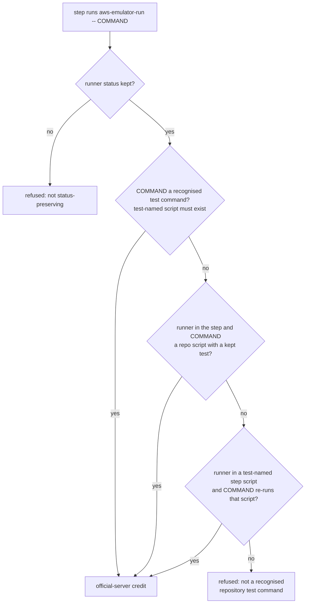

## Summary

Finishes the `BP-AWS-EMULATOR-MISSING` migration that PR #5332 started. The
scan now credits an `aws-emulator-run [--timeout N] -- COMMAND` step only when
COMMAND is the repository's test. An `echo`, `aws --version`, a `curl` health
probe, `sleep`, `sh -c 'exit 0'` or `bash -c 'deno task test || true'` no
longer earns `official-server` credit, and the finding's diagnostics name the
rejected COMMAND. A read-only fleet code search found no repository outside
VibeCoder that uses Floci, so there is no Floci-only repository to migrate.
AWS repositories without wiring get their finding from the scheduled scan,
which #5332 already wired up. Closes #5112.

## Spec

### Intent and Rationale

- Before this change, `serverHits` credited any COMMAND after `--` except the
  no-ops `true` and `:`. So a probe, an echo or a `-c` string that swallowed
  the test's failure satisfied the check. The issue says an echo, a version or
  health probe, or a deliberately ignored test failure must not.
- The COMMAND rule reuses `looksLikeTestCommand`, the matcher the Floci gap
  rule already uses, and the existing `keptCommands` and confined
  `makeRepoScriptReader`. No new matcher, audit or finding id was added.

### Essential Design Decisions

- **COMMAND credit** (`runnerRunsRepositoryTest` in
  `worker/deno/lib/aws_emulator_in_ci_check.ts`) accepts three forms:
  - (a) a recognised test command. A test-named repository script must exist
    in the checkout (relative, unexpanded paths only). It is credited by its
    name, because the scan does not read it for test adequacy.
  - (b) a repository script that has a kept test command. This is followed
    only when the runner is in the step itself, so at most one script is read
    per step.
  - (c) a test-named step script that re-executes itself. The variable's
    *last* assignment must be exactly the script's own path: `$0`,
    `${BASH_SOURCE[0]}`, a `$DIR/${BASH_SOURCE[0]##*/}` form, or its
    `realpath` / `readlink -f`. This keeps VibeCoder's own
    `infra/cloudformation/test-aws-emulator.sh` credited.
- **A `-c` command string is never followed**, so
  `aws-emulator-run -- bash -c 'deno task test'` is refused too. This fails
  closed rather than interpreting shell strings, which scope 3 rules out.
- **Name-based credit for a test-named script is the static contract, not a
  gap.** Scope 3 says presence checks establish configured execution, not
  semantic test adequacy, and the Floci gap rule already credits test-named
  scripts the same way. I chose this reading (an assumption) over reading
  every script for a test command. A script that runs AWS CLI calls directly,
  such as VibeCoder's own, would fail that stricter check.

### Undiscoverable Facts

- Triage on the issue (nleck, 23 November 2026): #5332 merged part of this
  into `main`, and the remaining scope (migrating Floci-only repositories)
  moved to the AWS Emulator validator hardening milestone.
- Live evidence, read only: on 23 November 2026,
  `gh search code --owner stSoftwareAU "floci"` and `"aws-emulator-run"`
  matched no repository other than VibeCoder, apart from worker logs in a
  log-archive repository. `gh search issues` found no open
  `BP-AWS-EMULATOR-MISSING` finding in another repository. No repository
  names are recorded here.

## Evidence

Backend and docs only, with no UI change.

Docs updated, after reading each passage through: `docs/BEST-PRACTICES-SCAN.md`
("AWS emulator in CI": the pass-condition bullet and a new **Test COMMAND**
paragraph), `DESIGN-PRINCIPLES.md` (the AWS emulator principle), and the
"Suggested fix" text of `buildAwsEmulatorFinding` in
`worker/deno/lib/idle_task_templates/best_practices_template.ts`. I grepped
`README.md`, `docs/` (excluding archive and audits), `CODING-STANDARDS.md` and
`prompts/` for `not a no-op`, `-- COMMAND` and `official-server`. The remaining
hits describe the `aws-emulator-run` helper's own usage or VibeCoder's own
`aws-emulator.yml` validator, which this PR does not change.

Issue numbers cited (each looked up with `gh issue view` / `gh pr view` this
run):

- #5112: Best practices: require real AWS Emulator test wiring and migrate
  Floci-only repos
- #5332: Best practices: require real AWS Emulator test wiring and migrate
  Floci-only repos (Issue #5112), the merged PR

## Acceptance Criteria

<!-- vibe-spec-review inputs="diff+issue-body" -->

- **met** — AWS repository with a working official-emulator test contract is
  recognised; a Floci-only setup with no documented gap produces one migration
  finding. — evidence:
  `worker/deno/tests/aws_emulator_in_ci_check_test.ts::workflowRunsAwsEmulator - a probe, no-op or ignored-failure COMMAND is not credited; a test COMMAND is`,
  `worker/deno/tests/aws_emulator_in_ci_check_test.ts::checkAwsEmulatorInCI - a repository script COMMAND is credited only when it runs a kept test`,
  `worker/deno/tests/best_practices_template_test.ts::runTask - floci-only files ONE finding with the migration title and no Floci-default, docker.sock or stub-pass text`
  — reviewer: partial — reason: the reviewer objected that a test-named
  script is credited by its name. After the review, such a script must exist
  in the checkout
  (`…::checkAwsEmulatorInCI - a test-named runner COMMAND script must exist in the checkout`),
  and the self re-exec evasions it found are refused. Name-based credit stays
  by design under scope 3 ("not semantic test adequacy"), as recorded in
  Essential Design Decisions.
- **met** — Fixtures cover server mode, justified embedded mode,
  installation-only, comment-only, unused image, disabled/ignored failure,
  unsupported gap and non-AWS Terraform. — evidence:
  `worker/deno/tests/aws_emulator_in_ci_check_test.ts` (the base fixtures from
  #5332 plus this diff's probe and ignored-failure COMMAND cases) — reviewer:
  met
- **met** — A required test command failure cannot satisfy the workflow
  contract. — evidence:
  `worker/deno/tests/aws_emulator_in_ci_check_test.ts::workflowRunsAwsEmulator - a probe, no-op or ignored-failure COMMAND is not credited; a test COMMAND is`
  (`bash -c 'deno task test || true'`),
  `…::checkAwsEmulatorInCI - a repository script COMMAND is credited only when it runs a kept test`
  (`deno task test || true` in the script), plus the #5332 status-preserving
  tests — reviewer: met
- **met** — Existing open findings are reused; valid suppressions still work,
  expired/malformed ones do not. — evidence:
  `worker/deno/tests/best_practices_template_test.ts::runTask - AWS finding already open under its finding-id is not re-filed`,
  `…::runTask - an expired waiver marker does not suppress: exactly one issue is filed`
  — reviewer: met
- **met** — Incomplete workflow/source reads remain unknown/retryable and never
  create a false missing-gate claim. — evidence:
  `worker/deno/tests/aws_emulator_in_ci_check_test.ts::checkAwsEmulatorInCI - an unparseable workflow is listed in unreadableWorkflows; a readable one is still judged`
  — reviewer: met
- **met** — The scan report distinguishes static wiring evidence from test
  results and reviewed behavioural coverage. — evidence:
  `docs/BEST-PRACTICES-SCAN.md` "What the scan establishes";
  `worker/deno/tests/best_practices_template_test.ts::buildAwsEmulatorFinding - body lists diagnostics, states what was checked, links the standard and is medium`
  — reviewer: met
- **met** — Live adoption findings use ordinary repo-local PRs and existing
  queue caps, with specific evidence and no duplicate Floci campaign. —
  evidence: the scheduled best-practices scan files one finding per repository
  through `fileFindingOnce` (#5332). The live code search in Undiscoverable
  Facts found no Floci-only repository to migrate. The new diagnostic names the
  rejected COMMAND:
  `worker/deno/tests/aws_emulator_in_ci_check_test.ts::checkAwsEmulatorInCI - a probe-only runner is missing and the diagnostic names the command`
  — reviewer: met
- **met** — Relevant detector, pre-filer, workflow and documentation checks
  pass. — evidence: the Test Plan runs below — reviewer: missing — reason: the
  reviewer called this "unverified" because it ran no checks. The checks were
  run here (see Test Plan).
- **unrequested** — the self re-exec rule (c) and its regexes in
  `worker/deno/lib/aws_emulator_in_ci_check.ts` — reviewer: unrequested —
  reason: without it, VibeCoder's own `test-aws-emulator.sh`, which
  re-executes itself under the runner, would lose credit and be filed against
  itself.
- **unrequested** — renaming fixture COMMANDs from `./t.sh` to `./test.sh`, and
  the `SCRIPT_SELF` line added to `RUNNER_SCRIPT` — reviewer: unrequested —
  reason: these let each existing test keep reaching the logic it asserts under
  the new COMMAND rule, with no expectation changed.

## Standards Review

<!-- vibe-standards-review inputs="diff+CODING-STANDARDS.md" -->

- **violation** — A new precondition must not stop existing tests short:
  the `..`, absolute/expanded-path, symlink and 1 MiB tests ran from step
  scripts that are not test-named, so the new rule (c) refused them before path
  confinement. — evidence:
  `worker/deno/tests/aws_emulator_in_ci_check_test.ts:1253` — reason: fixed in
  this diff (test-named step scripts, each with an in-repo positive control)
- **violation** — Writing a gate over text (evasion variants): the
  self-reference check accepted `V="echo $0"`, `V="true $0"` and a later
  reassignment. — evidence: `worker/deno/lib/aws_emulator_in_ci_check.ts:542`
  — reason: fixed in this diff (last assignment only, exact self-path forms,
  evasion tests added)
- **clean** — edited expectations still go red without their code; Australian
  English; a hostile long-input case per new regex with no overlapping
  quantifiers; reuse of `looksLikeTestCommand` and the confined reader (DRY);
  nothing exists only for a test; no dummy or "how" tests; refusals paired with
  accepted controls; the failure-reason test asserts the cause; docs and doc
  comments updated; fail-loud

## Test Plan

Added tests in `worker/deno/tests/aws_emulator_in_ci_check_test.ts`:

- `workflowRunsAwsEmulator - a probe, no-op or ignored-failure COMMAND is not credited; a test COMMAND is`
- `checkAwsEmulatorInCI - a probe-only runner is missing and the diagnostic names the command`
- `checkAwsEmulatorInCI - a repository script COMMAND is credited only when it runs a kept test`
- `checkAwsEmulatorInCI - a self re-exec is credited only inside a test-named step script`
- `workflowRunsAwsEmulator - hostile long self-reference scripts finish and are refused`
- `workflowRunsAwsEmulator - a variable that only mentions the script path is not a self re-exec`
- `checkAwsEmulatorInCI - a runner COMMAND script is read one level only (step, script, runner, script is not followed)`
- `checkAwsEmulatorInCI - a test-named runner COMMAND script must exist in the checkout`
- `checkAwsEmulatorInCI - the in-script diagnostic names the script path and the COMMAND`

`worker/deno/tests/best_practices_template_test.ts` gained one assertion on
the new "The COMMAND must be the test itself" finding text.

Red on base: with the base `aws_emulator_in_ci_check.ts` restored and the new
tests kept, the first six tests above failed (228 passed, 6 failed). The
depth, missing-script and evasion cases added after the review failed against
the pre-review head. The diagnostic test asserts existing wording, so it was
green there.

Existing tests edited, with no expectation changed:

- About 31 fixtures now run `aws-emulator-run -- ./test.sh` instead of
  `./t.sh`, and `checkRepoWith` writes that `test.sh`. A name that does not
  name a test is now refused, so without this each test would stop before the
  shell-flow logic it pins.
- `RUNNER_SCRIPT` assigns `SCRIPT_SELF="${BASH_SOURCE[0]}"`, mirroring
  VibeCoder's own script.
- `timeout 900 ./ci/t.sh resolves the script and counts` became
  `… ./ci/test.sh …`.
- The four path-confinement tests use test-named step scripts, and each has an
  in-repo positive control, so they again reach confinement and the size cap.
- In "a variable that only mentions the script path…", a bare
  `"${0##*/}"` moved from credited to refused. A bare basename is not the
  script's path, so the narrowed rule refuses it, and the positives now use
  `"${DIR}/${0##*/}"` and `$(readlink -f "$0")`.

Runs:

- `./quality.sh < /dev/null` on `d0c4bdd2e`: every stage passed except
  semgrep, which reported one `detect-non-literal-regexp` finding. It was fixed
  in `6ce26d57a`, and the pre-push gate passed on that push.
- After the review fixes, on the final code:
  `deno task test:unit tests/aws_emulator_in_ci_check_test.ts tests/best_practices_template_test.ts`
  passed, and `deno fmt --check`, `deno lint`, `deno check`,
  `semgrep --config p/default` on the detector and `markdownlint-cli2` were
  clean.
