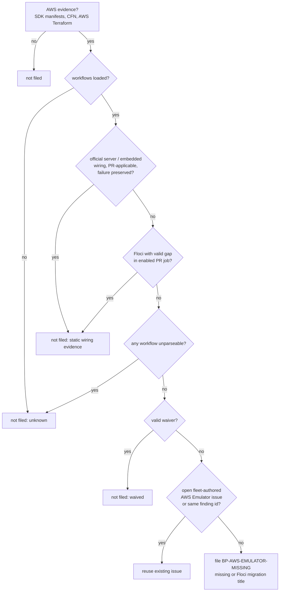

## Summary

Moves the existing `BP-AWS-EMULATOR-MISSING` best-practices check from "CI runs
any emulator" to "CI runs this repository's AWS tests through the official AWS
Emulator". The check keeps its detector, pre-filer, finding id, `medium`
severity, dedup and waiver rules. A repository whose AWS tests run only against
Floci now gets one migration finding through the ordinary scan. Closes #5112.

## Spec

### Intent and Rationale

- An installed tool or a service image only shows the emulator is available. The
  check now asks whether a `pull_request` job runs a test through
  `aws-emulator-run -- <test>` and whether a failure of that test fails the job.
- The existing detector (`aws_emulator_in_ci_check.ts`), shell helpers
  (`shell_command_words.ts`), workflow loader (`loadWorkflows`) and title-dedup
  helper (`findFleetAuthoredIssuesTitled`) are extended or reused. No second
  audit and no new finding id were added.

### Essential Design Decisions

- **Wiring classes, in precedence order:** `official-server`,
  `official-embedded`, `floci-gap`, `floci-only`, `missing`. Only `floci-only`
  and `missing` are filed, under the same id, with a migration title or a "no
  test wiring" title.
- **Official credit** needs all of the following:
  - The workflow runs on `pull_request`, or a `pull_request` workflow calls it
    through `workflow_call` (followed transitively).
  - Neither the job nor the step sets `continue-on-error`, and neither has a
    static-false `if:`.
  - The shell actually runs the body.
  - The runner's failure is preserved. It is not in a condition, not behind `!`,
    and not followed by `||`, `|` or `&`. It also runs via `exec`, or is last
    (or the rest of the body is an `&&` chain), or runs with errexit on. Errexit
    is on for GitHub's default `bash` and `sh`, and off at the start of a
    repository script. `set -e` and `set +e` toggle it.
- **Two comment markers were defined, because the issue gave no format** (an
  assumption):
  - `# aws-emulator-gap: version=…; behaviour=…; evidence=…; alternative=…; recheck=…`
    (the five fields `CODING-STANDARDS.md` requires for a gap). It counts only
    in a `pull_request`-applicable workflow whose Floci job is enabled and not
    soft-failing.
  - `# aws-emulator-embedded: version=X.Y.Z; justification=…` on a `cargo test`
    or `cargo nextest` step. It counts only in a repo with a `Cargo.toml` in its
    AWS evidence, since the standard allows embedded mode for Rust only.
- **A Floci-only repository with a valid gap record is not filed.** I read the
  acceptance line "a Floci-only setup with no documented gap produces one
  migration finding" as exempting a documented gap. An unparseable workflow
  makes the result unknown: nothing is filed, and the next scheduled scan
  retries (the #5009 principle). A failing gh call in the new equivalent-issue
  lookup fails the run rather than filing on an unknown.

### Undiscoverable Facts

- Owner clarification on the issue (17 November 2026): AWS CLI scripts count
  alongside SDK calls. Blocks local tests do not count as SDK/CLI coverage.
  Floci stays only for documented gaps. The emulator starts only from an
  explicitly invoked test command.

## Evidence

Backend and docs only, with no UI change.

Docs updated, after reading each section through:

- `docs/BEST-PRACTICES-SCAN.md`: the "AWS emulator in CI" section and its three
  diagrams, plus a new "What the scan establishes" paragraph that separates
  static wiring evidence from CI results and reviewed coverage.
- `DESIGN-PRINCIPLES.md`: the AWS emulator principle.
- `docs/IDLE-TASK-FRAMEWORK.md`: the `best-practices` row.
- `CODING-STANDARDS.md`: the rollout paragraph of AWS integration testing, which
  is now present tense and names both markers.
- `docs/CONTAINER-IMAGE.md`: the #5112 status sentence.
- The AWS sections of the `aws-cloudformation`, `terraform`, `typescript`,
  `rust` and `java` bucket guides, which no longer say "not yet: #5112" or
  "policy wins until".

I grepped for `Floci or the official`, `any .tf file`, `emulatorConfigured` and
`reachableSegments` outside `docs/archive` and `docs/audits`. None remain. The
remaining `floci` and `docker.sock` hits describe the Floci runtime and pre-push
gate, which this PR does not change.

Issue numbers the diff adds as provenance (each looked up with `gh issue view`):

- #5112: Best practices: require real AWS Emulator test wiring and migrate
  Floci-only repos
- #3368: File BP-AWS-EMULATOR-MISSING from the best-practices scan
- #3366: Add a deterministic check that detects AWS repos and whether their CI
  runs Floci
- #3346: Adopt Floci (local AWS emulator) for AWS integration testing
- #1243: Security: finding-id dedup in idle_task_snapshot.ts trusts an
  unauthenticated issue body — one planted issue suppresses a real finding for
  ever
- #5110: CI: migrate VibeCoder's AWS tests to AWS Emulator and record real
  coverage gaps
- #5009: Workflow auditor silently drops a workflow file whose content fetch
  fails, so a transient API error files a spurious 'Add … workflow' request

Related existing rules checked: the canonical **AWS integration testing**
section and its guidelines and review-brief restatements (#5111). Both markers
encode its gap fields and Rust-only embedded mode. I also checked the
suppression-comment governance (unchanged) and #1243's author-verified dedup,
which the new title lookup reuses. I applied the policy to this PR's own diff.
The PR changes the scan's static checks, not AWS behaviour, so it owes no
emulator test.

## Acceptance Criteria

<!-- vibe-spec-review inputs="diff+issue-body" -->

- **met** — AWS repository with a working official-emulator test contract is
  recognised; a Floci-only setup with no documented gap produces one migration
  finding. — evidence:
  `worker/deno/tests/aws_emulator_in_ci_check_test.ts::checkAwsEmulatorInCI - VibeCoder's own checkout is official-server (quality.yml calls aws-emulator.yml, which runs the repo script)`,
  `worker/deno/tests/best_practices_template_test.ts::runTask - floci-only files ONE finding with the migration title and no Floci-default, docker.sock or stub-pass text`
  — reviewer: met
- **met** — Fixtures cover server mode, justified embedded mode,
  installation-only, comment-only, unused image, disabled/ignored failure,
  unsupported gap and non-AWS Terraform. — evidence:
  `worker/deno/tests/aws_emulator_in_ci_check_test.ts` (the embedded-marker,
  service-image, `continue-on-error`/`|| true`/`!`/pipe/`if`, Floci gap-record
  and Terraform tests, plus the existing install-only and comment tests) —
  reviewer: partial — reason: the reviewer wanted an unsupported (HTTP 501) case
  on the official path, but a static scan cannot observe a 501. The policy
  records an unsupported operation as an `aws-emulator-gap` record, and the
  valid, incomplete, disabled-job and push-only gap fixtures cover it.
- **met** — A required test command failure cannot satisfy the workflow
  contract. — evidence:
  `worker/deno/tests/aws_emulator_in_ci_check_test.ts::checkAwsEmulatorInCI - a runner followed by && and another line is refused; as the last && link it is credited`,
  `…::a repository script without set -e that runs the runner then more lines is refused; with set -euo pipefail it is credited`,
  `…::set +e before the runner refuses it when another command follows; set -e or the default shell keeps it`,
  `…::a step shell of bash {0} with a later command refuses the runner; exactly bash keeps errexit and credits it`
  — reviewer: partial — reason: the reviewer's `&&`, `set +e`,
  script-without-`set -e` and custom-shell gaps were fixed after the review by
  the errexit-aware rule and the tests named here
- **met** — Existing open findings are reused; valid suppressions still work,
  expired/malformed ones do not. — evidence:
  `worker/deno/tests/best_practices_template_test.ts::runTask - AWS finding already open under its finding-id is not re-filed`,
  `…::runTask - a valid unexpired waiver marker in a workflow suppresses the AWS finding`,
  `…::runTask - an expired waiver marker does not suppress: exactly one issue is filed`,
  `…::runTask - a waiver marker missing author= does not suppress: one issue is filed`,
  `…::runTask - a fleet-authored open AWS Emulator issue with another title suppresses filing and is logged by number`
  — reviewer: met
- **met** — Incomplete workflow/source reads remain unknown/retryable and never
  create a false missing-gate claim. — evidence:
  `worker/deno/tests/aws_emulator_in_ci_check_test.ts::checkAwsEmulatorInCI - an unparseable workflow is listed in unreadableWorkflows; a readable one is still judged`,
  `worker/deno/tests/best_practices_template_test.ts::runTask - AWS-emulator pre-check skips filing and logs why (static wiring / unreadable workflow / no AWS / no workflow)`
  — reviewer: met
- **met** — The scan report distinguishes static wiring evidence from test
  results and reviewed behavioural coverage. — evidence:
  `worker/deno/tests/best_practices_template_test.ts::buildAwsEmulatorFinding - body lists diagnostics, states what was checked, links the standard and is medium`;
  `docs/BEST-PRACTICES-SCAN.md` "What the scan establishes" — reviewer: met
- **met** — Live adoption findings use ordinary repo-local PRs and existing
  queue caps, with specific evidence and no duplicate Floci campaign. —
  evidence: `worker/deno/lib/idle_task_templates/best_practices_template.ts`
  (one finding per repo through `fileFindingOnce` in the scheduled scan, counted
  in the scan's 6-finding cap, with AWS evidence and wiring diagnostics in the
  body) — reviewer: partial — reason: the reviewer found no live run. Scope 9
  says to use the normal scan path, and that path is the scheduled
  best-practices scan, which files these findings per repository once this
  merges. No separate campaign exists to run, and private repository names stay
  out of this public PR.
- **met** — Relevant detector, pre-filer, workflow and documentation checks
  pass. — evidence: `./quality.sh` on the final code commit (see Test Plan) —
  reviewer: partial — reason: the reviewer saw only the diff. The gate was run
  here and passed. `DESIGN-PRINCIPLES.md`, which the reviewer found stale, was
  updated after the review.
- **unrequested** — Embedded mode is credited only for a repository with a
  `Cargo.toml` in its AWS evidence — reviewer: unrequested — reason:
  `CODING-STANDARDS.md` allows embedded mode for Rust repositories only
- **unrequested** — The `aws-emulator-gap:` and `aws-emulator-embedded:` marker
  formats — reviewer: unrequested — reason: the issue requires recognising a
  documented gap and a justified, pinned embedded setup, and a static check
  needs a fixed format to read them
- **unrequested** — A gh failure in the equivalent-issue lookup fails the scan
  run — reviewer: unrequested — reason: fail loud. An unknown lookup must not
  file a possible duplicate, and the scan already retries a failed run.
- **unrequested** — Only `pull_request` (not `pull_request_target` or
  `merge_group`) makes a workflow applicable — reviewer: unrequested — reason:
  `pull_request_target` runs base-branch code, so it does not test the PR's
  change
- **unrequested** — `docs/CONTAINER-IMAGE.md` now calls the detector and
  migration findings delivered — reviewer: unrequested — reason: that sentence
  named #5112 as planned, and this PR delivers it

## Standards Review

<!-- vibe-standards-review inputs="diff+CODING-STANDARDS.md" -->

- **violation** — Writing a gate over text: failure propagation missed a
  non-final `&&` and a repository script with no `set -e` — evidence:
  `worker/deno/lib/aws_emulator_in_ci_check.ts:689` — reason: fixed in this diff
  (errexit-aware `keptCommands`, with tests for each form)
- **violation** — Call existing code: the title lookup re-implemented
  `findFleetAuthoredIssuesTitled` — evidence:
  `worker/deno/lib/idle_task_templates/best_practices_template.ts:786` — reason:
  fixed in this diff (it now calls the helper)
- **violation** — Every outcome of a branch needs a test: the hand-rolled
  payload rejections were untested — evidence:
  `worker/deno/lib/idle_task_templates/best_practices_template.ts:828` — reason:
  fixed in this diff (those branches were removed with the helper reuse)
- **violation** — A code change owes a docs change: `DESIGN-PRINCIPLES.md` still
  described the old Floci and any-`.tf` rules — evidence:
  `DESIGN-PRINCIPLES.md:1877` — reason: fixed in this diff
- **violation** — Remove unreachable dead code: `reachableSegments` was left
  with no caller — evidence: `worker/deno/lib/shell_command_words.ts:555` —
  reason: fixed in this diff (removed)
- **violation** — A doc comment the change made false ("computed independently
  of `usesAws`") — evidence: `worker/deno/lib/aws_emulator_in_ci_check.ts:60` —
  reason: fixed in this diff
- **clean** — Checked and found compliant:
  - Australian English.
  - Dummy and "how" tests, rules 1 to 4.
  - A refusal test must be refused by the rule it names: fixtures are otherwise
    valid and have controls.
  - A new precondition must not stop existing tests short: `on: pull_request`
    was added to every fixture.
  - A test must be able to fail on the wrong input.
  - Check where you insert.
  - Change only what the issue changes.
  - Named tests exist, no stubs of another repository's binary, and no workflow
    file changes.
  - Each edited existing expectation still fails without its code.
  - Hostile-input tests for each new Terraform regex.
  - Fleet-authored title dedup (#1243).
  - Fail loud on gh errors.
  - Optional note, not chased: the guidelines' AWS summary does not repeat the
    marker syntax that `CODING-STANDARDS.md` now names.

## Test Plan

- `worker/deno/tests/aws_emulator_in_ci_check_test.ts` covers every fixture the
  issue names, the errexit/`&&`/`exec`/`set +e`/custom-shell propagation cases,
  the Floci gap rules (valid, lacking `recheck`, disabled job, push-only) and
  the real VibeCoder checkout as `official-server`. It also covers AWS and
  non-AWS Terraform, the `.terraform` skip and one hostile long-line case per
  Terraform regex. The new rules are tested; existing tests were edited as
  follows:
  - Each workflow fixture gained `on: pull_request`, so it still reaches the
    rule it names.
  - `emulatorConfigured: true/false` became the specific wiring value. Floci
    fixtures now expect `floci-only` and refused fixtures expect `missing`. Each
    fixture still contains the thing it probes.
  - The `aws-emulator.yml` test gives that file a `pull_request` trigger in
    memory, and the CloudFormation round-trip copies the real `quality.yml` as
    its caller.
- `worker/deno/tests/best_practices_template_test.ts`:
  - Four removed assertions pinned the old Floci instructions
    (`CREATE_COMPLETE`, `::warning::`, `SKIPPED (needs Docker):`,
    `floci/floci@sha256:`). They are now absence checks, because the issue's
    scope item 8 says to "Remove obsolete unconditional
    Floci/image-only/stub-pass instructions". The new-wording assertions cover
    the replacement.
  - The skip scenario "floci configured" became "floci gap recorded", with
    scenarios added for official-server, official-embedded and unreadable
    workflows.
  - New tests cover the floci-only and missing titles, fleet versus non-fleet
    equivalent issues, gh-failure handling and the finding body.
  - The dedup and waiver tests are unchanged and pass.
- `worker/deno/tests/capability_coverage_scan_4367_test.ts` and
  `worker/deno/tests/idle_task_scan_dedup_conformance_test.ts`: the fake results
  gained the new fields only.
- The executors ran `deno task test:unit` on the five files above plus
  `worker/deno/tests/issue_5110_aws_emulator_workflow_test.ts`: 547 passed, 0
  failed. The importing suites (`github_actions_audit_template`,
  `issue_2315_actionlint_in_ci`, `linter_in_ci_check`) also passed.
- `./quality.sh < /dev/null` on commit 17f35b3c7 (the last code commit):
  `Result: PASSED (with skipped checks)`. Config integration and checkov were
  skipped by the gate itself. Deno tests, lint, type check, fmt, markdownlint,
  mermaid, semgrep and gitleaks passed.

Not done or not checked: no live best-practices scan was run against fleet
repositories from this run, so the first real findings appear on the next
scheduled scan. The static check does not prove that the cited tests are
adequate or that CI went green; the finding says so.

🤖 Generated with [Claude Code](https://claude.com/claude-code)
