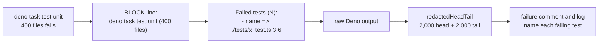

## Summary

A pre-push BLOCK for a `deno task test:unit` check no longer opens with every
quoted test file, and it names the failing tests ahead of Deno's raw output, so
the reason still names them after it is cut to a 2,000-character head and a
2,000-character tail.

- `worker/deno/lib/pre_flight_gate.ts`:
  - New `describeCommand`. A command over 200 characters
    (`COMMAND_DISPLAY_MAX_CHARS`) is shown as the tokens before its first file
    argument, a file count, and any later flags, for example
    `deno task test:unit (412 files) --serial-only`. Shorter commands are quoted
    whole. All three BLOCK messages use it, and `PreFlightGateError.command`
    still holds the full command.
  - New optional `summariseFailure` option. Its text goes between the BLOCK line
    and the output in the timeout and non-zero-exit messages.
- `worker/deno/lib/deno_test_baseline.ts`: new `denoTestFailureSummary`. It
  collects the `<name> => ./<file>:<line>:<col>` and `./x_test.ts (uncaught
  error)` lines, de-duplicated in order of first appearance. It lists at most 20,
  then `- … and M more`.
- `worker/deno/lib/pre_push_gate.ts`: `runPrePushGate` passes
  `denoTestFailureSummary` to the `deno test` check's run and to its
  `--serial-only` rerun.

Closes #5113.

## Spec

### Intent and Rationale

- The reason is cut by `redactedHeadTail` in `gateUnpushedCommits` and again in
  `gateBeforePush`. The 2,000-character head was filled by the quoted file list,
  and the tail held only the runner's last lines. The failing tests are now in
  the head.
- The summary is an option of the generic gate, not string surgery on its
  message. The Deno-specific parsing stays in `deno_test_baseline.ts`, next to
  `denoTestFailureKeys` and the same `FAILED_TEST_LINE` pattern.

### Essential Design Decisions

- Commands up to 200 characters are quoted verbatim. A short command, such as a
  one-file `deno fmt --check`, still names its file. Only an argv long enough to
  crowd the head is collapsed. The issue's "name the command by its task and
  file count" is applied to those long commands.
- A token counts as a file argument when it is not the program, does not start
  with `-`, and contains `/` or ends in `.<ext>`. `test:unit` is not one. A long
  command with no file argument is shown whole.
- The failed-test list is capped at 20 entries, so a mass failure cannot push
  the BLOCK line's useful part out of the head either.
- Only the `deno test` check gets the summary. Other changed-file checks and
  repo pre-flight commands keep header plus output.

### Undiscoverable Facts

None.

## Evidence

Backend only: no UI file is touched.

- Docs updated: `docs/INTERNALS.md` ("Two limits keep the failure comment
  postable…" paragraph) and `docs/CONFIGURATION.md` (the `deno test` bullet of
  the pre-push gate checks).
- Issue numbers this diff cites: #5113 (this issue) and #3577 (the pre-flight
  gate, already cited throughout `pre_flight_gate.ts` at the base).

## Reproduction

- **symptom** — the failure comment and worker log for a
  `no_pr:pre_push_gate:completion` release quoted
  `` command `deno task test:unit 'tests/a…_test.ts' 'tests/b…_test.ts' … ``
  and `error: Test failed`, but named no failing test.
- **status** — `verified` — the regression test was observed failing against
  the base `pre_flight_gate.ts` and `pre_push_gate.ts` (`FAILED | 0 passed | 1
  failed`) and passing after the fix
- **regression test** — `worker/deno/tests/pre_push_gate_test.ts::runPrePushGate: a 400-file test:unit block still names the failing tests after the head/tail cut (Issue #5113)`

## Test Plan

- Added `worker/deno/tests/pre_push_gate_test.ts::runPrePushGate: a 400-file test:unit block still names the failing tests after the head/tail cut (Issue #5113)`.
  It drives the real `runPrePushGate` with 400 changed-scope test files. The
  head run fails with about 3,000 `ok` lines, ERRORS and FAILURES sections for
  two tests, and a long runner trailer. The fork run passes, so the outcome is a
  verdict. The message is cut with `redactedHeadTail` and the
  `PRE_PUSH_GATE_REASON_*_CHARS` budgets, and the test asserts the cut text
  holds `deno task test:unit (400 files)` and both
  `<name> => ./tests/<file>:<line>:<col>` lines. It also asserts that
  `error.command` still holds the full argv.
- Added to `worker/deno/tests/pre_flight_gate_test.ts`:
  - A 400-file command is shown as `deno task test:unit (400 files)`, without
    the last file.
  - A trailing `--serial-only` flag is kept after the count.
  - A short `deno fmt --check --permit-no-files src/big.ts` stays verbatim.
  - The `summariseFailure` text comes before the output, and a null summary
    leaves header plus output.
- Added to `worker/deno/tests/deno_test_baseline_test.ts`, for
  `denoTestFailureSummary`:
  - Realistic output gives the exact de-duplicated list with line and column,
    plus the `(uncaught error)` line.
  - Passing output gives null.
  - 25 failures give 20 entries and `- … and 5 more`.
- Red before the fix:
  - The `pre_push_gate_test.ts` test failed with the base `pre_flight_gate.ts`
    and `pre_push_gate.ts` restored (`FAILED | 0 passed | 1 failed`).
  - The four new `pre_flight_gate_test.ts` cases other than the short-command one
    failed on the base message. The short-command case passed, as a guard of
    unchanged behaviour should.
  - `deno_test_baseline_test.ts` did not load on the base, because
    `denoTestFailureSummary` did not exist.
- No existing assertion was removed or changed. The existing
  `completion_phase_pre_push_gate_3689_test.ts` assertion that a short
  `deno fmt` command is named in the reason still passes, because short commands
  stay verbatim.
- Callers checked: `runPreFlightGate` has other callers in `pre_push_gate.ts`
  (the other changed-file checks, CI cargo checks, the cargo toolchain probe,
  repo pre-flight commands), `cargo_deny_gate.ts`, `deno_test_baseline.ts` (the
  fork worktree run) and `git_push.ts` (the commit-time pre-flight step). They get the shorter command text only when a
  command exceeds 200 characters, and no summary, because they do not pass
  `summariseFailure`. `judgeDenoTestFailure` reads `error.output`, not the
  message, so the baseline comparison is unchanged.
- `deno task test:unit` over `worker/deno/tests/pre_flight_gate_test.ts`,
  `worker/deno/tests/deno_test_baseline_test.ts`,
  `worker/deno/tests/pre_push_gate_test.ts`,
  `worker/deno/tests/completion_phase_pre_push_gate_3689_test.ts`,
  `worker/deno/tests/pre_push_gate_failure_category_test.ts` and
  `worker/deno/tests/cargo_deny_gate_test.ts` on commit `5ddb2a67`: 363 passed,
  0 failed.
- `./quality.sh < /dev/null` on `5ddb2a67`: these stages passed:
  - benchmark audit and the chokepoint checks
  - workflow hygiene
  - completeness
  - source targets
  - mermaid
  - markdownlint
  - semgrep
  - gitleaks
  - release-tag ruleset

  Config integration and checkov were skipped for the environment. The run then
  hit my 900-second bound in its unit-test stage and was stopped, so that stage
  has no result.

<!-- vibe-quality-gate-skipped reason="./quality.sh reached its 900s bound in the unit-test stage after every earlier stage passed; the touched test files were run instead (363 passed, 0 failed) and the worker re-runs the gate before the PR" -->

Not done or not checked: the full unit-test stage of `./quality.sh` did not
finish within the run's bound, as above. Repo pre-flight commands other than the
`deno test` check get the shorter command name, but no failed-test summary.

🤖 Generated with [Claude Code](https://claude.com/claude-code)
