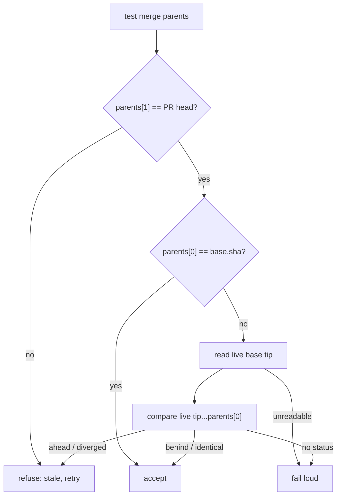

## Summary

The strict-base refresh no longer refuses an approved, green, `BEHIND` PR just
because GitHub's lagging `pulls/N` `base.sha` and the test merge's base parent
name different commits. `readTestMerge` in
`worker/deno/lib/required_branch_checks_4613.ts` now accepts a test merge whose
head parent is the PR head and whose base parent is either `base.sha` or an
ancestor of (or equal to) the live base-branch tip, checked through the compare
API (`behind` or `identical`). A head-parent mismatch, or a base parent off the
base's history, is still refused. Closes #5115.

## Spec

### Intent and Rationale

- On a base that moves every few minutes, `base.sha` and the test merge are
  updated lazily and independently, so the exact-equality check refused the
  refresh on pass after pass.
- The required checks on a test merge built on an earlier base commit still
  prove the head is green; the refresh then merges the current base, which CI
  checks again before merge.

### Essential Design Decisions

- The compare call is made only when the base parent differs from `base.sha`, so
  the common case costs no extra API reads.
- The compare is `compare/<live tip>...<base parent>`: `behind` means the parent
  is an ancestor of the tip, `identical` means it is the tip. `ahead` and
  `diverged` are refused with the existing stale message, so they stay retryable
  and keep the `test-merge-parents-stale` classification.
- An unreadable live tip (not 40-hex) or a compare response with no `status`
  throws its own message (`live base tip is unreadable`,
  `base compare status is unreadable`) rather than being read as stale or as
  accepted.
- The head-parent check runs first and never consults the compare API.

### Undiscoverable Facts

- Observed on this repo:
  `gh api repos/stSoftwareAU/VibeCoder/compare/7bb2c4c5...22860d5c --jq '{status,ahead_by,behind_by}'`
  returned `{"ahead_by":0,"behind_by":1,"status":"behind"}` (22860d5c is the
  parent of 7bb2c4c5), and `compare/7bb2c4c5...7bb2c4c5` returned
  `{"status":"identical"}`. `branches/main` `.commit.sha` is a 40-character SHA.
  The code relies on exactly these three facts.

## Evidence

Backend-only change; verified by tests.

- The fake GitHub in `worker/deno/tests/test_merge_lagging_base_5115_test.ts`
  stands in for the REST endpoints read by `readTestMerge` (`pulls/N`,
  `git/commits/<sha>`, `branches/<base>`, `compare/<a>...<b>`) and for
  `PUT pulls/N/update-branch`; its compare answers come from a linear history
  array, matching the observed `behind`/`identical` statuses above. The fake
  records each accepted update-branch as a refresh state (PR number and
  expected head) and rejects an expected head other than the PR head with a 422,
  so the tests assert outcomes, not request text.
- `#5115: Strict-base refresh compares the test merge's base parent to the PR's lagging base.sha, so a busy base refuses an approved, green, BEHIND PR on pass after pass`
  — the only issue number this diff adds as provenance.

## Reproduction

- **symptom** —
  `Auto-merge failed: branch update failed: required-check read failed: PR test merge parents do not match its head and base`,
  repeated every pass while `base.sha` (`5a8b950`), test-merge `parents[0]`
  (`e694d7a`) and the live tip (`751f627`) were three different commits.
- **status** — `verified` — with the base-branch
  `required_branch_checks_4613.ts` restored and the new test file kept, the
  three-distinct-commit case failed with
  `required-check read failed: PR test merge parents do not match its head and base`
  (3 passed, 4 failed); with the fix all 7 pass.
- **regression test** —
  `worker/deno/tests/test_merge_lagging_base_5115_test.ts::lagging base.sha, test-merge parent and live tip are all accepted when the parent is on the base history (Issue #5115)`

## Test Plan

- Added `worker/deno/tests/test_merge_lagging_base_5115_test.ts`:
  - three distinct commits on the base history → exactly one refresh recorded
    by the fake, for the PR head;
  - test-merge parent equal to the live tip → accepted;
  - head parent other than the PR head → refused with the stale message,
    classified `test-merge-parents-stale`, no refresh recorded, no owner
    comment;
  - base parent off the live base history, and base parent newer than the live
    tip → refused;
  - live tip unreadable, compare status missing → fail loud with their own
    messages.
  - Against the base-branch lib: 3 passed, 4 failed (the two accept cases and
    the two fail-loud cases); at head: 7 passed.
- Fixture-only edits, no assertion removed or changed:
  `worker/deno/tests/required_branch_checks_4613_test.ts` and
  `worker/deno/tests/support/base_refresh_fleet.ts` now return `commit.sha` from
  `branches/<base>` and answer `compare/` (`identical` when equal, else
  `diverged`), so existing stale-parent tests (for example
  `worker/deno/tests/repair_base_merge_4943_test.ts` "sweep and repair lanes
  retain stale-parent escalation…") still reach the stale refusal rather than
  the new unreadable-tip error.
- Callers of `readTestMerge`'s result checked: the base-refresh paths in
  `required_branch_checks_4613.ts` that use `shouldRetry`; the retry predicate
  now compares against the shared `TEST_MERGE_STALE` constant, so both the
  head-parent and base-parent refusals stay retryable.
- Docs: `docs/workflows/pr-feedback.md` auto-merge sweep bullet (the transient
  test-merge refusal paragraph) now states the accept rule.
- `./quality.sh < /dev/null` on the final code:
  `Result: PASSED (with skipped checks)` (config integration and checkov skipped
  by the gate itself).

## Not done or not checked

- Not observed against the busy private repo itself; the lagging-SHA case is
  reproduced only through the scripted GitHub fake.
