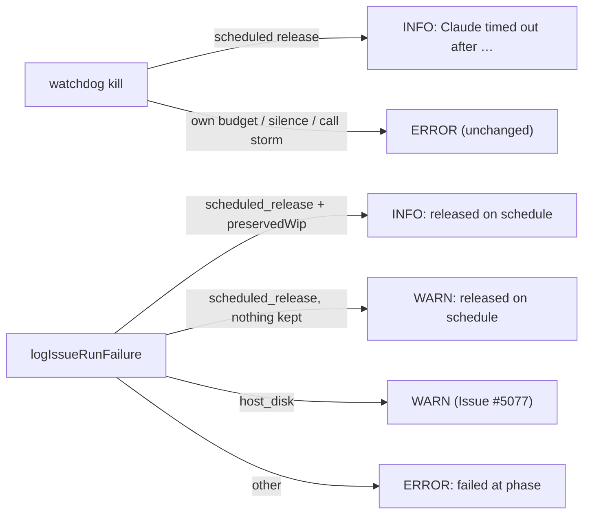

## Summary

A run released at the finish deadline no longer logs its designed hand-off as
two ERRORs:

- **The runner's kill line** (`Claude timed out after …`) is logged at INFO when
  the kill is a scheduled release. The other kills keep ERROR.
- **The run's closing line** for a `scheduled_release` now reads
  `Issue <ref> released on schedule at phase '<phase>': <reason>`, not
  `failed at phase`. It is logged at INFO when the work reached a pushed branch
  and at WARNING when the run kept nothing.
- **The outcome is unchanged:** it is still `no_pr:scheduled_release:<phase>`.

Closes #5118.

## Spec

### Intent and Rationale

- Under the log-level rules in `CODING-STANDARDS.md`, ERROR means the run cannot
  continue. A scheduled release is the planned hand-off: the work is pushed and
  the next cycle resumes the branch. Logging it at ERROR made it rank alongside
  real faults.
- Each log line is fixed where it is written (`fireKill` and
  `logIssueRunFailure`). No other part of the release path changes.

### Essential Design Decisions

- **Kill line:** a kill counts as a scheduled release when `reason` is
  `hard-timeout` and either the progress-extension check set `scheduledRelease`
  (finish deadline or run hard cap) or the session timeout was clamped to the
  finish deadline. This is the rule the runner already uses to set
  `finishDeadline` and `scheduledRelease` on its result. The hard cap is
  included because it is the same `scheduled_release` hand-off (Issue #424).
- **Why the kill line is always INFO:** the kill happens before preservation, so
  the runner cannot yet know whether the run kept anything. The closing line,
  written after preservation, carries the INFO/WARNING split.
- **What counts as kept work:** the run outcome is `no_pr` and carries
  `preservedWip`, which preservation sets only when the work reached a pushed
  branch. The reason text is not parsed, because its default wording says "WIP
  preserved" even when nothing was kept.
- **Unchanged:** the execute phase's own WARNING
  `Claude released on schedule — the finish deadline was reached …` stays as it
  is. It was not one of the two ERRORs.

### Undiscoverable Facts

- The two ERROR lines come from the log in the issue (laptop host, 2026-11-13
  04:00Z). The fix follows the same pattern as #5077, which moved the host-disk
  park from ERROR to WARNING in the same `logIssueRunFailure` helper.

## Evidence

Backend only; no UI file touched.

Issue numbers this diff cites:

- #5118: A scheduled release at the finish deadline (WIP pushed, resumes next
  cycle) is logged as two ERRORs.

Docs updated:

- `docs/CONFIGURATION.md`, section "A capped run is released, not failed (Issue
  #424)": new bullet on the log levels.
- `docs/TROUBLESHOOTING.md`: a note on the level under "The kill line", and a
  paragraph after the scheduled-release section describing the worker log.

A grep of `docs/` and `README.md` for "failed at phase" and "scheduled release"
found no other sentence that states a log level.

## Reproduction

- **symptom** — a run released at the finish deadline with WIP pushed logged
  `ERROR: Claude timed out after …` and
  `ERROR: Issue … failed at phase 'execute': Released on schedule: …`
- **status** — `verified` — the new tests were run against the unfixed
  production code and failed:
  - the runner's finish-deadline and hard-cap cases found the kill line on
    ERROR, not INFO;
  - the composition test failed with `no ERROR line anywhere in the run`, once
    the `outcome` field was added to the parameter type and before the behaviour
    changed;
  - all of them pass after the fix. The tests change no shared fake or fixture.
- **regression test** —
  `worker/deno/tests/execute_phase_scheduled_release_log_5118_test.ts::execute_phase #5118 - a finish-deadline release with WIP pushed logs no ERROR and stays scheduled_release`

## Test Plan

- Added `worker/deno/tests/execute_phase_scheduled_release_log_5118_test.ts`:
  - **Composition test:** the real runner and execute phase run against a real
    git remote. A finish-deadline refusal stops the agent. The test asserts:
    - category `scheduled_release`, and a reason that names the finish deadline
      and the pushed branch;
    - the agent's file is on the remote branch;
    - `describeRunOutcome` gives `no_pr:scheduled_release:execute`;
    - no ERROR line anywhere in the run;
    - the closing line is INFO.
  - **Unit cases:** kept nothing gives exactly one WARN, kept work gives INFO
    only, and a `timeout` failure still logs the ERROR `failed at phase` line
    (control).
- Added `worker/deno/tests/claude_runner_scheduled_release_log_5118_test.ts`. It
  drives the real runner and asserts the kill line is at INFO, with no ERROR,
  for each of these:
  - a finish-deadline release;
  - a hard-cap release;
  - a session ended by the finish clamp.

  Its two controls (an own-budget timeout, and one within the finish allowance)
  still log the kill line at ERROR. A temporary change that disabled the clamp
  check made the clamp case fail, so it guards that half of the condition.
- Existing related suites pass on the head:
  - `claude_runner_progress_extension_4296_test.ts`,
    `claude_runner_finish_deadline_4244_test.ts`,
    `execute_phase_scheduled_release_424_test.ts`,
    `execute_phase_host_disk_park_5077_test.ts`;
  - `claude_runner_killed_test.ts`, `execute_timeout_test.ts`,
    `execute_claude_phase_test.ts`, `execute_phase_superseded_wip_test.ts`,
    `claude_runner_kill_bound_test.ts`.
- No existing test was edited; no assertion was removed.
- `./quality.sh < /dev/null` on commit `b1a63622` gave
  `Result: PASSED (with skipped checks)` (config integration and checkov
  skipped).

Not done or not checked:

- The other routes to `scheduled_release` (`releaseRunAtFinishDeadline`, the
  quality-gate remediation phase) reach the same category-keyed branch of
  `logIssueRunFailure`. Each has no dedicated end-to-end test.
- The execute phase's own WARNING
  `Claude released on schedule — the finish deadline was reached …` is
  unchanged.
