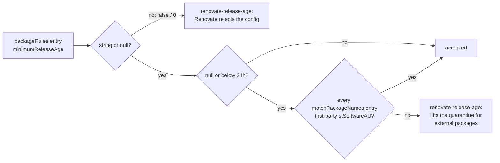

# PR summary — Issue #5120

## Summary

Reconciles the fleet's Renovate first-party update policy with valid Renovate
configuration and the blocking Semgrep check. The first-party exemption is now
scoped. A config carries it only when its Renovate manages a matching
`stSoftwareAU` package, matched by first-party names only, and spells it
`"minimumReleaseAge": null`. Renovate's validator accepts that value and
Semgrep's `p/default` rule does not report it. `false` is refused everywhere.

- **`renovate.json`**: VibeCoder manages no first-party package, so its inert
  `"minimumReleaseAge": "0"` rule is removed. So is the tree-sweep baseline
  entry that accepted it. Touching `renovate.json` no longer trips the local or
  CI Semgrep rule.
- **Supply-chain gate**: `renovate-release-age` (via the new
  `worker/deno/lib/renovate_release_age.ts`) now refuses a boolean or other
  non-string age, a top-level age below 24 hours or unreadable, and a `null` or
  sub-24h age that is not scoped to first-party names. Durations are read
  exactly as Renovate's `toMs` reads them, so `"1 Month"` or `"1 D 12 H"` (which
  Renovate applies as no quarantine) is refused as unreadable and `"1.5 M"` as
  1.5 minutes. A lifting rule that also carries `matchPackagePrefixes`,
  `packagePatterns` or `packageNames` is refused, because Renovate merges those
  into `matchPackageNames`. It also refuses the deprecated `stabilityDays` key
  at any depth (Renovate migrates `stabilityDays: 0` to
  `minimumReleaseAge: null`) and a `packageRules` entry that nests its own
  `packageRules` (Renovate merges the parent's age with the child's package
  names, so a first-party parent could exempt an external child).
- **Local Semgrep stage**: prints a remedy for
  `renovate-missing-minimum-release-age`. It contradicts the rule's own advice
  to write `false`.
- **Guidance**: the security-scan prompt, the scan manual, the best-practice
  bucket, the gate manual, the design principles and the emergency-override
  notes now state the same scoped policy. The "out of the supply-chain attack
  surface" claim is gone.

Closes #5120.

## Spec

### Intent and Rationale

- Two fleet runs worked round Semgrep's report of the `"0"` exemption: one
  dropped a Renovate manager, the other shipped `false`, which Renovate rejects.
  Using `null`, Renovate's documented no-wait value, satisfies Renovate, Semgrep
  and the policy together. No suppression is needed.
- Renovate's own code reads `"0"` as `null` (`massageConfig`), so the semantics
  are unchanged. Only the spelling moves.

### Essential Design Decisions

- VibeCoder is the no-matching-package case. No `uses:` under `.github/` names
  an `stSoftwareAU` owner, the container images are `denoland/*`, and the Deno
  manager is disabled. The inert rule is therefore deleted rather than respelt.
  `renovate_config_test.ts` fails if a first-party action appears without the
  `null` rule, or if the rule exists without one.
- First-party scope is decided by `matchPackageNames` / `matchPackagePatterns`
  only. It fails closed: a rule also carrying `matchPackagePrefixes`,
  `packagePatterns` or `packageNames` (folded into `matchPackageNames` by
  Renovate's migration), a negation, a `|` alternation, a prefix without the
  slash, a quantifier after the slash, or a rule scoped only by `matchManagers`
  / `matchSourceUrls` is refused. The `@stsoftware/` scope counts as
  first-party, matching the Deno exclude globs; a test pins the two together.
- `vulnerabilityAlerts` gets the type check only, so security-update treatment
  is unchanged. A null or short age on any other category (for example
  `github-actions`) is refused.
- The emergency override in `docs/security-advisory-triage.md` keeps its
  temporary `"0"` rule for one external package. Both blocking checks now report
  it, which is the intended signal, and the doc and `SECURITY.md` say to prefer
  merging the security PR directly.
- No cargo `customManagers` entry is added. The finding that kept #4683 from
  adding one is gone. That PR also keeps the cargo pins as named template
  constants, equal to the workflow copies by test, so an auto-bump of only the
  workflow copy would fail that test. This PR omits no manager.

### Undiscoverable Facts

- Observed with Renovate 44.251.0 (`renovate-config-validator --strict`):
  - `false` in a packageRule is rejected with "Configuration option
    `packageRules[0].minimumReleaseAge` should be a string".
  - `null`, `"0"` and `"0 days"` are accepted.
- The Semgrep rule (`p/default`, Semgrep 1.182.1, the CI image's tag):
  - it matches only inside `packageRules`;
  - it reports any string other than `"N days"` and any `"N days"` with N < 7;
  - it does not report `null` or `false`;
  - its message recommends `false`.
- Renovate docs: "As of Renovate 42.19.5, using `minimumReleaseAge=0 days` is
  treated the same as `minimumReleaseAge=null`."

## Evidence

Backend/CLI change; no UI files touched.

**Actual tool results on the committed fixtures**
(`worker/deno/tests/fixtures/renovate_release_age/*/renovate.json`) and the root
`renovate.json`:

| Config                                                  | Renovate 44.251.0 validator        | Semgrep 1.182.1 `p/default` | Supply-chain gate                                      |
| ------------------------------------------------------- | ---------------------------------- | --------------------------- | ------------------------------------------------------ |
| root `renovate.json`                                    | validated                          | 0 findings                  | clean                                                  |
| `third_party_only`                                      | validated                          | 0 findings                  | clean                                                  |
| `first_and_third_party` (`null` on `/^stSoftwareAU\//`) | validated                          | 0 findings                  | clean                                                  |
| `external_exemption` (`null` on `actions/checkout`)     | validated                          | 0 findings                  | `renovate-release-age` (not first-party)               |
| `insufficient_quarantine` (`"12 hours"` top-level)      | validated                          | 0 findings                  | `renovate-release-age` (below 24-hour floor)           |
| `boolean_age` (`false`)                                 | **rejected**: "should be a string" | 0 findings                  | `renovate-release-age` (accepts only a string or null) |

The before state is the base `renovate.json`: Semgrep 1.182.1 reported
`renovate-missing-minimum-release-age` on its `"minimumReleaseAge": "0"` line.
The external-exemption and short-window cases pass both Renovate and Semgrep,
which is why the gate check is needed.

**Renovate semantics.** Renovate's own `applyPackageRules`, `massageConfig` and
`calculateMinimumReleaseAgeMs` were run in a scratch script, not committed:

- `first_and_third_party`: `stSoftwareAU/some-action` waits 0 h and
  `actions/checkout` waits 24 h, the same as the old `"0"` rule.
- `third_party_only` and root `renovate.json`: both wait 24 h.

Commands (scratch install outside the checkout):

- `npm install --prefix /tmp/… renovate@44.251.0`
- `renovate-config-validator --strict`, run in each fixture directory
- `semgrep --config p/default --json <files>`

Provenance cited: #5120 (this issue); #4683: Fleet cargo-audit and cargo-upgrade
templates install crates without a version pin, and the ci-install-pins check
never inspects `cargo install`.

## Acceptance Criteria

<!-- vibe-spec-review inputs="diff+issue-body" -->

- **met** — A config with only third-party dependencies validates and retains
  its quarantine without a pointless first-party rule. — evidence:
  `worker/deno/tests/renovate_release_age_test.ts::renovate release-age - fixture: third-party-only config is accepted`,
  `worker/deno/tests/renovate_config_test.ts::renovate.json - carries a first-party exemption exactly when it manages a stSoftwareAU action`,
  validator and Semgrep table above — reviewer: partial — reason: the reviewer
  saw only the diff, where no validator run appears; the real validator and
  Semgrep were run on the fixture and root config (Evidence table)
- **met** — A config managing first-party and third-party dependencies
  validates, keeps internal immediate updates and preserves third-party
  quarantine. — evidence:
  `worker/deno/tests/renovate_release_age_test.ts::renovate release-age - fixture: first-party null exemption alongside third-party is accepted`,
  Renovate semantics probe (0 h vs 24 h) — reviewer: partial — reason: the
  reviewer could not see the validator run; Renovate 44.251.0 validated the
  `null` fixture and its own merge code gave 0 h / 24 h
- **met** — Applicable local/CI scans agree on the valid configuration. An
  external-package exemption or insufficient quarantine still produces the
  intended finding. — evidence: Semgrep 1.182.1 (the CI image tag, same
  `p/default` as the local stage) 0 findings on the valid fixtures;
  `worker/deno/tests/renovate_release_age_test.ts::renovate release-age - fixture: null exemption for a third-party action is refused`,
  `::renovate release-age - fixture: a 12-hour top-level age is refused`,
  `::renovate release-age - a top-level "1 Month" age, which Renovate's toMs reads as null (no quarantine), is refused`
  (and the same for `"2 MONTHS"`, `"1.5 months"`, `"1 D 12 H"`, `"12 H 1 day"`),
  `::renovate release-age - a top-level "1.5 M" age, which Renovate reads as 1.5 minutes, is refused as below the floor`,
  `::renovate release-age - a first-party exemption that also carries matchPackagePrefixes is refused, because Renovate merges it into matchPackageNames`
  (and the same for `packagePatterns`, `packageNames`) — reviewer: partial —
  reason: the reviewer noted Semgrep is stubbed in unit tests; the real scan was
  run and recorded above
- **met** — Invalid boolean age values are rejected; an expected false positive
  is not addressed by omitting the Renovate manager. — evidence:
  `worker/deno/tests/renovate_release_age_test.ts::renovate release-age - fixture: a boolean false age is refused by type`,
  `::renovate release-age - a non-string top-level age is refused by type, exactly once`,
  `worker/deno/tests/semgrep_check_test.ts::runSemgrepCheck - FAILED naming the Renovate release-age remedy (Issue #5120)`
  — reviewer: partial — reason: the reviewer read the absent cargo manager as an
  omission; this PR removes no manager, and the cargo pins stay named constants
  per #4683 (see Essential Design Decisions)
- **met** — Focused deterministic fixtures and actual validator/scan results
  demonstrate the changed contract; a grep proving prose disappeared is not
  sufficient evidence. — evidence:
  `worker/deno/tests/fixtures/renovate_release_age/`,
  `worker/deno/tests/renovate_release_age_test.ts`, Evidence table — reviewer:
  partial — reason: the reviewer had the diff only; the validator and scan
  results are recorded in Evidence
- **unrequested** — `@stsoftware/` npm/JSR scope accepted as first-party —
  reviewer: unrequested — reason: the fleet's internal npm/JSR scope (the Deno
  exclude globs); a test pins the two scope copies together
- **unrequested** — gate refusals for unparseable durations and category-wide
  null or short ages — reviewer: unrequested — reason: without them a
  `"github-actions": {"minimumReleaseAge": null}` or an unreadable age would
  bypass the scoped policy, so the gate fails closed
- **unrequested** — `docs/audits/lib-sweep-coverage/top-up-5120.json` —
  reviewer: unrequested — reason: the lib-sweep coverage test requires every new
  lib module to be claimed by a slice
- **unrequested** — doc comment in
  `worker/deno/lib/deno_minimum_dependency_age.ts` — reviewer: unrequested —
  reason: it said the globs mirror the `renovate.json` rule this PR removes
- **unrequested** — emergency-override note in
  `docs/security-advisory-triage.md` and `SECURITY.md` — reviewer: unrequested —
  reason: the gate now reports that external `"0"` rule, so the documented
  procedure says so

## Standards Review

<!-- vibe-standards-review inputs="diff+CODING-STANDARDS.md" -->

- **violation** — A new test must go red without its change (length cap
  untested) — evidence: `worker/deno/tests/renovate_release_age_test.ts` —
  reason: fixed in this diff; the test now uses a valid duration over 64
  characters (`"0".repeat(70) + "24 hours"` → null) with an under-cap control →
  24
- **violation** — Every outcome of a branch you add needs a test
  (matchPackagePatterns, non-array matchers, exact-name/glob and `@stsoftware`
  acceptance, bare number in a compound, capital `M`) — evidence:
  `worker/deno/lib/renovate_release_age.ts` — reason: fixed in this diff; a test
  was added for each outcome
- **violation** — Prose about the PR's own change (header said "only for
  first-party names", ignoring `vulnerabilityAlerts`) — evidence:
  `worker/deno/lib/supply_chain_gate.ts` — reason: fixed in this diff; the
  header now names the `vulnerabilityAlerts` carve-out
- **violation** — Change every copy of a twinned rule (Deno exclude globs vs
  Renovate first-party prefixes) — evidence:
  `worker/deno/lib/renovate_release_age.ts` — reason: fixed in this diff;
  `renovate release-age - every Deno internal-scope exclude is first-party, so the two scope copies cannot drift`
  fails when they disagree
- **clean** — Check where you insert; dummy/"how" tests; refusal tests refused
  by the rule they name, with accepted controls; nothing exists only for a test;
  no host state; fail-loud; ReDoS (capped, non-overlapping token regex);
  existing `evaluateRenovatePolicy` callers and tests; Australian English;
  commit safety. Optional items also fixed: `SIMPLE-ON-PURPOSE` lines carry
  `upgrade when`, the config test calls the exported `isScopedToFirstParty`, and
  the gate manual lists the unparseable-age case

## Test Plan

- Added `worker/deno/tests/renovate_release_age_test.ts`, 42 tests at head
  covering:
  - the five fixtures;
  - the first-party matcher, accepted and refused;
  - type, floor and category refusals, each with an accepted control;
  - the duration parser, including hostile and over-cap input, and the `toMs`
    case and decimal rules (`"1 Month"`, `"1 D 12 H"`, `"1.5 months"`,
    `"1.5 M"`, expected values from Renovate 44.251.0's `toMs`), refused through
    `evaluateRenovatePolicy` with an accepted control;
  - the legacy `matchPackagePrefixes` / `packagePatterns` / `packageNames` keys,
    each refused on a lifting rule with the accepted control;
  - the Deno and Renovate scope twin;
  - `stabilityDays` at a `packageRules` entry and in a category, refused with
    an accepted `"24 hours"` control;
  - a first-party rule nesting `packageRules`, refused with an accepted
    un-nested control;
  - mixed lists: first-party plus `actions/checkout` in `matchPackageNames`, and
    first-party `matchPackageNames` plus a third-party `matchPackagePatterns`,
    each refused as not first-party beside the accepted single-entry control.
- Added `worker/deno/tests/semgrep_check_test.ts`:
  - `runSemgrepCheck - FAILED naming the Renovate release-age remedy (Issue #5120)`;
  - `runSemgrepCheck - a finding from an unrelated rule omits the Renovate remedy`.
- Modified `worker/deno/tests/renovate_config_test.ts`:
  - it uses the shared parser;
  - the stSoftwareAU test is replaced by
    `renovate.json - carries a first-party exemption exactly when it manages a stSoftwareAU action`;
  - the 24h test is renamed
    `renovate.json - retains the 24h window for non-Deno ecosystems`.
- Removed from `worker/deno/tests/renovate_config_test.ts`:
  `assertNotEquals(rules.length, 0, "packageRules must not be empty");`
  - Required by: "A repository managing no matching first-party package needs no
    inert exemption rule, and its absence is not a finding."
- Removed from `worker/deno/tests/renovate_config_test.ts`:
  `assertNotEquals(internalRule, undefined, "expected a packageRules entry targeting stSoftwareAU/* packages")`
  and the following `assertEquals(hours, 0, …)` on that rule
  - Required by: "A repository managing no matching first-party package needs no
    inert exemption rule, and its absence is not a finding."
  - Replaced by: `assertEquals(hasExemption, managesFirstParty, …)`
- Removed from `worker/deno/tests/renovate_config_test.ts`:
  `assertNotEquals(internalRule, undefined, "the stSoftwareAU/* exemption must survive the Deno change")`,
  `assertEquals(…, 0, "internal stSoftwareAU/* rule must still bypass the quarantine")`,
  `assertNotEquals(…includes("deno"), true, "the internal exemption rule must be distinct from the deno-manager rule")`
  - Required by: "A repository managing no matching first-party package needs no
    inert exemption rule, and its absence is not a finding."
  - Still covered by:
    `worker/deno/tests/renovate_config_test.ts::renovate.json - disables the deno manager so native tooling owns Deno deps`
- Callers of the changed `evaluateRenovatePolicy`:
  - `runSupplyChainGate` in `worker/deno/lib/supply_chain_gate.ts`, via the CI
    `supply-chain-gate` job;
  - its existing tests in `worker/deno/tests/supply_chain_gate_test.ts`, which
    pass unchanged.
- Twinned copies found:
  - the Deno `INTERNAL_SCOPE_EXCLUDES` and the Renovate first-party prefixes,
    now pinned by test;
  - the security-scan prompt and `docs/SECURITY-SCAN.md`, both updated; both
    previously accepted `stabilityDays` as a legacy alias and now say the gate
    refuses it, as `docs/SUPPLY-CHAIN-GATE.md` does.
- Results on the final head:
  - `deno task test tests/renovate_release_age_test.ts tests/supply_chain_gate_test.ts tests/renovate_config_test.ts tests/deno_minimum_dependency_age_test.ts`:
    103 passed, 0 failed.
  - `tests/semgrep_check_test.ts`: 31 passed.
- `./quality.sh`:
  - passes every stage except deno tests, including semgrep, completeness,
    markdownlint, lint, type check and fmt;
  - the one failing test is
    `worker/deno/tests/pr_summary_ci_workflow_3768_test.ts`, which needs
    network: "dns error: failed to lookup address information" fetching
    `commonmark`/`entities` from registry.npmjs.org;
  - this diff does not touch that test.

## Not done / not checked

- No cargo `customManagers` entry is added for the repo's cargo pins (see
  Essential Design Decisions).
- The validator and Semgrep runs are recorded evidence, not unit tests: neither
  tool is available offline inside `deno test`.

🤖 Generated with [Claude Code](https://claude.com/claude-code)
