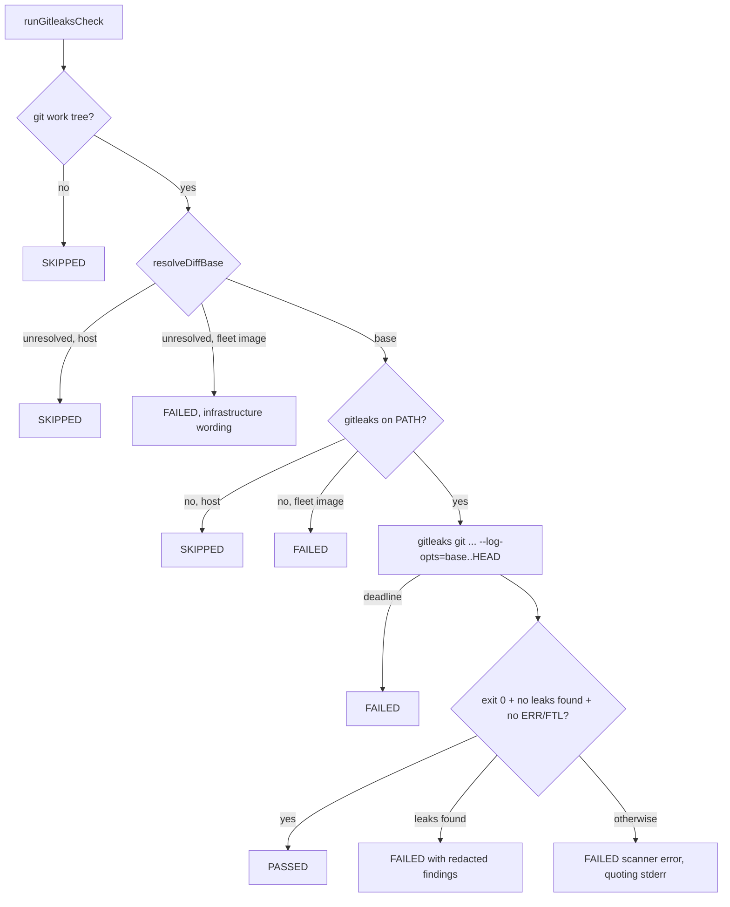

# PR Summary — Issue #5121

## Summary

Adds a `gitleaks` stage to the local quality gate (`./quality.sh` →
`worker/deno/quality.ts` → `runQualityGate`). The stage runs the same
`gitleaks git` scan as the CI fallback in `.github/workflows/gitleaks.yml`, over
the same commit range, so a committed secret fails the local gate before the PR
is raised. The same scan also gates a fleet babysitter repair, which does not go
through `./quality.sh`: `runBabysitterTreeGate` runs it over the branch's commit
range and the repair's uncommitted files before READY is honoured. CI stays the
backstop. Closes #5121.

### Publication paths

| Path                                                               | Gate that runs before publication                                                                              | Gitleaks scan                                                      |
| ------------------------------------------------------------------ | -------------------------------------------------------------------------------------------------------------- | ------------------------------------------------------------------ |
| Issue completion (`quality_gate_remediation_phase.ts`)             | `./quality.sh` → `runQualityGate`                                                                              | `runGitleaksQualityCheck`, commit range                            |
| Fleet babysitter repair (`babysitter_repair.ts`)                   | `runBabysitterTreeGate` → `runPrePushGate`; the host never starts `quality.sh` (`fleet_pr_babysitter.ts:2331`) | `runGitleaksTreeCheck`, commit range plus uncommitted files        |
| Worker pre-push gate over unpushed commits (`gateUnpushedCommits`) | `runPrePushGate`                                                                                               | not run; the completion gate's `./quality.sh` covers those commits |

## Spec

### Intent and Rationale

- Three fleet PRs (#5014, #5091, #5119) failed `gitleaks / gitleaks` in CI. The
  local gate had no secret scan, and gitleaks 8.30.1 was already in the image
  (`/usr/local/bin/gitleaks`).
- The stage is a new module, `worker/deno/lib/gitleaks_check.ts`, built like the
  semgrep and checkov stages. It reuses `resolveDiffBase`,
  `defaultEnsureHistory`, `makeGitRunner`, `probe` and `spawnWithDeadline` from
  `semgrep_check.ts` (now exported) instead of copying them.

### Essential Design Decisions

- **Same scan as CI.** The flags are
  `git --config .github/gitleaks.toml
  --redact --no-banner --exit-code 1 --log-opts=<merge-base>..HEAD .`.
  `<merge-base>..HEAD` covers the same commits as CI's `base_sha..head_sha`. The
  scan adds `--verbose --no-color` so each finding's file, line and rule are
  printed, with the secret redacted. These two flags do not change the verdict.
  Uncommitted changes are not scanned, which matches CI. The PASSED line says
  so.
- **A base that cannot be resolved is not a pass in the fleet image.**
  `resolveDiffBase` failing (`origin/HEAD` unset, a failed history deepen, a
  failed `merge-base`) is `SKIPPED` on a host, where `--strict` promotes it, and
  `FAILED` inside the fleet image, because the worker runs the gate with
  `strict: false` and a skipped stage passes. The output says the history is
  "not available in the worker environment", which `detectFailureCategory` reads
  as `missing_tools`, an infrastructure category, so it is not handed to the
  remediation agent as a finding.
- **The babysitter tree gate scans the repair's tree.** After the pre-push
  checks pass, `runGitleaksTreeCheck` runs: `git` over
  `<merge-base with refs/remotes/origin/<base>>..HEAD` (the merge-base is read
  without deepening, because the clone's `.git` is read-only and the clone is a
  full clone), then `gitleaks dir` over each changed file that still exists and
  is not a symlink, one process per file, because `gitleaks dir` takes one path.
  A finding is `blocked` (a repair attempt is spent) with the redacted rule,
  path and line; a missing scanner, unresolvable base, scanner error or deadline
  hit is `infrastructure`. The scan runs only on a tree the other checks passed,
  reads without writing, and `gitleaks` is listed in `checksRun`. The repository
  config is read from the working tree, as CI reads it from the PR head. Each
  changed file is scanned whole, so a repair that touches a file already holding
  allowlist-dependent content is held to the config's path allowlist (marked
  `SIMPLE-ON-PURPOSE` in the code).
- **Exit 0 alone does not pass.** The stage passes only when the exit code is 0,
  stderr says `no leaks found`, and no stderr line is `ERR` or `FTL`. Anything
  else is `FAILED`: a missing gitleaks inside the fleet image, a scan past the
  300s deadline, or a scanner error. On a host without gitleaks the stage is
  `SKIPPED` with the reason, and `--strict` turns that into a failure.
- **Registered only where `.github/workflows/gitleaks.yml` exists.** This
  follows the checkov stage, so the worker's gate over a monitored repository
  without that workflow does not gain the stage.
- **The `quality.sh` header now names the gitleaks stage.** The shift-left
  router (`localGateRunsTool` in `shift_left_failures.ts`) reads only
  `quality.sh`. Without the mention it would keep reporting that this gate does
  not run gitleaks.

### Undiscoverable Facts

- Observed with gitleaks 8.30.1: given an unresolvable range
  (`--log-opts=nosuchref..HEAD`), gitleaks logs
  `ERR [git] fatal: ambiguous argument 'nosuchref..HEAD': unknown revision ...`
  and still exits 0 with `INF no leaks found`. A missing `--config` file logs
  `FTL unable to load gitleaks config` and exits 1. Findings go to stdout and
  log lines go to stderr.
- The failed CI job logs for #5014, #5091 and #5119 could not be fetched
  (`gh run view --log-failed` → `Forbidden`), so the individual leaks were not
  inspected.

## Evidence

Backend/CLI change, so there is no screenshot. Real-tool commands run on a
scratch repository (gitleaks 8.30.1):

- `gitleaks git --redact --no-banner --exit-code 1 --log-opts="$base..HEAD" .`
  with a branch commit adding a fake GitHub PAT → `WRN leaks found: 1`, exit 1.
  With `--verbose --no-color` the stdout block shows `Secret: REDACTED`,
  `RuleID: github-pat` and `File: leak.ts`.
- The same command over an empty range (`$base..$base`) → `INF no leaks found`,
  exit 0.
- With `--log-opts="nosuchref..HEAD"` → `ERR [git] fatal: ambiguous argument`
  and `INF no leaks found`, exit 0. This is the false pass the judge refuses.
- With `--config /nonexistent.toml` →
  `FTL unable to load gitleaks config, err: open /nonexistent.toml: no such file or directory`,
  exit 1.

- `gitleaks dir [flags] [path]` takes one path: with two paths it scanned the
  whole working directory instead, so the tree scan runs one `dir` scan per
  file. `-- sub/leak.txt` and `-- -x.txt` both worked and printed
  `File: sub/leak.txt` / `File: -x.txt`; a path that does not exist logs
  `FTL stat missing.txt: no such file or directory` and exits 1, so deleted
  paths are skipped before the scan.
- `gitleaks git --pre-commit` found a leak in an unstaged edit and, with
  `--staged`, in a staged new file, but not in an untracked file, and on a merge
  it would include the base's own content; this is why the tree scan reads files
  instead.

The test fixtures copy those observed lines.

## Test Plan

- `worker/deno/tests/gitleaks_check_test.ts` (31 tests at head):
  - Each judge outcome, with fixtures from the observed output: PASSED; a
    finding is FAILED, names the rule and file, and never prints the secret; a
    bad range with exit 0 is FAILED and quotes `ambiguous argument`; a missing
    config is FAILED and quotes the cause; a deadline hit is FAILED.
  - SKIPPED outside a git repository.
  - An unresolvable diff base, for each of `origin/HEAD` unset, a failed
    `ensureHistory` and a failed `merge-base` (three tests): SKIPPED with the
    reason on a host and `FAILED` in the fleet image, the two runs differing
    only in the container stamp. The image output names the reason and "never
    scanned", and `isInfrastructureFailure(detectFailureCategory(output))`
    holds.
  - A missing gitleaks is SKIPPED on a host and FAILED in the fleet image. Both
    use the same fixture with only the container stamp changed.
  - A version drift is named in the output and the scan still runs.
  - The scan gets the range and the absolute config path, or no `--config` when
    the repository has none.
  - A drift test checks that every `GITLEAKS_VERSION` in
    `.github/workflows/gitleaks.yml` equals the module's pin. It also reads the
    `./gitleaks git …` command from the CI fallback step (joining its `\`
    continuation lines) and asserts its arguments equal `gitleaksScanArgs` minus
    the two local additions (`--verbose`, `--no-color`), with the `--config`
    value and the `<base>..<head>` range normalised. It also asserts that the CI
    `--log-opts` is the `${BASE_SHA}..${HEAD_SHA}` range. Red-checked: adding
    `--max-decode-depth 3` to the workflow command, removing `--redact` from it,
    changing its range to `--all`, and deleting `--redact` from
    `gitleaksScanArgs` each turned the test red.
  - Three real-tool tests run gitleaks 8.30.1 on a temporary repository: a
    branch with a runtime-built fake PAT is FAILED with `github-pat`, a clean
    branch is PASSED, and a branch whose earlier commit adds the fake PAT and
    whose later commit deletes the file is still FAILED with `github-pat` and
    without the token (the issue's "deleted at HEAD still blocks" case; the file
    is checked to be absent at HEAD, so only history holds the token). They are
    ignored where gitleaks is not installed, and they ran here.
  - Ten `runGitleaksTreeCheck` tests: a clean range plus a surviving file passes
    (the range scan and one file scan, the deleted path skipped); the base is
    `refs/remotes/origin/<baseBranch>` or `refs/remotes/origin/HEAD`; a finding
    in an uncommitted file is `blocked` with rule and path and never the token;
    a finding in the range is `blocked` and stops the file scans; a missing
    scanner, an unresolvable base (non-zero and empty output), a scanner error
    and a deadline hit are each `infrastructure`; an absolute or `..` path is
    `blocked` before any scan; a dash-leading name follows `--` and a symlink is
    not scanned; and one real-tool test blocks an uncommitted untracked fake PAT
    and passes a clean tree.
  - `runQualityGate - registers gitleaks only where gitleaks.yml exists` covers
    the production registration.
- `worker/deno/tests/babysitter_tree_gate_test.ts` (60 tests at head): the
  `depsFor` helper, `realGate`, `realDenoGate` and two other tests now pass a
  stub secret scan, so the existing tests keep reaching the verdicts they pin on
  a runner with no scanner (`validate (tests 3/4)` failed six tests there with
  `gitleaks is not installed`, which the earlier runs on a host with gitleaks
  hid), and their `passed` assertions now expect `gitleaks` in `checksRun`. Five
  tests added, through `runBabysitterTreeGate`: a token-shaped uncommitted file
  is `blocked` with `github-pat` and the path and without the token (real
  gitleaks, ignored where it is absent); a clean edit is `passed` with
  `["gitleaks"]` (real gitleaks); a scanner that cannot run is `infrastructure`,
  and its withheld response is recognised by `isGateInfrastructureResponse`; an
  unresolvable base (`origin/no-such-base`, real `merge-base`) is
  `infrastructure`; the scan receives the clone, the base branch and the changed
  paths (including a deleted one) and is not called when the other checks block.
- `deno task test:unit tests/gitleaks_check_test.ts
  tests/babysitter_tree_gate_test.ts tests/babysitter_repair_4738_test.ts <
  /dev/null`
  → 134 passed, 0 failed, re-run at head:
  `worker/deno/tests/gitleaks_check_test.ts` (31 tests at head),
  `worker/deno/tests/babysitter_tree_gate_test.ts` (60 tests at head) and
  `worker/deno/tests/babysitter_repair_4738_test.ts` (43 tests at head; the one
  test that builds its own real tree gate now passes the same stub secret scan,
  and nothing else in that file changed). The semgrep tests cover the
  `resolveDiffBase` and `defaultEnsureHistory` exports, whose behaviour did not
  change; they were not re-run in this round.
- Added `docs/audits/lib-sweep-coverage/top-up-5121.json` to claim the new
  module. The first full gate run failed only on
  `worker/deno/tests/lib_sweep_coverage_test.ts` (module claimed by no slice; 39
  tests at head, all passing, file unchanged by this PR), and the
  `completeness checks` stage failed for the same reason. After the slice was
  added, `deno task check:manifests` → 870 passed, 0 failed. The ancestry guard
  (`sweep-drift --default-branch origin/main`) exits 0, with `sweptAt` set to
  `origin/main`.
- `./quality.sh < /dev/null` at `70695a6e` →
  `Result: PASSED (with skipped
  checks)`, with `gitleaks`, `deno tests`,
  `deno lint`, `deno type check` and `deno fmt` PASSED; `config integration` and
  `checkov` SKIPPED for host reasons as before. `deno task pr-summary-check`
  reported 0 blocked gates.
- Earlier iteration: `./quality.sh < /dev/null` at `69208427` →
  `Result: PASSED (with skipped
  checks)`.
  `gitleaks: PASSED (commit range f67e030e991f..HEAD, gitleaks
  8.30.1; ...)`
  and `deno tests: PASSED`. Two stages were skipped for host reasons unrelated
  to this change: checkov (no pinned checkov or container runtime here) and
  config integration (no `.config.json`).
- No assertions were removed from existing tests.

## Docs

- `docs/INTERNALS.md` "Quality gate": the stage list now includes gitleaks, and
  a new gitleaks paragraph follows the checkov one. It now states the
  unresolved-base outcomes (host and image) and the publication paths, including
  the babysitter tree scan.
- `docs/workflows/fleet-pr-babysitter.md` (the container pre-push gate section
  and the checks list) and `docs/CONFIGURATION.md` (the babysitter repair gate
  sentence) now list the gitleaks scan and its blocked or infrastructure
  outcomes.
- `CONTRIBUTING.md` "Local quality gate" and `CODING-STANDARDS.md` (the gate
  stage list) now name gitleaks.
- `docs/CONTAINER.md` (the gitleaks table row and bullet) and the
  `REQUIRED_REPO_TOOLCHAIN_COMMANDS` doc comment in `container_manifest.ts` now
  say that VibeCoder's own gate runs gitleaks. GRQ-AutoTrader and
  NEAT-AI-Explore still enforce it in CI only.
- `quality.sh` header comment.
- Dated audit records (`docs/pre-pr-ci-audit.md`, `docs/audits/`) are left as
  they are.

## Not done

- The quality-gate stage does not scan uncommitted or untracked files, by
  design, to match CI. The babysitter tree scan does scan them, because the host
  commits and pushes them next.
- The worker's own pre-push gate over unpushed commits (`gateUnpushedCommits`)
  does not run gitleaks; the completion gate's `./quality.sh` covers those
  commits.
- A repair that changes `.github/gitleaks.toml` is scanned with that edited
  config, as CI scans a PR with its head's config. This is parity with CI, not a
  guard against a config that allowlists a genuine secret.
- The red run for the new image-versus-host and tree-scan tests against the
  previous head was not recorded: they import exports the previous head lacks.
- The licensed `gitleaks-action` path in CI was not reproduced. It uses upstream
  defaults. The local stage mirrors the CLI fallback instead.
