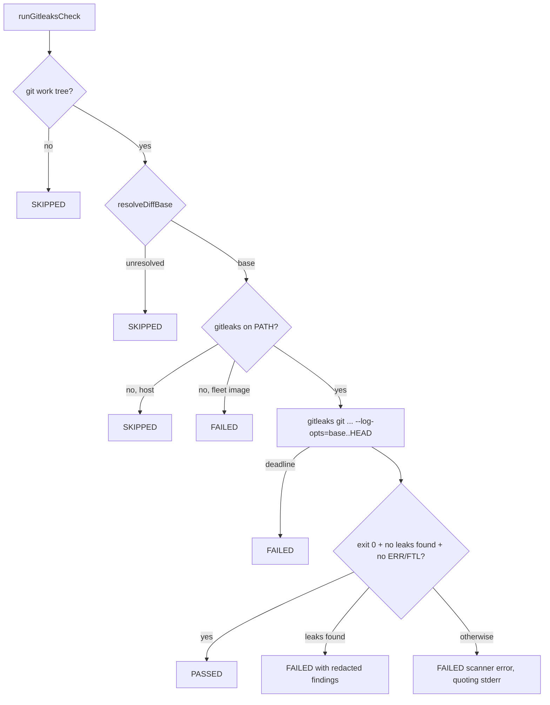

# PR Summary — Issue #5121

## Summary

Adds a `gitleaks` stage to the local quality gate (`./quality.sh` →
`worker/deno/quality.ts` → `runQualityGate`). The stage runs the same
`gitleaks git` scan as the CI fallback in `.github/workflows/gitleaks.yml`, over
the same commit range, so a committed secret fails the local gate before the PR
is raised. CI stays the backstop. Closes #5121.

## Spec

### Intent and Rationale

- Three fleet PRs (#5014, #5091, #5119) failed `gitleaks / gitleaks` in CI. The
  local gate had no secret scan, and gitleaks 8.30.1 was already in the image
  (`/usr/local/bin/gitleaks`).
- The stage is a new module, `worker/deno/lib/gitleaks_check.ts`, built like the
  semgrep and checkov stages. It reuses `resolveDiffBase`,
  `defaultEnsureHistory`, `makeGitRunner`, `probe` and `spawnWithDeadline` from
  `semgrep_check.ts` (now exported) instead of copying them.

### Essential Design Decisions

- **Same scan as CI.** The flags are
  `git --config .github/gitleaks.toml
  --redact --no-banner --exit-code 1 --log-opts=<merge-base>..HEAD .`.
  `<merge-base>..HEAD` covers the same commits as CI's `base_sha..head_sha`. The
  scan adds `--verbose --no-color` so each finding's file, line and rule are
  printed, with the secret redacted. These two flags do not change the verdict.
  Uncommitted changes are not scanned, which matches CI. The PASSED line says
  so.
- **Exit 0 alone does not pass.** The stage passes only when the exit code is 0,
  stderr says `no leaks found`, and no stderr line is `ERR` or `FTL`. Anything
  else is `FAILED`: a missing gitleaks inside the fleet image, a scan past the
  300s deadline, or a scanner error. On a host without gitleaks the stage is
  `SKIPPED` with the reason, and `--strict` turns that into a failure.
- **Registered only where `.github/workflows/gitleaks.yml` exists.** This
  follows the checkov stage, so the worker's gate over a monitored repository
  without that workflow does not gain the stage.
- **The `quality.sh` header now names the gitleaks stage.** The shift-left
  router (`localGateRunsTool` in `shift_left_failures.ts`) reads only
  `quality.sh`. Without the mention it would keep reporting that this gate does
  not run gitleaks.

### Undiscoverable Facts

- Observed with gitleaks 8.30.1: given an unresolvable range
  (`--log-opts=nosuchref..HEAD`), gitleaks logs
  `ERR [git] fatal: ambiguous argument 'nosuchref..HEAD': unknown revision ...`
  and still exits 0 with `INF no leaks found`. A missing `--config` file logs
  `FTL unable to load gitleaks config` and exits 1. Findings go to stdout and
  log lines go to stderr.
- The failed CI job logs for #5014, #5091 and #5119 could not be fetched
  (`gh run view --log-failed` → `Forbidden`), so the individual leaks were not
  inspected.

## Evidence

Backend/CLI change, so there is no screenshot. Real-tool commands run on a
scratch repository (gitleaks 8.30.1):

- `gitleaks git --redact --no-banner --exit-code 1 --log-opts="$base..HEAD" .`
  with a branch commit adding a fake GitHub PAT → `WRN leaks found: 1`, exit 1.
  With `--verbose --no-color` the stdout block shows `Secret: REDACTED`,
  `RuleID: github-pat` and `File: leak.ts`.
- The same command over an empty range (`$base..$base`) → `INF no leaks found`,
  exit 0.
- With `--log-opts="nosuchref..HEAD"` → `ERR [git] fatal: ambiguous argument`
  and `INF no leaks found`, exit 0. This is the false pass the judge refuses.
- With `--config /nonexistent.toml` →
  `FTL unable to load gitleaks config, err: open /nonexistent.toml: no such file or directory`,
  exit 1.

The test fixtures copy those observed lines.

## Test Plan

- Added `worker/deno/tests/gitleaks_check_test.ts`, 17 tests:
  - Each judge outcome, with fixtures from the observed output: PASSED; a
    finding is FAILED, names the rule and file, and never prints the secret; a
    bad range with exit 0 is FAILED and quotes `ambiguous argument`; a missing
    config is FAILED and quotes the cause; a deadline hit is FAILED.
  - SKIPPED outside a git repository, and SKIPPED when `origin/HEAD` is unset.
  - A missing gitleaks is SKIPPED on a host and FAILED in the fleet image. Both
    use the same fixture with only the container stamp changed.
  - A version drift is named in the output and the scan still runs.
  - The scan gets the range and the absolute config path, or no `--config` when
    the repository has none.
  - A drift test checks that every `GITLEAKS_VERSION` in
    `.github/workflows/gitleaks.yml` equals the module's pin, and that the CI
    fallback's flags are all in `gitleaksScanArgs`.
  - Two real-tool tests run gitleaks 8.30.1 on a temporary repository: a branch
    with a runtime-built fake PAT is FAILED with `github-pat`, and a clean
    branch is PASSED. They are ignored where gitleaks is not installed, and they
    ran here.
  - `runQualityGate - registers gitleaks only where gitleaks.yml exists` covers
    the production registration.
- `deno task test:unit tests/gitleaks_check_test.ts tests/semgrep_check_test.ts
  tests/checkov_check_test.ts < /dev/null`
  → 71 passed, 0 failed. The existing semgrep tests cover the `resolveDiffBase`
  and `defaultEnsureHistory` exports, whose behaviour did not change.
- Added `docs/audits/lib-sweep-coverage/top-up-5121.json` to claim the new
  module. The first full gate run failed only on
  `tests/lib_sweep_coverage_test.ts` (module claimed by no slice), and the
  `completeness checks` stage failed for the same reason. After the slice was
  added, `deno task check:manifests` → 870 passed, 0 failed. The ancestry guard
  (`sweep-drift --default-branch origin/main`) exits 0, with `sweptAt` set to
  `origin/main`.
- `./quality.sh < /dev/null` at `69208427` →
  `Result: PASSED (with skipped
  checks)`.
  `gitleaks: PASSED (commit range f67e030e991f..HEAD, gitleaks
  8.30.1; ...)`
  and `deno tests: PASSED`. Two stages were skipped for host reasons unrelated
  to this change: checkov (no pinned checkov or container runtime here) and
  config integration (no `.config.json`).
- No assertions were removed from existing tests.

## Docs

- `docs/INTERNALS.md` "Quality gate": the stage list now includes gitleaks, and
  a new gitleaks paragraph follows the checkov one.
- `CONTRIBUTING.md` "Local quality gate" and `CODING-STANDARDS.md` (the gate
  stage list) now name gitleaks.
- `docs/CONTAINER.md` (the gitleaks table row and bullet) and the
  `REQUIRED_REPO_TOOLCHAIN_COMMANDS` doc comment in `container_manifest.ts` now
  say that VibeCoder's own gate runs gitleaks. GRQ-AutoTrader and
  NEAT-AI-Explore still enforce it in CI only.
- `quality.sh` header comment.
- Dated audit records (`docs/pre-pr-ci-audit.md`, `docs/audits/`) are left as
  they are.

## Not done

- Uncommitted and untracked files are not scanned, by design, to match CI.
- The licensed `gitleaks-action` path in CI was not reproduced. It uses upstream
  defaults. The local stage mirrors the CLI fallback instead.
