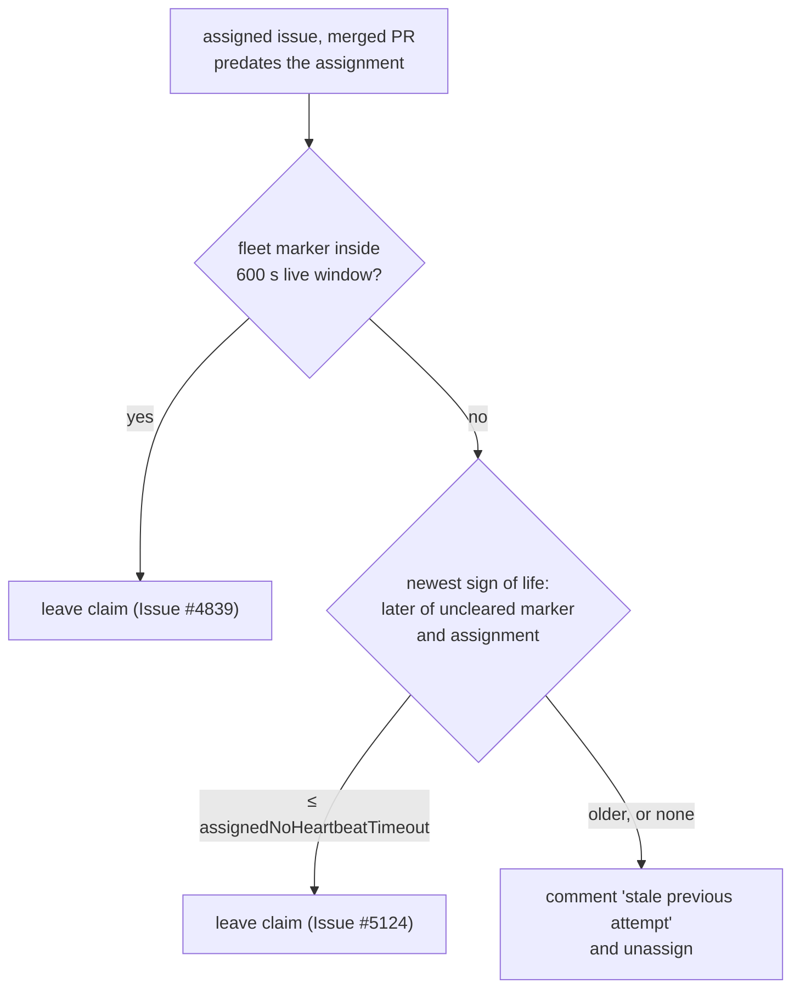

## Summary

Closed-PR self-healing no longer drops a re-claimed issue after 10 minutes of
heartbeat silence. When an earlier PR merged as `Part of` the issue before the
current assignment, the stale-previous-attempt branch of
`detectAssignedWithClosedPr` now waits until the claim has shown no sign of
life for `assignedNoHeartbeatTimeout` (1800 s by default). That is the same
threshold the ordinary no-heartbeat recovery (`detectAssignedWithoutHeartbeat`)
uses.

- `worker/deno/lib/stuck_recovery.ts`:
  - New private helper `newestSignOfLifeEpoch`. It returns the later of the
    newest uncleared fleet marker epoch and the latest assignment time.
  - The stale-previous-attempt branch skips the claim, with no comment and no
    unassign, while that sign of life is no older than
    `config.assignedNoHeartbeatTimeout`.
  - The heartbeat markers the #4839 check already reads are kept for this
    branch, so the scan makes no extra `gh` call.
  - The doc comment on `detectAssignedWithClosedPr` describes the new rule.
- `worker/deno/lib/claim_issue.ts`: the doc comment on
  `LIVE_HEARTBEAT_WINDOW_SECONDS` now says the closed-PR release waits for the
  same threshold.

Closes #5124.

## Spec

### Intent and Rationale

- The comment on `LIVE_HEARTBEAT_WINDOW_SECONDS` already states the design:
  past the 600 s live window, the ordinary stale-assignment recovery (default
  1800 s) takes over. The stale-previous-attempt branch unassigned at 600 s
  instead, so a run that stalled for 10 to 30 minutes lost its claim only on
  issues with an earlier merged partial PR. A second host then claimed the
  issue, and both runs pushed to the same branch.
- The issue proposes reusing the markers and assignment time the scan already
  reads, adding no new gate. This change does exactly that.

### Essential Design Decisions

- The threshold is `config.assignedNoHeartbeatTimeout`, the "default 1800 s"
  recovery named in the `claim_issue.ts` comment. `staleAssignmentTimeout`
  (14400 s) is not used: the 1800 s figure points at
  `assignedNoHeartbeatTimeout`.
- The sign of life is the **later** of the newest uncleared fleet marker and
  the assignment, not the marker alone. The issue says "the newest uncleared
  fleet marker (or, with no marker, the assignment itself)". Taking the later
  of the two keeps a fresh claim safe even when an uncleared marker left by an
  earlier, crashed attempt is hours old.
- Only the stale-previous-attempt branch changes, as the issue asks. The
  reopen, not-landed, close and closed-not-merged branches still act once no
  marker is inside the 600 s live window.
- Markers come from fleet accounts only (`config.fleetAuthors`, unchanged from
  #4839). A marker from another account is ignored, so it cannot keep a claim
  held.

### Undiscoverable Facts

- The incident timeline (host A's 28-minute stall, the unassign at 10:59:24
  and host B's claim at 11:03:44) is in the issue body. The worker logs are on
  a private fleet host and were not read in this run.

## Evidence

Backend only: no UI file is touched.

- Issue numbers this diff cites: #5124 (this issue): "Closed-PR self-healing
  unassigns a claim after 10 minutes of heartbeat silence, so a stalled run and
  a second host both work the issue (follow-up to #4839, seen on a private
  fleet issue)".
- Docs updated: the `ASSIGNED_NO_HEARTBEAT_TIMEOUT` row in
  `docs/CONFIGURATION.md` now says the closed-PR recovery pass waits the same
  time before releasing a re-claim whose earlier PR merged. No other manual
  describes the stale-previous-attempt branch: a search for
  `stale previous attempt`, `predates the current`,
  `detectAssignedWithClosedPr` and `LIVE_HEARTBEAT_WINDOW` outside
  `docs/archive/` and `docs/audits/` found only `docs/INTERNALS.md`'s
  claim-lock invariants, which name the 1.68 closed-PR pass without a
  threshold and stay true.

## Reproduction

- **symptom** — closed-PR self-healing commented "found merged PR … but it
  predates the current assignment — treating as stale previous attempt" and
  removed the assignee from a claim that was 20 minutes old, whose marker had
  been silent for more than 10 minutes.
- **status** — `verified` — the three new keep-the-claim tests failed against
  the unfixed `stuck_recovery.ts` (20 passed, 3 failed) and pass after the fix
- **regression test** —
  `worker/deno/tests/claim_lock_integrity_214_test.ts::detectAssignedWithClosedPr - keeps a claim whose marker went quiet 20 minutes ago (Issue #5124)`

## Test Plan

- Added to `worker/deno/tests/claim_lock_integrity_214_test.ts`. Each test
  drives the real `detectAssignedWithClosedPr` with a `gh` fake. The fake
  returns a merged PR dated 2026-11-01, an assignment at the given time, and
  the given comments, and it records every mutation:
  - `keeps a claim whose marker went quiet 20 minutes ago (Issue #5124)`: the
    issue's scenario. A fleet marker 1,200 s old and an assignment 1,200 s
    ago give 0 recovered and no mutations. Red on base.
  - `keeps a fresh claim with no marker at all (Issue #5124)`: an assignment
    1,200 s ago gives 0 recovered and no mutations. Red on base.
  - `an old marker from an earlier attempt does not age a fresh claim (Issue #5124)`:
    a 7-hour-old uncleared marker and an assignment 1,200 s ago give 0
    recovered and no mutations. Red on base.
  - `releases a claim silent past the no-heartbeat timeout (Issue #5124)`: the
    positive control. An assignment 1,860 s ago and no marker give 1
    recovered, a `--remove-assignee` mutation, and a comment containing
    "treating as stale previous attempt".
  - `a cleared marker does not keep an old claim alive (Issue #5124)`: a
    cleared marker (epoch 0 plus `cleared:`) and an assignment 1,860 s ago
    give 1 recovered. It passes on base too, as a control.
- `reclaimedAfterPartialMergeGh` takes an optional `assignedAt`, which defaults
  to the old fixed date. The existing tests that use it are otherwise
  unchanged.
- Changed in the same file: `detectAssignedWithClosedPr - still releases a claim whose heartbeat has stopped (Issue #4839)`.
  Its fleet marker is now `assignedNoHeartbeatTimeout + 60` s old instead of
  `LIVE_HEARTBEAT_WINDOW_SECONDS + 60` (660 s). Releasing at 660 s is the
  defect this issue removes ("leave a claim alone until it is as stale as the
  ordinary stale-assignment recovery requires"). No assertion was removed: it
  still asserts `recovered === 1` and a `--remove-assignee` mutation.
- Unchanged #4839 coverage still passes:
  - a live marker from another host keeps the claim;
  - a recent marker from a non-fleet account is ignored, so an old claim is
    released.
- Callers checked: `detectAssignedWithClosedPr` takes the threshold from its
  `StuckIssueConfig`, where `assignedNoHeartbeatTimeout` is a required field.
  - `lib/run_core_production_deps.ts` sets it to 1800.
  - `commands/stuck_issue_detector.ts` reads it with the
    `STUCK_ISSUE_DEFAULTS` value (1800) as the fallback.
- After merging `origin/main` (`9260f475`): the 28 test files whose text
  names `claim_issue`, `stuck_recovery` or this test file, run through
  `deno task test:unit`, gave 425 passed, 0 failed.
- Red on base, re-checked on this head: with `lib/stuck_recovery.ts` restored
  from `origin/main` and the new tests kept,
  `tests/claim_lock_integrity_214_test.ts` gave 20 passed, 3 failed (the three
  keep-the-claim tests).

Not done or not checked: the reopen and closed-not-merged branches of
`detectAssignedWithClosedPr` still release at the 600 s live window, as the
issue scopes the fix to the stale-previous-attempt branch. The cause of the
original 28-minute stall is outside this issue, as the issue body says.

🤖 Generated with [Claude Code](https://claude.com/claude-code)
