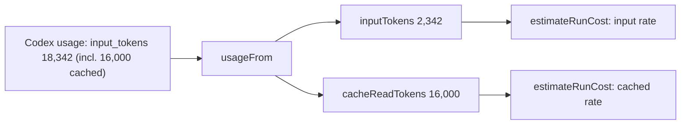

## Summary

Codex reports `cached_input_tokens` as part of `input_tokens`. `usageFrom` in
`worker/deno/lib/codex_output_adapter.ts` copied `input_tokens` straight into
`inputTokens`, so the pricing path charged every cached token twice: once at the
full input rate and once at the cached rate. `usageFrom` now sets `inputTokens`
to input less cached (never below 0), and `cacheReadTokens` stays the cached
count. Closes #5125.

## Spec

### Intent and Rationale

- The shared `TokenUsage.inputTokens` already means uncached input: Claude
  reports it that way, and the Gemini decoder already subtracts its cached
  count. Correcting the Codex adapter makes every reader agree without touching
  the pricing code.

### Essential Design Decisions

- The subtraction is clamped at 0, so a malformed event whose cached count
  exceeds its input can never produce a negative token count or cost.
- No reader of `inputTokens` needed the full Codex input count. Totals, callback
  telemetry and cache-rate telemetry
  (`worker/deno/lib/run_callback_telemetry.ts`,
  `worker/deno/lib/prompt_cache_telemetry.ts`) and the banded-rate prompt size
  in `ratesFor` (`worker/deno/lib/token_usage.ts`) all add `inputTokens` and
  `cacheReadTokens` together, so the fix also stops those from counting the
  cached prefix twice. The Codex context budget
  (`worker/deno/lib/codex_budget.ts`) reads its own rollout files, not this
  adapter.

### Undiscoverable Facts

- The subset relation comes from Codex's own figures in
  `worker/deno/tests/fixtures/agent_output/codex-0.147.0-legacy-envelope.jsonl`:
  `input_tokens` 9100, `cached_input_tokens` 8000, `output_tokens` 430,
  `total_tokens` 9530. 9530 is input plus output; the cached count is not added
  again.

## Evidence

Backend only; no UI file touched.

- Worked example from the issue (gpt-5, 18,342 input of which 16,000 cached,
  1,201 output). The estimate drops from $0.0369375 to $0.0169375 (2,342 ×
  1.25 + 1,201 × 10 + 16,000 × 0.125, per million), pinned by
  `worker/deno/tests/review_fleet_prs_run_cost_test.ts::attemptCost prices a Codex attempt on gpt-5 from its turn.completed usage, not the Claude result path`.
- `docs/MODEL-AND-CACHING.md`, Token Extraction section, Codex bullet: now
  states the input-less-cached mapping.

Issue numbers this PR cites:

- #5125: Codex cost estimates charge cached input tokens twice (`usageFrom` in
  codex_output_adapter.ts).

## Test Plan

- Added to `worker/deno/tests/codex_output_adapter_1695_test.ts`:
  - `codex adapter - cached input is not counted again as uncached input (Issue #5125)`:
    input 1200 and cached 900 decode to `inputTokens` 300 and
    `cacheReadTokens` 900. It failed against the unfixed adapter.
  - `codex adapter - usage without cached_input_tokens keeps the whole input uncached (Issue #5125)`:
    input 500 and no cached count give 500 and 0. It passes on both the base and
    the fix, because it pins the case the fix must leave unchanged.
  - `codex adapter - cached input above total input never yields negative uncached input (Issue #5125)`:
    input 100 and cached 150 give 0 and 150. It failed against the unfixed
    adapter.
- Edited expectations. Each still discriminates, because the old value is the
  double-counted one and no assertion was removed. The governing issue is #5125
  (`work-on` label added by the trusted maintainer `nleck` on 2026-11-13); each
  edit follows its text verbatim:
  - `worker/deno/tests/codex_output_adapter_1695_test.ts`: 18342 is now 2342,
    and 9100 is now 1100. `cacheReadTokens` and `outputTokens` are unchanged.
    Requirement: "In `usageFrom`, set `inputTokens` to
    `max(0, input_tokens - cached_input_tokens)` and keep `cacheReadTokens` as
    the cached count." Obsolete: the double-counted `inputTokens` (full Codex
    input). Remaining: `cacheReadTokens` and `outputTokens`. Covering test:
    `worker/deno/tests/codex_output_adapter_1695_test.ts::codex adapter - cached input is not counted again as uncached input (Issue #5125)`.
  - `worker/deno/tests/provider_token_usage_test.ts` Codex case: 1200 is now
    300. Requirement: "Update the expected values in the tests that pin the old
    figures". Obsolete: `inputTokens` 1200. Remaining: the other three counters,
    `usageUnknown` and `warning`.
  - `worker/deno/tests/review_fleet_prs_run_cost_test.ts` gpt-5 case:
    `0.0369375` is now `0.0169375`. Requirement: "The correct figure is 2,342 x
    $1.25 + 16,000 x $0.125." Obsolete: the double-charged cost. Remaining:
    `models`, non-null `usd` and `apiEquivalent`.
- `deno test -A` over the 14 test files touching token usage or Codex output
  (`codex_output_adapter_1695`, `provider_token_usage`,
  `review_fleet_prs_run_cost`, `cost_estimate`, `token_usage`,
  `agent_output_1695`, `agent_provider_per_invocation`, `credit_tracker`,
  `issue_run_stats_comment`, `run_callbacks`, `unpriced_spend_3870`,
  `orchestration_3642_gate`, `batch_api`, `callback_schema_compat`, all under
  `worker/deno/tests/`): 443 passed, 0 failed. `deno fmt`, `deno lint` and
  `deno check` were clean on the four changed TypeScript files.
- `./quality.sh` on the PR head before the review-fix push: `Result: FAILED`.
  Every stage passed except `deno tests`, which gave 35,122 passed, 1 failed and
  5 ignored. The one failure is
  `worker/deno/tests/pr_summary_ci_workflow_3768_test.ts::PR summary CI task runs git with restricted environment permissions`,
  which quotes `error: Failed caching npm package 'entities@3.0.1'` and
  `dns error: failed to lookup address information: Temporary failure in name resolution`
  for `registry.npmjs.org`. It fails the same way when run alone. The test,
  `worker/deno/deno.json`, `worker/deno/deno.lock` and
  `worker/deno/lib/pr_summary_check_cli.ts` are all unchanged from `origin/main`
  (`git diff --quiet`). The failure is this container's network, not this
  change.

## Not done or not checked

- `worker/deno/tests/pr_summary_ci_workflow_3768_test.ts` could not pass here
  because it needs to reach `registry.npmjs.org` (see above). It was not checked
  on a host with registry access.
- `deno fmt --check docs/MODEL-AND-CACHING.md` already fails on the base branch,
  on hunks unrelated to this change. The file was not reformatted.
