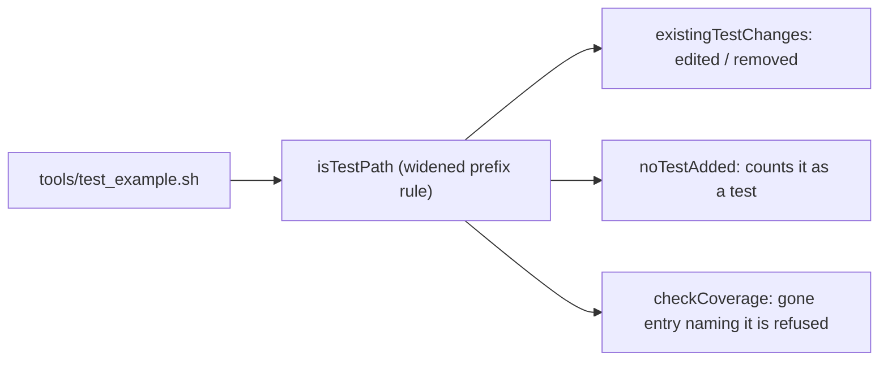

## Summary

The fleet reviewer's gate read a `test_` name prefix as a test only for Python,
so a shell test named `test_<name>.sh` beside the script it tests was not a test
to `isTestPath`. An edited or removed one was missing from `testChanges`, the
removed-test rule could not fire, and `noTestAdded` said the PR added no test.
The `test_` prefix pattern in `TEST_PATH_PATTERNS`
(`.claude/skills/review-fleet-prs/scripts/test_change_policy.ts`) now covers the
same shell extensions as the `_test` suffix pattern above it:
`/(^|\/)test_[^/]+\.(py|sh|ps1)$/`. Closes #5126.

## Spec

### Intent and Rationale

- One path rule feeds every consumer (`existingTestChanges`, `noTestAdded` and
  the `gone` coverage check in `checkCoverage`), so widening the pattern fixes
  all four symptoms the issue lists without touching those functions.

### Essential Design Decisions

- The prefix covers `.py`, `.sh` and `.ps1` only, matching the suffix pattern's
  shell extensions. As the issue proposes, other spellings such as
  `test-<name>.sh` are out of scope.
- The prefix must start the file name (`(^|\/)test_[^/]+`), so
  `contest_example.sh` and a file inside a `test_dir/` directory stay non-tests.

### Undiscoverable Facts

- The private fleet repo that triggered this names 226 shell files
  `test_<name>.sh`, of which the old rule recognised 7 (issue body). That
  evidence is on the reviewing host, not in this repository.

## Evidence

Backend only; no UI file touched.

- `worker/deno/tests/review_fleet_prs_gate_2675_test.ts` drives the gate's
  exported `isTestPath`, `existingTestChanges` and `noTestAdded`, which are the
  functions the issue's probe called.
- Corpus over this repository:
  `git ls-files | grep -cE
  '(^|/)test_[^/]+\.(sh|ps1)$'` gives 0, so no
  tracked file here changes classification. Only fleet repos using the
  `test_<name>.sh` convention are affected.

Issue numbers this PR cites:

- #5126: Reviewer gate does not see a shell test named `test_<name>.sh`.

## Test Plan

- Added to `worker/deno/tests/review_fleet_prs_gate_2675_test.ts`:
  - `isTestPath: shell and PowerShell test_ scripts are tests (Issue #5126)`:
    `tools/test_example.sh` and `tools/test_example.ps1` are tests;
    `tools/example.sh`, `tools/example.ps1`, `tools/contest_example.sh` and
    `tools/test_dir/example.sh` are not.
  - `existingTestChanges: shell test scripts count as edited or removed tests (Issue #5126)`:
    a modified `tools/test_edited.sh` (40 added, 6 removed) is listed under
    `edited`, a removed `tools/test_gone.sh` under `removed`, and the changed
    `tools/example.sh` in neither.
  - `noTestAdded: a changed shell test script satisfies the test requirement (Issue #5126)`:
    a script change plus lines added to `tools/test_example.sh` gives `false`.
    The same script change alone gives `true` (positive control).
- Before the fix, `deno test -A tests/review_fleet_prs_gate_2675_test.ts` (from
  `worker/deno`) failed all three new tests: `isTestPath` returned `false` for
  `tools/test_example.sh`, `existingTestChanges` returned
  `{ edited: [], removed: [] }`, and `noTestAdded` returned `true`. After the
  fix the file passes (65 passed, 0 failed).
- The 22 test files under `worker/deno/tests/` that import the gate or
  `test_change_policy.ts` pass under `deno task test:unit`: 615 passed, 0
  failed.
- No existing assertion was edited or removed.
- `./quality.sh` on the head commit `d0b4056fa`:
  `Result: PASSED (with skipped checks)`. `deno tests`, lint, type check, fmt,
  semgrep and markdownlint all passed. Two stages were skipped because their
  tools are missing here: `config
  integration` (no `.config.json`) and
  `checkov` (not on PATH; the CI checkov job is authoritative).

## Not done or not checked

- The `gone`-entry consequence (issue item 4) goes through the same `isTestPath`
  call in `checkCoverage`. It has no test of its own for a `test_<name>.sh`
  path.
