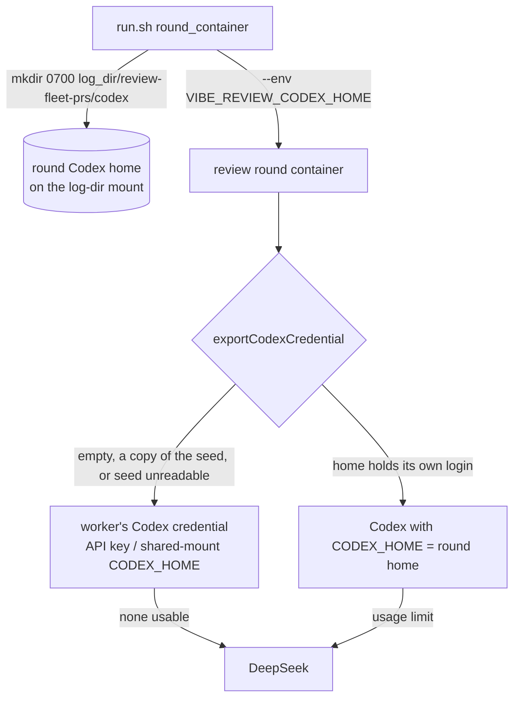

## Summary

The review round's container leaves out the `vibe-agent-state` volume, so the
documented Codex subscription login (a `CODEX_HOME` on that volume) never
reached a round, and a round whose Claude side was spent went straight to
DeepSeek. `run.sh` now creates the round's own persistent Codex home,
`<log_dir>/review-fleet-prs/codex` (0700), on the log directory's mount that
every round already shares. It passes that home's in-container path to the
round as `VIBE_REVIEW_CODEX_HOME`. The round tries that home first. Codex runs
there when the home holds a login of its own. The round never seeds that home,
and it refuses a copy of the worker's one-time login seed. Otherwise the
worker's Codex credential applies exactly as before. Closes #5127.

## Spec

### Intent and Rationale

- The log directory is already mounted read-write in every round (it holds the
  round directories). A home there outlives each round and needs no new mount.
  It also keeps the worker's named volumes out of the round, as Issue #3293
  intended.
- The home is passed as a separate variable (`VIBE_REVIEW_CODEX_HOME`), not as
  `CODEX_HOME`. This keeps it away from the Codex state initialiser
  (`initialiseCodexHome`), which would otherwise seed an empty home from the
  worker's one-time `auth.json`.

### Essential Design Decisions

- The round's home has to hold its own login. A copy of the seed is detected
  by identical text or the same non-empty `tokens.refresh_token`, and refused.
  ChatGPT refresh tokens rotate, so with a shared login whichever side
  refreshes first can sign the other out.
- If the seed cannot be read for any reason other than being absent, the home
  is refused rather than used, so the check fails closed.
- An empty round home, or a refused one, falls through to the unchanged
  #5083 path: an API key in `codex/provider.env`, or a `CODEX_HOME` on a
  shared mount. API-key operators therefore keep Codex.
- When the round's own home is used, its child environment is built by the
  Codex provider's `buildChildEnv` with `CODEX_HOME` set. Under the billing
  fail-closed rule this strips `OPENAI_API_KEY` and `CODEX_API_KEY`, and the
  denylist strips the Claude credentials.

### Undiscoverable Facts

- Assumption: the operator makes the one-time login, for example
  `CODEX_HOME=~/logs/review-fleet-prs/codex codex login --device-auth` on the
  host. The worker never logs in interactively, and `run.sh` offers no login
  command.

## Evidence

Purely backend and runner changes, with no UI files.

- `worker/deno/lib/review_round.ts`: adds `REVIEW_CODEX_HOME_ENV_VAR` and
  `roundCodexHomeUnusable`, and `exportCodexCredential` checks the round's
  home first.
- `.claude/skills/review-fleet-prs/scripts/run.sh`: `round_container` creates
  the home, and a round fails loudly if it cannot. `round_args` passes the
  variable, including on the Apple egress helper's rebuilt run.
- `worker/deno/lib/vibe_env_registry.ts` registers `VIBE_REVIEW_CODEX_HOME` as
  `launch_plumbing`.
- Docs updated: `.claude/skills/review-fleet-prs/references/running-unattended.md`
  (the "Which Codex credentials reach a round" paragraph), `docs/CONFIGURATION.md`
  (the fallback-chain paragraph), `docs/CODEX-SUBSCRIPTION-AUTH.md` (a new
  "Fleet PR review rounds" section), and the chain summaries in
  `.claude/skills/review-fleet-prs/SKILL.md`, `DESIGN-PRINCIPLES.md` and
  `docs/MODEL-AND-CACHING.md`. Every "not built / tracked as Issue #5127"
  sentence is removed.
- Issues cited: #5083: PR reviewer bot: Fable 5.2 @ high, falling back Opus 5.5
  -> Codex gpt-6-astra -> DeepSeek (closed); #5127: Review round: make the
  Codex subscription login reachable (follow-up to #5083).

## Test Plan

- `worker/deno/tests/review_round_wiring_test.ts` adds six tests, all driving
  the real `createReviewRoundDeps`:
  - "a round whose Claude side is spent runs on Codex from the round's own
    home and never reaches DeepSeek (Issue #5127)". This is the issue's wiring
    test. A real DeepSeek credential is provisioned, yet
    `exportFallbackCredential` is called 0 times, Codex runs once with
    `CODEX_HOME` set to the round's home, and the round exits 0.
  - "a round Codex home holding its own login offers Codex there, even when
    provider.env names the unmounted agent-state home (Issue #5127)". It also
    asserts that the API key and Claude token are stripped, that `auth.json`
    is unchanged, and that the agent-state path is not created.
  - "an empty round Codex home is never seeded from the worker's login seed
    (Issue #5127)".
  - "a round Codex home holding a copy of the seed is refused (Issue #5127)".
    It covers an identical copy and a copy with the same refresh token, plus a
    control with a different refresh token that is accepted.
  - "a seed the round cannot read refuses the round Codex home rather than
    passing it (Issue #5127)", with a control where the seed is absent and the
    home is accepted.
  - "an empty round Codex home still leaves the API-key credential usable
    (Issue #5127)".
- `worker/deno/tests/review_fleet_prs_runner_test.ts` adds four tests:
  - "run.sh gives the round its own Codex home on the log directory's mount,
    owner-only (Issue #5127)" (mode 0700, no `auth.json` written, `--env`
    placed before the image).
  - "run.sh keeps the round Codex home's login across passes (Issue #5127)".
  - "run.sh passes the round's Codex home on an Apple round too (Issue
    #5127)".
  - "run.sh fails a round whose Codex home cannot be created, without starting
    it (Issue #5127)".
- Red before the fix: against the base `review_round.ts` (with only the
  exported constant added so the test file loads), four new wiring tests
  failed. They were the own-login test ("the round's own login must offer
  Codex"), the spent-Claude test (DeepSeek fallback called 1 time, expected
  0), the empty-home test and the seed-copy test. The API-key test was green
  on base, as expected, because it pins unchanged behaviour. The seed-unreadable
  test was added later and was not run against base. Against the base
  `run.sh`, three of the four runner tests failed, all but the keep-login
  pin, which was green on base as expected.
- Green on the final code: `deno test -A tests/review_round_wiring_test.ts
  tests/review_round_test.ts` gave 46 passed, 0 failed, and `deno test -A
  tests/review_fleet_prs_runner_test.ts` gave 77 passed, 0 failed.
- Full `./quality.sh` on head `15892ab9`: PASSED (with skipped checks). Deno
  tests passed in both the parallel and serial passes. The config integration
  check was skipped (no `.config.json`), and so was checkov (not installed).
  The first gate run failed only `vibe_env_registry_test.ts`, which flagged
  the then-unregistered name and was fixed in `15892ab9`.
- No assertion was removed from any existing test. The only edits to existing
  test files are the import lists.

## Not checked

- No real round was run against a live ChatGPT login: the Codex CLI's token
  refresh in that home and the rotating refresh tokens come from OpenAI's
  documentation, not from observation here.
- Copy detection covers the worker's seed file only. A copy of the worker's
  refreshed agent-state `auth.json` cannot be detected, because that volume is
  not mounted in a round; the docs tell the operator not to make one.
