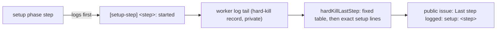

## Summary

A hard kill during setup was filed with `Last step logged: unknown`, because the
setup phase logs nothing the report's step table recognises. It logs only a 60s
`[phase] setup …: still running` ticker, which the report skips as noise. Each
blocking setup step now logs one fixed line as it starts,
`[setup-step] <step>: started`. The hard-kill report maps that line to a fixed
`setup: <step>` label, so the next setup wedge names the step it is in or after.
The setup phase also runs under a deadline: two agent budgets plus 30 minutes,
capped by the runway left to the run's hard cap. A setup still running then is
abandoned as a `timeout` failure, and the run's failure path releases the claim
it holds, instead of holding it until the launcher's watchdog reaps the
container. The abandoned setup stops at its next checkpoint, which sits before
each call that writes to the lane worktree, the shared clone or GitHub. The
cause of the #5128 wedge on `GRQ-25` is not established.

Part of #5128

## Spec

### Intent and Rationale

- The killed run was working `stSoftwareAU/GRQ#5515`. It claimed the issue at
  12:37:43Z and its log ran until 14:48:26Z, still in `setup`. The report could
  not say which of the dozen setup steps it was in.
- The wedge itself cannot be diagnosed from here, because its evidence is in
  `GRQ-25`'s private archive. A speculative change to setup behaviour would
  breach "no speculative fix for an unreproduced fault". Making the next
  recurrence name the step is the change the evidence supports.

### Essential Design Decisions

- Seven steps log a start line: `issue claim`, `claim churn check`,
  `repository setup`, `heartbeat start`, `default branch sync`, `feature branch`
  and `pre-setup command`. The label names the last step that started, so a
  wedge in a conditional step between two of them (milestone branch, resume,
  session priming) reads as "in or after" the earlier one.
- The step names are a fixed tuple in `worker/deno/lib/setup_steps.ts`, used by
  both the setup phase and the report, so the logged line and the matched line
  cannot drift. The report matches the exact line text with `includes()`, after
  the existing regex table, because Semgrep refuses a regex built at run time
  (`detect-non-literal-regexp`). No log text reaches the public issue.
- The labels are not part of the dedup signature `hard-kill-<handler>-<phase>`.
- The claim hold is the fault this change can fix. The worker's 60s setup ticker
  kept logging for 2h10m after the claim, so the event loop was alive while one
  awaited setup step never returned. `runSetupWithDeadline` in `setup_steps.ts`
  races the setup phase against a deadline and returns a `timeout` failure if
  setup is still running. It is wired at the setup `runPhase` in
  `issue_worker.ts`, with the deadline from
  `deps.infrastructure.setupDeadlineMs` (production: `setupDeadlineMs` in
  `setup_steps.ts`).
- The budget is `2 × claudeTimeout + 1800s`. Setup is not only bounded
  subprocesses: for a milestone issue the pre-sync runs the conflict-resolution
  agent for up to `claudeTimeout` (`milestone_presync.ts`, `agentTimeoutMs`) and
  may run a repair agent after the gate check, and the clone alone may take 600s
  (`DEFAULT_GH_CLONE_TIMEOUT`). The 1800s covers the clone, git, gates and the
  pre-setup command (300s by default). With the default `claude_timeout` of 3600
  s that is 9000s.
- The deadline is that budget capped by the runway left to the run's hard cap.
  `setupDeadlineMs` calls `resolveRunHardCap` (`run_hard_cap.ts`), whose
  `ceilingMs` is the supervisor's deadline (`VIBE_RUN_STARTED_EPOCH` plus
  `VIBE_RUN_MAX_SECONDS`) less the kill grace and the 120s WIP reserve, and
  takes the smaller of the budget and the time left to it, floored at 60s. The
  launcher's watchdog is `DEFAULT_MAX_RUN_SECONDS + WATCHDOG_MARGIN_SECONDS` =
  11400s from launch (`container_launch_plan.ts`, `resolveWatchdogSeconds`), and
  the supervisor's default cap is 10800s, so the cap falls before it. The budget
  alone fell after the watchdog in two cases: a setup that starts more than
  2400s after launch at the default `claude_timeout`, and any setup with
  `claude_timeout: 7200` (16200s). On the #5128 timeline (run start 12:21:10Z,
  claim 12:37:43Z) the budget falls at about 15:07:43Z and the cap's ceiling at
  about 15:14:40Z, so the cap does not move it: that wedge would still have been
  abandoned after the log stopped (14:48:26Z) and after the
  assigned-without-heartbeat recovery freed the claim (15:03:30Z). With no
  supervisor cap published (`VIBE_RUN_MAX_SECONDS` unset or `0`) there is
  nothing to cap by and the budget stands.
- The deadline is armed on an injected `Clock` (`SetupDeadlineOptions.clock`,
  supplied from `deps.infrastructure.setupClock`, production `systemClock`), the
  `lib/clock.ts` seam, so the tests drive it with `fakeClock()`.
- A failure from the deadline releases only a claim the run still holds. Every
  fleet host shares one login, so an unassign from a run that no longer owns the
  claim strips another host's live claim (Issues #1139, #1193, #214). Setup
  records its claim on `PhaseState.setupClaim` (worker id, and `won` once
  `claimIssue` returned `claimed`). When the deadline fires, `workOnIssueCore`
  treats the claim as held only if `ownClaimCommentPresent` finds this run's
  `CLAIM_LOCK:<workerId>` comment, authored by its GitHub account, whether or
  not `won` is set. A won claim is no exception: the fleet's recovery frees an
  issue whose setup wedged before the heartbeat (assigned-without-heartbeat
  1800s, `stuck_issue_timeout` 7200s, both before the 9000s deadline), and a
  host that then re-claims deletes this run's claim comment
  (`cleanupStaleClaimComments`), so a missing comment means the assignment is
  another host's. When the claim is not held the result carries `claimNotHeld`,
  which `run_core.ts`'s `releaseIssueClaim` honours by releasing nothing. A read
  of the comments that fails counts as not held, so the issue is then left to
  the fleet's recovery. One case is held without the comment: a claim that was
  still pending at the deadline and returned `claimed` during the comment read
  was taken just now (`won` was unset before the read and set after it). It is
  recorded as won by the abandoned setup instead of being unassigned by it
  (`state.setupClaimReleasedByRun` unset), so the run releases it, exactly once
  (a second unassign could strip another host's claim).
- The abandoned setup is told to stop. `onAbandon` sets `state.setupAbandoned`,
  and `workOnIssueSetupBranch` checks it before each of the seven step start
  lines, right after `claimIssue` and `startHeartbeat` return, and before each
  call that writes to the lane worktree, the shared clone or GitHub: the
  default-branch sync, the milestone branch push and its repair, the
  milestone-refusal label sweep, the pre-sync agent run, the milestone session
  restore, the resume checkout (the checkout call itself is wrapped to decline
  once abandoned), the compaction, the feature branch step (outside the
  `resumedFromCheckpoint` condition, so a resumed setup is stopped too), each
  repair rung (sweep, object-store repair, re-clone, retry), the host-fault
  label sweep and the pre-setup command. When it stops it logs one fixed line
  (`SETUP_ABANDONED_LOG_LINE`, without the `[setup-step]` prefix, so the
  hard-kill report ignores it). A heartbeat that starts late is stopped. A claim
  won late, when the run did not release it, is unassigned by the abandoned
  setup; one the run already released is not released twice
  (`state.setupClaimReleasedByRun`). A call already running when the deadline
  fires finishes (a milestone pre-sync agent run is the longest). There is
  also a check before the resume lookup (`resumeIssueBranch`) and before the
  stream-session priming (`primeStreamSession`, which can delete a stored stream
  session), and the lookup's candidate ordering (`orderBranchesByRecency`, which
  runs `git fetch origin <branch>` per candidate in the lane worktree) is
  wrapped to decline, keeping the listed order, once abandoned. The reads
  `loadResumeState`, `readHandoverNote` and `countCommitsAhead` are not
  checkpoints, because they write nothing.

### Undiscoverable Facts

- From `stSoftwareAU/GRQ-VibeCoder-logs`:
  `runs/GRQ-25/2026-11-13/stSoftwareAU-GRQ-5515-vibe-mwey44k4-e5e5c2.metadata.json`
  records `stSoftwareAU/GRQ#5515`, outcome `no_pr`, phase `setup`,
  `failureClass: hard_kill`, and no session log ("agent transcript tee not
  enabled for this run").
- Run id `vibe-mwey44k4` decodes to a start of 2026-11-13T12:21:10Z. The
  GRQ#5515 timeline shows the assignment at 12:37:43Z and an
  assigned-without-heartbeat recovery that unassigned it at 15:03:30Z. No
  release comment was posted. The capture at 15:32:45Z is 3h 11m after the
  start, which fits the launcher's 11400s watchdog.
- The 256 KiB worker-log tail behind the capture, the guest probes and the boot
  logs are in `GRQ-25`'s `~/logs/hard-kill-archive/`, which this host cannot
  read. The guest probe did not answer, so the guest itself had stopped.

## Evidence

Backend-only change; no UI files.

- `worker/deno/tests/setup_step_log_test.ts` drives the real
  `workOnIssueSetupBranch` (`createMockDeps`) and passes the lines it logs to
  `hardKillLastStep`:
  - a failed repository setup logs the first three lines and is labelled
    `setup: repository setup`;
  - a refused claim logs only `issue claim`;
  - a completed setup logs all seven lines in order.
- `worker/deno/tests/setup_deadline_5128_test.ts` (33 tests at this head)
  covers the deadline. The `workOnIssue` tests arm it on `fakeClock()` and
  advance it only after the stalled mock has been entered, and wait on the
  abandoned setup's own `SETUP_ABANDONED_LOG_LINE`, so none sleeps or races the
  real clock:
  - `setupDeadlineMs`: the budget exceeds one agent budget plus the clone and
    pre-setup bounds and grows by two agent budgets per extra `claudeTimeout`
    when no cap is published (and for `VIBE_RUN_MAX_SECONDS=0`); it is left
    alone when it fits the hard cap; it is capped when setup starts 9000s into a
    10800s run; it is capped for `claudeTimeout: 7200` and then falls before the
    11400s watchdog; it never drops below 60s;
  - `runSetupWithDeadline` returns the setup result, disarms its timer and never
    abandons when setup settles first, and abandons a setup that never settles
    once, at the deadline and not before, with a `timeout` failure;
  - `ownClaimCommentPresent` is true only for this run's exact leading claim
    marker authored by its GitHub account, across all pages; outsider or quoted
    markers, a failed read and a worker id that is not a plain id answer false;
  - through `workOnIssue`: a wedge inside `claimIssue` with no claim of its own
    returns `claimNotHeld`, and a claim that comes back late is released once
    and the setup goes no further; a wedge inside `claimIssue` with this run's
    claim comment present has no `claimNotHeld`, and a late claim is not
    released a second time; a wedge after a won claim whose own claim comment is present has no
    `claimNotHeld`, and one whose comment is gone (a host re-claimed) returns
    `claimNotHeld`; in both a clone that returns late starts no heartbeat and
    releases nothing; a
    heartbeat that starts after the deadline is stopped; for a wedge in
    `checkClaimChurn` or `createFeatureBranchFromBase` the named step's start
    line is logged and the next step (`repository setup`, `pre-setup command`)
    never logs its start line; a `getRepoDefaultBranch` that returns late runs
    no default-branch sync, milestone push, resume lookup or feature branch; an
    `ensureDefaultBranchCurrent` that returns late runs no milestone push,
    pre-sync or resume lookup; an `ensureMilestoneBranchExists` that returns
    late runs no pre-sync or resume lookup; a ruleset repair that returns late
    is not retried; a refusal-label sweep that returns late is followed by no
    pre-sync; a pre-sync that returns late is followed by no resume lookup; a
    resume lookup that returns a checkpoint branch late checks nothing out and
    creates no feature branch, and one with two candidates that returns late
    runs no ordering fetch; a stored stream session is not adopted by a setup
    whose deadline fell after the resume lookup; a stream compaction whose stream was joined just
    as the deadline fell is not started; a resumed setup whose compaction
    returns late runs no label sweep (no further `gh` command) or pre-setup
    command; a feature-branch failure that arrives late with object-store
    corruption starts neither the object-store repair nor the broken-ref sweep;
    and a repair, re-clone or sweep that returns late is followed by no re-clone
    or branch retry; and a claim won while the run reads its claim comment
    (comment posted or not yet posted) is released exactly once in all. The
    `createFeatureBranchFromBase` and `checkClaimChurn` wedges also assert that
    no `gh` command follows the deadline.
- `worker/deno/tests/run_core_test.ts` already drives the consumers of that
  result: "failure path releases the claim (unassign + clear) — Issue #2648
  regression" releases on a failure without `claimNotHeld`, and "a failed run
  that never held the claim releases nothing (Issue #1139)" releases nothing
  with it.
- `worker/deno/tests/hard_kill_report_test.ts::hardKillLastStep names each setup step from its start line, past the phase ticker (Issue #5128)`
  covers each of the seven labels behind ticker lines, a later step winning, and
  an unknown step name giving `unknown`.
- Docs updated: the hard-kill sections of `docs/CALLBACKS.md` ("Filing.") and
  `docs/TROUBLESHOOTING.md` list the setup labels. `docs/TROUBLESHOOTING.md`
  also describes the setup deadline, the claim it releases and the late-step
  stop. A grep for `agent turn` outside `docs/archive/` found no other copy of
  the label list. The `STEP_PATTERNS`, `hardKillLastStep` and
  `formatHardKillBody` doc comments describe the setup match.
- Issue-number provenance: #5095 and #4254 are cited only by existing text the
  docs change re-wraps.

## Reproduction

- **symptom** — a hard kill in setup is filed with `Last step logged: unknown`,
  so the step the guest wedged in is not named
- **status** — `partial` — reason: the missing label is reproduced: on unfixed
  main, `hardKillLastStep` returned `unknown` and the setup phase logged no step
  lines. The `GRQ-25` wedge itself was not reproduced, because its evidence is
  in that host's private archive.
- **regression test** —
  `worker/deno/tests/hard_kill_report_test.ts::hardKillLastStep names each setup step from its start line, past the phase ticker (Issue #5128)`
- **symptom** — a run wedged in setup holds its claim until the launcher's
  watchdog reaps the container, so it never releases the claim
- **status** — `partial` — a `workOnIssue` run whose `claimIssue` never returns
  did not return before the deadline was wired: it was still running after 120s
  and was stopped. With it wired it returns a `setup` / `timeout` failure. The
  `GRQ-25` wedge itself was not reproduced.
- **regression test** —
  `worker/deno/tests/setup_deadline_5128_test.ts::workOnIssue: a wedge after a won claim releases the claim and does no later setup work (Issue #5128)`

## Acceptance Criteria

<!-- vibe-spec-review inputs="diff+issue-body" -->

- **partial** — a container wedged and the launcher watchdog reaped it, so the
  run never released its claim — evidence:
  `worker/deno/tests/setup_deadline_5128_test.ts` (the four `workOnIssue`
  tests), `worker/deno/lib/setup_steps.ts` (`runSetupWithDeadline`,
  `setupDeadlineMs`), `worker/deno/lib/issue_worker.ts` (setup `runPhase`),
  `worker/deno/tests/run_core_test.ts` (the Issue #2648 and #1139 release tests)
  — reviewer: partial — reason: a wedge in a live worker now releases the claim
  the run holds. Not covered: a guest that stops first is still reaped by the
  watchdog and its claim is freed by the assigned-without-heartbeat recovery; a
  `claimIssue` that wedges after its assignment with no claim comment of this
  run's on the issue is left to that recovery; a setup that wedges within a
  budget's last stretch before the watchdog, as `GRQ-25` did, is still freed by
  that recovery first; a host with no supervisor cap published keeps the
  uncapped budget; the cause of the `GRQ-25` wedge is not established.

## Test Plan

- [x] Added `worker/deno/tests/setup_step_log_test.ts` (three cases through
      `workOnIssueSetupBranch`).
- [x] Added the setup-label test to
      `worker/deno/tests/hard_kill_report_test.ts`. No existing assertion was
      removed or edited.
- [x] Red on unfixed main: the new report test failed at `issue claim`
      (`hardKillLastStep` returned `unknown`), and the failed-setup and
      completed-setup cases captured no `[setup-step]` lines. The refused-claim
      case's log assertion was first run after the fix.
- [x] Added `worker/deno/tests/setup_deadline_5128_test.ts` (33 tests at this
      head). With the step-boundary checks in `setup_branch_phase.ts` disabled,
      the no-own-claim, won-claim and late-heartbeat `workOnIssue` tests failed;
      with `state.setupClaimReleasedByRun` forced false, the own-claim-comment
      test failed. After the review round, with the check after
      `getRepoDefaultBranch` removed, the `getRepoDefaultBranch` test failed on
      the default-branch sync it counted; with the checks before the pre-sync,
      after the pre-sync and compaction join, before the feature branch, after
      the sweep, in the re-clone, before the host-fault sweep and on the
      milestone retry removed, eight of the new checkpoint tests failed (the
      ruleset retry, label sweep, pre-sync, both compaction, object-store,
      re-clone and sweep tests). The `setupDeadlineMs` cap tests and the
      `fakeClock` rewrite were first run after the change. Earlier iterations of
      this file had a constant-restating test and a late-rejection test that
      passed without the code they named; both are removed. After the second
      review, with the won-claim ownership check, the check before
      `resumeIssueBranch` plus the ordering wrapper, and the check before
      `primeStreamSession` each reverted, the won-claim-comment-gone test, the
      two-candidate late-lookup test and the stream-session test failed
      (checked together, 30 passed and those 3 failed).
- [x] `deno test --allow-all tests/setup_deadline_5128_test.ts` from
      `worker/deno`: 33 passed, 0 failed. The other files that call
      `workOnIssue`, `workOnIssueSetupBranch` or touch `InfrastructureDeps` are
      covered by the local gate's test pass and by CI on the pushed head.
- [x] Full `deno task test:unit` on this head: 34565 passed, 1 failed, 6
      ignored. The one failure was `tests/fleet_babysitter_app_test.ts` (the
      non-watch container repair test hit its 25 s wait under the full parallel
      load); that file passes on its own (17 passed) and does not touch setup.
- [x] Local gate: the formatter, `deno lint` and `deno check` pass on the
      changed files. Config integration (no `.config.json`), Checkov, Semgrep
      and the live release-ruleset check are unavailable on this host and are
      left to CI.
- Callers checked: `hardKillLastStep` is called by `formatHardKillBody`, which
  gets the new labels. `workOnIssueSetupBranch` has one caller,
  `workOnIssueCore`; its extra return arms are reached only after
  `state.setupAbandoned`, which only the deadline sets. `runSetupWithDeadline`
  has one caller, the setup `runPhase`. `InfrastructureDeps.setupDeadlineMs` and
  the new `setupClock` are built in `issue_worker_wiring.ts` (production and
  `createMockDeps`), the only two constructors; `setupDeadlineMs` reads
  `resolveRunHardCap`, whose other callers are unchanged. The new module is
  claimed by `docs/audits/lib-sweep-coverage/top-up-5128.json`.
- Branch outcomes: deadline fires with claim won and its own comment present or
  gone (`workOnIssue: a wedge after a won claim whose own comment is …`); with
  own claim comment present
  (`… a wedged claim reads a marker from testbot
  and releases only its own`);
  with no claim of its own (`… with no claim of its
  own does not unassign`);
  setup settles first (`runSetupWithDeadline returns the
  setup result …`);
  late claim, late clone and late heartbeat after abandonment (the
  `workOnIssue` tests above); unreadable comments and a non-plain worker id
  (`ownClaimCommentPresent …`); abandonment before `repository setup`,
  `feature branch` and `pre-setup command` (the next-step tests, each also
  asserting the start line of the step that holds the wedge); a late
  `getRepoDefaultBranch`, `ensureDefaultBranchCurrent`,
  `ensureMilestoneBranchExists`, resume lookup and feature-branch failure (the
  checkpoint tests above); `setupDeadlineMs` with no cap, with the cap disabled,
  with the budget inside the cap, with a late start, with a large
  `claude_timeout` and past the cap (the five `setupDeadlineMs` tests). Exempt
  (untestable): the one checkpoint between `initialiseMilestoneSession` and
  `restoreSession`. Both are real filesystem calls that `createMockDeps` does
  not inject, and neither logs, so a test cannot make the deadline fall between
  them. Harness search: the tests that call `workOnIssue` or
  `workOnIssueSetupBranch` (`setup_step_log_test.ts`,
  `stream_compaction_seam_2642_test.ts` and this file) stage the deadline only
  through an injected mock or a logged line.

## Review corrections

- The timeout ownership lookup first accepted a marker without authenticating
  its author. It now reads paginated comment bodies and authors, accepts only an
  exact leading marker from this run's GitHub account, and treats missing or
  malformed evidence as no claim. The former command-string assertion and canned
  comment-ID response were replaced by ownership outcomes over comment bodies
  and authors. The positive own-claim, missing-claim, failed-read,
  invalid-worker-ID and exactly-once release assertions remain covered;
  outsider, quoted-marker and paginated-response cases are added.
- A won claim is no longer released unchecked. The deadline path used to treat
  `won` as held, so after the fleet's recovery freed the issue and another host
  re-claimed it, this run unassigned the shared login from that host's live
  claim. It now requires this run's own claim comment whatever `won` is; the
  test that pinned the unchecked release
  (`… a wedge after a won claim releases the claim …`) was replaced by two
  cases, comment present (released once, no `claimNotHeld`) and comment gone
  (`claimNotHeld`, nothing unassigned). The first case keeps the old test's
  assertions; the second is new.
- The resume lookup and the stream-session priming gained checks, and the
  ordering fetch declines once abandoned, as described above. The two-candidate
  late-lookup and stream-session tests are new.

## CI fix: gitleaks stub in the #4930 tree-gate tests

Merging `main` brought in the local `gitleaks` stage (#5121). Three
`worker/deno/tests/babysitter_tree_gate_test.ts` tests (the `deno.json` and
`deno.jsonc` config cases and the unreadable-primary-config case) ran the real
secret scan, which fails where `gitleaks` is not installed and otherwise adds
`gitleaks` to `checksRun`. They now inject `PASSING_GITLEAKS` and expect the
extra `gitleaks` entry. This is a test-only change; it touches no production
code and removes no assertion. Obsolete base behaviour: those tests left the
secret-scan dependency unset and expected `checksRun` to hold only
`deno task test:unit`. Remaining behaviour: an invalid or unreadable Deno config
still blocks repair validation instead of dropping the unit tests, and the
`deno task test:unit` entry is still first. Covering tests:
`worker/deno/tests/babysitter_tree_gate_test.ts::an invalid deno.json blocks repair validation instead of dropping the unit tests (#4930)`,
the `deno.jsonc` case of the same loop, and
`worker/deno/tests/babysitter_tree_gate_test.ts::an unreadable primary Deno config cannot fall through to a secondary config and pass (#4930)`.

## Merge verification

CI and code review are pending on the pushed head.

## Limitations and remaining risk

This does not fix or explain the wedge itself. A setup wedge in a step between
two start lines is reported as "in or after" the earlier step. The deadline
needs a live worker: if the guest stops first, the watchdog still reaps it and
the assigned-without-heartbeat recovery frees the claim, as before. A
`claimIssue` that wedges after its assignment, with no claim comment of this
run's on the issue, is also left to that recovery, because the run cannot prove
the claim is its own. A won claim whose comment cannot be read at the deadline, or
whose comment a re-claiming host deleted, is likewise not released by the run;
the fleet's recovery frees it. An abandoned setup stops at its next checkpoint, not
mid-call: the call running when the deadline fires finishes first. The deadline
is capped by the supervisor cap only when `VIBE_RUN_MAX_SECONDS` and
`VIBE_RUN_STARTED_EPOCH` are published; on a host without them a large
`claude_timeout` can still put it past the launcher's watchdog. On the #5128
timeline the deadline would not have fired before the recovery freed the claim.
