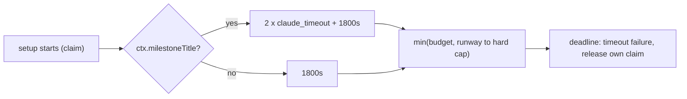

## Summary

PR #5130 put the setup phase under a deadline, so a wedged setup ends as a
`timeout` failure and the run releases the claim it holds. On the #5128 timeline
that deadline would still have fallen too late. The wedged issue,
`stSoftwareAU/GRQ#5515`, has no milestone, but its setup was given two agent
budgets plus 30 minutes: 9000s at the default `claude_timeout`, falling at about
15:07:43Z. The guest's log stopped at 14:48:26Z, so the deadline would never
have fired. Only the milestone pre-sync runs a full agent turn in setup, so the
two agent budgets now go to milestone issues only. A setup without a milestone
gets the fixed 1800s allowance. For the GRQ-25 run that deadline falls at
13:07:43Z, about 1h40m before the guest stopped, and the run releases its claim.

Closes #5128

## Spec

### Intent and Rationale

- PR #5130 left a gap: "a setup that wedges within a budget's last stretch
  before the watchdog, as `GRQ-25` did, is still freed by that recovery first".
  The budget for a setup without a milestone was sized for agent runs that setup
  never makes, so that stretch covered most of the run.
- The fix narrows the budget to the work this setup actually does. It does not
  change the step checkpoints, the claim-ownership check or the hard-cap
  capping.

### Essential Design Decisions

- `setupDeadlineMs` now requires `input.milestone`, and the
  `InfrastructureDeps.setupDeadlineMs` type has the same required argument. A
  caller cannot leave the milestone out and silently get either budget.
- The single caller passes `Boolean(ctx.milestoneTitle)`. This matches the setup
  phase's own `if (milestoneTitle)` test (`setup_branch_phase.ts`), which
  decides whether the milestone pre-sync (`presyncMilestoneOnceForArming`, the
  agent run and its repair run) happens at all.
- The 1800s allowance (`SETUP_FIXED_ALLOWANCE_SECONDS`) is unchanged. It covers
  the clone (600s, `DEFAULT_GH_CLONE_TIMEOUT`) and one re-clone, the 180s stream
  compaction (`COMPACT_TIMEOUT_SECONDS` in `stream_compaction.ts`, the only
  agent run in a setup without a milestone), the 300s pre-setup command
  (`runPreSetupCommand`'s default, which setup does not override) and the git
  calls. The milestone budget is unchanged.

### Undiscoverable Facts

- `gh issue view 5515 -R stSoftwareAU/GRQ` shows no milestone (labels:
  `work-on`), so the GRQ-25 run took the path without a milestone.
- The times come from the issue body and from PR #5130's record of the run
  metadata: run start 12:21:10Z, claim 12:37:43Z (993s later), last log line
  14:48:26Z (7843s after the claim).

## Evidence

Backend-only change; no UI files.

- `worker/deno/tests/setup_deadline_5128_test.ts::setupDeadlineMs grants a non-milestone setup the fixed allowance alone, so the GRQ-25 wedge is abandoned before its guest stopped (Issue #5128)`
  replays the GRQ-25 timeline with a 10800s cap and setup starting 993s in.
  Without a milestone the deadline is 1,800,000 ms, which is before the 7843s
  silence. With a milestone the same input still gives 9,000,000 ms. Without a
  cap, a setup with no milestone stays at 1800s whatever `claude_timeout` is.
- `worker/deno/tests/setup_deadline_5128_test.ts::workOnIssue: a non-milestone setup is abandoned at the fixed allowance, a milestone setup keeps its agent budgets (Issue #5128)`
  drives the real `workOnIssue` call site, with the real `setupDeadlineMs` and a
  fake clock. A setup with no milestone, wedged in `claimIssue`, ends as a
  `setup` / `timeout` failure once 1800s pass. A setup with `milestoneTitle` is
  still running after the same advance and flush, and ends once its agent
  budgets pass. The first case is the positive control for the flush.
- Docs: the setup-deadline paragraph in `docs/TROUBLESHOOTING.md` (the hard-kill
  section). I re-read the whole paragraph. The no-cap sentence now applies only
  to milestone setups. The `setupDeadlineMs` and `SETUP_FIXED_ALLOWANCE_SECONDS`
  doc comments are updated too. A grep for `agent budgets`, `setupDeadlineMs`
  and `SETUP_FIXED_ALLOWANCE` outside `docs/archive/` finds no other copy of the
  budget.
- Issue numbers cited: #5128 (this issue) and PR #5130 (the earlier delivery for
  this issue).

## Reproduction

- **symptom** — on the GRQ-25 timeline the setup deadline fell after the guest
  stopped, so the run never released its claim
- **status** — `partial` — reason: the deadline arithmetic is reproduced from
  the issue's timestamps. With the budget line made to ignore `milestone` (base
  behaviour), both new tests failed (36 passed, 2 failed). With the fix they
  pass. The guest stop and the wedged step themselves were not reproduced,
  because their evidence is in `GRQ-25`'s private archive.
- **regression test** —
  `worker/deno/tests/setup_deadline_5128_test.ts::setupDeadlineMs grants a non-milestone setup the fixed allowance alone, so the GRQ-25 wedge is abandoned before its guest stopped (Issue #5128)`

## Test Plan

- [x] Added the two tests named under Evidence to
      `worker/deno/tests/setup_deadline_5128_test.ts`.
- [x] The five existing `setupDeadlineMs` tests now pass `milestone: true`.
      Their expected values all describe milestone budgets and are unchanged,
      and no assertion was removed. The first test's title now says "for a
      milestone".
- [x] From `worker/deno`:
      `deno test --allow-all tests/setup_deadline_5128_test.ts tests/setup_step_log_test.ts tests/stream_compaction_seam_2642_test.ts tests/hard_kill_report_test.ts`
      gave 108 passed, 0 failed on the final head.
- [x] `deno fmt --check`, `deno lint` and `deno check` pass on the changed
      files. `markdownlint-cli2` reports 0 issues across the docs.
- Callers checked: `setupDeadlineMs` has one production caller, the setup
  `runPhase` in `issue_worker.ts`, which passes the milestone flag. The
  production and mock wiring in `issue_worker_wiring.ts` pass the function
  reference. The test harness override `() => DEADLINE_MS` ignores the input, as
  before.
- Branch outcomes: `milestone: false` (the fixed allowance alone; both new
  tests) and `milestone: true` (agent budgets kept; the five existing tests and
  both new tests).

<!-- vibe-quality-gate-skipped reason="./quality.sh did not finish within a 900s timeout on this host (Terminated, exit 143), and the remaining run budget could not cover a second attempt; targeted fmt, lint, check, tests and markdownlint passed" -->

## Limitations and remaining risk

The cause of the GRQ-25 wedge is not established: the 256 KiB log tail is in
that host's private archive. A recurrence now names its step through PR #5130's
`[setup-step]` lines. Some limits from PR #5130 stand:

- A guest that stops before the deadline is still reaped by the watchdog. Its
  claim is then freed by the assigned-without-heartbeat recovery.
- An abandoned setup stops at its next checkpoint, not in the middle of a call.
- A milestone setup keeps the larger budget.
- A setup without a milestone that is slow but healthy, needing more than 30
  minutes (for example a `GH_CLONE_TIMEOUT` raised well above 600s), would now
  be abandoned as a `timeout` and retried.

The full `./quality.sh` gate was not completed in this run.

🤖 Generated with [Claude Code](https://claude.com/claude-code)
