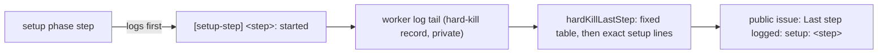

## Summary

A hard kill during setup was filed with `Last step logged: unknown`, because the
setup phase logs nothing the report's step table recognises. It logs only a 60s
`[phase] setup …: still running` ticker, which the report skips as noise. Each
blocking setup step now logs one fixed line as it starts,
`[setup-step] <step>: started`. The hard-kill report maps that line to a fixed
`setup: <step>` label, so the next setup wedge names the step it is in or after.
The setup phase also runs under a one-hour deadline. A setup still running then
is abandoned as a `timeout` failure, and the run's failure path releases the
claim, instead of holding it until the launcher's watchdog reaps the container.
The cause of the #5128 wedge on `GRQ-25` is not established.

## Spec

### Intent and Rationale

- The killed run was working `stSoftwareAU/GRQ#5515`. It claimed the issue at
  12:37:43Z and its log ran until 14:48:26Z, still in `setup`. The report could
  not say which of the dozen setup steps it was in.
- The wedge itself cannot be diagnosed from here, because its evidence is in
  `GRQ-25`'s private archive. A speculative change to setup behaviour would
  breach "no speculative fix for an unreproduced fault". Making the next
  recurrence name the step is the change the evidence supports.

### Essential Design Decisions

- Seven steps log a start line: `issue claim`, `claim churn check`,
  `repository setup`, `heartbeat start`, `default branch sync`, `feature branch`
  and `pre-setup command`. The label names the last step that started, so a
  wedge in a conditional step between two of them (milestone branch, resume,
  session priming) reads as "in or after" the earlier one.
- The step names are a fixed tuple in `worker/deno/lib/setup_steps.ts`, used by
  both the setup phase and the report, so the logged line and the matched line
  cannot drift. The report matches the exact line text with `includes()`, after
  the existing regex table, because Semgrep refuses a regex built at run time
  (`detect-non-literal-regexp`). No log text reaches the public issue.
- The labels are not part of the dedup signature `hard-kill-<handler>-<phase>`.
- The claim hold is the fault this change can fix. The worker's 60s setup ticker
  kept logging for 2h10m after the claim, so the event loop was alive while one
  awaited setup step never returned. `runSetupWithDeadline` in `setup_steps.ts`
  races the setup phase against `SETUP_PHASE_DEADLINE_MS` (one hour) and returns
  a `timeout` failure if setup is still running. It is wired at the setup
  `runPhase` in `issue_worker.ts`. A returned setup failure carries no
  `claimNotHeld`, so `run_core.ts`'s `releaseIssueClaim` unassigns the issue.
  One hour is far past every bounded setup subprocess (git 60-120s, pre-setup
  command 300s by default), so only a wedged step reaches it.

### Undiscoverable Facts

- From `stSoftwareAU/GRQ-VibeCoder-logs`:
  `runs/GRQ-25/2026-11-13/stSoftwareAU-GRQ-5515-vibe-mwey44k4-e5e5c2.metadata.json`
  records `stSoftwareAU/GRQ#5515`, outcome `no_pr`, phase `setup`,
  `failureClass: hard_kill`, and no session log ("agent transcript tee not
  enabled for this run").
- Run id `vibe-mwey44k4` decodes to a start of 2026-11-13T12:21:10Z. The
  GRQ#5515 timeline shows the assignment at 12:37:43Z and an
  assigned-without-heartbeat recovery that unassigned it at 15:03:30Z. No
  release comment was posted. The capture at 15:32:45Z is 3h 11m after the
  start, which fits the launcher's 11400s watchdog.
- The 256 KiB worker-log tail behind the capture, the guest probes and the boot
  logs are in `GRQ-25`'s `~/logs/hard-kill-archive/`, which this host cannot
  read. The guest probe did not answer, so the guest itself had stopped.

## Evidence

Backend-only change; no UI files.

- `worker/deno/tests/setup_step_log_test.ts` drives the real
  `workOnIssueSetupBranch` (`createMockDeps`) and passes the lines it logs to
  `hardKillLastStep`:
  - a failed repository setup logs the first three lines and is labelled
    `setup: repository setup`;
  - a refused claim logs only `issue claim`;
  - a completed setup logs all seven lines in order.
- `worker/deno/tests/setup_deadline_5128_test.ts` covers the deadline:
  - `runSetupWithDeadline` returns the setup result when setup settles first;
  - it ends a setup that never settles with a `timeout` failure;
  - it swallows a rejection that arrives after the deadline;
  - `workOnIssue ends a run whose setup wedges with a setup timeout failure, so the claim is released (Issue #5128)`
    drives `workOnIssue` with a `claimIssue` that never returns and gets a
    `setup` / `timeout` failure without `claimNotHeld`.
- `worker/deno/tests/hard_kill_report_test.ts::hardKillLastStep names each setup step from its start line, past the phase ticker (Issue #5128)`
  covers each of the seven labels behind ticker lines, a later step winning, and
  an unknown step name giving `unknown`.
- Docs updated: the hard-kill sections of `docs/CALLBACKS.md` ("Filing.") and
  `docs/TROUBLESHOOTING.md` list the setup labels. `docs/TROUBLESHOOTING.md`
  also describes the one-hour setup deadline and the claim release. A grep for
  `agent turn` outside `docs/archive/` found no other copy of the label list.
  The `STEP_PATTERNS`, `hardKillLastStep` and `formatHardKillBody` doc comments
  describe the setup match.
- Issue-number provenance: #5095 and #4254 are cited only by existing text the
  docs change re-wraps.

## Reproduction

- **symptom** — a hard kill in setup is filed with `Last step logged: unknown`,
  so the step the guest wedged in is not named
- **status** — `partial` — reason: the missing label is reproduced: on unfixed
  main, `hardKillLastStep` returned `unknown` and the setup phase logged no step
  lines. The `GRQ-25` wedge itself was not reproduced, because its evidence is
  in that host's private archive.
- **regression test** —
  `worker/deno/tests/hard_kill_report_test.ts::hardKillLastStep names each setup step from its start line, past the phase ticker (Issue #5128)`
- **symptom** — a run wedged in setup holds its claim until the launcher's
  watchdog reaps the container, so it never releases the claim
- **status** — `reproduced` — a `workOnIssue` run whose `claimIssue` never
  returns did not return. With the deadline unwired it was still running after
  120s and was stopped; with it wired it returns a `setup` / `timeout` failure
  in about 64ms.
- **regression test** —
  `worker/deno/tests/setup_deadline_5128_test.ts::workOnIssue ends a run whose setup wedges with a setup timeout failure, so the claim is released (Issue #5128)`

## Acceptance Criteria

<!-- vibe-spec-review inputs="diff+issue-body" -->

- **met** — a container wedged and the launcher watchdog reaped it, so the run
  never released its claim — evidence:
  `worker/deno/tests/setup_deadline_5128_test.ts::workOnIssue ends a run whose setup wedges with a setup timeout failure, so the claim is released (Issue #5128)`,
  `worker/deno/lib/setup_steps.ts` (`runSetupWithDeadline`),
  `worker/deno/lib/issue_worker.ts` (setup `runPhase`),
  `worker/deno/lib/run_core.ts` (`releaseIssueClaim`) — reviewer: met

## Test Plan

- [x] Added `worker/deno/tests/setup_step_log_test.ts` (three cases through
      `workOnIssueSetupBranch`).
- [x] Added the setup-label test to
      `worker/deno/tests/hard_kill_report_test.ts`. No existing assertion was
      removed or edited.
- [x] Red on unfixed main: the new report test failed at `issue claim`
      (`hardKillLastStep` returned `unknown`), and the failed-setup and
      completed-setup cases captured no `[setup-step]` lines. The refused-claim
      case's log assertion was first run after the fix.
- [x] Added `worker/deno/tests/setup_deadline_5128_test.ts` (five cases). Red
      with the deadline unwired from `issue_worker.ts`: the `workOnIssue` case
      hung for over 120s and was stopped. The helper cases were first run after
      the fix.
- [x] `deno task test:unit` on `setup_deadline_5128_test.ts`,
      `setup_step_log_test.ts`, `hard_kill_report_test.ts`,
      `issue_worker_test.ts`, `setup_branch_presync_test.ts` and
      `setup_branch_resume_test.ts`: 219 passed, 0 failed.
- [x] `deno task test:unit` on the two test files plus the existing setup-phase
      suites (`setup_branch_presync_test.ts`, `setup_branch_resume_test.ts`,
      `object_store_repair_test.ts`, `setup_broken_ref_repair_test.ts`,
      `lane_scoped_worktree_test.ts`, all under `worker/deno/tests/`): 104
      passed, 0 failed.
- [x] `./quality.sh < /dev/null` on the final code: Result PASSED (with skipped
      checks). Config integration (no `.config.json`) and Checkov (no binary or
      container runtime) were skipped on this host. The first run failed on
      three things, all fixed in the second commit: the Semgrep non-literal
      RegExp, the unclaimed sweep module and the manifest completeness check.
- Callers checked: `hardKillLastStep` is called by `formatHardKillBody`, which
  gets the new labels. `workOnIssueSetupBranch` adds only `logger.info` calls,
  so its control flow is unchanged. `runSetupWithDeadline` has one caller, the
  setup `runPhase` in `workOnIssueCore`. The new module is claimed by
  `docs/audits/lib-sweep-coverage/top-up-5128.json`.

## Merge verification

CI and code review are pending.

## Limitations and remaining risk

This does not fix or explain the wedge itself. A setup wedge in a step between
two start lines is reported as "in or after" the earlier step. The deadline
needs a live worker: if the guest stops first, the watchdog still reaps it and
the assigned-without-heartbeat recovery frees the claim, as before. An abandoned
setup step is not cancelled. If it ever returned after the deadline, the rest of
setup would run on with no run waiting for it. A late `claimIssue` could
re-assign the released issue, a late `startHeartbeat` would leave a heartbeat
running for it, and late git work could clash with the next run on that lane.
The run_core unassign is read from the code, not driven by a test.
