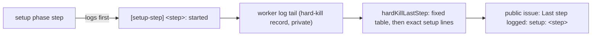

## Summary

A hard kill during setup was filed with `Last step logged: unknown`, because the
setup phase logs nothing the report's step table recognises. It logs only a 60s
`[phase] setup …: still running` ticker, which the report skips as noise. Each
blocking setup step now logs one fixed line as it starts,
`[setup-step] <step>: started`. The hard-kill report maps that line to a fixed
`setup: <step>` label, so the next setup wedge names the step it is in or after.
The setup phase also runs under a deadline of two agent budgets plus 30 minutes.
A setup still running then is abandoned as a `timeout` failure, and the run's
failure path releases the claim it holds, instead of holding it until the
launcher's watchdog reaps the container. The abandoned setup stops at its next
step boundary. The cause of the #5128 wedge on `GRQ-25` is not established.

Part of #5128

## Spec

### Intent and Rationale

- The killed run was working `stSoftwareAU/GRQ#5515`. It claimed the issue at
  12:37:43Z and its log ran until 14:48:26Z, still in `setup`. The report could
  not say which of the dozen setup steps it was in.
- The wedge itself cannot be diagnosed from here, because its evidence is in
  `GRQ-25`'s private archive. A speculative change to setup behaviour would
  breach "no speculative fix for an unreproduced fault". Making the next
  recurrence name the step is the change the evidence supports.

### Essential Design Decisions

- Seven steps log a start line: `issue claim`, `claim churn check`,
  `repository setup`, `heartbeat start`, `default branch sync`, `feature branch`
  and `pre-setup command`. The label names the last step that started, so a
  wedge in a conditional step between two of them (milestone branch, resume,
  session priming) reads as "in or after" the earlier one.
- The step names are a fixed tuple in `worker/deno/lib/setup_steps.ts`, used by
  both the setup phase and the report, so the logged line and the matched line
  cannot drift. The report matches the exact line text with `includes()`, after
  the existing regex table, because Semgrep refuses a regex built at run time
  (`detect-non-literal-regexp`). No log text reaches the public issue.
- The labels are not part of the dedup signature `hard-kill-<handler>-<phase>`.
- The claim hold is the fault this change can fix. The worker's 60s setup ticker
  kept logging for 2h10m after the claim, so the event loop was alive while one
  awaited setup step never returned. `runSetupWithDeadline` in `setup_steps.ts`
  races the setup phase against a deadline and returns a `timeout` failure if
  setup is still running. It is wired at the setup `runPhase` in
  `issue_worker.ts`, with the deadline from
  `deps.infrastructure.setupDeadlineMs` (production: `setupDeadlineMs` in
  `setup_steps.ts`).
- The deadline is `2 × claudeTimeout + 1800s`. Setup is not only bounded
  subprocesses: for a milestone issue the pre-sync runs the conflict-resolution
  agent for up to `claudeTimeout` (`milestone_presync.ts`, `agentTimeoutMs`) and
  may run a repair agent after the gate check, and the clone alone may take 600s
  (`DEFAULT_GH_CLONE_TIMEOUT`). The 1800s covers the clone, git, gates and the
  pre-setup command (300s by default). With the default `claude_timeout` of 3600
  s that is 9000s.
- A failure from the deadline releases only a claim the run holds. Every fleet
  host shares one login, so an unassign from a run that never took the claim
  strips another host's live claim (Issues #1139, #1193). Setup records its
  claim on `PhaseState.setupClaim` (worker id, and `won` once `claimIssue`
  returned `claimed`). When the deadline fires, `workOnIssueCore` treats the
  claim as held if `won` is set or `ownClaimCommentPresent` finds this run's
  `CLAIM_LOCK:<workerId>` comment; otherwise the result carries `claimNotHeld`,
  which `run_core.ts`'s `releaseIssueClaim` honours by releasing nothing. A read
  of the comments that fails counts as not held.
- The abandoned setup is told to stop. `onAbandon` sets `state.setupAbandoned`,
  and `workOnIssueSetupBranch` checks it before each of the seven step start
  lines and right after `claimIssue` and `startHeartbeat` return, so it does no
  further claim, clone, heartbeat or git work. A heartbeat that starts late is
  stopped. A claim won late, when the run did not release it, is unassigned by
  the abandoned setup; one the run already released is not released twice
  (`state.setupClaimReleasedByRun`). Between two step lines the setup does not
  check the flag, so the step that is running when the deadline fires finishes
  its own call (a milestone pre-sync agent run is the longest) before it stops.

### Undiscoverable Facts

- From `stSoftwareAU/GRQ-VibeCoder-logs`:
  `runs/GRQ-25/2026-11-13/stSoftwareAU-GRQ-5515-vibe-mwey44k4-e5e5c2.metadata.json`
  records `stSoftwareAU/GRQ#5515`, outcome `no_pr`, phase `setup`,
  `failureClass: hard_kill`, and no session log ("agent transcript tee not
  enabled for this run").
- Run id `vibe-mwey44k4` decodes to a start of 2026-11-13T12:21:10Z. The
  GRQ#5515 timeline shows the assignment at 12:37:43Z and an
  assigned-without-heartbeat recovery that unassigned it at 15:03:30Z. No
  release comment was posted. The capture at 15:32:45Z is 3h 11m after the
  start, which fits the launcher's 11400s watchdog.
- The 256 KiB worker-log tail behind the capture, the guest probes and the boot
  logs are in `GRQ-25`'s `~/logs/hard-kill-archive/`, which this host cannot
  read. The guest probe did not answer, so the guest itself had stopped.

## Evidence

Backend-only change; no UI files.

- `worker/deno/tests/setup_step_log_test.ts` drives the real
  `workOnIssueSetupBranch` (`createMockDeps`) and passes the lines it logs to
  `hardKillLastStep`:
  - a failed repository setup logs the first three lines and is labelled
    `setup: repository setup`;
  - a refused claim logs only `issue claim`;
  - a completed setup logs all seven lines in order.
- `worker/deno/tests/setup_deadline_5128_test.ts` (11 tests at head) covers the
  deadline:
  - `setupDeadlineMs` exceeds one agent budget plus the clone and pre-setup
    bounds, and grows by two agent budgets per extra `claudeTimeout`;
  - `runSetupWithDeadline` returns the setup result and never abandons when
    setup settles first, and abandons a setup that never settles once, with a
    `timeout` failure;
  - `ownClaimCommentPresent` is true only for a found own claim comment; a
    failed read and a worker id that is not a plain id answer false;
  - through `workOnIssue`: a wedge inside `claimIssue` with no claim of its own
    returns `claimNotHeld`, and a claim that comes back late is released once
    and the setup goes no further; a wedge inside `claimIssue` with this run's
    claim comment present has no `claimNotHeld`, and a late claim is not
    released a second time; a wedge after a won claim has no `claimNotHeld`, and
    a clone that returns late starts no heartbeat and releases nothing; a
    heartbeat that starts after the deadline is stopped; and, for a wedge in
    `checkClaimChurn`, `getRepoDefaultBranch` or `createFeatureBranchFromBase`,
    the next step (`repository setup`, `feature branch`, `pre-setup command`)
    never logs its start line.
- `worker/deno/tests/run_core_test.ts` already drives the consumers of that
  result: "failure path releases the claim (unassign + clear) — Issue #2648
  regression" releases on a failure without `claimNotHeld`, and "a failed run
  that never held the claim releases nothing (Issue #1139)" releases nothing
  with it.
- `worker/deno/tests/hard_kill_report_test.ts::hardKillLastStep names each setup step from its start line, past the phase ticker (Issue #5128)`
  covers each of the seven labels behind ticker lines, a later step winning, and
  an unknown step name giving `unknown`.
- Docs updated: the hard-kill sections of `docs/CALLBACKS.md` ("Filing.") and
  `docs/TROUBLESHOOTING.md` list the setup labels. `docs/TROUBLESHOOTING.md`
  also describes the setup deadline, the claim it releases and the late-step
  stop. A grep for `agent turn` outside `docs/archive/` found no other copy of
  the label list. The `STEP_PATTERNS`, `hardKillLastStep` and
  `formatHardKillBody` doc comments describe the setup match.
- Issue-number provenance: #5095 and #4254 are cited only by existing text the
  docs change re-wraps.

## Reproduction

- **symptom** — a hard kill in setup is filed with `Last step logged: unknown`,
  so the step the guest wedged in is not named
- **status** — `partial` — reason: the missing label is reproduced: on unfixed
  main, `hardKillLastStep` returned `unknown` and the setup phase logged no step
  lines. The `GRQ-25` wedge itself was not reproduced, because its evidence is
  in that host's private archive.
- **regression test** —
  `worker/deno/tests/hard_kill_report_test.ts::hardKillLastStep names each setup step from its start line, past the phase ticker (Issue #5128)`
- **symptom** — a run wedged in setup holds its claim until the launcher's
  watchdog reaps the container, so it never releases the claim
- **status** — `partial` — a `workOnIssue` run whose `claimIssue` never returns
  did not return before the deadline was wired: it was still running after 120s
  and was stopped. With it wired it returns a `setup` / `timeout` failure. The
  `GRQ-25` wedge itself was not reproduced.
- **regression test** —
  `worker/deno/tests/setup_deadline_5128_test.ts::workOnIssue: a wedge after a won claim releases the claim and does no later setup work (Issue #5128)`

## Acceptance Criteria

<!-- vibe-spec-review inputs="diff+issue-body" -->

- **partial** — a container wedged and the launcher watchdog reaped it, so the
  run never released its claim — evidence:
  `worker/deno/tests/setup_deadline_5128_test.ts` (the four `workOnIssue`
  tests), `worker/deno/lib/setup_steps.ts` (`runSetupWithDeadline`,
  `setupDeadlineMs`), `worker/deno/lib/issue_worker.ts` (setup `runPhase`),
  `worker/deno/tests/run_core_test.ts` (the Issue #2648 and #1139 release tests)
  — reviewer: partial — reason: a wedge in a live worker now releases the claim
  the run holds. Not covered: a guest that stops first is still reaped by the
  watchdog and its claim is freed by the assigned-without-heartbeat recovery; a
  `claimIssue` that wedges after its assignment with no claim comment of this
  run's on the issue is left to that recovery; the cause of the `GRQ-25` wedge
  is not established.

## Test Plan

- [x] Added `worker/deno/tests/setup_step_log_test.ts` (three cases through
      `workOnIssueSetupBranch`).
- [x] Added the setup-label test to
      `worker/deno/tests/hard_kill_report_test.ts`. No existing assertion was
      removed or edited.
- [x] Red on unfixed main: the new report test failed at `issue claim`
      (`hardKillLastStep` returned `unknown`), and the failed-setup and
      completed-setup cases captured no `[setup-step]` lines. The refused-claim
      case's log assertion was first run after the fix.
- [x] Added `worker/deno/tests/setup_deadline_5128_test.ts` (11 tests at head).
      With the step-boundary checks in `setup_branch_phase.ts` disabled, the
      no-own-claim, won-claim and late-heartbeat `workOnIssue` tests failed;
      with `state.setupClaimReleasedByRun` forced false, the own-claim-comment
      test failed. The helper tests were first run after the fix. Earlier
      iterations of this file had a constant-restating test and a late-rejection
      test that passed without the code they named; both are removed.
- [x] `deno task test:unit` on `setup_deadline_5128_test.ts`,
      `setup_step_log_test.ts`, `hard_kill_report_test.ts` and the 22 test files
      that call `workOnIssue` or `workOnIssueSetupBranch`: 400 passed, 0 failed.
      `deno task check` type-checked 1176 files without error.
- [x] `./quality.sh < /dev/null` on the final code: Result PASSED (with skipped
      checks). Config integration (no `.config.json`) and Checkov (no binary or
      container runtime) were skipped on this host. The first run failed on
      three things, all fixed in the second commit: the Semgrep non-literal
      RegExp, the unclaimed sweep module and the manifest completeness check.
- Callers checked: `hardKillLastStep` is called by `formatHardKillBody`, which
  gets the new labels. `workOnIssueSetupBranch` has one caller,
  `workOnIssueCore`; its extra return arms are reached only after
  `state.setupAbandoned`, which only the deadline sets. `runSetupWithDeadline`
  has one caller, the setup `runPhase`. `InfrastructureDeps.setupDeadlineMs` is
  built in `issue_worker_wiring.ts` (production and `createMockDeps`), the only
  two constructors. The new module is claimed by
  `docs/audits/lib-sweep-coverage/top-up-5128.json`.
- Branch outcomes: deadline fires with claim won
  (`workOnIssue: a wedge after a
  won claim …`); with own claim comment present
  (`… after this run's claim comment
  landed releases it, once`); with no claim
  of its own (`… with no claim of its
  own does not unassign`); setup settles
  first (`runSetupWithDeadline returns the
  setup result …`); late claim, late
  clone and late heartbeat after abandonment (the same four `workOnIssue`
  tests); unreadable comments and a non-plain worker id
  (`ownClaimCommentPresent …`); abandonment before `repository setup`,
  `feature branch` and `pre-setup command` (the three next-step tests). The
  checkpoint before `default branch sync` is reached only through the
  post-`startHeartbeat` check the late-heartbeat test covers.

## Merge verification

CI and code review are pending.

## Limitations and remaining risk

This does not fix or explain the wedge itself. A setup wedge in a step between
two start lines is reported as "in or after" the earlier step. The deadline
needs a live worker: if the guest stops first, the watchdog still reaps it and
the assigned-without-heartbeat recovery frees the claim, as before. A
`claimIssue` that wedges after its assignment, with no claim comment of this
run's on the issue, is also left to that recovery, because the run cannot prove
the claim is its own. An abandoned setup stops at its next step boundary, not
mid-step: the step running when the deadline fires finishes its own call first.
