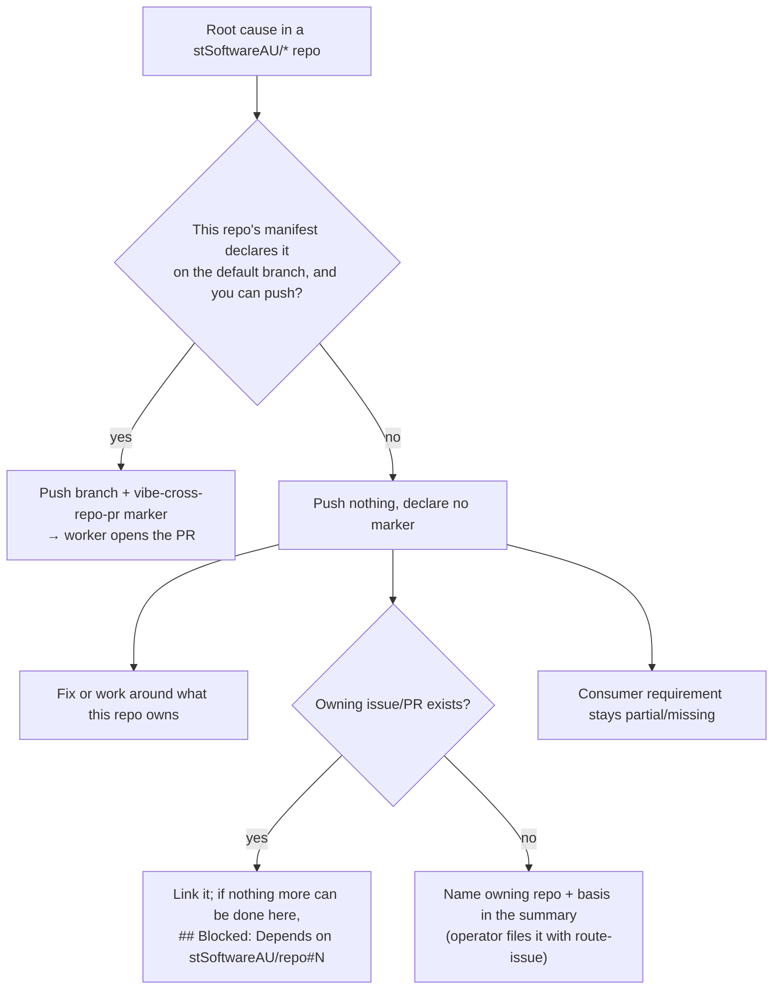

# PR Summary — Issue #5134

## Summary

The agent prompts now define "can access" for an internal `stSoftwareAU/*`
dependency the way the worker enforces it. The consuming repo's own manifest
must declare the dependency on its default branch, and the repo must be
cloneable and pushable. The definition now comes before the push-and-declare
steps, so the agent can check it before pushing anything. A repo the manifests
do not declare, such as one a script checks out, gets its own route: push no
branch, declare no marker, route the rest under `docs/ISSUE-ROUTING.md`, and
keep the consumer's requirement unmet. No worker code changes: the
`authoriseCrossRepoTarget` check (#1382) is unchanged. Closes #5134.

## Spec

### Intent and Rationale

- The guidelines said "can access" meant reachable, while
  `authoriseCrossRepoTarget` (`worker/deno/lib/cross_repo_fix.ts`) refuses any
  target the consumer's manifest does not declare. So a script-consumed sibling
  had no outcome that satisfied the prompts. Each run pushed a branch, had the
  marker refused, and ended in a `needs-human` hand-off (`handOffCrossRepoPr`,
  `worker/deno/lib/cross_repo_pr_handoff.ts`, "Open the PR by hand").
- The issue asked for a wording fix, not a new check, so the prompts now state
  what the worker enforces.

### Essential Design Decisions

- The undeclared route uses only existing mechanisms, as the audit
  reconciliation asks:
  - link an existing owning issue or PR;
  - defer on it with `## Blocked:` and `Depends on stSoftwareAU/<repo>#N`
    (cross-repo references are resolved by `issue_dependencies.ts`, #222);
  - otherwise name the owning repo and basis so an operator can file it with
    `route-issue`, the same wording the planning prompt already uses.
- The agent cannot file the issue itself: the run's `gh` writes reach only the
  claim repo (`gh_guard_decision.ts`, `WRITE_REPO_BLOCKED`).
- A transitive internal dependency is on the marker path only when the consumer
  also declares it, because authorisation reads only the consumer's manifests.
  The "Recurse" bullet now says so.
- An unreachable declared dependency now falls under the same "no branch, no
  marker" bullet, which keeps the old "work around it here" option.
- No new worked example was added: the issue asked only to align example 1, and
  the section is introduced as five cases.

### Undiscoverable Facts

- The three private-fleet runs in the issue are described there without names.
  They were not re-read here.

## Evidence

Prompt and documentation change; no runtime code changed.

Files changed:

- `prompts/coding_guidelines/prompt.md`:
  - The "Can access" definition now names the manifests that
    `CONSUMING_MANIFEST_PATHS` and `CONSUMING_CARGO_MANIFEST` list.
  - The "Recurse" bullet now limits transitive dependencies to declared ones.
  - The "Unreachable internal dependency → treat as external" bullet is replaced
    by "Undeclared or unreachable internal repo → no branch, no marker".
  - "How to open that PR" now says it applies only to a dependency the
    definition covers, and its closing paragraph points back to the definition.
  - Worked example 1 is aligned with the new definition.
- `prompts/issue/prompt.md`: in "No hand-back, no follow-up", "in another
  repository you can reach" is replaced by the same definition, plus one
  sentence on undeclared repos.
- `docs/CROSS-REPO-FIX.md` (step 1 of the bridge) and `DESIGN-PRINCIPLES.md`
  (the internal-dependency section) are brought into line.

Issue numbers the diff adds as provenance:

- #1382: Cross-repo PR bridge + unscoped GitHub App token allow cross-tenant
  writes
- #5134: this issue

Related rules checked:

- Human Escalation ("never files a follow-up issue"): consistent, because the
  undeclared route names the owner and files nothing.
- The `## Blocked:` deferral rules: consistent; cross-repo `Depends on` is
  supported.
- The planning prompt's routing rule: mirrored.
- The External-dependency bullet: kept.
- Release-gating's "exactly one follow-up": applies only to declared
  dependencies after their PR is open. It is untouched, and this change does not
  create a new conflict with it.

I applied the new rule to this PR's own diff and found nothing to fix. The PR
pushes to no other repo and declares no marker.

Docs sweep: I grepped `README.md`, `DESIGN-PRINCIPLES.md`, `CODING-STANDARDS.md`
and `docs/*.md` for `treat.* as external`, `you can
reach`, `can clone it` and
`reachable internal`. The only stale hit was `DESIGN-PRINCIPLES.md`, which is
now fixed. The `internal-reachable` hits in `docs/CROSS-REPO-FIX.md` name a
`resolveCrossRepoTarget` result and are still accurate.

## Test Plan

- Added `worker/deno/tests/cross_repo_access_definition_5134_docs_test.ts`, a
  documentation-drift test with three cases:
  - The guidelines section text before "### How to open that PR" names every
    manifest path, imported live from `worker/deno/lib/cross_repo_fix.ts`, and
    states the default-branch condition.
  - The same text pins the no-branch, no-marker and no-write-authority rule.
  - The issue prompt's "No hand-back, no follow-up" section no longer says "in
    another repository you can reach" and names the manifest condition.
- Red on base: with the two prompt files checked out from `origin/main`, the new
  test gave `FAILED | 0 passed | 3 failed`. With the files restored to HEAD, it
  passes 3 of 3.
- These passed (208 passed, 0 failed):
  - `coding_guidelines_layers_2574_test.ts`, which pins the section headings;
  - `coding_guidelines_twin_drift_test.ts`;
  - `issue_worker_test.ts`;
  - the six tests that read `DESIGN-PRINCIPLES.md`.
- `./quality.sh < /dev/null`: every stage passed except `deno tests`, where
  35241 tests passed and 1 failed. The failure is
  `worker/deno/tests/pr_summary_ci_workflow_3768_test.ts` ("PR summary CI task
  runs git with restricted environment permissions"), which fails here with
  `dns error: failed to lookup address information` while downloading
  `registry.npmjs.org/entities`. That is the container's npm registry outage;
  the test touches none of the changed files. A re-run alone failed the same
  way. The worker re-runs the gate before the PR is raised.
- No existing test was edited, and no assertion was removed.
