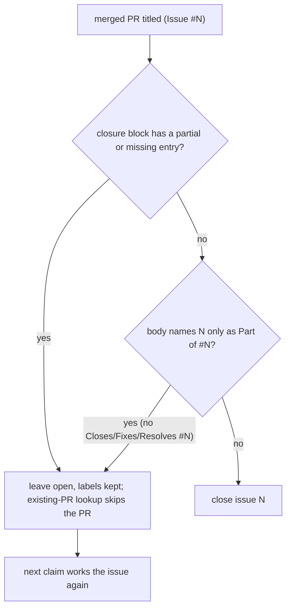

## Summary

Both merged-PR closers used to close an issue from its PR title's `(Issue #N)`,
even when the merged body named that issue only as `Part of #N`. They now leave
such an issue open with its labels, as the babysitter guard and the claim scan
already assumed. The two closers are `closeIssuesForMergedPrs` (priority 1.67)
and `ensureIssueClosedIfPrMerged` (the sweep, recovery and merged-PR pre-check
path). A closing keyword naming the issue still wins, and a body that names the
issue nowhere still closes it from the title.

`findExistingPrForIssue` now skips such a merged PR, as it already skips one
with unmet criteria. Without that skip, the merged-PR pre-check would find the
PR on every claim and exit early, so the issue would stay open but never be
worked. Closes #5135.

## Spec

### Intent and Rationale

- On VibeCoder#5119 and NEAT-AI#4165 a babysitter repair published a body saying
  `Part of #N`, and a closer then closed (or would have closed) the issue from
  the title. Closing loses the record of unfinished work; holding it open and
  queued is what the unmet-entry path already does.
- One helper holds the rule: `namesIssueOnlyAsPartOf`, with its body-reading
  form `bodyNamesIssueOnlyAsPartOf`, in
  `worker/deno/lib/missing_criterion_close_guard.ts`. Four callers share it:
  - both closers;
  - the claim scan's `mergedPrNamesIssue`;
  - the existing-PR lookup.

  So none of them can disagree again.

### Essential Design Decisions

- References are parsed with the existing `extractClosingIssueNumbers` and
  `extractPartOfIssueNumbers`, the parsers `mergedPrNamesIssue` already uses.
  How code spans and Markdown are read is left to #5039.
- The hold matches the unmet-criterion hold. The issue stays open with its
  labels. `closeIssuesForMergedPrs` marks the PR processed and logs a line.
  `ensureIssueClosedIfPrMerged` returns `closed: false` and logs a WARNING once
  per PR and issue, then DEBUG on repeats. Its reason carries no VibeCoder issue
  number. No comment, label or `needs-human` is added.
- **Persisted data (key bumped):** `MergedPR` gains `partOfRefs`, and the closer
  reads it from the `prs_merged_any` file cache, which outlives a restart. That
  key is now `prs_merged_any_v2`, so an older entry without the field is never
  read as "no `Part of`". New `prs_merged_${user}` entries carry the field too,
  but nothing reads it from that key, so that key is not bumped.
- Only `Part of #N` holds the issue open. `Ref #N`, `Refs #N` and similar forms
  do not stop the title closing it, and the babysitter manual now says so.

### Undiscoverable Facts

- `handlePrClosedAfterCreation` (`worker/deno/lib/issue_lifecycle.ts`) closes an
  issue when its own PR was closed and another PR titled for the issue merged.
  It reads titles only and already ignores the unmet-criterion hold. The issue
  names two closers, so this one is unchanged.

## Evidence

Backend-only change; no UI files.

- `worker/deno/tests/part_of_only_close_5135_test.ts` covers both closers, with
  the NEAT-AI#4165 and VibeCoder#5119 body shapes:
  - a `Part of #N`-only body leaves the issue open with no `issue edit` call;
  - `Closes #N` beside `Part of #N` closes it;
  - a body that names the issue nowhere closes it;
  - `Part of` for a different issue does not hold this one;
  - an old `prs_merged_any` cache entry without `partOfRefs` cannot close the
    issue: it stays open with no `issue edit` call;
  - `fetchMergedPRsAnyAuthor` ignores that old entry and carries `partOfRefs`
    from the body.
- The tests check outcomes only. They do not count how many times `gh` was
  called.
- The same file's
  `findExistingPrForIssue - a merged Part of-only PR does not
  suppress the remaining work (cache=false/true)`
  checks three outcomes:
  - the lookup returns no PR;
  - `workOnIssueMergedPrPrecheck` continues instead of exiting early;
  - with `Closes #N` added, the lookup returns the PR.
- Docs updated:
  - `docs/workflows/issue-processing.md`, the "At merge" bullet;
  - `docs/INTERNALS.md`, the closers' closure-block paragraph;
  - `docs/workflows/fleet-pr-babysitter.md`, after the list of non-closing
    references.
- Issue numbers this diff cites: #5135 (this issue).

## Test Plan

- Red runs: each new test was run against the unchanged production code before
  its fix.
  - Closers and cache: run with `--no-check`, because `partOfRefs` was not yet
    on the type. 6 passed and 6 failed. The failures were the `Part of`-only
    cases (both shapes, both closers), the old-cache-entry test and the
    `fetchMergedPRsAnyAuthor` test.
  - Lookup: 12 passed and 2 failed. The failures were the two new
    `findExistingPrForIssue` cases.

  The cases expected to stay green were green.
- After the call-count assertions were removed, the four changed lib files were
  reverted to base and the file was run again with `--no-check`. 6 passed and 8
  failed, the same 8 tests as before. Restoring the head code turned all 14
  green.
- After the fix, from `worker/deno`, `deno task test:unit` passed 1221 tests
  with 0 failures. It covered:
  - `tests/part_of_only_close_5135_test.ts`
  - `tests/missing_criterion_close_guard_3177_test.ts`
  - `tests/pr_issue_linking_test.ts`
  - `tests/issue_lifecycle_test.ts`
  - `tests/issue_lifecycle_cache_test.ts`
  - `tests/closed_pr_blocking_test.ts`
  - `tests/merged_pr_issue_sweep_test.ts`
  - `tests/completion_phase_merged_pr_closure_test.ts`
  - every test file that calls `findExistingPrForIssue` or
    `workOnIssueMergedPrPrecheck`

  An earlier run also passed `tests/issue_query_test.ts`,
  `tests/close_merged_pr_any_author_2537_test.ts` and
  `tests/reasons_no_vibecoder_numbers_4641_test.ts`.
- `./quality.sh` on the final code: every stage passed except `deno tests`,
  which ran 35146 passed and 2 failed. Neither failing test is touched here:
  - `worker/deno/tests/pr_summary_ci_workflow_3768_test.ts` could not download
    `commonmark` from npm ("dns error: failed to lookup address information").
    This is environmental.
  - `worker/deno/tests/ephemeral_root_telemetry_5105_test.ts` is a timing race
    under the parallel pass, and is fixed on the #5161 branch. It passed when
    re-run alone together with the new test file (34 passed).
- No existing test was edited and no assertion was removed. No existing test
  seeded the `prs_merged_any` key.
- Callers checked:
  - `namesIssueOnlyAsPartOf` is called by `closeIssuesForMergedPrs`,
    `mergedPrNamesIssue` and `bodyNamesIssueOnlyAsPartOf`.
  - `bodyNamesIssueOnlyAsPartOf` is called by `ensureIssueClosedIfPrMerged` and
    by both merged-PR skips in `findExistingPrForIssue`.
  - `mergedPrNamesIssue` behaves as before: missing criteria first, then
    `Part of` without a closing keyword, then the closing keyword, then the
    title.
  - `fetchMergedPRsAnyAuthor` has one caller, `closeIssuesForMergedPrs`.
  - `parseMergedPrListing` also feeds `fetchMergedPRsByUser`, whose readers
    (branch cleanup and `handlePrClosedAfterCreation`) do not read `partOfRefs`.
- Branch outcomes:
  - `Part of` only: held. Covered with both body shapes, for both closers.
  - `Part of` plus a closing keyword: closed.
  - No reference to the issue: closed.
  - `Part of` for another issue: closed.
  - Lookup skip: covered on both the cached and uncached paths.
  - The repeated-hold DEBUG path in `ensureIssueClosedIfPrMerged` uses the same
    `shouldWarnDecision` mechanism the missing-criteria hold has tested in
    `tests/missing_criterion_close_guard_3177_test.ts`. No test covers the new
    `part-of-only` key.
