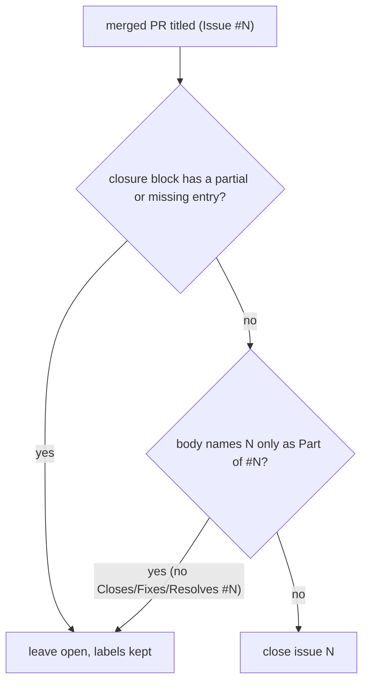

## Summary

Both merged-PR closers used to close an issue from its PR title's
`(Issue #N)`, even when the merged body named that issue only as `Part of #N`.
They now leave such an issue open with its labels, as the babysitter guard and
the claim scan already assumed. The two closers are `closeIssuesForMergedPrs`
(priority 1.67) and `ensureIssueClosedIfPrMerged` (the sweep, recovery and
merged-PR pre-check path). A closing keyword naming the issue still wins, and
a body that names the issue nowhere still closes it from the title.
Closes #5135.

## Spec

### Intent and Rationale

- On VibeCoder#5119 and NEAT-AI#4165 a babysitter repair published a body
  saying `Part of #N`, and a closer then closed (or would have closed) the
  issue from the title. Closing loses the record of unfinished work; holding
  it open is what the unmet-entry path already does.
- The rule moves into one helper, `namesIssueOnlyAsPartOf`
  (`worker/deno/lib/missing_criterion_close_guard.ts`). Both closers and the
  claim scan's `mergedPrNamesIssue` call it, so the three cannot disagree
  again.

### Essential Design Decisions

- References are parsed with the existing `extractClosingIssueNumbers` and
  `extractPartOfIssueNumbers`, the parsers `mergedPrNamesIssue` already uses.
  How code spans and Markdown are read is left to #5039.
- The hold matches the unmet-criterion hold. The issue stays open with its
  labels. `closeIssuesForMergedPrs` marks the PR processed and logs a line.
  `ensureIssueClosedIfPrMerged` returns `closed: false` and logs a WARNING
  once per PR and issue, then DEBUG on repeats. No comment, label or
  `needs-human` is added.
- **Persisted data:** `MergedPR` gains `partOfRefs`, and the closer reads it
  from the `prs_merged_any` file cache, which outlives a restart. That key is
  bumped to `prs_merged_any_v2`, so an older entry without the field is never
  read as "no `Part of`". New `prs_merged_${user}` entries also carry the
  field, but nothing reads it from that key, so that key is not bumped.
- Only `Part of #N` holds the issue open. `Ref #N`, `Refs #N` and similar
  forms do not stop the title closing it, and the babysitter manual now says
  so.

### Undiscoverable Facts

- `handlePrClosedAfterCreation` (`worker/deno/lib/issue_lifecycle.ts`) closes
  an issue when its own PR was closed and another PR titled for the issue
  merged. It reads titles only and ignores both the unmet-criterion and
  `Part of` holds. The issue names two closers, so this one is unchanged.

## Evidence

Backend-only change; no UI files.

- `worker/deno/tests/part_of_only_close_5135_test.ts` covers each case for
  both closers:
  - a `Part of #N`-only body (the NEAT-AI#4165 and VibeCoder#5119 shapes)
    leaves the issue open with no `issue edit` call;
  - `Closes #N` beside `Part of #N` closes it;
  - a body that names the issue nowhere closes it;
  - `Part of` for a different issue does not hold this one;
  - an old `prs_merged_any` cache entry without `partOfRefs` is not served,
    so a live listing happens and the issue stays open;
  - `fetchMergedPRsAnyAuthor` carries `partOfRefs` from the body.
- Docs updated:
  - `docs/workflows/issue-processing.md`, the "At merge" bullet;
  - `docs/INTERNALS.md`, the closers' closure-block paragraph;
  - `docs/workflows/fleet-pr-babysitter.md`, after the list of non-closing
    references.
- Issue numbers this diff cites: #5135 (this issue).

## Test Plan

- Red run: before the fix, the new test file was run against the unchanged
  production code with `--no-check`, because `partOfRefs` was not yet on the
  type. 6 passed and 6 failed. The 6 failures were:
  - `Part of`-only, both shapes, with each closer (4);
  - the old-cache-entry test (1);
  - the `fetchMergedPRsAnyAuthor` test (1).

  The cases expected to stay green were green. The fix and the tests were then
  committed together in `ce59c8d88`.
- After the fix, from `worker/deno`, `deno task test:unit` passed 413 tests
  with 0 failures, over:
  - `tests/part_of_only_close_5135_test.ts`
  - `tests/missing_criterion_close_guard_3177_test.ts`
  - `tests/issue_query_test.ts`
  - `tests/close_merged_pr_any_author_2537_test.ts`
  - `tests/pr_issue_linking_test.ts`
  - `tests/issue_lifecycle_test.ts`
  - `tests/issue_lifecycle_cache_test.ts`
  - `tests/closed_pr_blocking_test.ts`
  - `tests/merged_pr_close_rollback_1770_test.ts`
  - `tests/close_merged_pr_ordering_482_test.ts`
  - `tests/reasons_no_vibecoder_numbers_4641_test.ts`
  - `tests/merged_pr_window_order_2901_test.ts`
  - `tests/milestone_route_restore_test.ts`
  - `tests/completion_phase_merged_pr_closure_test.ts`
  - `tests/merged_pr_issue_sweep_test.ts`
- No existing test was edited and no assertion was removed. No existing test
  seeded the `prs_merged_any` key.
- Callers checked:
  - `namesIssueOnlyAsPartOf` has three callers: the two closers and
    `mergedPrNamesIssue`. `mergedPrNamesIssue` behaves as before: missing
    criteria first, then `Part of` without a closing keyword, then the closing
    keyword, then the title. The claim-scan tests above still pass.
  - `fetchMergedPRsAnyAuthor` has one caller, `closeIssuesForMergedPrs`.
  - `parseMergedPrListing` also feeds `fetchMergedPRsByUser`, whose readers
    (branch cleanup and `handlePrClosedAfterCreation`) do not read
    `partOfRefs`.
- Branch outcomes:
  - `Part of` only: held. Covered with both body shapes, for both closers.
  - `Part of` plus a closing keyword: closed.
  - No reference to the issue: closed.
  - `Part of` for another issue: closed.
  - The repeated-hold DEBUG path in `ensureIssueClosedIfPrMerged` uses the
    same `shouldWarnDecision` mechanism the missing-criteria hold has tested
    in `tests/missing_criterion_close_guard_3177_test.ts`. No test covers the
    new key.
- Full gate: not yet run.
