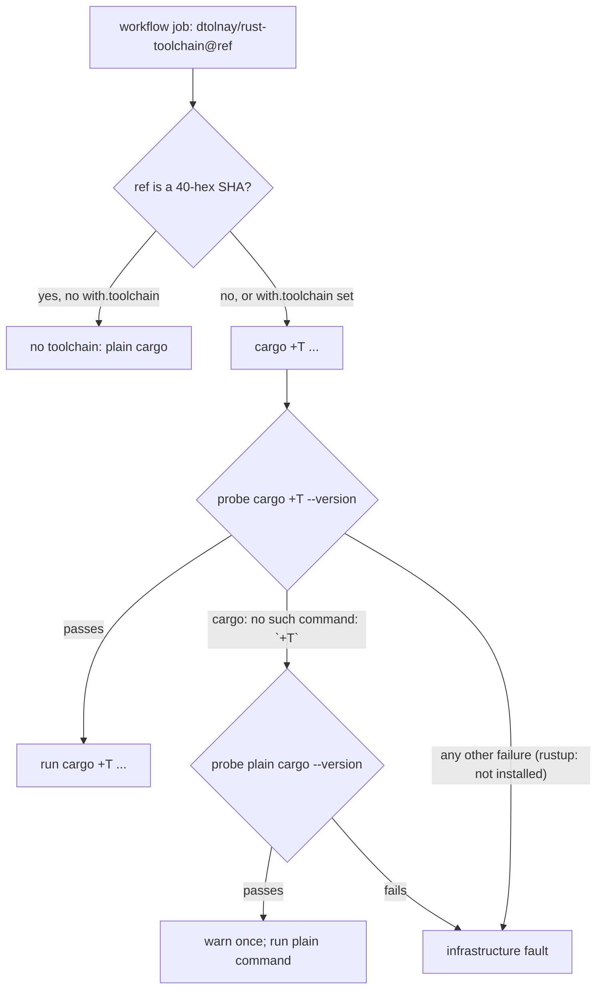

## Summary

A Rust-relevant push is no longer refused as an infrastructure fault just
because a workflow pins `dtolnay/rust-toolchain` to a commit SHA, or because
the worker image's `cargo` is not a rustup proxy.

- `worker/deno/lib/ci_cargo_checks.ts`: in `jobToolchain`, a
  `dtolnay/rust-toolchain@<ref>` whose ref is a full 40-hex commit SHA
  (`COMMIT_SHA`) names no toolchain. `with.toolchain` still wins when present.
  With neither, the job has no toolchain and the CI command runs as plain
  `cargo`, as it already did for a job with no toolchain step.
- `worker/deno/lib/pre_push_gate.ts`:
  - `planChangedFileChecks` records `cargo.plainCommand`, the CI command
    without its `+toolchain` word, when a toolchain is set.
  - `probeCargoToolchains` reads cargo's own refusal of the word
    (``error: no such command: `+…` ``, via `isCargoRefusingToolchainWord`).
    It then re-runs that group's probes without the word. If they pass, the
    gate runs each CI cargo command as `plainCommand` and prints one
    `[PRE_PUSH_WARNING]` line saying so. If the plain probe fails, that failure
    is reported as an infrastructure fault, as before.
  - Rustup's own "toolchain is not installed" output still makes the push an
    infrastructure fault.
- Doc comments in both files, and the CI cargo paragraph of
  `docs/CONFIGURATION.md`, now describe both rules.

Closes #5136.

## Spec

### Intent and Rationale

- The fleet standard pins every action to a commit SHA. `jobToolchain` read
  that SHA as a toolchain name, so the probe ran
  `cargo +29eef336d9b2848a0b548edc03f92a220660cdb8 --version`, which failed, and
  every completion push with a Rust-relevant path in those repos was refused.
- Fixing the SHA alone was not enough. The worker image installs Rust without
  rustup, so `cargo +stable --version` fails here with the same
  `no such command` error. That is the issue's second point, and its proposed
  answer (drop the word when `cargo` is not a rustup proxy) is the one taken.

### Essential Design Decisions

- "Not a rustup proxy" is detected from cargo's own refusal line, not by
  looking for a `rustup` binary. That line is printed only when cargo itself
  receives the `+T` word. A rustup proxy handles the word before cargo sees it,
  and a missing toolchain there gives rustup's "is not installed" error, which
  stays an infrastructure fault.
- Without rustup, every CI cargo command runs with the installed toolchain,
  including one that names a toolchain explicitly (`cargo +nightly clippy`).
  The cost: a check that needs a different toolchain can fail here when it
  would pass in CI. Where the gate has a `compareRef`, a failure the base has
  too is still only a warning. The `[PRE_PUSH_WARNING]` line records the
  substitution.
- Only a full 40-hex ref counts as a SHA. GitHub Actions accepts only full SHAs
  as commit pins, and a shorter hex ref could be a real branch or tag name.

### Undiscoverable Facts

- Observed in this run's container, where `cargo` is `/usr/local/bin/cargo`
  1.99.1 and there is no `rustup`. `cargo +stable --version`,
  `cargo +stable clippy --version` and
  `cargo +29eef336d9b2848a0b548edc03f92a220660cdb8 --version` each exit 101,
  printing ``error: no such command: `+…` `` followed by
  ``help: invoke `cargo` through `rustup` to handle `+toolchain` directives``.
  The test fake `CARGO_NOT_RUSTUP` copies that output.

## Evidence

Backend only: no UI file is touched.

- Issue numbers this diff cites: #5136: "Pre-push cargo probe reads a
  SHA-pinned `dtolnay/rust-toolchain` ref as the toolchain name, so every
  Rust-relevant completion push is refused as `infrastructure-error`
  (NEAT-AI-core#758, #759, #760 and four more public issues)".
- Doc sweep: `docs/CONFIGURATION.md` is the only manual outside
  `docs/archive/` and `docs/audits/` that describes the probe. A search for
  `clippy --version`, `cargo [+toolchain]` and `cargo +T` found nothing else.
  I read its CI cargo checks paragraph through and updated it.

## Test Plan

- `worker/deno/tests/ci_cargo_checks_test.ts`:
  `a dtolnay ref that is a commit SHA names no toolchain (Issue #5136)`.
  - The issue's exact workflow shape gives the argv
    `cargo clippy --workspace --all-targets --all-features -- -D warnings`, with
    no unverifiable entries.
  - A SHA ref plus `with.toolchain: nightly` gives `+nightly`.
  - A SHA-ref job whose command is `cargo +1.80 clippy` keeps `+1.80`.
  - An `@stable` ref still gives `+stable`.
  - Red on the unfixed code: 40 passed, 1 failed, and argv still held
    `+29eef336…`.
- `worker/deno/tests/pre_push_gate_test.ts`. The new tests fake `cargo` with the
  observed refusal for every `cargo +…` command. All three were red on the
  unfixed code: the first with
  ``Rust toolchain unavailable here: `cargo +stable --version` exited 101``.
  - `cargo that is not a rustup proxy runs the CI command without its
    +toolchain word (Issue #5136)`. The gate passes, the only CI run is
    `cargo clippy --all-targets`, and both plain probes ran.
  - `after the no-toolchain fallback a failing plain probe is still
    infrastructure, and no CI cargo command runs (Issue #5136)`.
  - `after the no-toolchain fallback a real clippy lint still blocks, run
    without the +toolchain word (Issue #5136)`. The result is a block, not an
    infrastructure fault.
  - The rustup-present behaviour is still covered by the existing tests, which
    are unchanged: `a CI +toolchain runs its probes and clippy with that
    toolchain`, and `a second toolchain that is missing is infrastructure, and
    no CI cargo command runs`.
- Edited test: `planChangedFileChecks: a CI +toolchain is kept as the cargo
  toolchain`. The expected `cargo` object now also holds
  `plainCommand: "cargo clippy -- -D warnings"`. No assertion was removed.
- Results on the final head (after merging `origin/main`; run from
  `worker/deno` with `deno task test:unit`):
  - `ci_cargo_checks_test.ts` and `pre_push_gate_test.ts`: 227 passed,
    0 failed.
  - Every other test file that imports `ci_cargo_checks.ts` or
    `pre_push_gate.ts` (`completion_phase_pre_push_gate_3689_test.ts`,
    `babysitter_tree_gate_test.ts`, `git_push_preflight_test.ts`,
    `pr_ci_processor_test.ts`, `pr_feedback_review_dismissal_3383_test.ts`,
    `pre_push_gate_cli_test.ts`, `shellcheck_gate_integration_test.ts`,
    `ci_mutation_contract_helpers_test.ts`, `pre_push_gate_cargo_deny_test.ts`,
    `ci_cargo_checks_list_operator_5074_test.ts`, `deno_test_baseline_test.ts`,
    `shellcheck_delegation_5046_test.ts`): 296 passed, 0 failed.
  - The doc tests that read `docs/CONFIGURATION.md`
    (`config_docs_consistency_test.ts`, `doc_prose_claims_test.ts`,
    `markdown_anchors_test.ts` and five more): 62 passed, 0 failed.
  - The full unit suite (`deno task test:unit` with no file list): 34920 and
    885 passed across its two passes, 0 failed. Its only time-budget lines are
    NOT ENFORCED lines for files this diff does not touch.
  - `deno fmt --check` and `deno lint` on the changed source and test files:
    clean.
- `./quality.sh < /dev/null`: not yet run on this head when this summary was
  committed.
  <!-- vibe-quality-gate-skipped reason="the branch was pushed before the full gate so the pre-push unit run could finish inside the run budget; the worker re-runs the gate before the PR" -->

Not done or not checked: the previous attempt's pre-push refusal
(`deno task test:unit (1974 files)` exited 1) was not reproduced; its log is
not on this host, and the full suite passes here. No test asserts the text of
the new `[PRE_PUSH_WARNING]` line. The `compareRef` base comparison is not
driven through the no-rustup path by a test, but it receives the same
rewritten check object as the head run.

🤖 Generated with [Claude Code](https://claude.com/claude-code)
