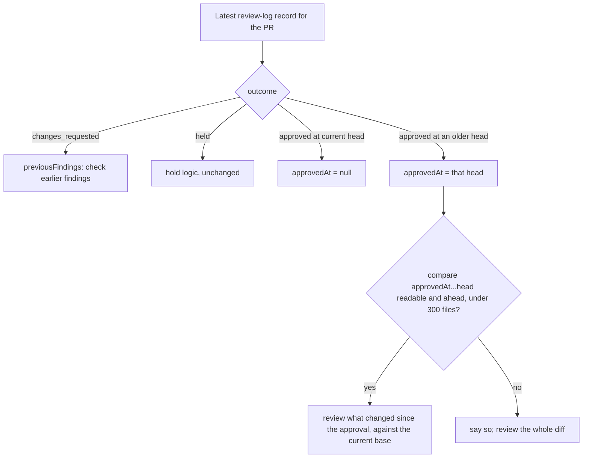

## Summary

When a fleet PR has been approved, any later push (a conflict merge, a version
bump, a two-line cleanup) meant the review-fleet-prs reviewer read the whole
diff again from scratch, and could send the PR back for code it had already
approved. The review after an approval is now anchored to that approval, the
way the review after a send-back is already anchored to its findings.

- `.claude/skills/review-fleet-prs/scripts/review_log.ts`: new
  `earlierApprovedHead(records, repo, number, headSha)` returns the head of the
  PR's latest log record when that record's outcome is `approved` and its head
  is not the current head; otherwise `null`.
- `.claude/skills/review-fleet-prs/scripts/gate.ts`: `ReadyPr` gains
  `approvedAt: string | null`, set from `earlierApprovedHead` on both the ready
  entry and the audit send-back entry.
- `.claude/skills/review-fleet-prs/SKILL.md`: rule 8 and the
  `{{PREVIOUS_FINDINGS}}` field use the issue's proposed wording, plus the
  audit reconciliation. The reviewer reviews what changed since the approved
  head and how it meets the current base. Unchanged code is blocked only for a
  concrete correctness or security defect. The earlier approval is context,
  not an approval of this head. When the comparison cannot be read, the
  reviewer reviews the whole diff.

Closes #5149.

## Spec

### Intent and Rationale

- A full model review of a large diff does not repeat exactly, so each
  from-scratch pass after an approval can find one more test gap in code that
  was already approved. Anchoring to the approved head removes that repeat
  test-adequacy discovery. Changed code and real defects are still reviewed.
- This reuses the existing pattern, `previousFindings` from the latest log
  record. It adds no gate, skip or check.

### Essential Design Decisions

- Only the PR's **latest** log record counts. A later send-back or hold clears
  the anchor (`previousFindings` or the hold logic takes over), and an
  approval at the current head gives `null`, since GitHub's own approval at
  that head already skips the PR.
- The gate does not decide what changed. The reviewer reads
  `compare/{approvedAt}...{headSha}`. If that cannot be read, its `status` is
  not `ahead`, or it lists 300 files, the reviewer says so in its summary and
  reviews the whole diff. An unavailable comparison is never treated as
  "nothing changed" (issue's audit reconciliation of 17 November 2026).
- Unchanged code still blocks on a concrete correctness or security defect,
  including an input-handling defect or one the changed base exposes. It is
  only exempt from general test-adequacy discovery.
- `prompts/pr_review_brief/prompt.md` and `worker/deno/lib/pre_pr_verifier.ts`
  are unchanged, so the worker's pre-PR verifier is unaffected.

### Undiscoverable Facts

- The anchor comes from this host's review log. When the approval was made on
  another host, or by the owner and not by this skill, the field is `null` and
  the review is the full review it was before.
- Observed `gh api repos/stSoftwareAU/VibeCoder/compare/9260f475...c5235ba9`
  (an ancestor compared with its descendant): `"status":"ahead"`. The reverse
  order gives `"status":"behind"`. GitHub's REST docs for "Compare two
  commits" say the response lists at most 300 files, hence the 300-file
  fallback.

## Evidence

Backend and skill-script change only; no UI file is touched.

Issue numbers the diff cites: #5149: review-fleet-prs reviews an approved PR
from scratch after any later push.

## Test Plan

- Added `worker/deno/tests/review_fleet_prs_approved_anchor_5149_test.ts`
  (11 tests):
  - Unit tests of `earlierApprovedHead`:
    - an older approved head is returned;
    - an approval at the current head gives `null`;
    - a later `changes_requested` gives `null`, with an approval-only positive
      control;
    - a later `held` gives `null`;
    - another PR number, another repo and an empty log each give `null`;
    - with two approvals, the latest head is returned.
  - Gate-level tests through the real `pass` export with a seeded `log.jsonl`:
    - an approved record at `approved-head` gives `approvedAt ===
      "approved-head"` and empty `previousFindings`;
    - no log gives `null`;
    - an approval at the current head `head-7` gives `null`.
- TDD: against the unmodified code the new file failed with `does not provide
  an export named 'earlierApprovedHead'`. With only the helper added, the
  three gate tests failed with `undefined vs "approved-head"` and `undefined
  vs null`. After the change, all 11 pass.
- Regression run (`deno task test:unit`), all passing (158 tests):
  - `worker/deno/tests/review_fleet_prs_log_2678_test.ts`
  - `worker/deno/tests/review_fleet_prs_checklists_3594_test.ts`
  - `worker/deno/tests/review_fleet_prs_gate_4347_test.ts`
  - `worker/deno/tests/review_fleet_prs_backlog_3225_test.ts`
  - `worker/deno/tests/review_fleet_prs_dependabot_test.ts`
  - `worker/deno/tests/review_fleet_prs_gate_2675_test.ts`
- Tests that read SKILL.md, all passing (24 tests):
  - `worker/deno/tests/pr_review_brief_shared_3395_test.ts`
  - `worker/deno/tests/review_fleet_prs_learn_3396_test.ts`
  - `worker/deno/tests/review_fleet_prs_private_refs_test.ts`
  - `worker/deno/tests/review_fleet_prs_skill_labels_2882_test.ts`
  - `worker/deno/tests/review_fleet_prs_skill_links_3300_test.ts`
- No existing test or assertion was edited or removed.
- Docs sweep: grepped SKILL.md and `references/*.md` for "fresh review" and
  "No earlier review". Every remaining hit describes a sent-back or held PR,
  so none contradicts the new rule. No `docs/` manual describes rule 8 or the
  gate entry fields.
- Related rules checked: SKILL.md rule 8's sent-back (`awaiting-fix`) and held
  (`awaiting-owner`) paragraphs, which stay as they are, and
  `prompts/pr_review_brief/prompt.md` field 6, which is unchanged.
- Full gate `./quality.sh < /dev/null` on this head: exit 0, `Result: PASSED
  (with skipped checks)`. `config integration` and `checkov` were skipped.

## Not done or not checked

- The `approved-code-reopened-after-push` count over the next 30 days
  (`guidance.ts due`) can only be measured after merge.
- No live review round was run against a real approved-then-pushed PR. The
  brief wording is checked only by the skill's doc tests.
