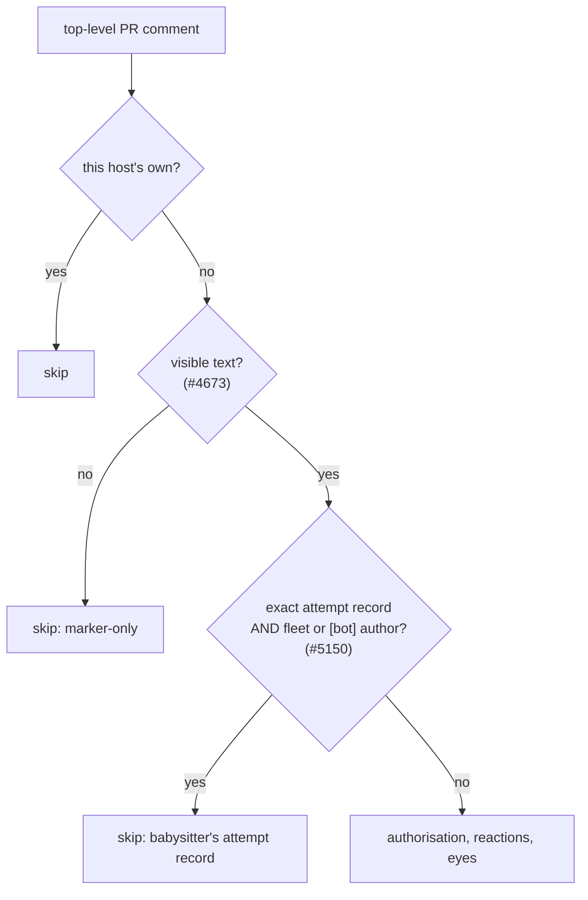

# PR Summary — Issue #5150

## Summary

The PR feedback scan no longer spends a `pr_feedback` run on the fleet PR
babysitter's attempt record. After each repair the babysitter posts a top-level
comment holding the line `Babysitter repair recorded.` and one
`vibe-babysitter-attempt` marker. That line is visible, so the #4673
marker-only skip did not catch it, and the babysitter App is an authorised
commenter, so `findActionableComment` returned the record as feedback.

`findActionableComment` (`worker/deno/lib/pr_maintenance.ts`) now skips a
top-level comment when both of these hold:

- `isBabysitterAttemptRecord` says the body is exactly an attempt record;
- its author is in the fleet set or its login ends in `[bot]`.

The skip runs right after the #4673 skip, before any reaction or authorisation
lookup, and logs an INFO line in the same shape. `isBabysitterAttemptRecord`,
`buildBabysitterAttemptRecordBody` and `BABYSITTER_ATTEMPT_RECORD_LINE` are new
in `worker/deno/lib/babysitter_retry_state.ts`, beside
`buildBabysitterAttemptMarker`. The babysitter's `recordSharedBabysitterAttempt`
now builds its body with the shared builder, so the writer and the reader share
one definition. The posted body is unchanged.

Closes #5150.

## Spec

### Intent and Rationale

- The record is bookkeeping for the babysitter's own retry tally. Each one
  claimed as feedback cost a model run and three PR comments, and held the PR's
  feedback claim.
- The check recognises the record by its exact body, not by the marker
  appearing somewhere. An authorised reviewer who quotes the marker inside a
  real request is still answered.

### Essential Design Decisions

- **The body must be anchored.** After normalising `\r\n` and trimming the end,
  the body must be the record line, a blank line, and one marker, with nothing
  else. The marker must pass the strict attempt-marker parser
  `parseCiFixAttemptMarkers`, using the same name translation as
  `sharedBabysitterAttemptCount`. Anything else returns `false`, so the comment
  is handled as before.
- **Author rule (an assumption).** The issue asks for "the babysitter App or a
  fleet account". The worker knows the App's login only through
  `fleet_pr_authors`, and `addBabysitterLockTrust`
  (`worker/deno/lib/fleet_babysitter_app.ts`) adds it only on the host that ran
  the babysitter setup. So any login ending in `[bot]` (a GitHub App account)
  also counts. Skipping is the safe direction: nothing gets acted on. A human
  account posting the same body is still answered.
- No regex runs over the whole body; the check uses `startsWith`, `endsWith` and
  `split`, so its cost is linear in the body length.

### Undiscoverable Facts

- The real record on VibeCoder#5106, read with
  `gh api repos/stSoftwareAU/VibeCoder/issues/5106/comments`, has author
  `fleet-pr-babysitter[bot]` (type `Bot`) and this body:
  `Babysitter repair recorded.\n\n<!-- vibe-babysitter-attempt signature="c9f80fe32a69743d" check="merge conflict" head="052f6568b09bc5912f249cc32abc0433dea7f471" attempt="1" outcome="pushed" -->`.
  The new test uses that body as a literal fixture.
- The issue cites "Issue #1659" for why the record keeps a visible line, but
  #1659 is an unrelated PR about sweep records. The doc comment states the
  reason without that citation.

## Evidence

Backend-only change: no UI files are touched.

- Red before the fix: the executor first added only the helpers, leaving the
  scan unchanged. Four scan tests in
  `worker/deno/tests/pr_feedback_babysitter_record_5150_test.ts` then failed:
  - "attempt record from the babysitter App is not returned" and "attempt record
    from a fleet account is not returned" both got the comment, not `null`;
  - "record then an ordinary authorised comment" got comment 203 instead of 204;
  - "the skip is logged at INFO once" found 0 skip lines.

  A fifth test, the look-alike case, also failed, but the cause was a bad
  fixture head SHA, which was corrected. After the fix, all seven tests pass.
- Issue and PR numbers this diff cites: #5150 (this issue: "Worker spends a PR
  feedback run on the babysitter's `Babysitter repair recorded.` comment …"),
  #4673 ("Worker spends a PR feedback run on the review-fleet-prs claim marker
  …"). VibeCoder#5106 is named only as the PR where the fixture comment was
  observed.

## Test Plan

- New test file `worker/deno/tests/pr_feedback_babysitter_record_5150_test.ts`,
  which drives the real `findPrCommentsToFix` through a mock `gh`:
  - the record from `fleet-pr-babysitter[bot]` (authorised, not in the fleet
    set) is not returned;
  - the record from a fleet account (`prAuthors`) is not returned;
  - a record followed by an authorised ordinary comment returns the ordinary
    comment;
  - control: the same body from an authorised human is still returned;
  - look-alikes from an App are still returned: leading text, trailing text,
    and the marker in a code span;
  - the skip logs one INFO line naming the comment and PR;
  - `isBabysitterAttemptRecord` accepts the literal from #5106, its CRLF and
    trailing-newline forms, and the builder's output. It rejects a marker-only
    body, a missing marker, a `vibe-ci-fix-attempt` marker, a suffixed marker
    name, two markers, extra text, a missing full stop, leading text, a missing
    `signature`, and an unclosed 100,000-space hostile input.
- No existing test was edited.
- Regression runs:
  - the new file, `worker/deno/tests/pr_feedback_marker_only_comment_4673_test.ts`
    and `worker/deno/tests/babysitter_retry_state_test.ts`: 22 passed;
  - `worker/deno/tests/fleet_pr_babysitter_test.ts` and
    `worker/deno/tests/pr_feedback_trusted_bot_e2e_test.ts`: 126 passed;
  - after the last commit, the new file again: 7 passed.
- Docs: in `docs/INTERNALS.md`, the "Feedback detection" table's
  "Issue/discussion comments" row now names the skip. The doc comment of
  `findActionableComment` gains a matching bullet. A grep of `README.md` and
  `docs/` (excluding `docs/archive/`) for `marker-only`, `4673` and
  `Babysitter repair recorded` found no other description of the scan.
- `./quality.sh < /dev/null`, run on the first commit:
  - every stage passed or was skipped, except `deno tests`, which had 35,140
    passed and 1 failed;
  - the failure is `worker/deno/tests/pr_summary_ci_workflow_3768_test.ts`
    ("PR summary CI task runs git with restricted environment permissions"),
    which downloads from `registry.npmjs.org`. In this container it fails with
    "dns error: failed to lookup address information". This PR does not touch
    it;
  - that failure stopped the gate's serial pass, so I ran
    `deno task test:unit --serial-only` on its own: 936 passed, 0 failed.

  The only later commit edits a doc comment.
