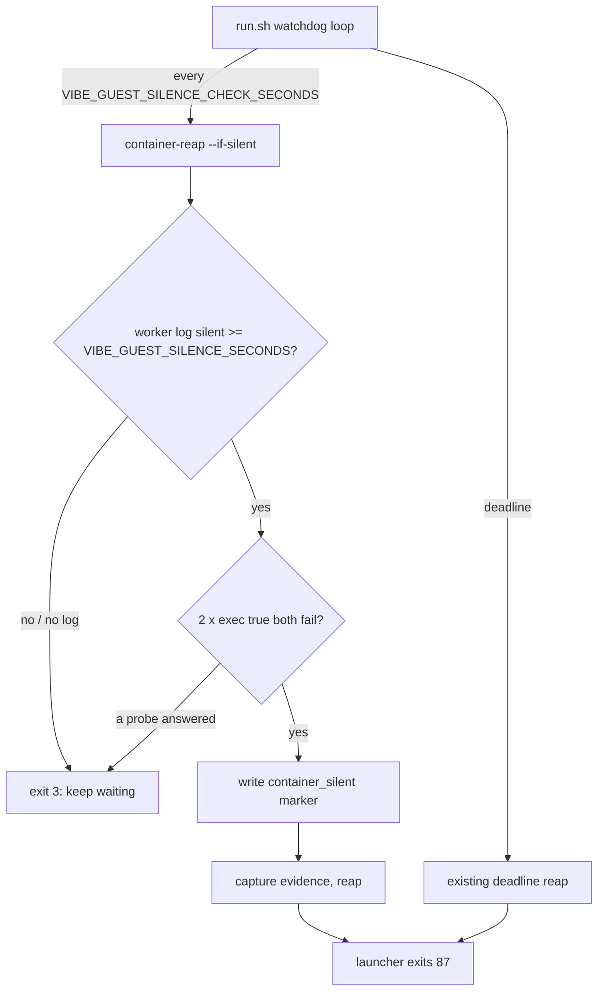

## Summary

On `GRQ-3`, three setup hard kills each report `guest probe: did not answer`. On
17 November the worker log was silent for 1h 5m, well past the 30-minute setup
deadline #5128 added. That deadline runs inside the worker, so it can only fire
while the worker is alive. These guests had stopped answering altogether: it is
the guest-VM wedge of #4173, not a setup step wedging inside a live worker.
Until now `run.sh` reaped such a guest only at the plan's full watchdog deadline
(the 3-hour cap plus 10 minutes).

`run.sh`'s watchdog now also runs an early check. Every
`VIBE_GUEST_SILENCE_CHECK_SECONDS` (default 300) it calls the new
`container-reap --if-silent` mode. That mode reaps only when the newest worker
log has been silent for `VIBE_GUEST_SILENCE_SECONDS` (default 900) **and** two
`container exec <name> true` probes (30s each) both fail. The reap is the
existing one: evidence capture first, then kill, then exit `87`. A guest that
answers is never reaped early. If that early command is cut short after it
decided to reap (for example its evidence capture crosses the remaining-deadline
bound), the watchdog finishes the reap itself instead of trusting the marker.

Closes #5161.

Part of #5105

## Spec

### Intent and Rationale

- The 17 November recurrence stayed silent 35 minutes past the 30-minute setup
  deadline, which means no timer inside the guest was firing. Only the host can
  end that run, so the fix goes in the launcher's watchdog rather than in setup.
- The fix shortens the time a dead guest holds the host and its cycle. The claim
  is still freed by the existing assigned-without-heartbeat recovery (1800s,
  `stuck_detection.ts`), as the #5128 summary records for a guest that stops
  before the deadline.

### Essential Design Decisions

- The check fails safe: with no worker log, a log younger than the threshold, an
  unreadable directory, or any probe that answers, the verdict is "not wedged"
  and the command exits `3` (`GUEST_ANSWERING_EXIT`, mirrored in `run.sh`).
  Silence alone never reaps. A healthy agent turn or quality gate can be quiet
  for a long time, but its guest still answers `exec`.
- The early reap keeps `trigger: "watchdog"`, so the dedup class stays
  `hard-kill-watchdog-<phase>` and a recurrence still lands on this issue. Only
  the evidence `reason` and the public **Reason:** line differ: "The launcher's
  watchdog found the guest silent and not answering its exec probe."
  `parseHardKillEvidence` accepts the deadline shapes, this fixed silence shape
  and, for the cut-short case (see Review round 3), the fixed reason "the
  launcher's early silent-guest reap exited N before it finished", which
  publishes its own **Reason:** line (the early reap was cut short and the
  watchdog finished it).
- `container-reap` writes the wedge marker (`container_silent`) before it kills
  anything, as the deadline path already does. Once the client dies, the
  launcher reads the marker and still exits `87`.
- `VIBE_GUEST_SILENCE_SECONDS` is registered as a `switch`, like
  `VIBE_HOST_DISK_REFRESH_SECONDS`, and not as an `operator_config` setting: `0`
  turns the early reap off and tests shorten it. The `operator_config` count is
  capped, so registering it there would fail the cap test.
- This change is in `run.sh` only. `run.ps1`'s watchdog is unchanged, and it
  already captures no hard-kill evidence (it passes no `--evidence-dir`), so it
  has no worker-log view to check silence against.

### Undiscoverable Facts

- Comparison with the earlier fix: `run.sh` updates the worker checkout on the
  host before every launch (Issue #512). PR #5138 merged on 15 November at
  07:50Z, so each of the three runs most likely ran with the #5128 setup
  deadline. I could not check the deployed version on `GRQ-3`: a failed update
  is only a warning, and the host's archive is private. Either way the 1h 5m
  silence rules out a live worker in setup.
- The last step logged is the most recent step any lane started, so `setup`
  names where the log stopped, not necessarily what stopped the guest. #5062,
  #4743 and #4349 show the same `did not answer` guest wedge on `GRQ-3` in other
  phases.

## Evidence

Backend/launcher-only change; no UI files.

- `worker/deno/tests/run_sh_launcher_test.ts::run.sh - reaps a silent guest that stops answering before the watchdog deadline (Issue #5161)`
  drives the real `run.sh` with a stub runtime whose `exec` fails, a 120s
  deadline and a worker log ten minutes old. It asserts exit 87, the early-reap
  stderr line, that the container is gone from the stub runtime's table (the
  stub's `kill` removes it; the test reads that state, not the call), and a
  hard-kill record whose reason is the silence form with trigger `watchdog`. The
  deadline path would record a different reason.
- `worker/deno/tests/run_sh_launcher_test.ts::run.sh - a silent guest that still answers is left to the deadline (Issue #5161)`
  uses the same silent log but `exec` answers, so the reap comes only at the 6s
  deadline, with the deadline reason. Its probes are slower than the early
  command's bound, so it also asserts the "without reaping" warning that the
  cut-short check logs.
- `worker/deno/tests/run_sh_launcher_test.ts::run.sh - an early reap cut short by the deadline is finished, not trusted (Issue #5161)`
  authorises the reap with two instantly failing probes, then stalls the first
  evidence read past the early command's bound (a stub `logs` arm, first call
  only). The early command dies after writing the marker and before its kill. It
  asserts exit 87, the "before it finished" warning, that the stub runtime's
  container table no longer holds the container, and that one hard-kill record
  carries the "early silent-guest reap exited N before it finished" reason. It
  fails against the previous `run.sh` (the warning is absent; the early branch
  trusted the marker).
- `worker/deno/tests/guest_silence_watch_test.ts` covers each verdict of
  `checkGuestSilence`: wedged, a probe that answers, a log under the threshold
  (no probe run), no log, and disabled. It also covers
  `resolveGuestSilenceSeconds` for unset, `0`, valid and invalid values.
- `worker/deno/tests/container_reap_command_test.ts` covers the `--if-silent`
  mode against a stateful fake runtime (a table of running containers; `kill`
  removes one and the listing reports the rest). An answering guest exits 3 and
  is still running, with nothing written. A silent, unanswering guest gets the
  marker, is gone from the table and reports `reaped`, with the silence reason
  in its evidence. A run without `--evidence-dir` is refused and the guest is
  still running.
- `worker/deno/tests/hard_kill_report_test.ts` checks that the silence reason
  parses, the issue body carries the new public reason, the failure class is
  unchanged, and a reason with invented wording is still rejected.
- Docs: `docs/TROUBLESHOOTING.md` ("A container that stopped answering (exit
  87)"), `docs/workflows/resilience-and-concurrency.md` (outer watchdog) and the
  settings table in `docs/DEPLOYMENT.md` (both new variables). A grep for
  "watchdog deadline expired" in the docs outside `docs/archive/` finds no stale
  sentence.
- Issue numbers cited: #5161 (this issue), #5128 and PR #5138 (the earlier
  setup-deadline fix), #4173 (the guest-VM wedge watchdog), #512 (the per-launch
  checkout update), and #5062, #4743 and #4349 (the same `did not answer` wedges
  in other phases).

## Reproduction

- **symptom** — a guest that stopped answering was held until the launcher's
  full watchdog deadline (the 17 November run was silent 1h 5m before capture)
- **status** — `verified` — I checked out the base-branch `run.sh`,
  `container_reap.ts`, `hard_kill_report.ts` and `hard_kill_evidence.ts`, kept
  the new tests and harness, and ran
  `deno test --allow-all tests/run_sh_launcher_test.ts --filter "Issue #5161"`.
  The early-reap test failed (1 passed, 1 failed: the record carried the
  deadline reason) and passes on head. The guest wedge itself was not
  reproduced, because its evidence is in `GRQ-3`'s private archive.
- **regression test** —
  `worker/deno/tests/run_sh_launcher_test.ts::run.sh - reaps a silent guest that stops answering before the watchdog deadline (Issue #5161)`

## Test Plan

- [x] From `worker/deno`, run per file on this head, 0 failed in each:
      `tests/guest_silence_watch_test.ts` (10 tests at head),
      `tests/container_reap_command_test.ts` (10 tests at head),
      `tests/hard_kill_report_test.ts` (71 tests at head),
      `tests/hard_kill_evidence_test.ts` (32 tests at head),
      `tests/container_watchdog_test.ts` (37 tests at head),
      `tests/run_core_hard_kill_test.ts` (3 tests at head).
- [x] `deno test --allow-all tests/run_sh_launcher_test.ts` (the whole launcher
      file) gave 123 passed, 0 failed before the round-4 edits; the three Issue
      #5161 launcher tests pass at head.
- [x] `deno fmt --check`, `deno lint` and `deno check` pass on the changed TS
      files. `bash -n run.sh` and `shellcheck run.sh` are clean.
- [x] `./quality.sh` on the final code: every stage passed except `deno tests`.
      Its one failure is
      `worker/deno/tests/pr_summary_ci_workflow_3768_test.ts`, which could not
      download `commonmark` from the npm registry ("dns error: failed to lookup
      address information: Temporary failure in name resolution"). The failure
      is environmental and that test is not touched here. The completeness stage
      passes after two declarations: `VIBE_GUEST_SILENCE_SECONDS` is registered
      in `worker/deno/lib/vibe_env_registry.ts` with role `switch`, and the new
      module is claimed by `docs/audits/lib-sweep-coverage/top-up-5161.json`.
- [x] `worker/deno/tests/ephemeral_root_telemetry_5105_test.ts` (the slow-scan
      ordering test of #5105 "Agent-owned ephemeral cargo target dirs cannot be
      released mid-cycle (EACCES)…", opened by a maintainer; this PR links it
      with `Part of #5105` because it only de-flakes that test's race guard)
      lost a race under the pre-push gate's loaded parallel pass: its zero-delay
      timer beat the probe's verdict. The guard timer is now 10s and is cleared
      once the race settles, so it only bounds a probe that really blocks on the
      never-completing scan. No assertion was removed: the verdict is still
      asserted to be the host-disk-below-floor reason, and a probe blocked on
      the scan still resolves the guard instead. The
      `docs/audits/lib-sweep-coverage/top-up-5161.json` `sweptAt` is the
      `origin/main` merge-base (not a branch commit), which `sweep-drift`
      checks.
- The answering-guest launcher test is expected to pass on base too: it pins
  that a guest that answers is not reaped early.
- No assertion was removed from any existing test. The stub runtime's new
  `exec)` arm defaults to exit 0, the same as the old `*)` arm, so existing
  launcher tests see no change.
- Callers checked: `publicReason` has one caller (`formatHardKillBody`), which
  now passes the reason. `reap()` keeps its one-argument call sites, and the new
  second parameter is optional. The deadline path in `run.sh` and
  `container-reap` behaves as before.
- Branch outcomes: disabled, listing failure, no log, under threshold, a probe
  answering, all probes failing, and a probe that throws
  (`guest_silence_watch_test.ts`). For the launcher: exit 3 keeps waiting
  (answering-guest test), and a written marker with an early command that exited
  0 means an early reap (silent-guest test). Any other exit with no marker logs
  a warning and keeps the deadline (the answering-guest launcher test asserts
  the warning). A non-zero exit with a marker (the reap was cut short) logs a
  warning and runs the ordinary reaper with its own budget (the cut-short
  launcher test).
- Twinned copies: `GUEST_ANSWERING_EXIT` (TS) and its `run.sh` copy. The
  launcher tests exercise both sides together. `run.ps1` is deliberately not
  changed (see Essential Design Decisions).

## Limitations and remaining risk

- The cause of the guest wedge on `GRQ-3` is not diagnosed. This change limits
  how long a wedge costs; it does not prevent one.
- A guest that answers `exec` while its worker is wedged inside the VM is still
  left to the in-worker deadlines and the watchdog deadline.
- `run.ps1` hosts get no early reap.

🤖 Generated with [Claude Code](https://claude.com/claude-code)

## Review fixes and validation

The watchdog now measures elapsed time, including probe commands, and bounds
each early check by the remaining deadline budget. Without a host timeout
command it skips early checks. A fresh worker-log listing and fresh clock
reading after the failed probes prevent reaping a guest that resumed logging;
unavailable fresh evidence also retains the guest. Updated the resilience
documentation.

Replaced probe call-count/order assertions with outcome assertions. Added
resumed logging and unavailable-fresh-evidence regressions. The launcher fixture
can delay exec responses and records runtime-start timestamps; the
answering-guest test asserts deadline evidence capture starts within ten seconds
of runtime start for a six-second deadline. This excludes unrelated setup and
cleanup overhead. The two watchdog fixtures disable the unrelated host disk
floor to reach the watchdog on small test hosts.

Validation: 10 guest-silence tests and both Issue #5161 launcher tests pass.
Restoring the original run.sh makes the delayed-answering regression fail on its
deadline assertion. Shell syntax and diff whitespace checks pass. Local runs
used temporary dependency mappings and --no-check; those environment changes are
not committed. Hosted CI must validate the normal dependency setup.

## Review round 3

The marker `container_silent` records the decision to reap, not a finished reap:
`container-reap` writes it before evidence capture and kill. `run.sh` now trusts
it only when the early command exited 0. After a non-zero exit with the marker
present (cut short by the remaining-deadline bound, or the container survived)
the watchdog leaves the loop and runs the ordinary reaper with its 300-second
budget and a reason naming the unfinished early reap. The marker keeps
`container_silent`, so the launcher still reports the early reap and exits 87.
`docs/TROUBLESHOOTING.md`, `docs/workflows/resilience-and-concurrency.md` and
the `container_reap.ts` header say so.

The command and launcher tests no longer assert recorded runtime calls. The
command test uses a fake runtime with a container table, and the launcher stub
keeps `containers/<name>` from `run` until an accepted `kill`; tests read that
state. The earlier `#5105` telemetry test change is now tied to `#5105` (see the
Test Plan).

Validation on this head: 0 failed in each of the six files listed in the Test
Plan; 123 passed, 0 failed for `run_sh_launcher_test.ts`; `deno fmt --check`,
`deno lint` and `deno check` clean on the changed TS; `shellcheck run.sh` clean.
The full `./quality.sh` was not run in this round.

## Review round 4

The completing reap's reason ("the launcher's early silent-guest reap exited N
before it finished") was rejected by `parseHardKillEvidence`, so that record was
never filed or archived. The parser now accepts that fixed shape
(`worker/deno/lib/hard_kill_report.ts`) with its own public reason, and the
cut-short launcher test parses the record it leaves. `run.sh` also skips the
second evidence capture when the early command already wrote a
`hard-kill-<container>-*.json` record. The stale Limitations bullet about probe
time is removed: probe time counts towards the deadline and each early check is
bounded by the remaining budget. `docs/TROUBLESHOOTING.md` is updated.

Validation on this head: `tests/hard_kill_report_test.ts` 71 passed, 0 failed;
the three Issue #5161 launcher tests in `tests/run_sh_launcher_test.ts` pass;
`shellcheck run.sh` clean. The later regression below now exercises interruption after the evidence
record is written and the attached client is killed. The full `./quality.sh` was not run in this round.

## Client-death cleanup regression

The launcher keeps its watchdog alive while an authorised reap completes,
and the completing reap no longer requires the attached client to be alive.
The new launcher test interrupts the real reaper after its client SIGKILL,
during the process-table read and before helper cleanup. The test supplies
only its own helper PID through the simulated process table and uses a real
sleep process as that helper; no unrelated host process is exposed to killing.
It asserts the container table is cleared, the helper exits from SIGKILL,
and the launcher exits 87. A bounded wait catches a surviving helper.

The regression fails against `727f6152`'s launcher because the container is
left standing, and passes against `91a8bc5b`. All four Issue #5161 launcher
tests pass together (4 passed, 0 failed). Existing assertions are retained.
These local runs use temporary standard-library mappings and `--no-check`;
the dependency files are restored and are not part of the commit. Hosted CI
must validate type checking with the normal dependencies.
