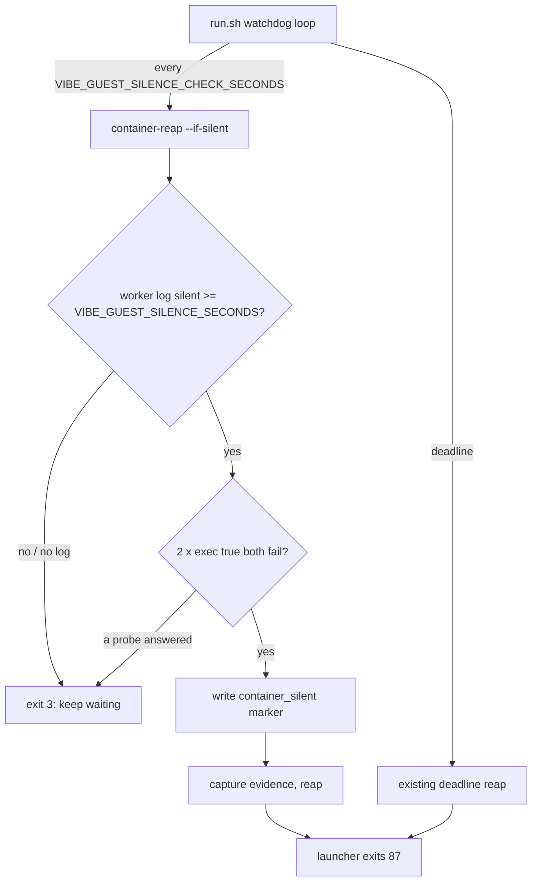

## Summary

On `GRQ-3`, three setup hard kills each report `guest probe: did not answer`.
On 17 November the worker log was silent for 1h 5m, well past the 30-minute
setup deadline #5128 added. That deadline runs inside the worker, so it can
only fire while the worker is alive. These guests had stopped answering
altogether: it is the guest-VM wedge of #4173, not a setup step wedging inside
a live worker. Until now `run.sh` reaped such a guest only at the plan's full
watchdog deadline (the 3-hour cap plus 10 minutes).

`run.sh`'s watchdog now also runs an early check. Every
`VIBE_GUEST_SILENCE_CHECK_SECONDS` (default 300) it calls the new
`container-reap --if-silent` mode. That mode reaps only when the newest worker
log has been silent for `VIBE_GUEST_SILENCE_SECONDS` (default 900) **and** two
`container exec <name> true` probes (30s each) both fail. The reap is the
existing one: evidence capture first, then kill, then exit `87`. A guest that
answers is never reaped early. Closes #5161.

## Spec

### Intent and Rationale

- The 17 November recurrence stayed silent 35 minutes past the 30-minute setup
  deadline, which means no timer inside the guest was firing. Only the host can
  end that run, so the fix goes in the launcher's watchdog rather than in
  setup.
- The fix shortens the time a dead guest holds the host and its cycle. The
  claim is still freed by the existing assigned-without-heartbeat recovery
  (1800s, `stuck_detection.ts`), as the #5128 summary records for a guest that
  stops before the deadline.

### Essential Design Decisions

- The check fails safe: with no worker log, a log younger than the threshold, an
  unreadable directory, or any probe that answers, the verdict is "not wedged"
  and the command exits `3` (`GUEST_ANSWERING_EXIT`, mirrored in `run.sh`).
  Silence alone never reaps. A healthy agent turn or quality gate can be quiet
  for a long time, but its guest still answers `exec`.
- The early reap keeps `trigger: "watchdog"`, so the dedup class stays
  `hard-kill-watchdog-<phase>` and a recurrence still lands on this issue. Only
  the evidence `reason` and the public **Reason:** line differ: "The launcher's
  watchdog found the guest silent and not answering its exec probe."
  `parseHardKillEvidence` accepts that one fixed reason shape and nothing else.
- `container-reap` writes the wedge marker (`container_silent`) before it kills
  anything, as the deadline path already does. Once the client dies, the
  launcher reads the marker and still exits `87`.
- This change is in `run.sh` only. `run.ps1`'s watchdog is unchanged, and it
  already captures no hard-kill evidence (it passes no `--evidence-dir`), so it
  has no worker-log view to check silence against.

### Undiscoverable Facts

- Comparison with the earlier fix: `run.sh` updates the worker checkout on the
  host before every launch (Issue #512). PR #5138 merged on 15 November at
  07:50Z, so each of the three runs most likely ran with the #5128 setup
  deadline. I could not check the deployed version on `GRQ-3`: a failed update
  is only a warning, and the host's archive is private. Either way the
  1h 5m silence rules out a live worker in setup.
- The last step logged is the most recent step any lane started, so `setup`
  names where the log stopped, not necessarily what stopped the guest. #5062,
  #4743 and #4349 show the same `did not answer` guest wedge on `GRQ-3` in
  other phases.

## Evidence

Backend/launcher-only change; no UI files.

- `worker/deno/tests/run_sh_launcher_test.ts::run.sh - reaps a silent guest that stops answering before the watchdog deadline (Issue #5161)`
  drives the real `run.sh` with a stub runtime whose `exec` fails, a 120s
  deadline and a worker log ten minutes old. It asserts exit 87, the early-reap
  stderr line, the kill, and a hard-kill record whose reason is the silence
  form with trigger `watchdog`. The deadline path would record a different
  reason.
- `worker/deno/tests/run_sh_launcher_test.ts::run.sh - a silent guest that still answers is left to the deadline (Issue #5161)`
  uses the same silent log but `exec` answers, so the reap comes only at the 6s
  deadline, with the deadline reason.
- `worker/deno/tests/guest_silence_watch_test.ts` covers each verdict of
  `checkGuestSilence`: wedged, a probe that answers, a log under the threshold
  (no probe run), no log, and disabled. It also covers
  `resolveGuestSilenceSeconds` for unset, `0`, valid and invalid values.
- `worker/deno/tests/container_reap_command_test.ts` covers the `--if-silent`
  mode. An answering guest exits 3 with nothing killed or written. A silent,
  unanswering guest gets the marker and is reaped with the silence reason in
  its evidence. A run without `--evidence-dir` is refused.
- `worker/deno/tests/hard_kill_report_test.ts` checks that the silence reason
  parses, the issue body carries the new public reason, the failure class is
  unchanged, and a reason with invented wording is still rejected.
- Docs: `docs/TROUBLESHOOTING.md` ("A container that stopped answering (exit
  87)"), `docs/workflows/resilience-and-concurrency.md` (outer watchdog) and
  the settings table in `docs/DEPLOYMENT.md` (both new variables). A grep for
  "watchdog deadline expired" in the docs outside `docs/archive/` finds no stale
  sentence.
- Issue numbers cited: #5161 (this issue), #5128 and PR #5138 (the earlier
  setup-deadline fix), #4173 (the guest-VM wedge watchdog), #512 (the per-launch
  checkout update), and #5062, #4743 and #4349 (the same `did not answer`
  wedges in other phases).

## Reproduction

- **symptom** — a guest that stopped answering was held until the launcher's
  full watchdog deadline (the 17 November run was silent 1h 5m before capture)
- **status** — `verified` — I checked out the base-branch `run.sh`,
  `container_reap.ts`, `hard_kill_report.ts` and `hard_kill_evidence.ts`, kept
  the new tests and harness, and ran
  `deno test --allow-all tests/run_sh_launcher_test.ts --filter "Issue #5161"`.
  The early-reap test failed (1 passed, 1 failed: the record carried the
  deadline reason) and passes on head. The guest wedge itself was not
  reproduced, because its evidence is in `GRQ-3`'s private archive.
- **regression test** — `worker/deno/tests/run_sh_launcher_test.ts::run.sh - reaps a silent guest that stops answering before the watchdog deadline (Issue #5161)`

## Test Plan

- [x] From `worker/deno`:
      `deno test --allow-all tests/guest_silence_watch_test.ts tests/container_reap_command_test.ts tests/hard_kill_report_test.ts tests/hard_kill_evidence_test.ts tests/container_watchdog_test.ts tests/run_core_hard_kill_test.ts`
      gave 159 passed, 0 failed.
- [x] `deno test --allow-all tests/run_sh_launcher_test.ts` (the whole launcher
      file) gave 122 passed, 0 failed.
- [x] `deno fmt --check`, `deno lint` and `deno check` pass on the changed TS
      files. `bash -n run.sh` and `shellcheck run.sh` are clean.
- The answering-guest launcher test is expected to pass on base too: it pins
  that a guest that answers is not reaped early.
- No assertion was removed from any existing test. The stub runtime's new
  `exec)` arm defaults to exit 0, the same as the old `*)` arm, so existing
  launcher tests see no change.
- Callers checked: `publicReason` has one caller (`formatHardKillBody`), which
  now passes the reason. `reap()` keeps its one-argument call sites, and the
  new second parameter is optional. The deadline path in `run.sh` and
  `container-reap` behaves as before.
- Branch outcomes: disabled, listing failure, no log, under threshold, a probe
  answering, all probes failing, and a probe that throws
  (`guest_silence_watch_test.ts`). For the launcher: exit 3
  keeps waiting (answering-guest test), and a written marker means an early
  reap (silent-guest test). Any other exit with no marker logs a warning and
  keeps the deadline; no test reaches that path.
- Twinned copies: `GUEST_ANSWERING_EXIT` (TS) and its `run.sh` copy. The
  launcher tests exercise both sides together. `run.ps1` is deliberately not
  changed (see Essential Design Decisions).

## Limitations and remaining risk

- The cause of the guest wedge on `GRQ-3` is not diagnosed. This change limits
  how long a wedge costs; it does not prevent one.
- A guest that answers `exec` while its worker is wedged inside the VM is
  still left to the in-worker deadlines and the watchdog deadline.
- Each early check that probes adds up to about 60s before the deadline count
  resumes, because `waited` counts only the loop's sleeps.
- `run.ps1` hosts get no early reap.

🤖 Generated with [Claude Code](https://claude.com/claude-code)
