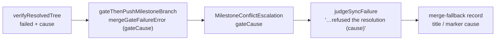

# PR Summary — Issue #5162

## Summary

The merge-fallback record for a refused milestone resolution now names the
gate's cause. Before, it said only "the merge gate refused the resolution", so
nobody could tell a failed check from a timed-out one. `verifyResolvedTree` now
sets a `MergeGateCause` on every `failed` outcome, and
`syncMilestoneBranchWithDefault` passes it on the `MilestoneConflictEscalation`
(new `gateCause` field). `judgeSyncFailure` then reports
`the merge gate refused the resolution (<cause>)`, using the same phrases as the
merged-tree rows of Issue #4847. The refusal is still `not-charged` and still
counted in `refusedCycles`. Closes #5162.

## Spec

### Intent and Rationale

- The fallback in #5162 was refused for three cycles in a row, with 466s spent
  in the gate, and the record could not say why. The merged-tree path already
  named its cause (Issue #4847); the resolution path lost it. This change reuses
  that cause vocabulary instead of adding a new one.
- The source repository is private, so the actual failure can't be diagnosed
  from here. The fix makes the next fallback diagnosable rather than guessing at
  this one.

### Essential Design Decisions

- A step killed at its time limit (`timedOut`) is `check-timed-out`, not
  `tree-check-failed`. An exhausted gate budget is `check-timed-out`, an
  exception from the runner is `check-could-not-run`, and a missing or
  unreadable tree is `tree-unreadable`.
- An escalation with no cause, or with an unknown cause value, keeps the bare
  reason (`isMergeGateCause` guards it), so older escalations read exactly as
  before.
- Charging is unchanged. Every resolution refusal stays `not-charged` and counts
  toward the refusal ceiling. Only the reason text changes.
- `mergeFallbackCause` dedups by title, so the bare-cause record (#5162) and
  each new `(…)` variant are now separate records, one per gate cause. Nothing
  renames the open record.

### Undiscoverable Facts

- The issue's run ran on `vibe-coder-88719`, with gate 466s and agent 288s. Its
  repository is private, so its check output was not available to this run.

## Evidence

Backend-only change; there is no UI surface. The cause now flows as follows:

- `worker/deno/tests/milestone_resolution_gate_cause_5162_test.ts` drives the
  real `syncMilestoneBranchWithDefault` on a temporary git remote. A gate that
  times out reaches `judgeSyncFailure` with
  `the merge gate refused the resolution (the check timed out)`. A climbed
  refusal reaches `mergeFallbackCause` with its cause intact.
- Provenance cited: #4847: Merge fallback: the merge gate refused the merged
  tree. #4456: A merge fallback is a VibeCoder failure: file it in VibeCoder,
  never as a new product-repo issue. #4328: Three VibeCoder milestones fail to
  sync with main every cycle and fall further behind.
- Docs updated:
  - `docs/INTERNALS.md`, the conflict-ledger row "Merge gate refused the
    resolution".
  - `docs/workflows/merge-conflicts.md`, the bullet "One issue per cause, not
    one per event".
- Docs read with no change needed:
  - `docs/workflows/milestones.md`, the refusal-ceiling paragraph and diagram.
  - `docs/MERGE.md`, the Not-charged row.

## Reproduction

- **symptom** — a merge-fallback issue whose cause read only "the merge gate
  refused the resolution", with no word on whether the check failed, timed out
  or could not run
- **status** — `verified` — with the base branch's production files restored, 8
  of the 10 new tests failed: the end-to-end sync, both
  `judgeSyncFailure`/`mergeFallbackCause` cause cases, and five
  `verifyResolvedTree` cause cases. All 10 pass at head. The other two pin
  behaviour that was already correct: the bare reason with no cause, and a
  type-check outcome's cause passed through.
- **regression test** —
  `worker/deno/tests/milestone_resolution_gate_cause_5162_test.ts::syncMilestoneBranchWithDefault - a refused resolution carries the gate's cause into the ledger reason (Issue #5162)`

## Test Plan

- Added `worker/deno/tests/milestone_resolution_gate_cause_5162_test.ts` (10
  tests). It covers every new cause branch in `verifyResolvedTree`: step exit 1,
  step timed out, runner throws, missing tree, budget exhausted and type-check
  pass-through. It also covers the bare/forged-cause fallback in
  `judgeSyncFailure`. No existing test was edited.
- Base-branch red run: production files were checked out from the base, and the
  test's one new import (`MERGE_GATE_REFUSED_RESOLUTION`) was inlined into a
  scratch copy, which was then deleted. Result: 8 failed, 2 passed.
- Regression suites: `deno task test:unit` over the 17 existing test files that
  reference `judgeSyncFailure`, `verifyResolvedTree`,
  `MilestoneConflictEscalation`, `mergeFallbackCause` or the reason text all
  passed (335 passed, 0 failed).
- Callers checked: `MilestoneConflictEscalation` is constructed at two sites in
  `worker/deno/lib/git_pull.ts`. The gate-refusal site passes
  `mergeGateFailureCause(gatedResolved.error)`. The ladder-escalation site has
  no gate verdict, so it passes nothing and keeps the bare reason. The
  `syncMilestoneBranches` log line now prints `judged.reason`.
- `./quality.sh` ran on head `8f0d78df` (the code is unchanged since
  `2c213667`). Result: `PASSED (with skipped checks)`, with every stage passing.
  `config integration` was skipped because there is no `.config.json`, and
  `checkov` was skipped because it is not on PATH; CI's checkov job is the one
  that counts. The first run on this head failed only
  `worker/deno/tests/pr_summary_ci_workflow_3768_test.ts::PR summary CI task runs git with restricted environment permissions`,
  with `dns error: failed to lookup address information` while fetching
  `entities` from `registry.npmjs.org`. That test starts Deno with a cleared
  environment, which reads the default `~/.cache/deno` rather than the warm
  `DENO_DIR`, and this host has no DNS for the registry. Copying the warm npm
  cache into `~/.cache/deno`, outside the repository, made the test pass (11
  passed, 0 failed), and the re-run gate passed. The new test file passes at
  head (10 passed, 0 failed), and `deno task pr-summary-check` on this summary
  blocked 0 gates.
