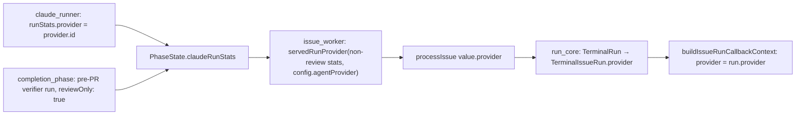

# PR Summary — Issue #5163

## Summary

The post-run callback document's `provider` (`VIBECODER_PROVIDER`) was set from
the host's configured `agent_provider` in `runIssueCallbacks`, so a run that a
repository `agent_provider` pin, a non-external subscription allocation, a
reroute or an `agent_provider_fallback` switch sent to another provider was
archived as the host's provider. The issue worker now derives the provider that
served the run from its recorded invocations and carries it on the result, the
terminal run and the callback context. Review-only passes such as the pre-PR
verifier are left out. The configured provider is used only when the run spawned
no implementation agent. Closes #5163.

## Spec

### Intent and Rationale

- The runner already stamps every invocation's `runStats.provider` with the id
  of the provider it spawned (`buildRunStats(..., { provider: provider.id })` in
  `worker/deno/lib/claude_runner.ts`, including a provider switched to by
  `agent_provider_fallback`), and every invocation of an issue run is recorded
  on `PhaseState.claudeRunStats`. Reading the implementation invocations in that
  record names the provider that served the run, rather than re-deriving the
  pin, allocation or reroute decision a second time.
- The completion phase's pre-PR verifier is a review-only pass. It is called
  without an `agentProvider`, so it runs on the host's configured provider
  whatever the run was pinned or rerouted to, and its run is recorded on the
  same `claudeRunStats`. The completion phase now records it with
  `reviewOnly: true`, and `servedRunProvider` leaves review-only entries out.
  Otherwise every pinned run that reached the verifier would look mixed and lose
  its `provider`. The verifier's spend is still counted in the telemetry and the
  run-stats comment.
- The same record feeds the run's callback telemetry, so `provider` and the cost
  figures describe the same invocations.

### Essential Design Decisions

- `servedRunProvider` (`worker/deno/lib/run_callback_telemetry.ts`) reads only
  entries not marked `reviewOnly` (`PhaseClaudeResult.reviewOnly`, kept by
  `statsEntryOf`). No such invocation → the host's configured provider (the run
  spawned no implementation agent); exactly one distinct provider named → that
  id; none named, or more than one (for example an orchestrated run whose calls
  ran on different providers) → `provider` is **omitted**, never defaulted to
  the configured provider. Mixed or unknown provenance is therefore excluded by
  readers that screen on `provider === "claude"` instead of being counted as
  Claude.
- `provider` moved from `CallbackIdentity` to `TerminalIssueRun`, so
  `runIssueCallbacks` can no longer substitute `config.agentProvider`. A run
  that never reported its invocations (a hard-killed or thrown run) carries no
  provider. Assumption: such a run may have spawned an agent, so the issue's
  "fall back only when the run never spawned an agent" rules the fallback out
  there.
- `processIssue` carries `result.provider` on skips too: a skip spawned no
  agent, and the issue worker already reports the configured provider for it,
  which is what the document reported before.
- Persisted data: the field's type and name are unchanged, but archived records
  written before this change hold the configured provider, and nothing in a
  record tells the two apart. No key was bumped. The TokenEconomizer trial
  report keeps reading those records as before, and its "Not checked" line now
  says that records written before #5163 carry the configured provider.

### Undiscoverable Facts

- None.

## Evidence

Purely backend change, so there is no UI evidence.

## Test Plan

- Added `worker/deno/tests/run_callback_provider_5163_test.ts`:
  - `servedRunProvider` rule: no invocations → configured (blank → absent), one
    provider → that id, two distinct → absent, unattributed → absent and never
    the configured provider. A review-only `claude` entry beside a `deepseek`
    one still gives `deepseek`; only review-only entries give the configured
    provider.
  - `workOnIssue` on a Claude host with
    `repo_config.<repo>.agent_provider:
    deepseek`. The fake runner stamps
    `runStats.provider` with `selectAgentProvider(options.agentProvider).id`,
    the same resolution `claude_runner.ts` uses. The result and the published
    document both say `deepseek`. Control: no pin gives `claude`, and the runner
    was invoked. That run does not reach the pre-PR verifier, so the next test
    covers the recorded verifier run.
  - `workOnIssue` with the claim refused: the runner is never invoked, and the
    result carries the configured provider.
  - Production `runIssueCallbacks` (a real hook captures the document):
    `deepseek` is published; a run with no provider publishes none, even though
    the host is configured with `claude`.
  - Production `processIssue` carries `provider` on a failure and on a skip.
- `worker/deno/tests/completion_phase_pre_pr_verifier_3395_test.ts`, new test
  "the verifier run is recorded review-only and does not mix the served provider
  (Issue #5163)". It runs the real `workOnIssueCompletion` with a fake verifier
  that returns a run stamped `provider: "claude"`. It asserts that the recorded
  entry is `reviewOnly`, and that `servedRunProvider` over a pinned `deepseek`
  invocation plus the recorded state still gives `deepseek`. Red-checked: with
  the `reviewOnly` filter removed from `servedRunProvider`, this test and the
  rule test fail; with it in place, both pass.
- `worker/deno/tests/run_core_callbacks_test.ts`: the scan loop's terminal run
  carries `provider` from `processIssue`, and omits it when absent.
- `worker/deno/tests/run_callback_context_test.ts`: the "blank optional identity
  fields are omitted" and "known optional identity fields are carried" tests now
  set `provider` on the run instead of the identity, because the identity no
  longer has that field. Every assertion is kept.
- `worker/deno/tests/hard_kill_report_test.ts`: `provider: "claude"` was removed
  from the identity, which no longer has that field. No assertion was removed;
  the test compares the two documents' keys, and neither now carries `provider`.
- Callers checked for the new `provider` value: `workOnIssueRecorded` (sets it),
  production `processIssue` (copies it), `withProcessCallbackFacts` and
  `dispatchIssueCallbacks` (copy it), `runIssueCallbacks` (no longer injects the
  configured value), `reportHardKills` and the slot catch / shutdown drain (no
  invocation record, so no provider), and the `callback-conformance` command
  (its fixtures name no provider).
- After the verifier fix, `deno test` on `run_callback_provider_5163_test.ts`,
  `completion_phase_pre_pr_verifier_3395_test.ts` and
  `run_core_callbacks_test.ts` gave 55 passed and 0 failed. `deno check` on the
  changed modules and tests is clean.
- `./quality.sh` on the final code, after merging `main`, passed: the parallel
  pass in 9m16s and the serial pass in 4m08s. config-integration and checkov
  were skipped on this host. The first run that day failed one test,
  `worker/deno/tests/pr_summary_ci_workflow_3768_test.ts`, with `dns error:
  failed to lookup address information: Temporary failure in name resolution`
  (`entities@3.0.1`), while 35,250 others passed. That test runs
  `deno task pr-summary-check` in a cleared environment, which uses the default
  `~/.cache/deno`. That cache lacked the npm packages, and this container has
  no network. After the run's own npm cache was copied there (outside the
  repository), the test passed (11/11) and so did the gate. This is a host
  fault, not a fault in this change.
- `deno task pr-summary-check` on this summary: 0 gates blocked.
- Docs read and updated: `docs/CALLBACKS.md` (the `VIBECODER_PROVIDER` row,
  which now says review-only passes are left out, and the paragraph on omitted
  facts) and `docs/TOKEN-ECONOMIZER-TRIAL.md` (the population paragraph and the
  "not checked" paragraph). The report's own "Not checked" line in
  `worker/deno/lib/token_economizer_trial_report.ts` was reworded to match.
