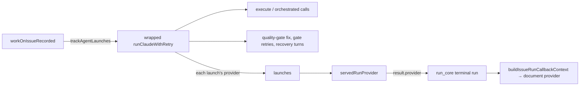

# PR Summary — Issue #5163

## Summary

The post-run callback's `provider` (`VIBECODER_PROVIDER`) used to come from
`config.agentProvider`, the host's configured provider. It is now the provider
that actually served the run. The issue worker wraps its agent runner seam
(`deps.claude.runClaudeWithRetry`), so every agent launch in the run records the
provider it reported. `servedRunProvider` turns those launches into the
document's value:

- **No launch:** the host's configured provider, for example a refused claim.
- **One distinct provider:** that id.
- **Unknown or mixed:** omitted when any launch reported no provider or the
  launches reported several. It is never defaulted to the configured provider.

The value travels on the issue result and the terminal run to
`buildIssueRunCallbackContext`. `runIssueCallbacks` no longer injects
`config.agentProvider`. Closes #5163.

This redoes closed PR #5282 on a fresh branch off `main`. It also fixes the
three blocking review findings left on that PR.

## Spec

### Intent and Rationale

- Trial comparisons screen archived runs by provider, so a pinned or rerouted
  run labelled with the host's provider joins a Claude-only population. The
  issue asks to keep unknown or mixed provenance explicit.
- The provider is counted at the runner seam, not from `state.claudeRunStats`.
  Several later agents (the quality-gate fix agent, gate retries) never record
  stats. A launch that fails after the agent started (a host-disk park with
  `agentStarted` true) records nothing either. Counting launches covers both,
  and "no launch" then really means no agent ran.

### Essential Design Decisions

- A launch whose result carries no provider is unknown, and one unknown launch
  makes the run's provider absent. For an error result, the provider comes from
  the billed result the error carries (`billedResultOfError`), if it carries
  one.
- The wrapper does not wrap `runOrchestratedIssueRun`: the execute phase passes
  the wrapped runner into it, so each orchestrated call counts once.
- Three runs are not counted because they do not use that seam: the pre-PR
  verifier (`runPrePrVerifier`), the clarity assessment (a direct import in
  `lib/clarity_assessment.ts`) and a resumed stream session's `/compact` prime
  (`primeStreamCompaction`). They are review, assessment and housekeeping runs,
  not issue work. This replaces the earlier `reviewOnly` flag on run stats,
  which this branch no longer adds.
- A pinned run whose later agent runs on the host's provider is reported as
  mixed (omitted), not as the pinned provider, because the issue asks that mixed
  provenance stay explicit.

### Undiscoverable Facts

- The closed PR #5282 review reproduced two cases.
  `servedRunProvider([{}, {runStats:{provider:'claude'}}], 'deepseek')` returned
  `claude`. A `HostDiskParkError(..., true)` run published `claude` for a
  repository pinned to DeepSeek.
- That PR's pre-PR verifier also found that the quality-gate fix agent
  (`lib/phases/quality_gate_remediation_phase.ts`) launches without
  `agentProvider` and records no stats.
- Run records written before #5163 carry the host's configured provider, and
  nothing marks them. The TokenEconomizer trial report's "Not checked" line
  still says so (`lib/token_economizer_trial_report.ts`).

## Evidence

Backend-only change; the tests below verify it.

- Red check against the prior fix (closed PR #5282's code, ported as
  `efe88aa2f`): with its lib files restored and the new test file kept, two
  workOnIssue tests in `worker/deno/tests/run_callback_provider_5163_test.ts`
  failed. They were "a host-disk park after an agent ran leaves the provider
  unknown" and "a later agent on another provider counts toward the served
  provider". Both pass at the head.
- The `HostDiskParkError(message, agentStarted)` constructor in
  `lib/heavy_build_gate.ts` and `billedResultOfError` in
  `lib/failed_invocation_result.ts` were read to build the fixtures. Fakes stand
  in for `runClaudeWithRetry` (`lib/claude_runner.ts`). They return results
  shaped like its `Result<ClaudeRunResult>`, with `runStats.provider` taken from
  `selectAgentProvider`, the selector the runner itself uses.
- Docs updated: the `VIBECODER_PROVIDER` row and the "omitted" paragraph in
  `docs/CALLBACKS.md`, and the provider paragraph in
  `docs/TOKEN-ECONOMIZER-TRIAL.md`.

## Test Plan

- `worker/deno/tests/run_callback_provider_5163_test.ts` (new):
  - **The rule** (`servedRunProvider - the rule`): no launches gives the
    configured provider, or none when it is blank. One provider gives that id.
    Several give none. An unknown launch beside a named one gives none.
  - **The wrapper** (`trackAgentLaunches - …`): it records a launch's provider
    and records none for a launch with no stats. For a host-disk park it records
    none and passes the result through. For a turn-cap error it records the
    billed provider. A throwing runner records none and the throw propagates.
    Mixed launches give none, and other deps pass through unchanged.
  - **The issue worker** (`#5163 - workOnIssue: …`), on a Claude host:
    - A repo pinned to DeepSeek reports `deepseek`, and an unpinned repo reports
      `claude`.
    - A host-disk park after the agent ran, and a launch with no stats, both
      leave the provider absent from the result and the published document.
    - A later quality-gate fix agent on `claude` makes the run mixed and the
      provider absent. The same flow with both launches on DeepSeek gives
      `deepseek`.
    - A refused claim launches nothing and reports the configured provider.
  - **Production wiring:** `runIssueCallbacks` publishes the run's provider and
    never substitutes the configured one. `processIssue` surfaces the provider
    for a normal run and an expected-skip run.
- `worker/deno/tests/run_core_callbacks_test.ts`: new tests, and no existing
  assertion was changed. Each covers one caller of `dispatchIssueCallbacks` in
  `lib/run_core.ts`:
  - "the terminal run carries / omits an absent provider" covers the call at the
    end of `releaseIssueClaim` (line 2502). It is changed and tested.
  - "the exit-threshold branch carries the run's provider" covers the call in
    the serial loop's failure-threshold branch (line 3257). It is changed and
    tested.
  - Both callers pass a `TerminalRun` built by `withProcessCallbackFacts`, which
    now copies `provider`. No caller's arguments changed. Removing that copy
    makes the carries test and the exit-threshold test fail.
- `worker/deno/tests/run_callback_context_test.ts`: the provider fixtures moved
  from the identity to the run, because the identity no longer has a `provider`
  field. The expected values (`claude`, and none for a blank) are unchanged.
- `worker/deno/tests/hard_kill_report_test.ts`: `provider: "claude"` was removed
  from the shared identity fixture for the same reason. The test's document and
  outcome assertions are unchanged. The comparison of keys between ordinary and
  hard-kill documents no longer includes `provider`, because neither run
  supplies one.
- `./quality.sh < /dev/null` on the head after merging `main` (`e17ea5339`):
  passed (`Result: PASSED (with skipped checks)`; config integration and checkov
  skipped on this host; deno tests 769.7s, parallel and serial passes both
  passed).
- `deno task pr-summary-check`: run on this summary before the push; nothing
  blocked.

## Not checked

- CI on the pushed branch.
- The earlier run's pre-push block was
  `tests/pr_summary_ci_workflow_3768_test.ts`, which this branch does not touch.
  The test clears its environment, so Deno reads the default cache, and this
  host cannot resolve `registry.npmjs.org`. The four npm packages it needs were
  copied into the host's default Deno cache from the worker's own cache; no
  repository file was changed for it.
- Config integration and checkov, both skipped by the gate on this host.
- `docs/CALLBACKS.md`: much of its diff is a line reflow that the worker's
  formatter commit made on the abandoned branch. It was carried over as is, and
  markdownlint passes on it.
