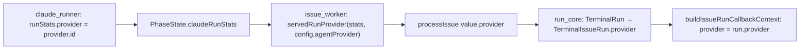

# PR Summary — Issue #5163

## Summary

The post-run callback document's `provider` (`VIBECODER_PROVIDER`) was set from
the host's configured `agent_provider` in `runIssueCallbacks`, so a run that a
repository `agent_provider` pin, a non-external subscription allocation, a
reroute or an `agent_provider_fallback` switch sent to another provider was
archived as the host's provider. The issue worker now derives the provider that
served the run from its recorded invocations and carries it on the result, the
terminal run and the callback context; the configured provider is used only when
the run spawned no agent. Closes #5163.

## Spec

### Intent and Rationale

- The runner already stamps every invocation's `runStats.provider` with the id
  of the provider it spawned (`buildRunStats(..., { provider: provider.id })` in
  `worker/deno/lib/claude_runner.ts`, including a provider switched to by
  `agent_provider_fallback`), and every invocation of an issue run is recorded
  on `PhaseState.claudeRunStats`. Reading that record names the provider that
  actually served the run on every path, rather than re-deriving the pin,
  allocation or reroute decision a second time.
- The same record feeds the run's callback telemetry, so `provider` and the cost
  figures describe the same invocations.

### Essential Design Decisions

- `servedRunProvider` (`worker/deno/lib/run_callback_telemetry.ts`): no recorded
  invocation → the host's configured provider (the run spawned no agent);
  exactly one distinct provider named → that id; none named, or more than one
  (for example an orchestrated run whose calls ran on different providers) →
  `provider` is **omitted**, never defaulted to the configured provider. Mixed
  or unknown provenance is therefore excluded by readers that screen on
  `provider === "claude"` instead of being counted as Claude.
- `provider` moved from `CallbackIdentity` to `TerminalIssueRun`, so
  `runIssueCallbacks` can no longer substitute `config.agentProvider`. A run
  that never reported its invocations (a hard-killed or thrown run) carries no
  provider. Assumption: such a run may have spawned an agent, so the issue's
  "fall back only when the run never spawned an agent" rules the fallback out
  there.
- `processIssue` carries `result.provider` on skips too: a skip spawned no
  agent, and the issue worker already reports the configured provider for it,
  which is what the document reported before.
- Persisted data: the field's type and name are unchanged, but archived records
  written before this change hold the configured provider, and nothing in a
  record tells the two apart. No key was bumped. The TokenEconomizer trial
  report keeps reading those records as before, and its "Not checked" line now
  says that records written before #5163 carry the configured provider.

### Undiscoverable Facts

- None.

## Evidence

Purely backend change, so there is no UI evidence.

## Test Plan

- Added `worker/deno/tests/run_callback_provider_5163_test.ts`:
  - `servedRunProvider` rule: no invocations → configured (blank → absent), one
    provider → that id, two distinct → absent, unattributed → absent and never
    the configured provider.
  - `workOnIssue` on a Claude host with
    `repo_config.<repo>.agent_provider:
    deepseek`. The fake runner stamps
    `runStats.provider` with `selectAgentProvider(options.agentProvider).id`,
    the same resolution `claude_runner.ts` uses. The result and the published
    document both say `deepseek`. Control: no pin gives `claude`, and the runner
    was invoked.
  - `workOnIssue` with the claim refused: the runner is never invoked, and the
    result carries the configured provider.
  - Production `runIssueCallbacks` (a real hook captures the document):
    `deepseek` is published; a run with no provider publishes none, even though
    the host is configured with `claude`.
  - Production `processIssue` carries `provider` on a failure and on a skip.
- `worker/deno/tests/run_core_callbacks_test.ts`: the scan loop's terminal run
  carries `provider` from `processIssue`, and omits it when absent.
- `worker/deno/tests/run_callback_context_test.ts`: the "blank optional identity
  fields are omitted" and "known optional identity fields are carried" tests now
  set `provider` on the run instead of the identity, because the identity no
  longer has that field. Every assertion is kept.
- `worker/deno/tests/hard_kill_report_test.ts`: `provider: "claude"` was removed
  from the identity, which no longer has that field. No assertion was removed;
  the test compares the two documents' keys, and neither now carries `provider`.
- Callers checked for the new `provider` value: `workOnIssueRecorded` (sets it),
  production `processIssue` (copies it), `withProcessCallbackFacts` and
  `dispatchIssueCallbacks` (copy it), `runIssueCallbacks` (no longer injects the
  configured value), `reportHardKills` and the slot catch / shutdown drain (no
  invocation record, so no provider), and the `callback-conformance` command
  (its fixtures name no provider).
- `./quality.sh` on the final code: every stage passed except `deno tests`. It
  had one failure, `worker/deno/tests/pr_summary_ci_workflow_3768_test.ts` ("PR
  summary CI task runs git with restricted environment permissions"). That test
  shells `deno task pr-summary-check`, which failed to fetch npm packages:
  `dns error: failed to lookup address information: Temporary failure in name
  resolution`
  (`commonmark@0.31.2`). It is a network failure in this container, not this
  change. Because that parallel pass failed, the gate did not run its serial
  pass. Those 40 parallel-unsafe tests
  (`worker/deno/lib/parallel_unsafe_test_manifest.ts`) were run separately with
  `deno task test --parallel=false`, giving 948 passed and 0 failed. The
  pre-push hook refused the push for the same DNS failure (`minimist@1.2.8`).
- `deno task pr-summary-check` on this summary: 0 gates blocked.
- Docs read and updated: `docs/CALLBACKS.md` (the `VIBECODER_PROVIDER` row and
  the paragraph on omitted facts) and `docs/TOKEN-ECONOMIZER-TRIAL.md` (the
  population paragraph and the "not checked" paragraph). The report's own "Not
  checked" line in `worker/deno/lib/token_economizer_trial_report.ts` was
  reworded to match.
