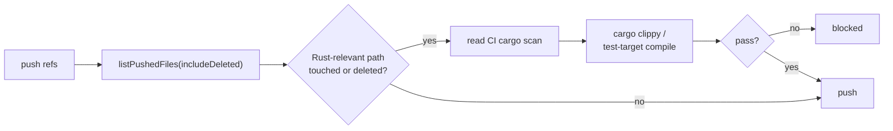

# PR Summary — Issue #5169

## Summary

The pre-push gate now runs the repo CI's `cargo clippy` and test-target compile
for a push whose only Rust-relevant change is a deletion. Before this change,
the CI cargo trigger in `runPrePushGate` read a file list built with
`--diff-filter=d` and filtered to files still in the working tree. Deleting
`src/helper.rs` while `mod helper;` stayed in `lib.rs`, or deleting
`clippy.toml` or a toolchain pin, therefore planned no cargo check, and the push
went out as passed while CI's clippy failed. The trigger now reads the touched
list that keeps deleted paths, and that list now runs `git log --no-renames`, so
a rename such as `src/helper.rs` to `src/helper.rs.disabled` or `clippy.toml` to
`clippy.toml.bak` is listed under its old name too and triggers the same checks.
Every caller that passes `findCiCargo` goes through this code: the agent's
pre-push hook, `gateUnpushedCommits` and the babysitter tree gate. The
stsoftware-pr-reviewer comment on #5169 (from the PR #5252 review) reported this
bypass. Parts of the issue are still not done (listed under Acceptance
Criteria).

Part of #5169

## Spec

### Intent and Rationale

- A deletion changes what CI's `cargo clippy` builds as much as an edit does, so
  it has to trigger the same checks. The fix changes the list the existing
  trigger reads. No new gate is added, as the issue requires ("Do not create
  parallel language-specific gates").

### Essential Design Decisions

- `ciCargoPaths` is the `includeDeleted` list (`touched.value`). That list
  applies no working-tree filter, so it is a superset of the list it replaces.
  It still holds a file under a symlinked crate directory, so the Issue #4630
  refusal (`cwdEscape`, "resolves outside the repository") still fires.
- That list passes `--no-renames` to `git log`. By default git's rename
  detection lists a rename under its new name only, so a Rust-relevant path
  renamed to a non-Rust name was invisible to the trigger. With `--no-renames` a
  rename shows as a deletion of the old path plus an addition of the new one.
  The default list (`--diff-filter=d`) is unchanged.
- Once that list was replaced, nothing passed `containToCheckout = false` to
  `listPushedFiles`, so the parameter was removed and the symlinked-parent skip
  is always on.
- A deletion that removes a CI cargo working directory entirely now reaches the
  existing "working directory … is missing" refusal, an infrastructure fault. It
  is refused and not published, and CI would fail on that tree too.

### Undiscoverable Facts

- PR #5252 (merged) already made the babysitter tree gate run CI's cargo checks
  and `deno fmt --check`. This PR builds on that head.

## Evidence

Backend-only change: no UI files are touched.

- Red before the rename fix: with `--no-renames` reverted, the two rename tests
  below failed and the non-Rust rename control passed.
- Red before the fix: the four deletion tests below that expect a cargo check
  failed against the unfixed `pre_push_gate.ts` (`result.ok` was true, `ciRuns`
  was `[]`, and the babysitter outcome was `passed` where `blocked` was
  expected). Both controls (the non-Rust deletion, and the babysitter deletion
  with a passing clippy) passed on the unfixed code, as expected.
- Issue numbers cited as provenance: #5169 (this issue); #4630 (the earlier CI
  cargo trigger and its symlinked-crate refusal, cited in existing comments
  only).

## Acceptance Criteria

- **missing** — "Acceptance requires evidence for both incident groups" —
  reason: both groups' failing CI jobs are in a private repository this run
  cannot read, and this host has no shift-left ledger with the observations.
- **missing** — "incorporating #5151's three ShellCheck failures" — reason: no
  ShellCheck bypass was found. Every push path runs the repo's ShellCheck
  policy, and #5151's failing jobs are private, so they could not be diagnosed.
- **missing** — "A disk/resource deferral must retain WIP and resume
  automatically, not publish unvalidated work as passed" — reason: the milestone
  merge-only sync (Issue #4326) still pushes a cargo-only merge with an
  `UNGATED:` note under disk pressure. This PR does not change that path.
- **missing** — "cargo llvm-cov" — reason: the gates run CI's test-target
  compile, but no gate measures the line-coverage threshold, and
  `cargo-llvm-cov` is not installed in the worker container.

## Test Plan

- Added to `worker/deno/tests/pre_push_gate_test.ts` (with a `makeRepoDeleting`
  helper that commits and pushes files to origin, then makes one local commit
  that only deletes a path):
  - `runPrePushGate: a push that only deletes a .rs file runs CI's clippy, and a failing clippy blocks it (Issue #5169)`:
    a failing clippy blocks with `PreFlightGateError` (not infrastructure),
    `command === CLIPPY_CMD`, and `E0583` in the message.
  - `runPrePushGate: a push that only deletes a .rs file runs CI's clippy when it passes (Issue #5169)`:
    the positive control; `ciRuns` is exactly `[CLIPPY_CMD]`.
  - `runPrePushGate: a push that only deletes clippy.toml runs CI's clippy (Issue #5169)`.
  - The negative control: deleting `rust/NOTES.md` runs no CI cargo command, and
    `findCiCargo` is never called.
  - `runPrePushGate: a push that only renames rust/src/helper.rs to a non-Rust name runs CI's clippy, and a failing clippy blocks it (Issue #5169)`
    and the same for `rust/clippy.toml` to `rust/clippy.toml.bak`: the push runs
    exactly `[CLIPPY_CMD]` and a failing clippy blocks with
    `PreFlightGateError`. `makeRepoDeleting` gained an optional `renameTo`
    argument that runs `git mv` in place of `git rm`.
  - `runPrePushGate: a push that only renames a non-Rust file runs no CI cargo and never reads the scan (Issue #5169)`:
    the rename control (`rust/NOTES.md` to `rust/README.txt`).
- Added to `worker/deno/tests/babysitter_tree_gate_test.ts`, through the real
  `runBabysitterTreeGate` and the production workflow scan:
  - `a repair deleting a Rust file with a failing CI clippy blocks with its diagnostic (Issue #5169)`.
  - `a repair deleting a Rust file with a passing CI clippy passes (Issue #5169)`.
  - `cargoFixtureEdit` gained an optional `deleteInstead` flag, and its fixture
    now also commits `src/helper.rs`. The three existing tests that use it are
    unchanged, and no assertion was removed from them.
- Existing symlinked-crate and missing-directory refusals
  (`runPrePushGate: a CI cargo working directory that is a symlink outside the repository is infrastructure`)
  still pass, so the removed `containToCheckout = false` list lost no coverage.
  The `listPushedFiles` symlink tests use the default and are unchanged.
- No other caller of `listPushedFiles` passed a sixth argument
  (`worker/deno/lib/repo_formatters.ts` uses the defaults). I checked with
  `git grep -n listPushedFiles`.
- `deno task test:unit tests/pre_push_gate_test.ts tests/babysitter_tree_gate_test.ts tests/repo_formatters_test.ts`
  (from `worker/deno`), before the rename fix: 277 passed, 0 failed.
- After the rename fix: `deno test -A --filter 5169 tests/pre_push_gate_test.ts`
  gave 10 passed, 0 failed. A plain `deno test -A` over the four touched test
  files (not the `test:unit` task) gave 252 passed and 43 failed, in tests that
  do not touch the rename path (such as the PR #5034 base-baseline tests). That
  run was not repeated under `deno task test:unit` before the deadline, so the
  quality gate's run is the authoritative result.
- `deno fmt --check`, `deno lint` and `deno check` on
  `worker/deno/lib/pre_push_gate.ts` are clean. `markdownlint-cli2` on the two
  edited docs reports 0 issues.
- Docs updated: `docs/CONFIGURATION.md` (the babysitter-repair paragraph and the
  "CI's cargo clippy and test-target compile" bullet) and
  `docs/workflows/fleet-pr-babysitter.md` (the "Container repairs" gate
  paragraph and the READY-line paragraph) now say "changed or was deleted".
- Test change in `worker/deno/tests/pre_push_hook_test.ts`, test
  `integration: a CI scan the worker could not produce refuses a Rust push as infrastructure, and lets a doc push through`
  (governing issue #5169, requirement quoted verbatim from its body: "fix each
  demonstrated bypass using the existing pre-push/quality mechanism"):
  - Obsolete old behaviour: the positive control deleted `src` and `Cargo.toml`
    in a new commit on top of the unpushed Rust commit and expected that push to
    pass. Its pushed range still contained the Rust commit's paths, and the CI
    cargo trigger now reads the touched list that keeps deleted paths (the #5169
    fix), so that range is refused. The expectation "a range that touched and
    then deleted Rust paths passes" is the bypass the issue asks to close.
  - Remaining behaviour: a Rust push is refused as infrastructure when the CI
    scan is unverifiable, with the reason in stderr and nothing reaching the
    remote (the refusal half is unchanged, with all of its assertions), and a
    push whose range touches no Rust path is allowed with the same unverifiable
    scan (exit code 0), so the refusal is the scan and not the push.
  - Coverage:
    `worker/deno/tests/pre_push_hook_test.ts::integration: a CI scan the worker could not produce refuses a Rust push as infrastructure, and lets a doc push through`
    (the changed test itself), and
    `worker/deno/tests/pre_push_gate_test.ts::runPrePushGate: a push that only deletes a .rs file runs CI's clippy, and a failing clippy blocks it (Issue #5169)`
    for the deletion trigger.
  - The control now runs `git update-ref -d HEAD` (exit code asserted 0) so the
    branch is unborn, then commits `notes.txt` as a docs-only range. No
    assertion was removed, and one was added.
- `./quality.sh < /dev/null` on the final code: every stage passed except
  `deno tests`, with 35116 passed and 1 failed. The failure is
  `worker/deno/tests/pr_summary_ci_workflow_3768_test.ts` ("PR summary CI task
  runs git with restricted environment permissions"). It needs
  `registry.npmjs.org` ("dns error: failed to lookup address information"), and
  this container has no network. Because of that failure the serial test pass
  did not run.
