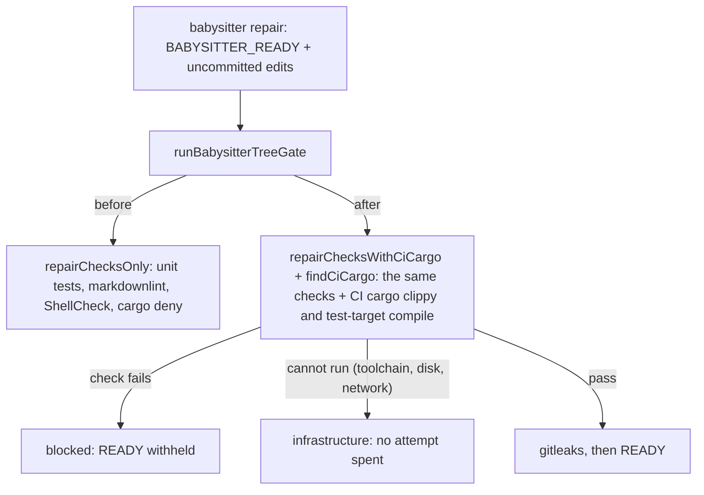

# PR Summary — Issue #5169

## Summary

The fleet babysitter's repair gate was the last publication path still on
`repairChecksOnly`. In that mode the pre-push gate plans no CI cargo check, so a
babysitter repair to a fleet PR reached CI without the repo's `cargo clippy` or
test-target compile (the build step behind `cargo llvm-cov`). The issue's
`E0252`, `E0308` and clippy codes come from those two steps.

- `worker/deno/lib/babysitter_tree_gate.ts`: `runBabysitterTreeGate` now calls
  the gate with `repairChecksWithCiCargo: true` and `findCiCargo`, which by
  default is the real workflow scan `repoCiCargoChecks`. This is the repair mode
  the CI-fix, PR-feedback, spelling and merge-conflict repairs already use
  (Issue #4630; PR #5226 for this issue). The CI cargo checks run when a
  Rust-relevant file changed.
- No `compareRef` is passed. The base comparison fetches into the clone and
  makes a worktree outside the gate's temp root, and the babysitter clone's
  `.git` is read-only. A failing CI cargo check therefore always blocks a
  babysitter repair. CI runs on the PR's own tree, so such a repair would fail
  CI anyway.
- `worker/deno/lib/pre_push_gate.ts` and `worker/deno/lib/git_push.ts`: the
  `repairChecksOnly` option and spec field had no production caller left, so
  they are removed. `repairChecksWithCiCargo` is now the only repair mode.
- Docs updated: `docs/CONFIGURATION.md`, `docs/INTERNALS.md` and
  `docs/workflows/fleet-pr-babysitter.md`.

The rest of the issue is still open (see Acceptance Criteria). Part of #5169.

## Spec

### Intent and Rationale

- PR #5226 closed the bypass for spelling and merge-conflict repairs, and
  deliberately left the babysitter tree gate on `repairChecksOnly`. The
  babysitter pushes repairs to fleet PRs, the population this issue counts.
  Among the repair push paths, it was the last one where a Rust edit met no CI
  cargo check.
- The fix reuses the existing gate mode and workflow scan. No new gate is added,
  as the issue asks.

### Essential Design Decisions

- The babysitter has no PR-base comparison for its cargo checks, because of the
  read-only `.git`. A base that already fails clippy blocks the repair, and the
  repair agent is told why. The CI-fix and other repairs keep their comparison.
- A CI cargo command the gate cannot reproduce, a missing toolchain, a full disk
  or an unreachable registry is an `infrastructure` outcome. It spends no repair
  attempt and never passes. This is `runPrePushGate`'s existing
  `PrePushGateInfrastructureError` path.
- Cargo may write `target/` in the clone. The tree gate's status read excludes
  ignored files. An unignored `target/` turns a pass into `blocked` through the
  existing settle step, so it is never staged by the host's `git add -A`.

### Undiscoverable Facts

- The 22 Rust/Deno PRs and #5151's three ShellCheck PRs are in a private
  repository. No shift-left ledger (`shift-left-ledger.json`) exists on this
  host, so this run could not read their jobs. The bypass was found by tracing
  the publication paths in code.
- `cargo llvm-cov` is not installed in the worker container (`cargo llvm-cov`
  gives `error: no such command: llvm-cov`). The coverage threshold therefore
  cannot be measured locally; only the test-target compile is.

## Evidence

Backend only: no UI file is touched.

- Issue numbers this diff cites: #5169 ("Fix local quality-check bypasses before
  fleet publication (Rust, Deno and ShellCheck)"). Existing citations (#4630,
  #4930, #5121, #4626, #4631) are kept as they were.
- Doc sweep: I grepped `docs/` and `worker/deno/lib/` for `repairChecksOnly`,
  "tree gate" and "formatters or linters". The babysitter "Pre-push gate"
  paragraph and the summary under "Container repairs" in
  `docs/workflows/fleet-pr-babysitter.md`, the babysitter paragraph and the
  unit-test and `cargo deny` bullets in `docs/CONFIGURATION.md`, and the
  publication-paths passage in `docs/INTERNALS.md` now name the CI cargo
  checks. Each now says the gate runs no linter other than CI's cargo clippy.
  `grep -rn repairChecksOnly worker/ docs/ --include=*.ts --include=*.md`,
  excluding `docs/archive`, finds nothing.

## Acceptance Criteria

- **missing** — "Acceptance requires evidence for both incident groups" —
  reason: the failing jobs of both groups are in a private repository that this
  run could not read, and no shift-left ledger exists on this host. This PR
  fixes a bypass found in code, without matching it to a private job.
- **missing** — "incorporating #5151's three ShellCheck failures" — reason: no
  ShellCheck bypass was found. Every push path, the babysitter tree gate
  included, already runs the repo's ShellCheck policy. The private `Run script
  tests` jobs were not readable.
- **missing** — "A disk/resource deferral must retain WIP and resume
  automatically, not publish unvalidated work as passed" — reason: the milestone
  merge-only sync (Issue #4326) still pushes a cargo-only merge with the
  `UNGATED:` note and leaves the build to CI. This PR does not change that path.
- **missing** — "cargo llvm-cov" — reason: the test-target compile now gates the
  babysitter too, but the `--fail-under-lines` threshold is not measured,
  because cargo-llvm-cov is not installed in the worker container.
- **missing** — "deno fmt" — reason: repair pushes still run no `deno fmt
  --check`, which is the existing repair formatter policy (PR #5226). This PR
  does not change it.

## Test Plan

- `worker/deno/tests/babysitter_tree_gate_test.ts` has three new tests. Each
  runs the real `runBabysitterTreeGate` and the real workflow scan (no
  `findCiCargo` injected) over a real clone whose `main` holds a crate and a
  pull-request workflow running `cargo clippy --all-targets -- -D warnings`.
  Only the command runner is faked.
  - `a repair changing a Rust file with a failing CI clippy blocks with its
    diagnostic (Issue #5169)`: an uncommitted `src/lib.rs` edit, clippy exits
    101, and the outcome is `blocked` with the clippy diagnostic. Red on the
    unfixed gate: `AssertionError: Values are not equal` (`passed` vs
    `blocked`), because clippy never ran.
  - `a repair changing a Rust file with a passing CI clippy passes and ran
    clippy (Issue #5169)`: the valid-path control. Red on the unfixed gate:
    `AssertionError: clippy ran: ` (no commands).
  - `a repair changing only a non-Rust file runs no cargo command (Issue
    #5169)`: a `NOTES.md` edit with a failing clippy stub passes and runs no
    `cargo` command. Green on base too, as expected.
- Edited tests, after `repairChecksOnly` was removed:
  - Removed from `worker/deno/tests/pre_push_gate_cargo_deny_test.ts`: the
    whole test `cargo deny: repairChecksOnly mode checks Cargo.lock`, with
    `assert(result.ok);` and
    `assertEquals(denyCommands(seen), [{ command: DENY_ARGV, cwd: clone }]);`.
    - Obsolete: the `repairChecksOnly` mode no longer exists.
    - Still covered by: `worker/deno/tests/pre_push_gate_cargo_deny_test.ts::cargo deny: repairChecksWithCiCargo mode checks Cargo.lock`,
      which makes the same assertions.
  - `worker/deno/tests/pre_push_gate_cargo_deny_test.ts`: `cargo deny:
    repairChecksOnly mode skips a source-only repair even with a baseRef` is
    renamed to the `repairChecksWithCiCargo` mode, with every assertion kept.
    It passes.
  - `worker/deno/tests/pre_push_gate_test.ts`: the `{ repairChecksOnly: true }`
    entry is dropped from two mode loops. The `{}` and
    `{ repairChecksWithCiCargo: true }` entries and every assertion in the loop
    bodies remain.
  - `worker/deno/tests/git_push_preflight_test.ts`: the repair test that passed
    `{ commands: [], repairChecksOnly: true, runner }` now passes
    `{ ...REPAIR_CHECKS_WITH_CI_CARGO_PRE_FLIGHT, runner }`, with every
    assertion unchanged. The change has no Rust file, so no cargo check is
    planned and the assertions hold.
- Results on this head, run from `worker/deno`:
  - `deno test -A tests/babysitter_tree_gate_test.ts
    tests/babysitter_repair_4738_test.ts tests/pre_push_gate_cargo_deny_test.ts
    tests/git_push_preflight_test.ts`: 159 passed, 0 failed.
  - `deno check` on the changed lib files and `commands/babysitter_repair.ts`:
    clean.
  - Run directly with `deno test`, `tests/pre_push_gate_test.ts` gave 144 passed
    and 41 failed, and the same 144/41 on the unchanged base. The failures come
    from the fixtures' own `git push` meeting the host's pre-push hook
    (markdownlint on a fixture `README.md`). Under `./quality.sh` that file
    raised no failure.
- `./quality.sh < /dev/null` on this head:
  - Every stage passed except `deno tests`. Config integration and checkov
    were skipped in this environment.
  - The parallel pass gave 35116 passed and 1 failed. The failure was
    `tests/pr_summary_ci_workflow_3768_test.ts::PR summary CI task runs git with
    restricted environment permissions`: it could not resolve
    `registry.npmjs.org` (no network). This change does not touch that test.
  - The serial pass did not run because the parallel pass had failed.

Not done or not checked:

- The Acceptance Criteria entries above.
- The serial test pass of `./quality.sh`, and the network-dependent test.
- No real `cargo clippy` ran in a babysitter container. The tests fake the
  command runner.

🤖 Generated with [Claude Code](https://claude.com/claude-code)
