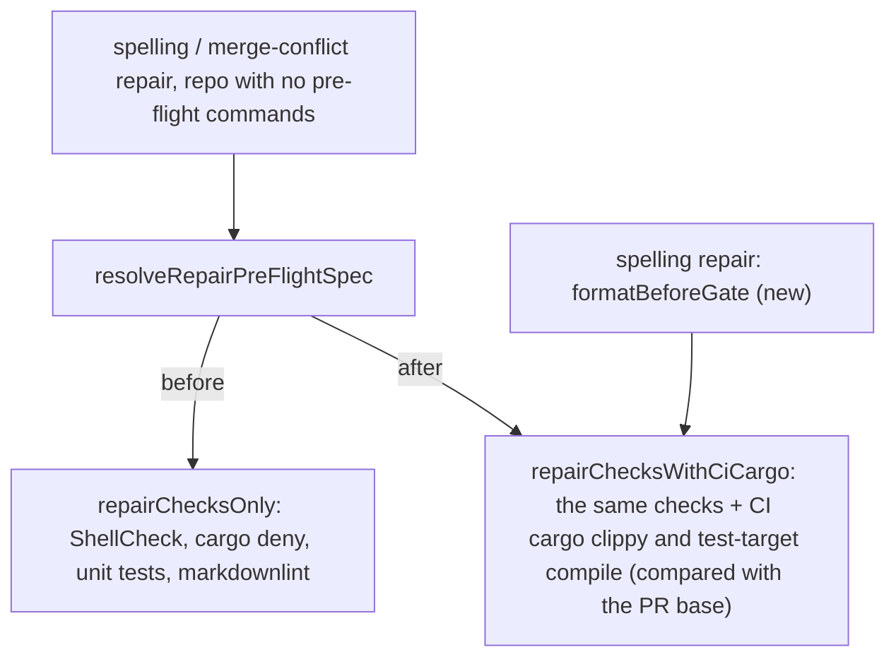

## Summary

Two publication paths pushed repairs to fleet PRs without the checks CI runs.
This PR closes both, using the existing pre-push gate. Part of #5169.

- `worker/deno/lib/git_push.ts`: when a repo has no pre-flight commands,
  `resolveRepairPreFlightSpec` now returns
  `REPAIR_CHECKS_WITH_CI_CARGO_PRE_FLIGHT` instead of
  `{ commands: [], repairChecksOnly: true }`. Spelling and merge-conflict
  repairs now run the repo CI's own `cargo clippy` and test-target compile
  before the push, compared against the PR base, as CI-fix and PR-feedback
  repairs already did (Issue #4630).
- `worker/deno/lib/pr_spelling_processor.ts`: the spelling repair passes the
  `formatBeforeGate` round to `commitAndPushPending`, on the first push and on
  the push-recovery retry. The repo's formatters therefore run over its unpushed
  commits before the gate, as they already do for the CI-fix and PR-feedback
  rounds.
- `repairChecksOnly` is now used only by the fleet babysitter's tree gate. The
  doc comments in `git_push.ts` and `pre_push_gate.ts`, and three passages of
  `docs/CONFIGURATION.md`, now say so.

## Spec

### Intent and Rationale

- Both processors already passed `requireCargoBaseComparison: true` to
  `commitAndPushPending`, ready to compare a CI cargo failure against the PR
  base. Their spec planned no CI cargo check, so that comparison never ran, and
  `docs/CONFIGURATION.md` said ShellCheck was the only Step 1b check for these
  repairs. A spelling fix inside a Rust doc comment (`clippy::doc_markdown`)
  therefore reached CI with no clippy run at all.
- The fix reuses the spec the CI-fix and PR-feedback repairs already use, and
  the formatter round they already run. No new gate is added.

### Essential Design Decisions

- The merge-conflict path keeps its own merged-tree fast checks
  (`merge_fast_checks.ts`). The CI cargo check now runs after them, in Step 1b,
  with `compareBaseBranch` set, so a lint the base already has is a warning and
  not a block.
- The formatter round is never fatal. Anything it cannot fix is still reported
  by CI. The repair spec adds no `deno fmt --check` of its own, so a repair that
  only touches a badly formatted file is not refused for formatting the base
  already had.
- The babysitter tree gate stays on `repairChecksOnly`. It runs against a
  read-only `.git` through an emulated git seam, and running cargo there was not
  checked in this run.

### Undiscoverable Facts

- The issue's 22 Rust/Deno PRs and #5151's three ShellCheck PRs are in a private
  repository, and this run could not read their jobs. The bypasses fixed here
  were found by tracing the publication paths in code, not by matching the
  private failures.

## Evidence

Backend only: no UI file is touched.

- Issue numbers this diff cites:
  - #5169: "Fix local quality-check bypasses before fleet publication (Rust,
    Deno and ShellCheck)".
  - #4630: the CI cargo repair checks.
  - #4631, #4626 and #4930: existing citations, kept as they were.
- Doc sweep. I read every `repairChecksOnly` and `repairChecksWithCiCargo`
  passage in `docs/CONFIGURATION.md` (around lines 5462, 5590 and 5676) and
  updated them. `docs/INTERNALS.md` has no sentence saying these repairs skip
  the CI cargo checks.

## Acceptance Criteria

<!-- vibe-spec-review inputs="diff+issue-body" -->

- **partial** — "cargo llvm-cov" — evidence:
  `worker/deno/tests/git_push_preflight_test.ts::a spelling or merge-conflict
  repair compiles CI's cargo llvm-cov test targets and is refused when they
  fail (Issue #5169)`
  — reviewer: partial — reason: spelling and merge-conflict repairs now compile
  CI's llvm-cov test targets, but the `--fail-under-lines` coverage threshold is
  not measured, because cargo-llvm-cov is not installed in the worker container.
- **partial** — "incorporating #5151's three ShellCheck failures" — evidence:
  `worker/deno/tests/shellcheck_publication_test.ts::a spelling or
  merge-conflict repair blocks a real ShellCheck diagnostic and pushes a clean
  script (Issue #5169)`
  — reviewer: partial — reason: the test also passes on `origin/main`, so no
  ShellCheck bypass was found or fixed, and the three private failing jobs were
  not read.
- **partial** — "A disk/resource deferral must retain WIP and resume
  automatically, not publish unvalidated work as passed" — evidence:
  `worker/deno/tests/git_push_preflight_test.ts::a spelling or merge-conflict
  repair whose CI clippy hits a full disk keeps its commits unpushed (Issue
  #5169)`
  — reviewer: partial — reason: automatic resumption was not traced, and the
  milestone merge-only path (Issue #4326) still pushes cargo-skipped merges with
  the `UNGATED:` note, unchanged.
- **missing** — "Acceptance requires evidence for both incident groups" —
  reviewer: missing — reason: the private failing jobs of neither group were
  read; only the Rust/Deno group has red/green tests, and the ShellCheck group
  has no failing test.

## Test Plan

- `worker/deno/tests/git_push_preflight_test.ts`. Both tests are new; they run
  through `commitAndPushPending`.
  - `a spelling or merge-conflict repair without pre-flight commands is
    refused on a failing CI clippy (Issue #5169)`.
    Red against the unfixed `git_push.ts` with
    `AssertionError: failing CI clippy must refuse the push`. No cargo check ran
    and the push went through.
  - The valid-path control: CI clippy passes and the repair is pushed.
- `worker/deno/tests/git_push_preflight_test.ts`, two more new tests added after
  the completion check, both through `commitAndPushPending` with
  `resolveRepairPreFlightSpec(undefined, "org/repo")`:
  - `a spelling or merge-conflict repair compiles CI's cargo llvm-cov test
    targets and is refused when they fail (Issue #5169)`,
    with a valid-path control that pushes when the targets compile.
  - `a spelling or merge-conflict repair whose CI clippy hits a full disk
    keeps its commits unpushed (Issue #5169)`:
    the push fails with `PrePushGateInfrastructureError`, origin is unchanged,
    and the local head keeps the agent's commit.
  - Red against `origin/main`'s `git_push.ts`: all four Issue #5169 tests in
    this file failed (`a failing llvm-cov test-target compile must refuse`,
    `a disk-full check must not publish the repair`).
- `worker/deno/tests/shellcheck_publication_test.ts`: new test
  `a spelling or
  merge-conflict repair blocks a real ShellCheck diagnostic and pushes a clean
  script (Issue #5169)`,
  run with the host's real ShellCheck 0.11.0. It passes on `origin/main` too, so
  it records the existing ShellCheck coverage of these repairs. It does not
  prove a fix.
- `worker/deno/tests/pr_round_repo_formatters_test.ts`: new test
  `spelling fix - an unformatted .ts fix the agent committed is formatted and
  pushed (Issue #5169)`.
  Red against the unfixed processor: the gate refused the unformatted `a.ts` and
  nothing was pushed.
- `worker/deno/tests/pr_round_repo_formatters_test.ts`: two more new tests, run
  through the real `processSpellingFailure`, the real `commitAndPushPending` and
  the real `cargo clippy` against a real repository and bare remote, with a repo
  that has no pre-flight commands and a CI workflow running
  `cargo clippy --all-targets -- -D warnings`:
  - `spelling fix - a repair that fails CI's cargo clippy never reaches the
    remote (Issue #5169)`: the remote branch tip is unchanged.
  - `spelling fix - a repair that passes CI's cargo clippy is pushed (Issue
    #5169)`: the repaired file is on the remote.
  - Red when `resolveRepairPreFlightSpec` returns the old
    `{ commands: [], repairChecksOnly: true }`: the failing-clippy test failed
    because the repair was pushed.
- Removed test assertions and test (TDD rule 3). Each pinned the spec object a
  mocked `commitAndPushPending` was handed, which the mock never ran, so a gate
  that ignored `repairChecksWithCiCargo` would still have passed; the review
  required their removal rather than a re-count. The base behaviour they
  recorded (a repo with no pre-flight commands gets `repairChecksOnly: true`
  from the spelling and merge-conflict repairs) is obsolete under this issue.
  - `worker/deno/tests/pr_spelling_processor_test.ts::processSpellingFailure -
    succeeds with mock Claude output`: the `preFlights` assertion is removed;
    the test still checks the processed result and the agent request.
  - `worker/deno/tests/pr_merge_conflict_processor_test.ts::processMergeConflict
    - the push is gated on the repository's ShellCheck policy (Issue #4631)` is
    deleted: its only assertion was that spec. The merge-conflict push still
    reaches the gate through `resolveRepairPreFlightSpec`, which the tests below
    exercise through the real gate.
  - `worker/deno/tests/pr_side_gate_guarantee_4876_test.ts`: the
    `capturedPreFlight?.repairChecksOnly` assertion is removed; the `commands`
    and prompt assertions remain.
  - Remaining behaviour and covering tests: the repair gate is run for real by
    `worker/deno/tests/pr_round_repo_formatters_test.ts::spelling fix - a repair
    that fails CI's cargo clippy never reaches the remote (Issue #5169)` and
    its passing counterpart, and, through `resolveRepairPreFlightSpec`, by the
    `git_push_preflight_test.ts` tests above and
    `shellcheck_publication_test.ts::commitAndPushPending: a spelling or
    merge-conflict repair blocks a real ShellCheck diagnostic and pushes a clean
    script (Issue #5169)`. The merge-conflict processor is not driven through a
    real gate: its fixture scripts every git call.
  - The new `git_push_preflight_test.ts` tests no longer assert the cargo
    runner's calls or their order; they assert the refusal diagnostic, the
    retained local head and the unchanged or advanced remote.
  - The `repairChecksOnly` gate itself is still covered by the existing
    `{ commands: [], repairChecksOnly: true, runner }` test in
    `worker/deno/tests/git_push_preflight_test.ts`, which passes.
- Results, run with `deno test -A` from `worker/deno`:
  - `git_push_preflight_test.ts`: 37 passed, 0 failed.
  - `pr_spelling_processor_test.ts`, `pr_merge_conflict_processor_test.ts`,
    `pr_round_repo_formatters_test.ts` and
    `pr_side_gate_guarantee_4876_test.ts`: 156 passed, 0 failed.
  - `shellcheck_publication_test.ts`: 6 passed, 2 failed. Both failures are CLI
    subprocess tests that could not load the `@std/yaml` JSR manifest (no
    network). They do not call `resolveRepairPreFlightSpec`, and they were not
    run on the unchanged tree.
  - `deno fmt` and `deno lint` on the changed files: clean.
- `./quality.sh < /dev/null` was stopped by my 600 s `timeout` (exit 124). Every
  stage it reported before that passed: completeness, mermaid, markdownlint,
  semgrep, gitleaks and release-tag ruleset. Config integration and checkov were
  skipped in this environment.
  <!-- vibe-quality-gate-skipped reason="the full gate overran the 600 s bound in this run; every reported stage passed, and the worker re-runs the gate before the PR" -->

Not done or not checked:

- The Acceptance Criteria entries above.
- The full unit suite did not finish in this run.
- The two network-dependent ShellCheck CLI tests.
- A spec reviewer sub-agent reviewed the four criteria above over the final
  diff. Its verdicts are recorded there. No standards reviewer ran.

🤖 Generated with [Claude Code](https://claude.com/claude-code)
