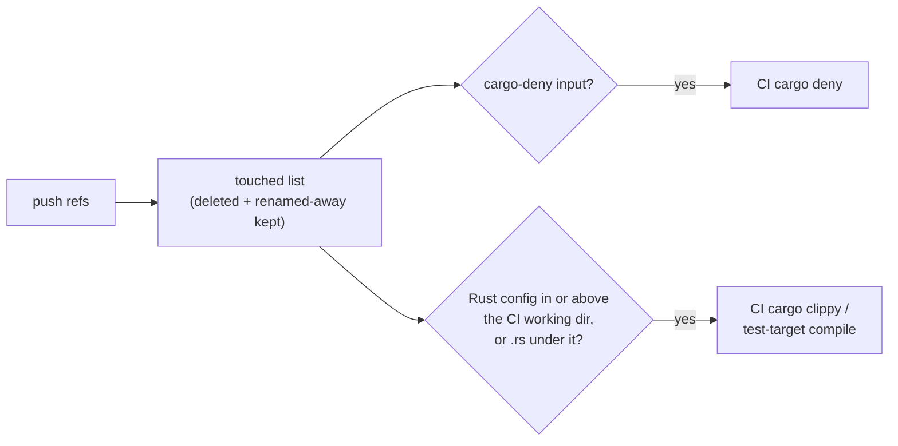

# PR Summary — Issue #5169

## Summary

Closes two more pre-push gate bypasses that the stsoftware-pr-reviewer reported
on #5169 while reviewing PR #5257:

- **cargo deny for deleted inputs.** `runPrePushGate` now decides the cargo-deny
  trigger from the touched list (`touched.value`), which keeps deleted paths and
  the old name of a rename (`git log --no-renames`). Before this change it read
  `contained.value` (`--diff-filter=d`, existing files only). So when `always`
  was false (no `baseRef`, or any `repairChecksWithCiCargo` repair, including
  the babysitter tree gate), a push that only deleted or renamed away
  `deny.toml`, `Cargo.lock`, `Cargo.toml`, `.deny.toml` or `.cargo/config.toml`
  ran no cargo deny.
- **CI clippy for ancestor Rust config.** `planChangedFileChecks` now plans a CI
  cargo check when a Rust config file (`RUST_CONFIG_NAMES`: `Cargo.toml`,
  `Cargo.lock`, `rust-toolchain`, `rust-toolchain.toml`, `clippy.toml`,
  `.clippy.toml`) changes in an ancestor of the check's working directory, not
  only under it. A root toolchain pin or workspace `Cargo.lock` change therefore
  runs CI's `cargo clippy` for a `rust/` working directory. A `.rs` file still
  counts only under the working directory.

Parts of the issue are still not done (listed under Acceptance Criteria). Part
of #5169.

## Spec

### Intent and Rationale

- Both fixes change the inputs of the existing triggers. No new gate is added,
  as the issue requires ("Do not create parallel language-specific gates").
- rustup reads `rust-toolchain(.toml)` from parent directories, clippy reads
  `clippy.toml` from parent directories, and a workspace's `Cargo.toml` and
  `Cargo.lock` sit above its member crates. A change to any of them changes what
  CI's cargo command in a sub-directory builds.

### Essential Design Decisions

- `governsCargoDir(path, dir)` in `worker/deno/lib/pre_push_gate.ts` is the one
  rule. A Rust-relevant path under `dir` (or any path when `dir` is `.`) counts,
  and a `RUST_CONFIG_NAMES` file in a strict ancestor of `dir` counts. The
  ancestor test compares whole path segments, so `rusty/Cargo.lock` does not
  govern `rust`.
- Any ancestor config counts, even a root `Cargo.toml` that is not a workspace
  of the sub-directory crate. That can cost an extra clippy run, which is
  accepted because the rule fails closed.
- The cargo-deny trigger list also keeps files under a symlinked parent
  directory. That can only add a cargo-deny run, never skip one.

### Undiscoverable Facts

- PRs #5252 and #5257 (both merged) delivered the babysitter tree gate's CI
  cargo and `deno fmt --check` checks, and the deleted- and renamed-path CI
  cargo trigger. This branch builds on `main` at 5c3a5a837.

## Evidence

Backend-only change: no UI files are touched.

- Red before the fix: an executor ran the new tests against the unchanged
  production code. Eight failed, all of them new: the three looped cargo-deny
  removal tests, the cargo-deny verdict test, the `repairChecksWithCiCargo`
  cargo-deny test, the `planChangedFileChecks` ancestor test and both
  root-config `runPrePushGate` tests. The controls (the non-cargo deletion,
  `tools/Cargo.lock`, `build.rs`) passed on the unchanged code, as expected.
- Issue numbers cited as provenance: #5169 (this issue).

## Acceptance Criteria

- **missing** — "Acceptance requires evidence for both incident groups" —
  reason: both groups' failing CI jobs are in a private repository this run
  cannot read, and this host has no shift-left ledger with the observations.
- **missing** — "incorporating #5151's three ShellCheck failures" — reason: no
  ShellCheck bypass was found. Every push path runs the repo's ShellCheck
  policy, and #5151's failing jobs are private, so they could not be diagnosed.
- **missing** — "A disk/resource deferral must retain WIP and resume
  automatically, not publish unvalidated work as passed" — reason: the milestone
  merge-only sync (Issue #4326) still pushes a cargo-only merge with an
  `UNGATED:` note under disk pressure. This PR does not change that path.
- **missing** — "cargo llvm-cov" — reason: the gates run CI's test-target
  compile, but no gate measures the line-coverage threshold, and
  `cargo-llvm-cov` is not installed in the worker container.

## Test Plan

- Added to `worker/deno/tests/pre_push_gate_cargo_deny_test.ts` (with a
  `makeRepoRemoving` helper that pushes the CI workflow and files, then makes
  one local commit that only `git rm`s or `git mv`s a path). The tests run with
  no `baseRef`, so `always` is false:
  - `cargo deny: a push that only deletes deny.toml runs CI's cargo deny (Issue #5169)`,
    and the same for `deletes Cargo.lock` and `renames deny.toml away`. Each
    asserts that exactly CI's argv ran, in the clone.
  - `cargo deny: a verdict after a push that only deletes Cargo.lock blocks, and is not infrastructure (Issue #5169)`.
  - `cargo deny: repairChecksWithCiCargo runs cargo deny for a push that only deletes deny.toml (Issue #5169)`.
  - `cargo deny: a push that only deletes a non-cargo file runs no cargo deny (Issue #5169)`
    (the control).
- Added to `worker/deno/tests/pre_push_gate_test.ts`:
  - `planChangedFileChecks: Rust config in an ancestor of the CI working directory plans the check, a look-alike prefix does not (Issue #5169)`.
    A root `rust-toolchain.toml` plans `cargo clippy (rust)`, and
    `rust/Cargo.lock` plans the `rust/crates/a` check. `rusty/Cargo.lock` and a
    root `build.rs` plan nothing.
  - `runPrePushGate: a push that only changes a root rust-toolchain.toml runs the sub-directory CI clippy, and a failing clippy blocks it (Issue #5169)`,
    and the same for a root `Cargo.lock`. The passing run executes exactly
    `[CLIPPY_CMD]`, and a failing clippy blocks with a `PreFlightGateError` that
    is not infrastructure.
  - `runPrePushGate: a push that only changes a sibling directory's tools/Cargo.lock runs no CI clippy for rust (Issue #5169)`
    and `… a root .rs file build.rs …` (the controls).
- No existing test was edited, and no assertion was removed.
- `deno task test:unit tests/pre_push_gate_test.ts tests/pre_push_gate_cargo_deny_test.ts tests/babysitter_tree_gate_test.ts`
  (from `worker/deno`, on the final code): 285 passed, 0 failed.
  `deno fmt
  --check`, `deno lint` and `deno check` on the three changed code
  files are clean.
- Docs: in `docs/CONFIGURATION.md`, I read and updated the "push guarantee"
  paragraph, the repair-processor paragraph, the "CI's cargo clippy and
  test-target compile" bullet and the `cargo deny` bullet. In
  `docs/workflows/fleet-pr-babysitter.md`, I updated the Container repairs gate
  paragraph and the READY-line paragraph. A grep of `docs/` (excluding
  `docs/archive/`) and `README.md` for `Rust-relevant`, `cargo input`,
  `cargo-deny` and `cargo deny` found no other sentence about when these checks
  trigger. `markdownlint-cli2` on the two docs reports 0 issues.
- `./quality.sh < /dev/null` on the final code: every stage passed except
  `deno tests` (35130 passed, 1 failed). The failure is
  `worker/deno/tests/pr_summary_ci_workflow_3768_test.ts` ("PR summary CI task
  runs git with restricted environment permissions"). It needs
  `registry.npmjs.org` ("dns error: failed to lookup address information"), and
  this container has no network. Because of that failure the serial test pass
  did not run.
