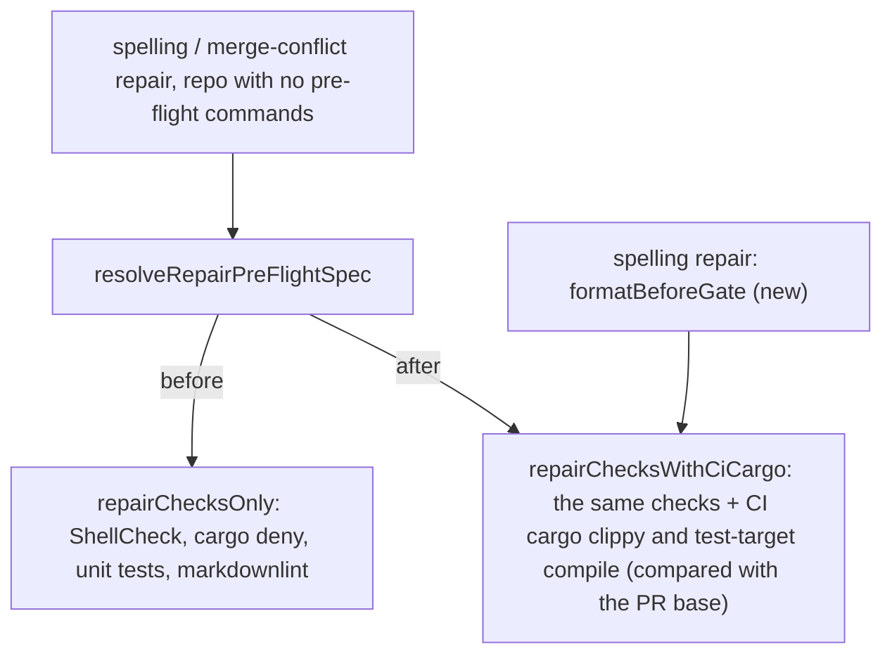

## Summary

Two publication paths pushed repairs to fleet PRs without the checks CI runs.
This PR closes both, using the existing pre-push gate. Part of #5169.

- `worker/deno/lib/git_push.ts`: when a repo has no pre-flight commands,
  `resolveRepairPreFlightSpec` now returns
  `REPAIR_CHECKS_WITH_CI_CARGO_PRE_FLIGHT` instead of
  `{ commands: [], repairChecksOnly: true }`. Spelling and merge-conflict
  repairs now run the repo CI's own `cargo clippy` and test-target compile
  before the push, compared against the PR base, as CI-fix and PR-feedback
  repairs already did (Issue #4630).
- `worker/deno/lib/pr_spelling_processor.ts`: the spelling repair passes the
  `formatBeforeGate` round to `commitAndPushPending`, on the first push and on
  the push-recovery retry. The repo's formatters therefore run over its
  unpushed commits before the gate, as they already do for the CI-fix and
  PR-feedback rounds.
- `repairChecksOnly` is now used only by the fleet babysitter's tree gate.
  The doc comments in `git_push.ts` and `pre_push_gate.ts`, and three passages
  of `docs/CONFIGURATION.md`, now say so.

## Spec

### Intent and Rationale

- Both processors already passed `requireCargoBaseComparison: true` to
  `commitAndPushPending`, ready to compare a CI cargo failure against the PR
  base. Their spec planned no CI cargo check, so that comparison never ran,
  and `docs/CONFIGURATION.md` said ShellCheck was the only Step 1b check for
  these repairs. A spelling fix inside a Rust doc comment (`clippy::doc_markdown`)
  therefore reached CI with no clippy run at all.
- The fix reuses the spec the CI-fix and PR-feedback repairs already use, and
  the formatter round they already run. No new gate is added.

### Essential Design Decisions

- The merge-conflict path keeps its own merged-tree fast checks
  (`merge_fast_checks.ts`). The CI cargo check now runs after them, in Step 1b,
  with `compareBaseBranch` set, so a lint the base already has is a warning and
  not a block.
- The formatter round is never fatal. Anything it cannot fix is still reported
  by CI. The repair spec adds no `deno fmt --check` of its own, so a repair
  that only touches a badly formatted file is not refused for formatting the
  base already had.
- The babysitter tree gate stays on `repairChecksOnly`. It runs against a
  read-only `.git` through an emulated git seam, and running cargo there was
  not checked in this run.

### Undiscoverable Facts

- The issue's 22 Rust/Deno PRs and #5151's three ShellCheck PRs are in a
  private repository, and this run could not read their jobs. The bypasses
  fixed here were found by tracing the publication paths in code, not by
  matching the private failures.

## Evidence

Backend only: no UI file is touched.

- Issue numbers this diff cites:
  - #5169: "Fix local quality-check bypasses before fleet publication (Rust,
    Deno and ShellCheck)".
  - #4630: the CI cargo repair checks.
  - #4631, #4626 and #4930: existing citations, kept as they were.
- Doc sweep. I read every `repairChecksOnly` and `repairChecksWithCiCargo`
  passage in `docs/CONFIGURATION.md` (around lines 5462, 5590 and 5676) and
  updated them. `docs/INTERNALS.md` has no sentence saying these repairs skip
  the CI cargo checks.

## Acceptance Criteria

- **missing** — "cargo llvm-cov" — reason: no publication path reproduces
  CI's coverage threshold, and the repair specs do not run `quality.sh`; not
  addressed in this run.
- **missing** — "incorporating #5151's three ShellCheck failures" — reason:
  every repair spec already runs the ShellCheck policy, so no ShellCheck
  bypass was shown in code, and the private failing jobs could not be read.
- **missing** — "A disk/resource deferral must retain WIP and resume
  automatically, not publish unvalidated work as passed" — reason: the
  milestone merge-only path (Issue #4326) still pushes a cargo-skipped merge
  with its `UNGATED:` note. That is published as unverified, not as passed,
  and it was not changed here.
- **missing** — "Acceptance requires evidence for both incident groups" —
  reason: the incidents are in a private repository this run could not read.
  The fleet babysitter's repair tree gate still runs no CI cargo check.

## Test Plan

- `worker/deno/tests/git_push_preflight_test.ts`. Both tests are new; they run
  through `commitAndPushPending`.
  - `a spelling or merge-conflict repair without pre-flight commands is
    refused on a failing CI clippy (Issue #5169)`. Red against the unfixed
    `git_push.ts` with `AssertionError: failing CI clippy must refuse the push`.
    No cargo check ran and the push went through.
  - The valid-path control: CI clippy passes and the repair is pushed.
- `worker/deno/tests/pr_round_repo_formatters_test.ts`: new test
  `spelling fix - an unformatted .ts fix the agent committed is formatted and
  pushed (Issue #5169)`. Red against the unfixed processor: the gate refused
  the unformatted `a.ts` and nothing was pushed.
- Edited expectations. Each removal is required by the issue: "Make the fleet
  run `cargo clippy, cargo llvm-cov, deno fmt, deno test` the way CI does, and
  require it to pass, before a PR is raised or a fix is pushed".
  - Removed from `worker/deno/tests/pr_spelling_processor_test.ts`:
    `assertEquals(preFlights, [{ commands: [], repairChecksOnly: true }]);`
    - Replaced by: `assertEquals(preFlights, [{ commands: [], repairChecksWithCiCargo: true }]);`
  - Removed from `worker/deno/tests/pr_merge_conflict_processor_test.ts`:
    `{ commands: [], repairChecksOnly: true },`
    - Replaced by: `{ commands: [], repairChecksWithCiCargo: true },`
  - Removed from `worker/deno/tests/pr_side_gate_guarantee_4876_test.ts`:
    `capturedPreFlight?.repairChecksOnly,`
    - Replaced by: `capturedPreFlight?.repairChecksWithCiCargo,` and
      `assertEquals(capturedPreFlight?.repairChecksOnly, undefined);`
      (6 passed, 0 failed).
  - The `repairChecksOnly` gate itself is still covered by the existing
    `{ commands: [], repairChecksOnly: true, runner }` test in
    `worker/deno/tests/git_push_preflight_test.ts`, which passes.
- Results, run with `deno task test:unit` from `worker/deno`:
  - `git_push_preflight_test.ts` and `pr_feedback_processor_pre_flight_4630_test.ts`:
    39 passed, 0 failed.
  - `pr_spelling_processor_test.ts`, `pr_merge_conflict_processor_test.ts` and
    `pr_round_repo_formatters_test.ts`: 149 passed, 0 failed.
  - `shellcheck_publication_test.ts`: 9 passed, 2 failed. Both failures are
    CLI subprocess tests that could not load the `@std/yaml` JSR manifest (no
    network). They do not call `resolveRepairPreFlightSpec`, and they were not
    run on the unchanged tree.
  - `deno fmt`, `deno lint` and `deno check` on the changed files: clean.
- `./quality.sh < /dev/null` was stopped by my 600 s `timeout` (exit 124).
  Every stage it reported before that passed: completeness, mermaid,
  markdownlint, semgrep, gitleaks and release-tag ruleset. Config integration
  and checkov were skipped in this environment.
  <!-- vibe-quality-gate-skipped reason="the full gate overran the 600 s bound in this run; every reported stage passed, and the worker re-runs the gate before the PR" -->

Not done or not checked:

- The Acceptance Criteria entries above.
- The full unit suite did not finish in this run.
- The two network-dependent ShellCheck CLI tests.
- No spec or standards reviewer ran: the issue has no acceptance-criteria
  heading.

🤖 Generated with [Claude Code](https://claude.com/claude-code)
