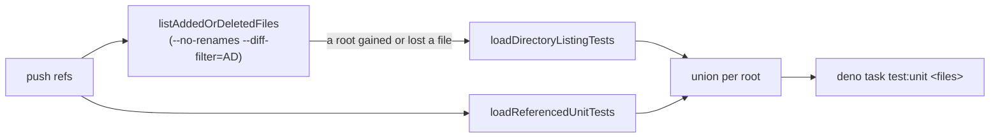

# PR Summary — Issue #5169

## Summary

Closes the "targeted subset" bypass behind the public VibeCoder incidents on
#5169 (the #5230 group). The pre-push gate's `deno test` check runs only the
tests it selects: changed tests, the same-named tests of changed sources, and
tests whose text names or imports a changed file. A test that checks the set of
files in a directory never names a new file, so it was never selected. Two
examples are `worker/deno/tests/parallel_unsafe_test_manifest_test.ts` (scans
`tests/`) and `worker/deno/tests/lib_sweep_coverage_test.ts` (walks `lib/`
through `lib/lib_sweep_coverage.ts`). PR #5232 added a test file and #5251 added
a module. Both pushes passed the local gate and then failed those tests in CI.

Now, when a push adds, deletes or renames a file under a Deno root with a
`test:unit` task, `runPrePushGate` also runs that root's directory-listing
tests:

- `listAddedOrDeletedFiles` lists the paths the pushed commits add or delete
  (`--no-renames --diff-filter=AD`, so a rename counts as both).
- `loadDirectoryListingTests` selects a `_test.ts` when it, or a test-tree file
  it imports, lists a directory or directly imports a module that does. Listing
  means calling `Deno.readDir`, `walk` or `expandGlob` (or their `Sync` forms),
  or quoting `ls-files`. A tracked `.ts` file that cannot be read counts as
  listing, so it fails closed.

These tests join the existing selected list. No new gate is added.

Parts of the issue are still not done (see Acceptance Criteria). Part of #5169.

## Spec

### Intent and Rationale

- Running the whole `test:unit` suite whenever the file set changes would never
  miss a test, but most pushes add a file. This rule runs fewer tests: on this
  repository's tree it selects 674 of the 2,382 test files, including both
  incident tests.
- The rule extends the existing `denoReferencedTests` selection. That matches
  the issue's "Do not create parallel language-specific gates".

### Essential Design Decisions

- It follows one import hop out of the test tree. A test that reaches a listing
  only through a second non-test module is not selected. This limit is marked
  `SIMPLE-ON-PURPOSE`, and CI's shards remain the backstop.
- Any add or delete under a root runs all of that root's listing tests, not just
  those for the changed directory. A text match also counts a comment that
  spells a listing call. Both rules over-select, so they fail closed.

### Undiscoverable Facts

- PRs #5226, #5252, #5257 and #5263 (all merged) delivered the earlier gate
  fixes for this issue. This branch starts from `main` at 56dd3ada1.

## Evidence

Backend-only change: no UI files are touched.

- Incident trace (public jobs, read with `gh run view` / `gh api .../logs` in an
  earlier run on this issue):
  - #5232, run 44001699372, head `576028085`, Deno tests (shard 3 of 4):
    `tests/parallel_unsafe_test_manifest_test.ts` failed because the new
    `tests/dummy_test_scan_5016_test.ts` was not in `WALL_CLOCK_TEST_FILES`.
  - #5251, run 44114964923, Deno tests (shard 1 of 4):
    `tests/lib_sweep_coverage_test.ts` failed because
    `docs/audits/lib-sweep-coverage.json` was out of date.
- On this repository's real tree, `loadDirectoryListingTests` returns 674 tests
  for `worker/deno`. They include `tests/parallel_unsafe_test_manifest_test.ts`
  (through `tests/support/test_source_graph.ts`, which calls `Deno.readDir`) and
  `tests/lib_sweep_coverage_test.ts`. I checked this with a throwaway script
  that imported the function; the script is not committed.
- Red before the fix: with `lib/pre_push_gate.ts` restored from `origin/main`
  (plus a stub `loadDirectoryListingTests` returning `{}`), the three new tests
  in the first commit failed. The selection was `[]` or missed the listing test.
  With `--no-renames` removed, the rename case failed (`[]`). Without the
  fail-closed change, the unreadable-module test failed (`"worker/deno": []`).
- Issue and PR numbers cited as provenance: #5169 (this issue), #5230 and #5151
  (incident reports consolidated here), #5232 and #5251 (the incident PRs), and
  #5226, #5252, #5257 and #5263 (earlier PRs on this issue).

## Acceptance Criteria

<!-- vibe-spec-review inputs="diff+issue-body" -->

- **partial** — "Find the path that skipped it (a disk-budget deferral that
  leaves checks to CI, a targeted subset) and close it" — evidence:
  `worker/deno/tests/pre_push_gate_test.ts::runPrePushGate: a push that only adds a test file also runs the tests that list the tests directory (Issue #5169)`
  — reviewer: partial — reason: the targeted-subset gap for directory-listing
  tests is closed, but a listing reached through a second non-test module is
  still missed, and the milestone merge-only sync (Issue #4326) still pushes a
  cargo-only merge with an `UNGATED:` note.
- **partial** — "Acceptance requires evidence for both incident groups" —
  evidence: `## Evidence` (runs 44001699372 and 44114964923) — reviewer: partial
  — reason: the VibeCoder group's two Deno shard failures are traced to this
  gap, but the private group's 22 jobs cannot be read from this run.
- **missing** — "incorporating #5151's three ShellCheck failures" — reviewer:
  missing — reason: #5151's jobs are in a private repository and were not
  diagnosed; this diff does not touch ShellCheck.
- **missing** — "A disk/resource deferral must retain WIP and resume
  automatically, not publish unvalidated work as passed" — reviewer: missing —
  reason: this diff touches no deferral path; the milestone merge-only sync
  (`worker/deno/lib/milestone_merge_only.ts`) is unchanged.
- **missing** — "cargo llvm-cov" — reviewer: missing — reason: no gate measures
  CI's line-coverage threshold, and `cargo-llvm-cov` is not installed in the
  worker container.
- **met** — "focused behavioural regressions for the actual publication paths,
  plus successful valid-path controls" — evidence:
  `worker/deno/tests/pre_push_gate_test.ts::runPrePushGate: a push that adds, deletes or renames a source runs the tests whose imported module walks a directory (Issue #5169)`
  and
  `worker/deno/tests/pre_push_gate_test.ts::runPrePushGate: a push that only adds a test file also runs the tests that list the tests directory (Issue #5169)`
  (each drives the real `runPrePushGate` publication path over a real git push;
  the valid-path control in the second test, editing an existing test, runs only
  that test) — reviewer: met — reason: the reviewer noted the stub runner always
  passes; whether a failing selected test blocks the push is already covered by
  the existing `deno test` failure tests.
- **met** — "Do not create parallel language-specific gates" — evidence:
  `worker/deno/lib/pre_push_gate.ts:3132` (`runPrePushGate` calls
  `loadDirectoryListingTests` and merges the result into the existing
  `denoReferencedTests` option at line 3155, consumed by the existing
  `deno task test:unit` check at line 1379; no new gate or check type is added)
  — reviewer: met
- **unrequested** — the `pushedNames` helper, now shared by `listPushedFiles`
  and `listAddedOrDeletedFiles` — reviewer: unrequested — reason: the reviewer
  judged it traceable; it lets both functions share one `git log` call, and
  `listPushedFiles` behaves as before.

## Standards Review

<!-- vibe-standards-review inputs="diff+CODING-STANDARDS.md" -->

- **violation** — the rename case had no test that failed without `--no-renames`
  — evidence: `worker/deno/lib/pre_push_gate.ts:308` — reason: fixed in this
  diff (rename case added; it fails with `--no-renames` removed)
- **violation** — an unreadable tracked `.ts` was skipped with `continue`, a
  silent pass — evidence: `worker/deno/lib/pre_push_gate.ts:3384` — reason:
  fixed in this diff (it now counts as listing a directory, pinned by a new
  test)
- **clean** — `LISTS_DIRECTORY` has no overlapping quantifiers. Doc comments are
  updated (module header, `plannedUnitTestFiles`, `planChangedFileChecks`,
  `denoReferencedTests`, `listPushedFiles`). Review-enforced rules checked:
  insertion points (Check where you insert), avoid over-engineering (reuses
  `relativeTsSpecifiers`, `resolveSpecifier`, `readRepoFile`), Australian
  English. No existing test was edited, and a git failure fails loud as
  infrastructure.

## Test Plan

- Added to `worker/deno/tests/pre_push_gate_test.ts`, with a small
  `unitCommandsAfterBase` helper (makes a pushed base, then the push under
  test):
  - `loadDirectoryListingTests: a test that lists a directory, or imports a file that does, is selected; a plain test and prose are not (Issue #5169)`
  - `loadDirectoryListingTests: an unreadable tracked module counts as listing a directory, so its importer runs (Issue #5169)`
    (control: a plain test is not selected).
  - `runPrePushGate: a push that only adds a test file also runs the tests that list the tests directory (Issue #5169)`
    (control: editing an existing test runs only that test).
  - `runPrePushGate: a push that adds, deletes or renames a source runs the tests whose imported module walks a directory (Issue #5169)`
- The helper's base push to its throwaway local remote uses `--no-verify`, as
  the existing fixture in the same file does: this host's `core.hooksPath` hook
  would otherwise run the outer gate on the fixture.
- No existing test was edited, and no assertion was removed.
- `deno test -A --filter "Issue #5169" tests/pre_push_gate_test.ts` (from
  `worker/deno`, with the host's `GIT_CONFIG_*` hook variables unset, on the
  final code): 18 passed, 0 failed. Re-run at the head after the pre-PR
  verifier's notice: 18 passed, 0 failed. `deno fmt --check`, `deno lint` and
  `deno check` on the two changed code files are clean.
- Docs: in `docs/CONFIGURATION.md`, I updated the pre-push gate's `deno test`
  selection paragraph and the stage summary ("the changed, referencing and, when
  the push adds, deletes or renames a file, directory-listing tests").
  `markdownlint-cli2` reports 0 issues. A grep of `docs/` (excluding
  `docs/archive/`) and `README.md` found no other description of this selection.
- `./quality.sh < /dev/null` ran on the first commit; the review fixes came
  after it. Every stage passed except `deno tests` (35,136 passed, 1 failed).
  The failure is `worker/deno/tests/pr_summary_ci_workflow_3768_test.ts` ("PR
  summary CI task runs git with restricted environment permissions"), which
  needs `registry.npmjs.org` ("dns error: failed to lookup address
  information"); this container has no network. Because of that failure the
  serial test pass did not run.
