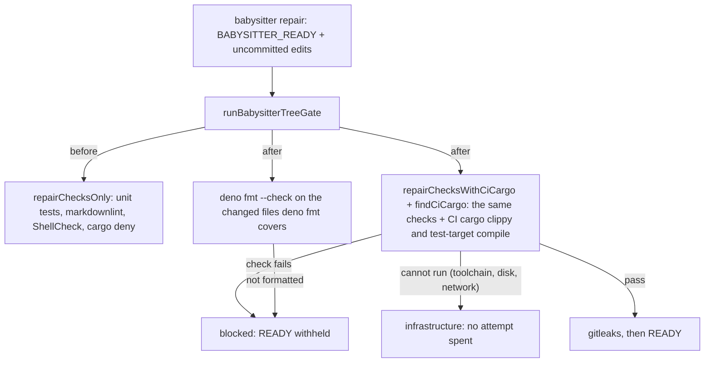

# PR Summary — Issue #5169

## Summary

The fleet babysitter's repair gate was the last publication path still on
`repairChecksOnly`. In that mode the pre-push gate plans no CI cargo check, so a
babysitter repair to a fleet PR reached CI without the repo's `cargo clippy` or
test-target compile (the build step behind `cargo llvm-cov`). The issue's
`E0252`, `E0308` and clippy codes come from those two steps.

- `worker/deno/lib/babysitter_tree_gate.ts`: `runBabysitterTreeGate` now calls
  the gate with `repairChecksWithCiCargo: true` and `findCiCargo`, which by
  default is the real workflow scan `repoCiCargoChecks`. This is the repair mode
  the CI-fix, PR-feedback, spelling and merge-conflict repairs already use
  (Issue #4630; PR #5226 for this issue). The CI cargo checks run when a
  Rust-relevant file changed.
- No `compareRef` is passed. The base comparison fetches into the clone and
  makes a worktree outside the gate's temp root, and the babysitter clone's
  `.git` is read-only. A failing CI cargo check therefore always blocks a
  babysitter repair. CI runs on the PR's own tree, so such a repair would fail
  CI anyway.
- `worker/deno/lib/pre_push_gate.ts` and `worker/deno/lib/git_push.ts`: the
  `repairChecksOnly` option and spec field had no production caller left, so
  they are removed. `repairChecksWithCiCargo` is now the only repair mode.
- `worker/deno/lib/pre_push_gate.ts`: the `repairChecksWithCiCargo` repair mode
  now also keeps the changed-file `deno fmt --check` the full gate runs. Before,
  a repair push ran no `deno fmt` at all, the issue's `deno fmt
  --check` step.
  Its file selection now also takes the files `deno fmt` covers, and the cspell
  lookup is skipped in that mode, so no check the mode skips (deno lint, cargo
  fmt, cspell, Floci) can block the push. This covers the CI-fix, PR-feedback,
  spelling and merge-conflict repairs and the babysitter's tree gate.
- Docs updated: `docs/CONFIGURATION.md`, `docs/INTERNALS.md` and
  `docs/workflows/fleet-pr-babysitter.md`.

The rest of the issue is still open (see Acceptance Criteria). Part of #5169.

## Spec

### Intent and Rationale

- PR #5226 closed the bypass for spelling and merge-conflict repairs, and
  deliberately left the babysitter tree gate on `repairChecksOnly`. The
  babysitter pushes repairs to fleet PRs, the population this issue counts.
  Among the repair push paths, it was the last one where a Rust edit met no CI
  cargo check.
- The fix reuses the existing gate mode and workflow scan. No new gate is added,
  as the issue asks.

### Essential Design Decisions

- The babysitter has no PR-base comparison for its cargo checks, because of the
  read-only `.git`. A base that already fails clippy blocks the repair, and the
  repair agent is told why. The CI-fix and other repairs keep their comparison.
- A CI cargo command the gate cannot reproduce, a missing toolchain, a full disk
  or an unreachable registry is an `infrastructure` outcome. It spends no repair
  attempt and never passes. This is `runPrePushGate`'s existing
  `PrePushGateInfrastructureError` path.
- Cargo may write `target/` in the clone. The tree gate's status read excludes
  ignored files. An unignored `target/` turns a pass into `blocked` through the
  existing settle step, so it is never staged by the host's `git add -A`.

### Undiscoverable Facts

- The 22 Rust/Deno PRs and #5151's three ShellCheck PRs are in a private
  repository. No shift-left ledger (`shift-left-ledger.json`) exists on this
  host, so this run could not read their jobs. The bypass was found by tracing
  the publication paths in code.
- `cargo llvm-cov` is not installed in the worker container (`cargo llvm-cov`
  gives `error: no such command: llvm-cov`). The coverage threshold therefore
  cannot be measured locally; only the test-target compile is.

## Evidence

Backend only: no UI file is touched.

- Issue numbers this diff cites: #5169 ("Fix local quality-check bypasses before
  fleet publication (Rust, Deno and ShellCheck)"). Existing citations (#4630,
  #4930, #5121, #4626, #4631) are kept as they were.
- Doc sweep: I grepped `docs/` and `worker/deno/lib/` for `repairChecksOnly`,
  "tree gate" and "formatters or linters". The babysitter "Pre-push gate"
  paragraph and the summary under "Container repairs" in
  `docs/workflows/fleet-pr-babysitter.md`, the babysitter paragraph and the
  unit-test and `cargo deny` bullets and the CI-fix push-guarantee paragraph in
  `docs/CONFIGURATION.md`, and the publication-paths passage in
  `docs/INTERNALS.md` now name the CI cargo checks. Each now says the gate runs
  no linter other than CI's cargo clippy.
  `grep -rn repairChecksOnly worker/ docs/ --include=*.ts --include=*.md`,
  excluding `docs/archive`, finds nothing.

## Acceptance Criteria

<!-- vibe-spec-review inputs="diff+issue-body" -->

- **met** — "Do not create parallel language-specific gates" — evidence:
  `worker/deno/lib/babysitter_tree_gate.ts` — reviewer: met — reason: reuses
  `repairChecksWithCiCargo` and `repoCiCargoChecks`, and removes
  `repairChecksOnly`.
- **partial** — "focused behavioural regressions for the actual publication
  paths, plus successful valid-path controls" — evidence:
  `worker/deno/tests/babysitter_tree_gate_test.ts::a repair changing a Rust file with a failing CI clippy blocks with its diagnostic (Issue #5169)`
  — reviewer: partial — reason: clippy block/pass tests exist for the babysitter
  gate and fmt block/pass tests for `runPrePushGate`, but there is no fmt-block
  test through `runBabysitterTreeGate` or `commitAndPushPending`, and no
  ShellCheck or llvm-cov test.
- **missing** — "Acceptance requires evidence for both incident groups" —
  reviewer: missing — reason: both groups' failing jobs are in a private
  repository this run could not read, and this host has no shift-left ledger.
- **missing** — "incorporating #5151's three ShellCheck failures" — reviewer:
  missing — reason: no ShellCheck change or test. #5151's failed step was "Run
  script tests", and it was not investigated.
- **missing** — "A disk/resource deferral must retain WIP and resume
  automatically, not publish unvalidated work as passed" — reviewer: missing —
  reason: the milestone merge-only sync (Issue #4326) still pushes an `UNGATED:`
  cargo-only merge. This PR does not change that path.
- **partial** — "cargo llvm-cov" — evidence:
  `worker/deno/tests/babysitter_tree_gate_test.ts::a repair changing a Rust file with a passing CI clippy passes and ran clippy (Issue #5169)`
  — reviewer: partial — reason: the babysitter gate now runs CI's test-target
  compile, but the coverage threshold is not measured. cargo-llvm-cov is not
  installed in the worker container.
- **partial** — "deno fmt" — evidence:
  `worker/deno/tests/pre_push_gate_test.ts::runPrePushGate: repairChecksWithCiCargo blocks a repair whose changed .ts file fails deno fmt --check, as CI's deno fmt step would (Issue #5169)`
  — reviewer: partial — reason: every repair push now runs the changed-file
  `deno fmt --check` (red on the unfixed gate), but not CI's whole-tree command.
- **unrequested** — the cspell lookup is skipped in repair mode — reviewer:
  unrequested — reason: needed so that taking the `deno fmt` files into repair
  mode cannot make a missing cspell block a repair that never runs cspell.
- **unrequested** — fixture `deno.json` files in `pre_push_gate_test.ts` are
  written formatted — reviewer: unrequested — reason: a host pre-push hook now
  runs `deno fmt` on the fixtures' own pushes.

## Standards Review

<!-- vibe-standards-review inputs="diff+CODING-STANDARDS.md" -->

- **violation** — A Code Change Owes a Docs Change: doc comments and docs still
  described repair mode without `deno fmt` — evidence:
  `worker/deno/lib/git_push.ts:63` — reason: fixed in this diff, along with
  `git_push.ts` (field doc and `resolveRepairPreFlightSpec`), `pre_push_gate.ts`
  (the `runPrePushGate` doc comment), `babysitter_tree_gate.ts`,
  `docs/INTERNALS.md` and four passages in `docs/CONFIGURATION.md`. The doc
  comments on `PreFlightGateSpec` and `REPAIR_CHECKS_WITH_CI_CARGO_PRE_FLIGHT`
  now say the babysitter tree gate sets `repairChecksWithCiCargo` directly for
  every repo and that the constant is used by the four repair processors only.
- **clean** — the `repairChecksOnly` removal (no hits outside `docs/archive`),
  the updated CONFIGURATION.md, INTERNALS.md and fleet-pr-babysitter.md
  paragraphs, test isolation (private temp dirs), the PR summary's records of
  edited and removed tests, spelling, and fail-closed handling (infrastructure
  faults never pass).

## Test Plan

- `deno fmt` repair check (this round): new red/green test above, with a passing
  control. Updated old-policy assertions that said a repair runs no `deno fmt`:
  `worker/deno/tests/babysitter_tree_gate_test.ts` (new test file, invalid and
  unreadable Deno config cases), `worker/deno/tests/git_push_preflight_test.ts`
  (`.ts` repair), `worker/deno/tests/babysitter_repair_4738_test.ts` (the runner
  now fails only the unit tests), and the
  `worker/deno/tests/pre_push_gate_test.ts` repair and docs-only tests. Fixture
  `deno.json` files are now written formatted. Results: those three files gave
  146 passed, 0 failed. The `PR #5034 review` tests gave 13 passed with the host
  pre-push hook disabled. With the host hook on, they fail because the fixtures'
  own `git push` meets that hook.
- Final head, run from `worker/deno` with the host pre-push hook disabled
  (`GIT_CONFIG_COUNT=1 GIT_CONFIG_KEY_0=core.hooksPath
  GIT_CONFIG_VALUE_0=/dev/null`):
  `deno test -A tests/pre_push_gate_test.ts tests/shellcheck_publication_test.ts`
  gave 192 passed, 2 failed (re-run on the head). Both failures are
  `pre-push CLI:` tests that could not download
  `https://jsr.io/@std/yaml/meta.json` (no network here).

- `worker/deno/tests/babysitter_tree_gate_test.ts` (66 tests at head) has three
  new tests. Each runs the real `runBabysitterTreeGate` and the real workflow
  scan (no `findCiCargo` injected) over a real clone whose `main` holds a crate
  and a pull-request workflow running
  `cargo clippy --all-targets -- -D warnings`. Only the command runner is faked.
  - `a repair changing a Rust file with a failing CI clippy blocks with its
    diagnostic (Issue #5169)`:
    an uncommitted `src/lib.rs` edit, clippy exits 101, and the outcome is
    `blocked` with the clippy diagnostic. Red on the unfixed gate:
    `AssertionError: Values are not equal` (`passed` vs `blocked`), because
    clippy never ran.
  - `a repair changing a Rust file with a passing CI clippy passes and ran
    clippy (Issue #5169)`:
    the valid-path control. Red on the unfixed gate:
    `AssertionError: clippy ran:` (no commands).
  - `a repair changing only a non-Rust file runs no cargo command (Issue
    #5169)`:
    a `NOTES.md` edit with a failing clippy stub passes and runs no `cargo`
    command. Green on base too, as expected.
- Governing requirement for the edited tests (Part of #5169, "What to fix",
  quoted verbatim): "Make the fleet run
  `cargo clippy, cargo llvm-cov, deno fmt, deno test` the way CI does, and
  require it to pass, before a PR is raised or a fix is pushed. Find the path
  that skipped it (a disk-budget deferral that leaves checks to CI, a targeted
  subset) and close it."
- Edited tests, after `repairChecksOnly` was removed:
  - Removed from `worker/deno/tests/pre_push_gate_cargo_deny_test.ts`: the whole
    test `cargo deny: repairChecksOnly mode checks Cargo.lock`, with
    `assert(result.ok);` and
    `assertEquals(denyCommands(seen), [{ command: DENY_ARGV, cwd: clone }]);`.
    - Obsolete: the `repairChecksOnly` mode no longer exists.
    - Still covered by:
      `worker/deno/tests/pre_push_gate_cargo_deny_test.ts::cargo deny: repairChecksWithCiCargo mode checks Cargo.lock`,
      which makes the same assertions.
  - `worker/deno/tests/pre_push_gate_cargo_deny_test.ts`:
    `cargo deny:
    repairChecksOnly mode skips a source-only repair even with a baseRef`
    is renamed to the `repairChecksWithCiCargo` mode, with every assertion kept.
    It passes.
  - `worker/deno/tests/pre_push_gate_test.ts`: the `{ repairChecksOnly: true }`
    entry is dropped from two mode loops. The `{}` and
    `{ repairChecksWithCiCargo: true }` entries and every assertion in the loop
    bodies remain.
  - `worker/deno/tests/git_push_preflight_test.ts`: the repair test that passed
    `{ commands: [], repairChecksOnly: true, runner }` now passes
    `{ ...REPAIR_CHECKS_WITH_CI_CARGO_PRE_FLIGHT, runner }`, with every
    assertion unchanged. The change has no Rust file, so no cargo check is
    planned and the assertions hold.
  - `worker/deno/tests/pre_push_gate_test.ts`: five repair-mode tests change
    because the mode now keeps the changed-file `deno fmt --check`.
    - Obsolete: a `repairChecksWithCiCargo` repair push runs no `deno fmt` at
      all.
    - Remaining: no `deno lint`, no cspell, and no cargo command beyond the CI
      checks; the docs-only repair still reads no CI cargo scan.
    - Covered by:
      - `worker/deno/tests/pre_push_gate_test.ts::runPrePushGate: repairChecksWithCiCargo runs deno fmt --check and the CI cargo commands for a .rs and .ts push, and nothing else (Issue #5169)`
        (renamed; expected `checksRun` goes from `[CLIPPY_CMD]` to
        `[BAD_TS_FMT, CLIPPY_CMD]`, and the only-cargo-commands assertion also
        allows the one `deno fmt --check` command).
      - `worker/deno/tests/pre_push_gate_test.ts::runPrePushGate: repairChecksWithCiCargo on a docs-only push runs only deno fmt --check and markdownlint for the pushed Markdown and does not read the CI cargo scan (Issues #4930 and #5169)`
        (renamed; the control expects
        `deno fmt --check --permit-no-files
        'README.md'` first, then
        markdownlint).
      - `worker/deno/tests/pre_push_gate_test.ts::runPrePushGate: repair pushes enforce unit tests and markdownlint (PR #5034 review)`
        (the `{ repairChecksOnly: true }` mode entry is dropped; no longer
        asserts that no `deno fmt` ran; asserts
        `deno fmt --check --permit-no-files
        'lib/foo.ts'` ran and no
        `deno lint` ran).
  - `worker/deno/tests/git_push_preflight_test.ts::commitAndPushPending - repairChecksWithCiCargo: a .ts file gets only deno fmt --check, no other deno check (#4630, #5169)`:
    renamed. It asserted that no deno command ran for a `.ts` file in a repair
    push (obsolete); it now asserts the deno commands are exactly
    `deno fmt --check --permit-no-files 'bad.ts'`, and still that no `deno lint`
    or other deno check ran.
  - `worker/deno/tests/babysitter_tree_gate_test.ts::an uncommitted new test file that fails blocks, naming the failing command, with only deno fmt --check and no linter run (#4930, #5169)`:
    renamed. The expected `deno fmt` and `deno lint` command list goes from `[]`
    (obsolete) to `["deno fmt --check --permit-no-files 'tests/new_test.ts'"]`.
    The invalid-config test and both passes of the unreadable-config test in
    that file likewise gain a leading `deno fmt --check` entry in the expected
    `checksRun` of a passing gate.
  - `worker/deno/tests/babysitter_repair_4738_test.ts`: the fake runner failed
    every command; it now fails only `deno task test:unit` commands, so the new
    `deno fmt --check` passes. No assertion changes; the same test still blocks
    on a failing unit test.
- Results on this head, run from `worker/deno`:
  - `worker/deno/tests/babysitter_tree_gate_test.ts` (66 tests at head),
    `worker/deno/tests/babysitter_repair_4738_test.ts` (43),
    `worker/deno/tests/pre_push_gate_cargo_deny_test.ts` (13) and
    `worker/deno/tests/git_push_preflight_test.ts` (37): 159 passed, 0 failed in
    total, each file run on its own.
  - `deno check` on the changed lib files and `commands/babysitter_repair.ts`:
    clean.
  - Run directly with `deno test -A`, `worker/deno/tests/pre_push_gate_test.ts`
    (186 tests at head) gave 145 passed and 41 failed on this head. The failures
    come from the fixtures' own `git push` meeting the host's pre-push hook
    (markdownlint on a fixture `README.md`; filed as #5254). Under
    `./quality.sh` that file raised no failure.
- `./quality.sh < /dev/null` on this head:
  - Every stage passed except `deno tests`. Config integration and checkov were
    skipped in this environment.
  - The parallel pass gave 35116 passed and 1 failed. The failure was in the
    unchanged
    `PR summary CI task runs git with restricted environment
    permissions`
    test (Issue #3768): it could not resolve `registry.npmjs.org` (no network).
    Re-run alone on the head, that file gave 10 passed, 1 failed for the same
    reason. This change does not touch that test.
  - The serial pass did not run because the parallel pass had failed.

Not done or not checked:

- The Acceptance Criteria entries above.
- The serial test pass of `./quality.sh`, and the network-dependent test.
- No real `cargo clippy` ran in a babysitter container. The tests fake the
  command runner.

🤖 Generated with [Claude Code](https://claude.com/claude-code)
