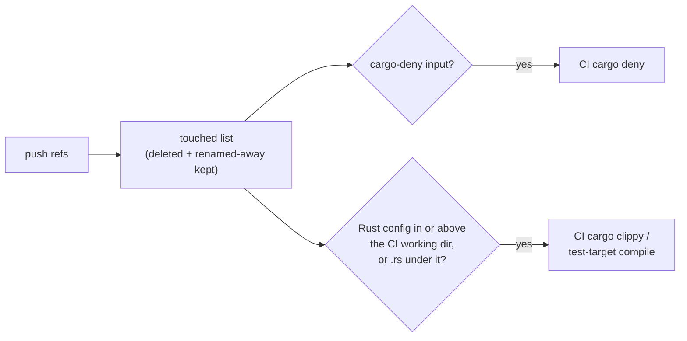

# PR Summary — Issue #5169

## Summary

Closes two more pre-push gate bypasses that the stsoftware-pr-reviewer reported
on #5169 while reviewing PR #5257:

- **cargo deny for deleted inputs.** `runPrePushGate` now decides the cargo-deny
  trigger from the touched list (`touched.value`), which keeps deleted paths and
  the old name of a rename (`git log --no-renames`). Before this change it read
  `contained.value` (`--diff-filter=d`, existing files only). So when `always`
  was false (no `baseRef`, or any `repairChecksWithCiCargo` repair, including
  the babysitter tree gate), a push that only deleted or renamed away
  `deny.toml`, `Cargo.lock`, `Cargo.toml`, `.deny.toml` or `.cargo/config.toml`
  ran no cargo deny.
- **CI clippy for ancestor Rust config.** `planChangedFileChecks` now plans a CI
  cargo check when a Rust config file (`RUST_CONFIG_NAMES`: `Cargo.toml`,
  `Cargo.lock`, `rust-toolchain`, `rust-toolchain.toml`, `clippy.toml`,
  `.clippy.toml`) changes in an ancestor of the check's working directory, not
  only under it. A root toolchain pin or workspace `Cargo.lock` change therefore
  runs CI's `cargo clippy` for a `rust/` working directory. A `.rs` file still
  counts only under the working directory.

Parts of the issue are still not done (listed under Acceptance Criteria). Part
of #5169.

## Spec

### Intent and Rationale

- Both fixes change the inputs of the existing triggers. No new gate is added,
  as the issue requires ("Do not create parallel language-specific gates").
- rustup reads `rust-toolchain(.toml)` from parent directories, clippy reads
  `clippy.toml` from parent directories, and a workspace's `Cargo.toml` and
  `Cargo.lock` sit above its member crates. A change to any of them changes what
  CI's cargo command in a sub-directory builds.

### Essential Design Decisions

- `governsCargoDir(path, dir)` in `worker/deno/lib/pre_push_gate.ts` is the one
  rule. A Rust-relevant path under `dir` (or any path when `dir` is `.`) counts,
  and a `RUST_CONFIG_NAMES` file in a strict ancestor of `dir` counts. The
  ancestor test compares whole path segments, so `rusty/Cargo.lock` does not
  govern `rust`.
- Any ancestor config counts, even a root `Cargo.toml` that is not a workspace
  of the sub-directory crate. That can cost an extra clippy run, which is
  accepted because the rule fails closed.
- The cargo-deny trigger list also keeps files under a symlinked parent
  directory. That can only add a cargo-deny run, never skip one.

### Undiscoverable Facts

- PRs #5252 and #5257 (both merged) delivered the babysitter tree gate's CI
  cargo and `deno fmt --check` checks, and the deleted- and renamed-path CI
  cargo trigger. This branch builds on `main` at 5c3a5a837.

## Evidence

Backend-only change: no UI files are touched.

- Red before the fix: an executor ran the new tests against the unchanged
  production code. Eight failed, all of them new: the three looped cargo-deny
  removal tests, the cargo-deny verdict test, the `repairChecksWithCiCargo`
  cargo-deny test, the `planChangedFileChecks` ancestor test and both
  root-config `runPrePushGate` tests. The controls (the non-cargo deletion,
  `tools/Cargo.lock`, `build.rs`) passed on the unchanged code, as expected.
- Issue and PR numbers cited as provenance: #5169 (this issue), #5151 and #5230
  (the incident reports consolidated into it), #5232 and #5251 (the VibeCoder
  PRs whose failing runs are traced below), #4326 (the merge-only sync), and
  #5252 and #5257 (earlier PRs on this issue).

## Incident Evidence

The private-repository group (the 22 Rust/Deno failures and #5151's three
ShellCheck failures) cannot be read from this run: the PRs are withheld and no
shift-left ledger with the observations is on this host.

The VibeCoder group (#5230) is public. I read the failing jobs of the two
recurrences named on #5230 with `gh run view` and `gh api .../jobs/<id>/logs`:

| PR    | Run                            | Failed step                   | Failing check                                                                                                                                                            |
| ----- | ------------------------------ | ----------------------------- | ------------------------------------------------------------------------------------------------------------------------------------------------------------------------ |
| #5232 | 44001699372 (head `576028085`) | Deno tests (shard 3 of 4)     | `tests/parallel_unsafe_test_manifest_test.ts` ("no wall-clock test is missing from it"): the new `tests/dummy_test_scan_5016_test.ts` was not in `WALL_CLOCK_TEST_FILES` |
| #5251 | 44114964923                    | Deno tests (shard 1 of 4)     | `tests/lib_sweep_coverage_test.ts` (`docs/audits/lib-sweep-coverage.json` out of date) and `tests/token_economizer_trial_docs_test.ts` (live trial page drift)           |
| #5251 | 44091587524                    | Sweep ledger sweptAt ancestry | slice `top-up-4959`: `sweptAt 29b84dec…` is not an ancestor of `origin/main`                                                                                             |

What this shows, read from the code and not run: the shard failures are
repo-wide invariant tests. The pre-push gate's `deno test` check runs only the
files `plannedUnitTestFiles` (`worker/deno/lib/pre_push_gate.ts`) selects: a
changed `_test.ts`, the `_test.ts` sibling of a changed source, and the tests
whose text names a changed file. `parallel_unsafe_test_manifest_test.ts` scans
the test directory rather than naming the new file, so a push that only adds
`dummy_test_scan_5016_test.ts` does not select it. That is the "targeted subset"
path the issue names. This PR does not fix it. The sweep-ledger ancestry step is
a CI step with no local equivalent in the gate.

ShellCheck runs only inside `runPrePushGate` (`runAffectedShellcheckChecks`),
and `commitAndPushPending` reaches that gate only under `if (preFlight)` at
`worker/deno/lib/git_push.ts:1163`. These pushes always go through it: the
agent's own pre-push hook, the completion gate (which substitutes an empty spec
when the repo configures none), the repair processors and the babysitter tree
gate. These pushes reach it only when the repo configures pre-flight commands,
because they pass `resolvePreFlightSpec`, which returns `undefined` otherwise:
the PR-body-length re-commit (`worker/deno/lib/pr_body_length.ts:464`), the
screenshot-gate retry (`worker/deno/lib/screenshot_gate_retry.ts:217`) and the
summary-rule-gate retry (`worker/deno/lib/summary_rule_gate_retry.ts:538`).
These pushes pass no pre-flight spec at all, so they run no ShellCheck and no
other changed-file check: the WIP checkpoints
(`worker/deno/lib/wip_checkpoint.ts:355` and `:378`), WIP preservation
(`worker/deno/lib/phases/run_wip_preservation.ts:456`) and the declared-handoff
push (`worker/deno/lib/phases/declared_handoff.ts:102`). They push to the issue
branch, so they reach a PR's CI only when that branch already has an open PR. I
have not traced whether #5151's three failures came through any of these pushes,
because the failing jobs are private.

## Acceptance Criteria

<!-- vibe-spec-review inputs="diff+issue-body" -->

- **partial** — "Acceptance requires evidence for both incident groups" —
  evidence: `## Incident Evidence` (runs 44001699372, 44114964923, 44091587524)
  — reviewer: partial — reason: the VibeCoder group's #5232 and #5251 failures
  are traced to their CI step and to the targeted `deno test` subset, but the
  private group's jobs cannot be read here and that subset gap is not fixed.
- **missing** — "incorporating #5151's three ShellCheck failures" — reviewer:
  missing — reason: #5151's jobs are private and were not diagnosed; the pushes
  that skip ShellCheck are named in `## Incident Evidence` but not traced to
  #5151.
- **missing** — "A disk/resource deferral must retain WIP and resume
  automatically, not publish unvalidated work as passed" — reviewer: missing —
  reason: the milestone merge-only sync (Issue #4326,
  `worker/deno/lib/git_pull.ts`) still pushes a cargo-only merge with an
  `UNGATED:` note; this PR does not change it.
- **missing** — "cargo llvm-cov" — reviewer: missing — reason: no gate measures
  CI's line-coverage threshold, and `cargo-llvm-cov` is not installed in the
  worker container.

## Test Plan

- Added to `worker/deno/tests/pre_push_gate_cargo_deny_test.ts` (with a
  `makeRepoRemoving` helper that pushes the CI workflow and files, then makes
  one local commit that only `git rm`s or `git mv`s a path). The tests run with
  no `baseRef`, so `always` is false:
  - `cargo deny: a push that only deletes deny.toml runs CI's cargo deny (Issue #5169)`,
    and the same for `deletes Cargo.lock` and `renames deny.toml away`. Each
    asserts that exactly CI's argv ran, in the clone.
  - `cargo deny: a verdict after a push that only deletes Cargo.lock blocks, and is not infrastructure (Issue #5169)`.
  - `cargo deny: repairChecksWithCiCargo runs cargo deny for a push that only deletes deny.toml (Issue #5169)`.
  - `cargo deny: a push that only deletes a non-cargo file runs no cargo deny (Issue #5169)`
    (the control).
- Added to `worker/deno/tests/pre_push_gate_test.ts`:
  - `planChangedFileChecks: Rust config in an ancestor of the CI working directory plans the check, a look-alike prefix does not (Issue #5169)`.
    A root `rust-toolchain.toml` plans `cargo clippy (rust)`, and
    `rust/Cargo.lock` plans the `rust/crates/a` check. `rusty/Cargo.lock` and a
    root `build.rs` plan nothing.
  - `runPrePushGate: a push that only changes a root rust-toolchain.toml runs the sub-directory CI clippy, and a failing clippy blocks it (Issue #5169)`,
    and the same for a root `Cargo.lock`. The passing run executes exactly
    `[CLIPPY_CMD]`, and a failing clippy blocks with a `PreFlightGateError` that
    is not infrastructure.
  - `runPrePushGate: a push that only changes a sibling directory's tools/Cargo.lock runs no CI clippy for rust (Issue #5169)`
    and `… a root .rs file build.rs …` (the controls).
- No existing test was edited, and no assertion was removed.
- `deno task test:unit` (from `worker/deno`, re-run on the head, 0 failed in
  each): `worker/deno/tests/pre_push_gate_test.ts` (198 tests at head) and
  `worker/deno/tests/pre_push_gate_cargo_deny_test.ts` (19 tests at head), both
  changed by this PR; `worker/deno/tests/babysitter_tree_gate_test.ts` (68 tests
  at head) is an unchanged regression suite run for the callers of the changed
  gate. `deno fmt --check`, `deno lint` and `deno check` on the three changed
  code files are clean.
- Docs: in `docs/CONFIGURATION.md`, I read and updated the "push guarantee"
  paragraph, the repair-processor paragraph, the "CI's cargo clippy and
  test-target compile" bullet and the `cargo deny` bullet. In
  `docs/workflows/fleet-pr-babysitter.md`, I updated the Container repairs gate
  paragraph and the READY-line paragraph. A grep of `docs/` (excluding
  `docs/archive/`) and `README.md` for `Rust-relevant`, `cargo input`,
  `cargo-deny` and `cargo deny` found no other sentence about when these checks
  trigger. `markdownlint-cli2` on the two docs reports 0 issues.
- Source doc comments: after PR #5263 review, I updated the
  `planChangedFileChecks` doc comment and item 2 of the `pre_push_gate.ts`
  module header to state the ancestor-config rule. A grep for `Rust-relevant`
  and `under the check` over `worker/deno/lib/` on the final head found no other
  sentence that still gives the under-directory-only rule.
- `./quality.sh < /dev/null` on the final code: every stage passed except
  `deno tests` (35130 passed, 1 failed). The failure is
  `worker/deno/tests/pr_summary_ci_workflow_3768_test.ts` ("PR summary CI task
  runs git with restricted environment permissions"). It needs
  `registry.npmjs.org` ("dns error: failed to lookup address information"), and
  this container has no network. Because of that failure the serial test pass
  did not run.
