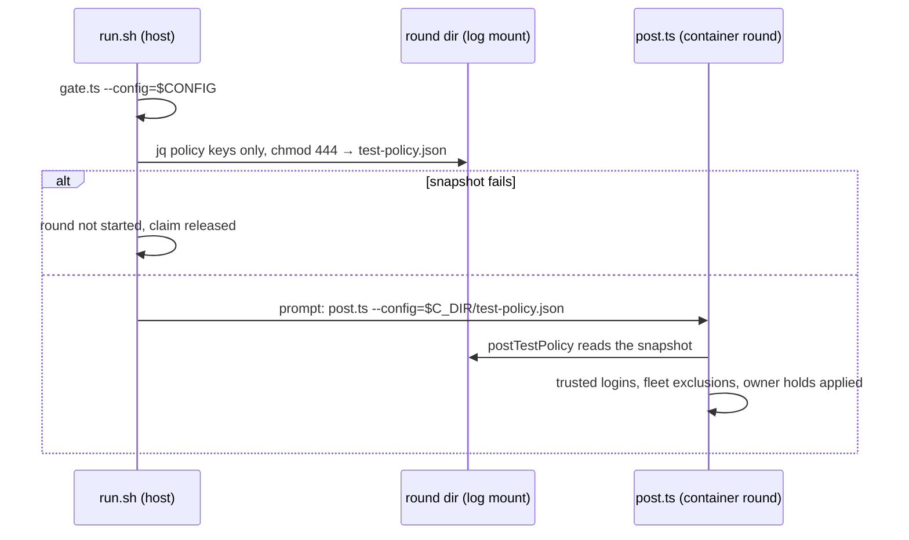

## Summary

A review round runs in the worker container, which has no `.config.json`.
`post.ts` called `loadTestPolicy()` with no argument and ignored `--config`, and
the loader turned a missing file into `effectiveTestPolicy({})`. So the round
posted on an empty policy. It had no trusted logins, no service-account
exclusions and no `pr_reviewer_test_hold_repos`. An owner-approved issue filed
by the reviewer App was then rejected as "not by a trusted author" (PRs #5170
and #5171).

- `.claude/skills/review-fleet-prs/scripts/post.ts`: new `postTestPolicy(args)`
  reads the policy from `--config=<path>`, else from the checkout's
  `.config.json`. `main()` uses it before anything is filed or posted. On a
  missing or malformed config it prints `test-change policy: …` and exits 1, as
  `gate.ts` already does.
- `.claude/skills/review-fleet-prs/scripts/test_change_policy.ts`:
  - `loadTestPolicy` now throws `<path> not found: …` on a missing file. It no
    longer returns the defaults.
  - New `TEST_POLICY_CONFIG_KEYS` lists the eight keys the policy reads.
    `effectiveTestPolicy` reads only those keys.
- `.claude/skills/review-fleet-prs/scripts/run.sh`: `start_review` writes the
  round directory's `test-policy.json`. It copies only those keys from `$CONFIG`
  with `jq`, so no credential is copied, and sets the file to mode 0444. The
  round prompt tells the round to run post.ts with
  `--config=$C_DIR/test-policy.json`. If the snapshot cannot be written, the
  round is not started and its claim is released.
- Docs: `SKILL.md` (the post.ts step), `references/running-unattended.md` (the
  round's container paths) and `docs/CONFIGURATION.md`
  (`pr_reviewer_test_hold_repos`).

Closes #5174.

## Spec

### Intent and Rationale

- The poster must judge with the same policy the gate loaded. The round already
  gets its state directory through the log mount, so a key-limited snapshot in
  the round directory carries the policy there. Mounting `.config.json` itself
  would expose credentials (issue: "rather than copying credentials into review
  artefacts").
- A missing config now fails loud and is never read as an empty policy. The
  issue says missing deployment configuration is "repaired as infrastructure,
  not converted into a branch finding or a permissive policy".

### Essential Design Decisions

- The snapshot key list exists twice: `TEST_POLICY_KEYS` in `run.sh` and
  `TEST_POLICY_CONFIG_KEYS` in TypeScript. `effectiveTestPolicy` reads only the
  TypeScript list, so a newly read key must be added to it. The runner test
  fails when the snapshot made by `run.sh` drops a key from that list or
  includes another one.
- The owner-approval, edit-history, quote and coverage decisions are unchanged.
  Only where the policy comes from has changed.
- The host-side audit send-back already passed `--config="$CONFIG"` to post.ts.
  That flag is now honoured too.

### Undiscoverable Facts

- `run.sh:654` (audit send-back) and `SKILL.md`'s post.ts command already passed
  `--config`, but post.ts never read it.
- The read-only mode is a guard against accidental edits, not a security
  boundary. The round may use `deno run`, so a round set on changing the
  snapshot could still `chmod` it. The round is the reviewer, which already
  decides the outcome.

## Evidence

Backend and CLI change only; no UI file is touched.

Issue numbers the diff cites: #5174: Review posting drops the configured test
policy in container rounds, rejecting owner-approved governing issues.

## Test Plan

- New tests in `worker/deno/tests/review_fleet_prs_runner_test.ts`, which run
  the real `run.sh` with a stubbed gate and container:
  - "run.sh hands the round a read-only snapshot of only the test-change policy,
    which post.ts reads (Issue #5174)". It uses an alternate config that sets
    every policy key plus `github_token` and `pr_reviewer_app` values, with no
    checkout `.config.json`. It checks that:
    - the snapshot's keys are exactly `TEST_POLICY_CONFIG_KEYS`;
    - no secret value is copied, and the file has no write bits;
    - the prompt names `--config=<round dir>/test-policy.json`;
    - the real `postTestPolicy` on that path equals
      `effectiveTestPolicy(<full
      config>)`, with the hold repo in
      `hold-all` and the bot in `fleetWorkerLogins`.
  - "run.sh starts no round when the test-change policy cannot be snapshotted,
    and releases its claim (Issue #5174)".
- New tests in `worker/deno/tests/review_fleet_prs_test_policy_4655_test.ts`.
  Each loads a snapshot through `postTestPolicy`:
  - an issue filed by `stsoftware-pr-reviewer[bot]` with `work-on` added by
    `nleck` is governing. With `effectiveTestPolicy({})` it is refused as "not
    by a trusted author", which is the reported defect;
  - `work-on` added by `mallory` is refused;
  - `acme/held` is in `hold-all` mode and other repos stay in `evidence` mode;
  - a missing `--config` file rejects with "not found";
  - a key outside `TEST_POLICY_CONFIG_KEYS` does not change the policy.
- Red on base: with `run.sh` restored from `origin/main`, both new runner tests
  failed. One failed because no `test-policy.json` was written; the other
  because the round still started. With the base `post.ts` and
  `test_change_policy.ts`, the new 4655 tests failed at import (no
  `postTestPolicy`).
- Removed from `worker/deno/tests/review_fleet_prs_test_policy_4655_test.ts`:
  ``assertEquals(await loadTestPolicy(`${dir}/missing.json`), effectiveTestPolicy({}))``
  - Required by: "Missing deployment configuration should be repaired as
    infrastructure, not converted into a branch finding or a permissive policy."
  - Replaced by:
    ``assertRejects(() => loadTestPolicy(`${dir}/missing.json`), Error, "not found")``
    in the same test. The test is renamed to "loadTestPolicy: a missing file is
    an error, never the defaults; other read errors rethrow (Issue #5174)", and
    its other assertions are unchanged.
- Fixtures changed for the new precondition (the worktree has no
  `.config.json`), with no assertion changed:
  - `review_fleet_prs_runner_test.ts`: `fixture()` writes `{}` to
    `${home}/config.json`, and `runBash` and `runFor` set
    `REVIEW_FLEET_PRS_CONFIG` to it by default.
  - `review_fleet_prs_post_claim_4398_test.ts` and
    `review_fleet_prs_checklists_3594_test.ts`: these start the real post.ts,
    now with `--config` pointing at a `{}` file. Before, the missing file gave
    them the same empty policy.
- Callers of the changed `loadTestPolicy`:
  - `gate.ts` reads the same file with `readTextFile` first, so a missing file
    already failed there;
  - `post.ts` now goes through `postTestPolicy`.
- Runs on the final head, all passing:
  - `deno task test tests/review_fleet_prs_runner_test.ts`: 79 passed;
  - every other `review_fleet_prs_*_test.ts` unit file plus
    `pr_review_brief_shared_3395_test.ts`: 462 passed;
  - `./quality.sh < /dev/null`: `Result: PASSED (with skipped checks)`, with
    `config integration` and `checkov` skipped.
- Docs sweep: grepped `SKILL.md`, `references/*.md` and `docs/` for
  `loadTestPolicy`, `--config` and "defaults". The passages updated are the
  post.ts step in `SKILL.md`, the "The round is given container paths" paragraph
  and the `pr_reviewer_test_hold_repos` section.

## Not done or not checked

- No live review round was run in a real worker container against PRs #5170 and
  #5171. The container path is covered only by the runner stub.
- The learning round gets no snapshot: it posts no review.
