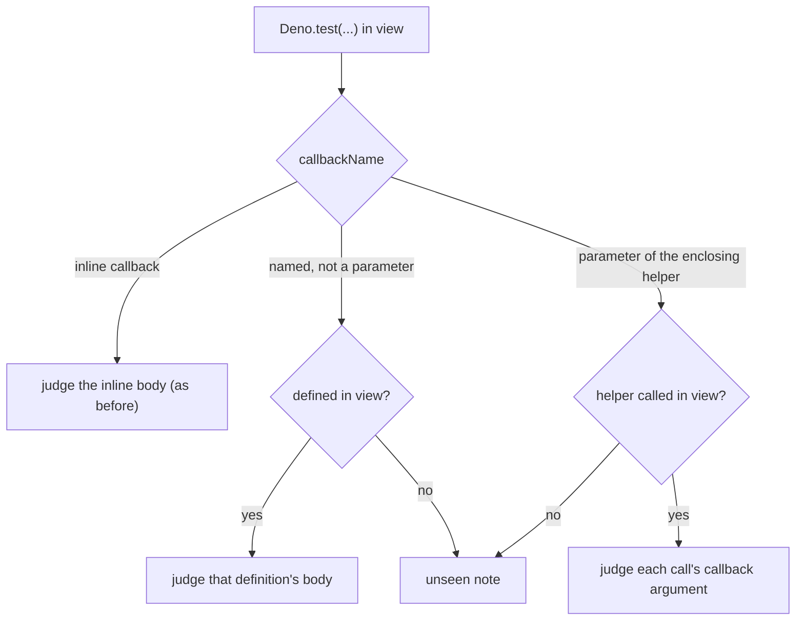

# PR Summary — Issue #5215

## Summary

The dummy-test scan now judges a test registered with a callback by the
callback's body, not by the registration's argument span. It handles
`Deno.test("x", check)`, `Deno.test({ name, fn: check })` and a registration
helper such as `Deno.test({ name, ignore: cond, fn })`. Before this change the
scan gave a definitive `no-assertion` finding for every registration helper,
whatever its callers passed. For a helper, the scan now judges the callback
argument at each call of the helper in view. A callback defined in view that
asserts nothing is still refused. A callback the diff cannot resolve becomes an
`unseen` checklist note, never a finding. That includes a property-path
reference (`Deno.test("x", suite.check)`, `fn: suite.check`, or
`register("a", suite.check)`). A trailing value after an inline callback, as in
`it("x", async () => {...}, TIMEOUT)`, is not read as the callback: the inline
body is judged as before. Each definition's parameter names are parsed once, and
bracket tables remain available for the duration of a scan. Callback and
parameter candidates are indexed by name. Closes #5215.

## Spec

### Intent and Rationale

- The base scanner passed the whole registration argument span to `judge`. For a
  wrapper, that span holds only `{ name, ignore, fn }`, so a useful test was
  refused (PR #5214, `aws_emulator_run_5109_test.ts:283`).
- The fix resolves the callback where the scan already resolves helpers: from
  function definitions in view (`definitionSpans`). The scan stays deterministic
  and diff-only.

### Essential Design Decisions

- A registration whose callback is a parameter of the enclosing function
  (`registrarOf`) is not judged at the registration. Each call of that helper in
  the same file is judged instead: an inline callback by its body, a named one
  by its definition. A helper with no call in view is an `unseen` note on its
  `Deno.test` line.
- A callback passed by name that is not defined in view (imported, say) is an
  `unseen` note. This reuses the existing uncertain path and its checklist item,
  whose wording now also names "the callback it registers".
- Wrappers are not suppressed. A helper call whose callback asserts nothing is
  refused on the call line.

### Undiscoverable Facts

- The issue's reproduction (a new-file diff of the `register` helper) gave
  `no-assertion` on line 3 against the base scanner. The first test below
  reproduces it.

## Evidence

Backend/CLI-only change: no UI files.

- Corpus run, before and after: every tracked `worker/deno/tests/*_test.ts` and
  `.claude/**/*_test.ts` file was scanned as a new-file diff, first with the
  base `dummy_test_scan.ts` and then with the head copy.
  - Base: 144 findings and 268 notes. Head: 141 findings and 268 notes.
  - The only difference is three base findings that are gone at head:
    `aws_emulator_run_5109_test.ts:283` (the issue's case),
    `setup_ps1_test.ts:116` and `setup_ps1_update_mode_test.ts:151`.
  - Each of the three is a `pwshTest` or `testAsOrdinaryUser` wrapper whose call
    sites pass asserting callbacks, so all three were false positives. The run
    added no finding and no note.
- Regexes on untrusted text that the change adds: `CALL_NAME`, `PARAM_NAME`,
  `FN_PROPERTY` and `FUNCTION_HEAD` (`REF` is fully anchored).
  - `CALL_NAME`'s lookbehind allows one start per identifier run. `PARAM_NAME`
    and `FN_PROPERTY` are anchored. `FUNCTION_HEAD` runs on a 40-character
    slice.
  - A hostile case with a 50,000-character run covers the first three; each one
    asserts its result.

## Test Plan

Tests added to `worker/deno/tests/dummy_test_scan_5016_test.ts`. No existing
assertion was edited or removed.

- `a registration helper's asserting callback is accepted (Issue #5215)`: the
  issue's own reproduction.
- `a helper with the issue's options shape and an asserting callback is
  accepted (Issue #5215)`:
  the `testAsOrdinaryUser` shape from PR #5214.
- `a registration helper's dummy call is refused on its call line, not the
  helper's (Issue #5215)`:
  an assertion-free callback passed through a helper is still refused, beside an
  accepted asserting call.
- Named callbacks:
  - `a named callback defined in view and asserting is accepted (Issue #5215)`
    covers the positional, `fn:` and helper forms.
  - `a named callback defined in view that asserts nothing is refused on each
    registration (Issue #5215)`
    and
    `a helper call passing a named callback
    that asserts nothing is refused on the call line (Issue #5215)`
    cover a resolved callback that really asserts nothing.
- Unresolved callbacks:
  - `a callback not defined in view is a note, not a finding (Issue #5215)`.
  - `a registration helper whose calls are not in view is a note on its
    Deno.test line (Issue #5215)`.
- `an inline options callback is judged as before (Issue #5215)`: the existing
  inline path, positive and negative.
- `a registration helper call nested in another call is judged (Issue #5215)`
  and
  `a helper call directly inside a call's parentheses is judged (Issue
  #5215)`:
  helper calls that are not at statement level.
- `registration patterns stay linear on long hostile runs (Issue #5215)`: the
  hostile regex cases described under Evidence.
- `a trailing value after an inline callback is not read as the callback (Issue
  #5215)`:
  `it("x", async () => {...}, TIMEOUT)` with a dummy body is still
  `no-assertion` on its line, and with an asserting body gives no finding and no
  note.
- `a callback passed as a property path is a note, not a finding (Issue
  #5215)`:
  `Deno.test("x", suite.check)`, `fn: suite.check` and
  `register("a", suite.check)` each give no finding and one `unseen` note.
- `a long parameter list around many registrations stays linear (Issue
  #5215)`:
  compares 1,500 and 6,000 parameters/registrations with `assertLinearGrowth`,
  and asserts no findings or notes. This file is registered in the serial pass.
  At commit 1849c160 the larger input took 38,092 ms versus 2,337 ms for
  the smaller input, exceeding the 18,872 ms allowance: the guard failed.

Results:

- Red against base: with the base `worker/deno/lib/dummy_test_scan.ts` restored
  and the new tests kept, `deno test
  tests/dummy_test_scan_5016_test.ts`
  reported 9 failures. Those are the nine tests above whose expectation differs
  on base.
  `a named callback defined in
  view that asserts nothing is refused on each registration`
  and the inline test pass on base too, as intended: the base scanner already
  refused them. The hostile test was added after this run.
- The former output-only parameter-list test passed on the quadratic scanner;
  its earlier red-run claim was incorrect after the wall-clock bound was removed.
  The replacement growth detector was run against 1849c160 and failed as recorded
  above. The trailing-value and property-path regressions are retained.
- Head: `deno test tests/dummy_test_scan_5016_test.ts` gave 41 passed and 0
  failed. That file, the wiring test and the four `pre_pr_verifier` test files
  together gave 143 passed and 0 failed.
- `./quality.sh < /dev/null` passed on the code head before the verifier fixes,
  with the config-integration and checkov stages skipped. The worker re-runs it
  on this head. `deno task
  pr-summary-check` reported 0 gates blocked.

Docs updated: `CODING-STANDARDS.md` (the dummy-test scan bullets under **Dummy
tests and "how" tests are refused**) and `docs/review-checklists.md` (the
dummy-test-scan paragraph), plus the module doc in `dummy_test_scan.ts`. The
checklist item text and the review intro in `dummyTestNotesReview` now name the
registered-callback case. The consumers in
`.claude/skills/review-fleet-prs/scripts/gate.ts`, `post.ts` and
`worker/deno/lib/pre_pr_verifier.ts` use the unchanged `scanDummyTests` API.
With the fixes above they again get `no-assertion` for a dummy test with a
trailing value after its inline callback, and no longer get a false `unseen`
note for an asserting one.

Issue numbers cited: #5215: Dummy-test scan mistakes a callback registration
wrapper for an assertion-free test; #5065: Dummy-test scan reads a helper's
object-literal return type as its body…; #5016: Review refuses dummy tests and
"how" tests, with a deterministic dummy-test scan; #5109: Container: add the
official AWS Emulator with an isolated test runner.

Not done or not checked:

- Rust registrations are unchanged: the issue concerns Deno only.

🤖 Generated with [Claude Code](https://claude.com/claude-code)

## Scope review repair

Named callbacks are resolved only within the same visible hunk, to a definition
whose enclosing brackets also contain the registration. A forwarding helper's
parameter stays unresolved. Cross-hunk scope is not guessed: it produces an
unseen note. Regression tests cover non-asserting and asserting same-named locals
in another test, positional/options/helper registrations, and a forwarding
wrapper. Local runs use a temporary import map to published standard-library
packages because direct JSR downloads stall; repository dependencies are unchanged.

Validation after the scope repair: 79 tests pass across the scanner, wiring
and parallel-unsafe manifest suites. All four new scope regressions fail with
the previous head scanner restored. These include a missing wrapper header in
another hunk and a destructured loop callback. Full hosted CI remains required.

## Large-diff and truncated-block repair

Bracket tables are retained throughout each scan instead of evicted every 256
bodies. Callback definitions and registrar parameters are indexed by name.
A hunk with unmatched brackets yields an unseen note for named callbacks,
because its scope ancestry is incomplete. This deliberately favours uncertainty
over a false finding, including callbacks inside the same truncated hunk.

Added growth guards for many asserting inline tests and many named callbacks,
and a regression for both directions of cut blocks with asserting/non-asserting
locals. All 48 scanner tests pass locally with the temporary dependency map.
Full hosted CI remains required.

Both new growth guards fail against 2be8ac61: inline input grows from 2,544 ms
to 31,591 ms at about 4x size; named registrations grow from 4,232 ms to
63,447 ms. The cut-block regression also fails on that prior scanner.

## Shared-name and nested-memory review repair

Only whole hunks receive cached bracket tables. Body-level argument matching
uses a forward scan without allocating or retaining another table. On the
2,000-nested-registration reproduction, Linux VmHWM fell from 294,676 kB on
a46721e to 110,132 kB with this repair (separate Deno processes, same input).

Definitions are keyed by enclosing opener and name; parameter-bearing functions
are keyed by body opener. Lookup walks the registration's enclosing chain,
never all definitions sharing a name. Both new shared-name growth tests fail
on a46721e: callback blocks grew from 881 to 12,353 ms; registration helpers
from 431 to 4,996 ms for approximately four times the input.
All 84 scanner, wiring and manifest tests pass after repair. Local runs used
the temporary dependency map described above; hosted CI remains required.
