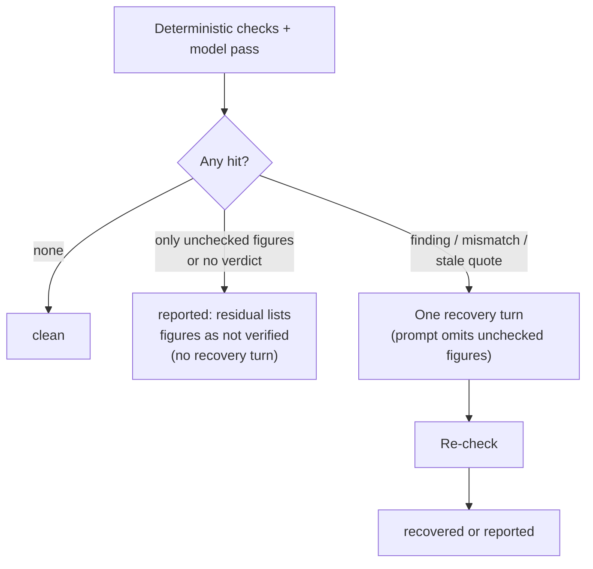

## Summary

Retires the unchecked-only Test Plan recovery trigger that #3740 added to the
PR-feedback drift check. A Test Plan figure that the recount cannot check is
still logged and listed in the reply residual as unverified. On its own, though,
it no longer starts the full-tools recovery turn. When recovery runs for a real
defect, its prompt no longer asks for tests to be re-run so that an unchecked
figure can be restated as "`<file>` (N tests at head)". The pr_feedback prompt
now allows a stale, redundant per-file count or aggregate total to be removed,
as long as the command, its observed result and the regression evidence stay.

Closes #5223.

## Spec

### Intent and Rationale

- An unchecked figure shows a limit of the recount, not that the figure is
  false. #3740's trigger spent a recovery turn on figures nobody had shown to be
  wrong, and stale counts still recurred in 29 PRs. The issue asks for count
  maintenance to be simplified, not extended.

### Essential Design Decisions

- Unchecked figures still stop a run from returning `clean`, and they go to the
  residual under "Test Plan figures the drift check could not verify". The run
  therefore ends `reported` with `recoveryRan: false`, and the figures are never
  shown as verified.
- `buildDriftRecoveryPrompt` loses its `uncheckedFigures` option entirely, so a
  recovery turn for a real defect never sees these figures or a rerun step for
  them.
- Mismatch handling, prose findings and stale-quote handling are unchanged. The
  drift outcome is only logged by `pr_feedback_processor.ts`, so merge behaviour
  is untouched.

### Undiscoverable Facts

None.

## Evidence

This is a backend and prompt change with no UI. Behaviour is covered by real
temporary-git-repo tests that drive `runPrFeedbackDriftCheck`.

Docs updated:

- `prompts/pr_feedback/prompt.md`: the **Keep the PR summary true to the head**
  paragraph, covering both the recount sentence and the drift-check sentence.
- `docs/workflows/pr-feedback.md`: the "Recount the Test Plan after a review fix
  (Issue #3117)" section, recount stage 2, the recovery and residual paragraphs,
  and the flowchart.
- The module doc and comments in `worker/deno/lib/pr_feedback_drift_check.ts`.

I grepped for `restate`, `tests at head`, `is a hit too`,
`unchecked figure is drift` and `uncheckedFigures` outside `docs/archive/` on
the final head. Nothing stale remains. The `docs/INTERNALS.md` rows for
`test_plan_recount.ts` and `pr_feedback_drift_check.ts` stay true.

Related rules checked: the prompt's own "A run against this PR's own earlier
commit is not 'red on base'; … label it with that commit" sentence agrees with
the new "a historical run keeps its provenance". The Issue #3117 recount pins in
`worker/deno/tests/pr_feedback_test_plan_recount_3117_test.ts` still hold. I
found no other rule on unchecked figures in `CODING-STANDARDS.md` or `prompts/`.
I also applied the new wording to this PR's own summary. It quotes the counts
only for the runs below, which ran on this head.

## Test Plan

- `worker/deno/tests/pr_feedback_drift_check_3740_test.ts`
  - New test: "an unchecked-only Test Plan figure launches no recovery turn and
    is reported unverified (Issue #5223)". It asserts a single read-only call,
    `reported` with `recoveryRan === false`, the figure in
    `residual.testPlanUnchecked`, the reply heading, the "could not check 1
    figure(s)" warning, and no "running one recovery turn" log.
  - New test: "a Test Plan mismatch beside an unchecked figure still runs the
    recovery turn, whose prompt omits the unchecked figure (Issue #5223)". The
    recovery turn fixes the mismatch. The residual keeps the unchecked figure
    and no mismatch.
  - Updated: the Rust-named red result test (Issues #4537, #5223). It now
    launches no recovery turn and the figure is still unchecked.
- `worker/deno/tests/test_plan_recount_added_n_to_3983_test.ts`: the drift test
  now asserts one call, no mismatch, and the "Added 5 tests to" line in the
  unchecked residual.
- `worker/deno/tests/fence_coverage_repair_test.ts`: the `uncheckedFigures`
  canary is dropped along with the option.
- Red before the fix: with the tests edited and the lib unchanged, the two new
  3740 tests and the updated Rust test failed. The unchecked-only and Rust tests
  failed with "runAgent called more times (2) than expected", and the mismatch
  test failed because the unchecked line was fenced into the recovery prompt.
  All three passed after the lib change.
- Removed from `worker/deno/tests/pr_feedback_drift_check_3740_test.ts`:
  `assertStringIncludes(prompt, "Test Plan figures the recount could not check:")`,
  `assertStringIncludes(prompt, UNCHECKED_LINE)` and
  `assertStringIncludes(prompt, "re-run the tests it names on the head and restate the figure")`
  - Required by: "Remove unchecked figures as an independent reason to start a
    recovery turn."
- Removed from `worker/deno/tests/pr_feedback_drift_check_3740_test.ts`:
  `assertEquals(outcome.recoveryRan, true)` (unchecked-only case), and
  `assertEquals(outcome.status, "recovered")` in the recovery-removes-figure
  test
  - Required by: "verify that a real mismatch still reaches recovery while an
    unchecked-only result stays explicitly unverified without launching it"
  - Replaced by: `assertEquals(outcome.recoveryRan, false)` and
    `assertEquals(calls.length, 1)`. The recovery path is still covered by the
    new mismatch test's `assertEquals(outcome.recoveryRan, true)`.
- Removed from `worker/deno/tests/test_plan_recount_added_n_to_3983_test.ts`:
  `assertEquals(calls.length, 2)` and
  `assertStringIncludes(prompt, "Test Plan figures the recount could not check:")`
  - Required by: "Remove unchecked figures as an independent reason to start a
    recovery turn."
  - Replaced by: `assertEquals(outcome.residual.mismatches, [])`. The #3983
    "never a count mismatch" guard still holds.
- Removed from `worker/deno/tests/fence_coverage_repair_test.ts`:
  `uncheckedFigures: [recovery.uncheckedFigure]`
  - Removed functionality: the `buildDriftRecoveryPrompt` `uncheckedFigures`
    option. No caller remains (`git grep uncheckedFigures` finds none).
- Targeted run: `deno task test:unit` on the three test files above plus
  `worker/deno/tests/pr_feedback_drift_check_3143_test.ts` passed with 44 passed
  and 0 failed (parallel) and 7 passed and 0 failed (serial).
  `worker/deno/tests/pr_feedback_test_plan_recount_3117_test.ts` and the other
  docs tests that read the edited prompt and doc passed: 161 passed, 0 failed.
- `./quality.sh`: every stage passed except deno tests. Its parallel pass had
  35238 passed and 1 failed. The failure was
  `worker/deno/tests/pr_summary_ci_workflow_3768_test.ts`, which lost the
  network fetching `registry.npmjs.org/minimist` ("dns error: failed to lookup
  address information"). That is a sandbox network limit, unrelated to this
  diff. The gate skipped the serial pass after that failure, so I ran it
  separately with `deno task test:unit --serial-only`: 948 passed, 0 failed.

Not done or not checked: I did not re-run the network-dependent
`worker/deno/tests/pr_summary_ci_workflow_3768_test.ts` with network access. CI
runs it.

🤖 Generated with [Claude Code](https://claude.com/claude-code)
