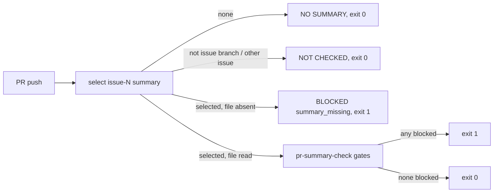

# PR Summary — Issue #5227

## Summary

Retires the commit-order freshness check that #3768 added to
`deno task pr-summary-ci`. That check failed CI whenever a code commit under
`worker/`, `prompts/` or `.claude/` was newer than the newest commit touching
the PR's archived summary. `judgeFreshness`, `listPrCommits`, `isCodePath`,
`CODE_PATH_PREFIXES`, the `Freshness` type and the `Summary freshness (#3768)`
report section are gone. `ciFailed` now fails only when the selected summary is
missing from the checkout or a `pr-summary-check` gate blocks. A missing summary
used to be one of the freshness variants. It is now its own `summary_missing`
result kind, so it still fails loud. The CI step is renamed `PR summary gates`.
`CODING-STANDARDS.md` no longer tells authors to rewrite the summary just
because a later code commit exists. It points to the final-state guidance in the
next paragraph instead. The babysitter's repair prompt and its manual no longer
say CI checks the summary "for freshness". Closes #5227.

## Spec

### Intent and Rationale

- Commit order does not show that the prose is accurate. Editing the summary in
  the same or a later commit passed the check even when stale claims stayed (PRs
  #4749, #4752 and #4754). A later commit that left every claim true still
  failed. #3768 recurred on 87 independent PRs after it closed.
- The useful parts of the step stay: the substantive `pr-summary-check` gates,
  the missing-summary failure, issue-branch selection and git error handling.

### Essential Design Decisions

- This PR adds no replacement scanner, gate, recovery trigger, Test Plan line or
  proof obligation, and it does not change auto-merge arming. The issue asked
  for none of these.
- `summary_missing` became a top-level `PrSummaryCiResult` kind rather than a
  leftover freshness variant. `ciFailed` still returns `true` for it, and
  `formatCiReport` prints `[BLOCKED] PR summary (#3768)`.
- The step keeps `fetch-depth: 0`, because summary selection still diffs the PR
  against its merge-base.

### Undiscoverable Facts

- The recurrence count (87 PRs) and the three example PRs come from the
  review-fleet-prs guidance ledger (`guidance.ts due`), which is outside this
  repository.

## Evidence

This is a backend/CLI and documentation change with no UI files.

- Files changed: `worker/deno/lib/pr_summary_ci.ts`,
  `worker/deno/lib/pr_summary_ci_cli.ts` (exit-code doc),
  `.github/workflows/validate-scripts.yml` (step name and comment),
  `CODING-STANDARDS.md` (the `pr-summary-ci` paragraph under PR Summary and
  Evidence), `worker/deno/commands/fleet_pr_babysitter.ts` (repair-prompt
  wording), `docs/workflows/fleet-pr-babysitter.md`, and the two test files
  below.
- The worker also committed a handover note,
  `docs/archive/handover/issue-5227.md`, for the run that was interrupted.
- **Docs sweep** — grep:
  `judgeFreshness|listPrCommits|isCodePath|CODE_PATH_PREFIXES|CommitChange|Summary freshness|freshness and gates|for freshness|commit-order`
  across the repository, excluding `docs/archive/` and `docs/audits/`, on the
  final head. The hits left are the retirement notes (`validate-scripts.yml`,
  the `pr_summary_ci.ts` and test-file headers), the #5227 test's
  `Summary freshness` assertion, and one unrelated `codex_budget.ts` comment
  ("for freshness" about a budget read instant, not PR summaries); section:
  `CODING-STANDARDS.md` "PR Summary and Evidence" (the `pr-summary-ci` paragraph
  and the final-state paragraph after it) and
  `docs/workflows/fleet-pr-babysitter.md` repair-prompt section, both read and
  updated; siblings: `no_summary`, `not_checked` — `PrSummaryCiResult` is listed
  only in `pr_summary_ci.ts` and its test, and both name `summary_missing`
- **Branch outcomes:** `ciFailed` returns `true` for `summary_missing`, covered
  by
  `worker/deno/tests/pr_summary_ci_test.ts::ciFailed - missing and blocked fail; clean, no-summary and not-checked do not`
  and
  `::runPrSummaryCi - a selected summary missing from the checkout is summary_missing`.
  `formatCiReport` prints the `summary_missing` block, covered by that second
  test
- Related existing rules checked: the `CODING-STANDARDS.md` final-state
  paragraph ("The summary describes the **final** state of the branch"), which
  is now the rule the `pr-summary-ci` paragraph points to, and the issue
  prompt's "Describe the final state of the branch" rule. Both agree, and
  neither depends on commit order. The babysitter prompt's "check that reads
  commit history" sentence is still true, because summary selection reads the
  committed diff. I applied the reworded rule to this PR's own diff and found
  nothing that depends on commit order.
- Provenance cited in the diff:
  - #3768: the PR-summary CI gate this PR trims.
  - #5227: Retire the ineffective summary commit-order freshness check after
    #3768 recurrence.

## Test Plan

- `worker/deno/tests/pr_summary_ci_test.ts`. This PR's tests:
  - New:
    `pr-summary-ci - a code commit after the summary no longer blocks on commit order (Issue #5227)`
    uses a real clone with summary → code commits. It asserts exit 0 and that no
    `Summary freshness` section is printed, while the gates still run.
  - New:
    `formatCiReport - control characters in a not-checked reason are escaped, not printed raw`
    builds the input through `selectSummary` with a branch name carrying `\n`
    and DEL. The removed stale-path tests were the only coverage of this
    escaping, which still guards the not-checked reason.
  - New: `pr-summary-ci - a blocked gate still fails CI end to end`.
  - New:
    `runPrSummaryCi - a selected summary missing from the checkout is summary_missing`
    asserts the new result kind, that `ciFailed` is `true` for it, and the
    `[BLOCKED] PR summary (#3768)` report.
  - New: three tests on the PR diff's own git error handling (`runChecked`,
    which guards `git diff --name-only … <base>...HEAD`). Red-checked: replacing
    both `runChecked` error messages with placeholders fails these three and
    leaves the other 25 green.
    - `runPrSummaryCi - a non-zero exit from the PR diff names git diff, the exit code and git's stderr`
      (`failNthGitCall("diff", 1)`).
    - `runPrSummaryCi - a runner error on the PR diff names git diff and the cause`
      (a runner `{ok:false}` on `diff`).
    - `main - a failing PR diff exits 2 and writes the git error to stderr`.
  - Updated: the `ciFailed` test now uses the `summary_missing` result kind.
- Removed tests, and what still protects the behaviour:
  - Gone with the freshness behaviour, whose code and callers are deleted:
    - The `isCodePath` test.
    - The five `judgeFreshness` tests.
    - The two `listPrCommits` error tests.
    - The `runPrSummaryCi` commit-listing git-failure test.
    - The stale-report tests: "stale summaries must be rewritten", "lists five
      code paths", and the control-character and DEL tests on code paths.
    - The integration tests for "code newer blocks", "merge commits ignored" and
      "child dated earlier is still stale".
  - Still covered:
    - Escaping: the new not-checked escape test.
    - Gates still run on a fresh summary: the renamed
      `a summary commit newer than the code passes and runs the gates`.
    - Git error handling (the removed `listPrCommits` and commit-listing
      git-failure tests): the three new PR-diff git-failure tests above, which
      reach both `runChecked` error branches. The separate gates' own git
      failure stays covered by
      `runPrSummaryCi - a git failure inside the PR-summary gates is returned as an error`.
    - Coverage carry-over, checked by hand because the automated check could not
      run (see Results): `deno coverage` over `pr_summary_ci_test.ts` gives
      `lib/pr_summary_ci.ts` 100% (170/170) on the head against 92.7% at the
      merge base. `lib/pr_summary_ci_cli.ts` is 80.5% on both, and the uncovered
      lines (114-130, the `import.meta.main` entry) are the same lines on both.
      They run only in the subprocess test.
- `worker/deno/tests/pr_summary_ci_workflow_3768_test.ts`: the step name in the
  test name and its doc comment changed to match. Its workflow invariants are
  unchanged.
- Results on the final head:
  - `deno task test:unit tests/pr_summary_ci_test.ts`: 28 passed.
  - The coverage carry-over check could not run because a base test fails at the
    merge base (`ce06e926b`). I reproduced that in a merge-base worktree:
    `pr_summary_ci_test.ts` passes there, and the one failure is
    `pr_summary_ci_workflow_3768_test.ts::PR summary CI task runs git with restricted environment permissions`,
    the DNS failure described below. It cannot be fixed from this branch,
    because the check runs the base's copy of the test.
  - `deno task test:unit tests/fleet_pr_babysitter_test.ts`: 122 passed.
  - `deno check` on the changed modules and tests: clean.
  - `pr_summary_ci_workflow_3768_test.ts`: 10 passed, 1 failed. The failure is
    `PR summary CI task runs git with restricted environment permissions`, which
    runs with `clearEnv` and so drops `DENO_DIR`. Deno then tried to download
    `mdurl@1.0.1` and failed on DNS. The test is unchanged by this PR. Run by
    hand with `DENO_DIR` kept, the same task exits 0 (`[NO SUMMARY] …`). The
    test fails the same way on an `origin/main` export of `worker/deno` (DNS
    error fetching `commonmark-0.31.2.tgz`), so it is the sandbox's lack of
    network, not this change. CI has network.
  - `./quality.sh`: every stage passed or was skipped except `deno tests`, where
    35227 passed and 1 failed. The one failure is the same environmental test.
    This run came before the three PR-diff git-failure tests were added. For
    those, `deno check`, `deno lint` and `deno fmt --check` on
    `tests/pr_summary_ci_test.ts` are clean, along with the 28-pass run above.
    `config integration` and `checkov` were skipped.
