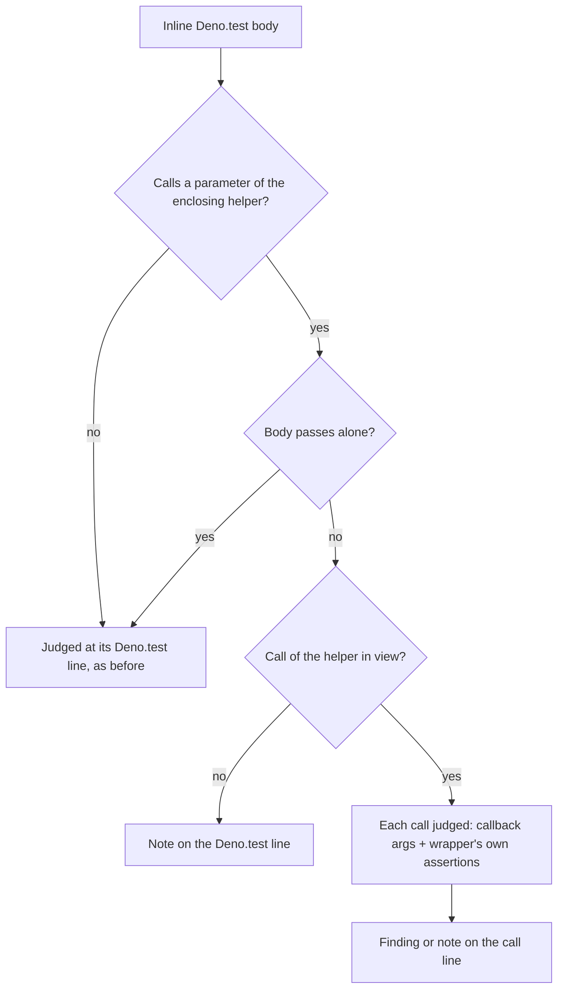

# PR Summary — Issue #5233

## Summary

The dummy-test scan no longer refuses a fixture wrapper whose inline `Deno.test`
body calls the enclosing helper's callback parameter. Such a body, when it does
not assert enough by itself, is now judged at each call of the helper, with the
wrapper's own assertions counted; with no call of the helper in view it is a
reviewer note on its `Deno.test` line. Closes #5233.

## Spec

### Intent and Rationale

- A setup/teardown wrapper
  (`Deno.test(name, async () => { const f = await setup(); await fn(f); })`) got
  a definitive `no-assertion` finding on its `Deno.test` line, because the
  callee `fn` is a parameter whose body is supplied by the helper's callers and
  can never be "defined in view" by name.
- The fix reuses the #5215 registration-helper path (pending registration,
  judged at each helper call, note when no call is in view) rather than adding a
  second mechanism.

### Essential Design Decisions

- Only a wrapper that does not pass alone is deferred: a body whose own
  assertions (and those of helpers it calls in view) already pass is judged at
  its `Deno.test` line exactly as before, so its calls are not judged at all.
- A wrapper with only success-only assertions, or with an out-of-view call in an
  edited file, carries those into each call's judgement (`success-only`, or a
  note instead of `no-assertion`).
- Each registration is judged only on the callback arguments it invokes (plus
  the wrapper's own assertions), never on the whole helper call: a helper that
  registers two separate tests (`first()`, `second()`) judges each test by its
  own argument, so one asserting callback cannot exempt an assertion-free or
  success-only one, and an assertion in an unused argument counts for nothing
  (PR #5269 review). A wrapper whose one test invokes several parameters is
  judged on those arguments together, so a plain setup callback beside an
  asserting test callback is not refused; if one of several callbacks is passed
  by name, the call is a note.
- A skipped inline test (`Deno.test.ignore`, `it.skip`, `test.todo`, `xit`, ...)
  is never a candidate: the scan never judges a skipped test (it is held to the
  `ignored-without-reason` rule instead), so its helper's calls are not judged
  either. The first and second passes share one `isSkipToken` predicate.
- Assumption: a parameter call inside an inline body is treated as a callback
  whatever the parameter's type, as the issue suggests; a non-callback parameter
  passed by name resolves to nothing in view and becomes a note, never a
  finding.

### Undiscoverable Facts

- `TS_KEYWORDS` does not list `async`, so in an edited file an `async (`
  callback is itself an out-of-view callee and makes a test a note. This
  predates the change and is left as is; the edited-file test uses non-async
  callbacks so its note comes from the wrapper.

## Evidence

Backend/CLI change only (the deterministic scan in
`worker/deno/lib/dummy_test_scan.ts`); no UI files.

- `worker/deno/lib/dummy_test_scan.ts`: the per-hunk `delegated` closure is now
  the module function `delegatedAssertions` (with a `skip` set for the wrapper's
  parameter callees); `registrars` hold `Registration { indices, wrapper }`
  lists; inline bodies are collected as candidates in the first pass and decided
  once every file's definitions are known; `judge` takes the wrapper's
  `Delegation` in place of the old `extraStrong` flag (Rust `#[should_panic]`
  passes a strong one). `isSkipToken` replaces the second pass's inline skip
  regex and keeps skipped inline bodies out of the candidates.
- Doc comments updated: the module header, `scanDummyTests`, and the
  `registrars` and `pending` comments. `CODING-STANDARDS.md` (**Dummy tests and
  "how" tests are refused**, the scan paragraph) gains one sentence on the new
  case. Grepped `README.md`, `docs/` (excluding `docs/archive/`) and
  `.claude/skills/review-fleet-prs/SKILL.md` for "registration helper" and
  "callback parameter": the only hits were `CODING-STANDARDS.md` and the scanner
  itself.
- `#5233`: Dummy-test scan refuses a fixture wrapper whose inline test body
  calls the helper's callback parameter (the only issue number this diff adds).

## Test Plan

Twelve tests added to `worker/deno/tests/dummy_test_scan_5016_test.ts` (eight
named `(Issue #5233)`, four named `(PR #5269 review)`); no existing test was
edited or removed:

- `an inline test body calling a helper's callback is accepted when the call asserts`
  — the issue's exact source: no finding, no note.
- `an assertion-free call of such a helper is refused on its call line, not the Deno.test line`
  — exactly `[no-assertion, 10]`.
- `an inline test body calling a helper with no call in view is a note on its Deno.test line`
  — note at line 2, no finding.
- `a helper whose inline body asserts itself is judged as before, not at its calls`
  — an assertion-free callback is not refused when the wrapper asserts.
- `a helper whose inline body has only a success-only assertion is judged at each call`
  — `[success-only, 10]` for the call that asserts nothing; the asserting call
  passes.
- `a helper calling two callbacks is judged as a whole at each call` — a plain
  setup callback beside an asserting one is accepted.
- `a helper whose inline test is skipped with a reason is not judged at its calls`
  — a `Deno.test.ignore` with a reason comment and an inline body calling `fn`:
  no finding at its assertion-free call, no note. Added after the pre-PR
  verifier's finding; before the `isSkipToken` check it failed with
  `[no-assertion, 8]`.
- `in an edited file, an assertion-free call of a helper whose body calls an out-of-view setup is a note`
  — note at the call line (10), no finding.

The four `(PR #5269 review)` tests, each with one registration helper that
registers separate tests per callback argument (`pair`, `run`):

- `a helper registering two tests judges each test by its own callback only` —
  one asserting callback and one assertion-free: `[no-assertion, 9]`.
- `a success-only callback is not exempted by another registration's strong assertion`
  — `[success-only, 9]`.
- `a helper registering two tests accepts a call where each callback asserts` —
  no finding (positive control).
- `an assertion in a callback no registered test invokes does not satisfy the test`
  — the test invokes only `used`; the asserting `unused` argument does not
  exempt it: `[no-assertion, 6]`. The existing
  `a helper calling two callbacks is judged as a whole at each call` still
  passes, preserving the one-test-invokes-both case.

Red before the review fix: against the earlier `dummy_test_scan.ts` (commit
`4618f7e92`), the three finding-expecting `(PR #5269 review)` tests failed; the
positive control passed.

Red before the fix (the first seven tests): against the unfixed
`dummy_test_scan.ts`, the file ran 52 passed / 6 failed — the issue's source
gave `[no-assertion, 2]`, and cases 2, 3, 5, 6 and 7 failed as described; case 4
passed on base, as a control should.

Results on the final head:

- `deno test --allow-all tests/dummy_test_scan_5016_test.ts tests/dummy_test_scan_wiring_5016_test.ts tests/capability_security_review_4366_test.ts`
  (from `worker/deno`): 75 passed, 0 failed. `deno fmt`, `deno lint` and
  `deno check` are clean on the two changed files.
- `./quality.sh` (run on the head before the `isSkipToken` fix, not re-run after
  it; the worker re-runs the gate): every stage passed except `deno tests`,
  where the one failure was
  `worker/deno/tests/pr_summary_ci_workflow_3768_test.ts` —
  `error sending request for url (https://registry.npmjs.org/mdurl/-/mdurl-1.0.1.tgz) ... dns error: failed to lookup address information`.
  The container has no DNS, and that test fails the same way on its own; it does
  not touch the scan. The parallel pass otherwise ran 35133 tests and passed
  them.
- The gate skipped its serial pass after that failure, so the 40 serial files
  (`PARALLEL_UNSAFE_TEST_FILES`, which includes
  `worker/deno/tests/dummy_test_scan_5016_test.ts`) were run directly on that
  same earlier head: 943 passed, 0 failed, 1 ignored.

Callers checked: `scanDummyTests` keeps its signature; its users
(`worker/deno/lib/pre_pr_verifier.ts`,
`.claude/skills/review-fleet-prs/scripts/gate.ts`, `post.ts`) are covered by
`worker/deno/tests/dummy_test_scan_wiring_5016_test.ts`, which passes.

## Not checked

- The 43 integration suites the gate leaves to CI were not run here.
- CI has not run on this branch yet.
