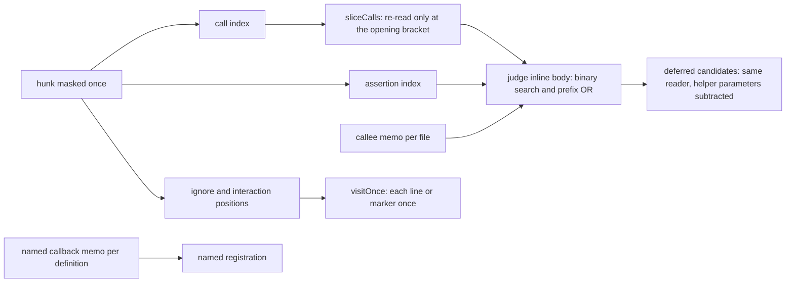

# PR Summary — Issue #5236

## Summary

`scanDummyTests` now costs time in proportion to the diff for the two shapes the
issue measured and for the two it names beside them. Each helper's assertions
are worked out once per file per scan, not once for every test that calls it. A
named callback's definition is read once per scan, however many tests register
it. An inline test body is judged from per-hunk indexes of its calls,
assertions, `ignore: true` markers and lines, so a body nested inside another is
no longer sliced and read again. That includes a nested body that calls a
parameter of the helper it sits in. Verdicts are unchanged. Closes #5236.

## Spec

### Intent and Rationale

- The diff is untrusted input to the fleet reviewer gate and the pre-PR
  verifier. Before this change, a 550 KB diff could stall either one for tens of
  seconds.
- Memoising by callee name removes the tests × helper-size cost. Memoising a
  named callback's result by its definition (`${hunk}:${start}`) removes the
  registrations × callback-size cost. A positional index per hunk, read with
  binary searches and prefix counts, removes the re-read of enclosing bodies.
  All of them keep the existing readers, so no verdict rule is rewritten.

### Essential Design Decisions

- **Exact equivalence is a requirement.** The index must read what
  `calleesIn(masked.slice(open, close + 1))` reads. `sliceCalls` re-reads the
  few calls that differ where the registration's own `test(` consumes the `(`
  the slice can use as a prefix. One example is `test(label(1), …)`, where the
  slice reads `label` and the whole hunk does not. After that, the hunk index is
  used.
- **Strength lists are deduplicated (`distinct`) and summarised as bits.** The
  bits are `WEAK`, `STRONG` and `UNSEEN`. Only "is there any", "are all weak"
  and "is a call unseen" are ever read, so neither change can alter a verdict.
- **One reader for inline bodies (`bodyBits`).** The inline branch of `judge`
  and the deferred-candidate pass both use it. A candidate skips the helper
  parameters it calls. Each call of a name adds the same bits, so the skipped
  names' calls are subtracted from per-bit prefix counts (`rangeCounts`). A
  candidate's wrapper is kept as bits too: where it is judged, only which
  strengths occur is read.
- **What still reads bodies as strings:** a named callback's definition (once
  per definition), helper-call registrations (`spans`) and Rust tests.
- **A dead check was removed.** `enclosingParams` collects exactly the names
  that `registrarOf` resolves, so the old `if (hit === null) continue;` in the
  candidate loop could no longer fire. It is now a non-null assertion.
- **Each sorted position is visited once** (`visitOnce`) for the interaction
  notes and the `ignore: true` refusals. Every repeat call of `note` or `add` on
  the same line was already a no-op, so the order of findings and notes is
  unchanged.

### Undiscoverable Facts

- `check(` is itself an assertion-helper name (`HELPER_CALL`). For that reason
  the growth fixture's helper is called `probe`: with `check`, the weak variant
  could never produce a finding.
- One known way the index could still disagree with the string reading is
  mismatched brackets inside an assertion's arguments. There, `tsStrength` reads
  the hunk's bracket table instead of scanning the slice. The corpus run below
  found no case where this happens.

## Evidence

The change is backend only, and the issue is a performance fix, so the evidence
is behavioural and timing is indicative:

- **Growth guards:** `worker/deno/tests/dummy_test_scan_growth_5236_test.ts`
  drives `scanDummyTests` through `assertLinearGrowth` for all four shapes.
- **Red on base:** with the base branch's `lib/dummy_test_scan.ts` restored, 9
  of 12 tests failed (all nine growth guards). The 3 output pins passed. One
  failure line:
  `helper called by every test: 38668 chars took 210 ms but 159075 chars (4.1x)
  took 3139 ms, over the 1732 ms a linear rule allows — the rule is
  super-linear`.
  The nested shape failed the same way: 34053 chars took 266 ms and 139054 chars
  took 4175 ms. The named callback did too: 41538 chars took 374 ms and 170738
  chars took 6071 ms.
- **Red on the previous head:** with the earlier head (`6e50873fc`) restored,
  the four new guards failed and the other 8 tests passed. For example, the
  nested registrations that call a helper's parameter: 34138 chars took 150 ms
  and 139139 chars took 2224 ms.
- **Equivalence corpus:** I scanned every tracked `.ts`, `.tsx`, `.js` and `.rs`
  file (3,899 files) twice with both the base scan and the head scan: once as a
  new-file diff, and once as an edited diff with every third line as context.
  All 7,798 outputs were identical (`diff: 0`). After the named-callback and
  candidate changes, I ran the same corpus again with the previous head as the
  reference (7,802 outputs). I also ran 6,000 generated diffs of named callbacks
  and of nested registrations inside a helper that call its parameters. These
  were new and edited, and 4,100 of them gave findings or notes of all four
  kinds. Every output was identical (`diff: 0`).
- **Indicative timings** (shared, parallel host, never asserted), measured
  through `scanDummyTests`:

  | Shape                     | Size                 | Before   | Head  |
  | ------------------------- | -------------------- | -------- | ----- |
  | Helper                    | 4,000 tests, 281 KB  | 9,579 ms | 69 ms |
  | Nested                    | 4,000 levels, 111 KB | 2,800 ms | 31 ms |
  | Named callback            | 4,000 tests, 202 KB  | 9,473 ms | 38 ms |
  | Nested, calling parameter | 4,000 levels, 111 KB | 1,458 ms | 41 ms |

  For the last two rows, "Before" is the previous head (`6e50873fc`).

## Test Plan

All the test files below are under `worker/deno/tests/`:

- **Added** `dummy_test_scan_growth_5236_test.ts`:
  - Two growth guards for the helper shape: strong (no findings) and weak
    (`MAX_DUMMY_TEST_FINDINGS` `success-only`).
  - Three growth guards for the nested shape: strong, weak, and no assertion,
    with the first finding on line 1.
  - Two growth guards for a named callback that many `Deno.test(…, named)` calls
    register: strong (no findings) and weak (`MAX_DUMMY_TEST_FINDINGS`
    `success-only`).
  - Two growth guards for nested registrations inside a helper that call its
    parameter, with a strong and a weak call of the helper. The weak one gives
    one `success-only` finding at the helper's call.
  - Pins for `test(label(1), …)` in an edited file: an `unseen` note, against a
    control that gives `no-assertion`.
  - Pins for `test(g(f()), …)`: `g` is read as a call and `f` is not.
  - A pin of the nested `ignore: true` and interaction output.
- **Added** `support/new_file_diff.ts`: the `added` diff builder, moved out of
  `dummy_test_scan_5016_test.ts`. That file now imports it and its tests are
  otherwise unchanged. No assertion was removed.
- **Changed** `worker/deno/lib/parallel_unsafe_test_manifest.ts`: the new growth
  test is listed in `WALL_CLOCK_TEST_FILES`, beside
  `dummy_test_scan_5016_test.ts`, so it runs in the serial pass. The first gate
  run flagged it under `parallel_unsafe_test_manifest_test.ts`.
- **Ran:**
  `deno test -A tests/dummy_test_scan_wiring_5016_test.ts
  tests/dummy_test_scan_5016_test.ts tests/dummy_test_scan_growth_5236_test.ts`
  on the head. Result: 78 passed, 0 failed. No other test imports the scan.
- **Ran:** `deno fmt --check` and `deno lint` on the changed files. Both are
  clean.
- **Ran:** `./quality.sh < /dev/null` on the head's tree (`f4dfdd237`), after
  the named-callback and candidate changes. Result:
  `PASSED (with
  skipped checks)`. The gate itself skipped `config integration`
  and `checkov`.

## Not done or not checked

- The tool's own bounds on findings and notes are unchanged.
- On the first gate run, `tests/pr_summary_ci_workflow_3768_test.ts` failed
  because this host has no DNS
  (`Failed caching npm package
  'entities@3.0.1'`). I seeded the host's
  `~/.cache/deno` from the worker cache; that is not a repository change. The
  test then passed (11 passed).
- No new reviewer sub-agents were run, because the issue has no
  acceptance-criteria list.
- Rust tests and helper-call registrations (`spans`) still read their bodies as
  strings. Neither is a shape the issue names.
