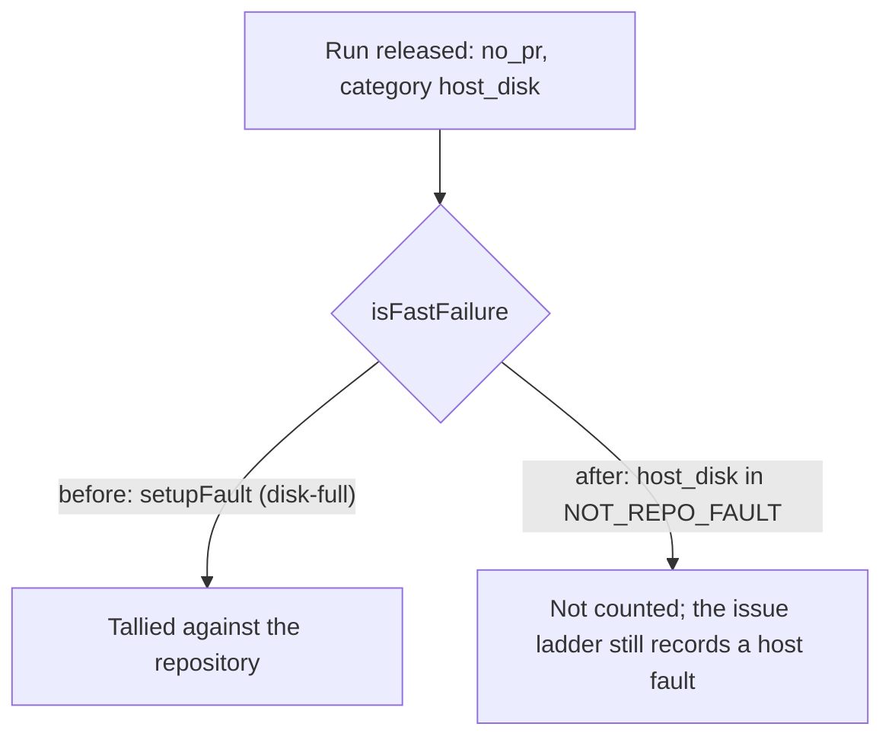

# PR Summary — Issue #5237

## Summary

Some runs park because the host disk is below its floor (category `host_disk`, Issue #5077). The fast-failure repository back-off counted those parks against the repository whatever their elapsed time. `isFastFailure` now treats `host_disk` as a host-wide cause, like `rate_limit` and `scheduled_release`, so a host-disk park no longer backs a healthy repository off. Closes #5237.

## Spec

### Intent and Rationale

- The only tally on #5237 is a run of #5169 on host `vibe-coder-67710`. It ran 2224 s in `execute` and was released as `host-disk` with the reason "host disk below its floor … ephemeral cargo root refresh in progress". The run was not fast and the repository was not at fault.
- Cause: `detectHostFault` (`worker/deno/lib/host_fault.ts:137`) maps `host_disk` to `disk-full`, so `isSetupFault` is true. `isFastFailure` counts a setup fault however long it took. The Issue #4388 guard, `hostDiskIsNotThisRepository`, only exempts `internal_error` and `zero_output`, so the newer category got past it.
- `host_disk` now goes in `NOT_REPO_FAULT`. That is the one-line change and needs no message parsing: the category is only ever written by the execute-phase host-disk park (`worker/deno/lib/phases/execute_phase.ts`, the `HostDiskParkError` arm).

### Essential Design Decisions

- The issue ladder does not change. `isSetupFault` and `detectHostFault` still class the park as a `disk-full` host fault, so the issue is still not blamed. Only the repository back-off ignores it.
- `clone_corrupt` still counts. It is a fault in this host's clone of that one repository, and it has its own repeat-corruption escalation.

### Undiscoverable Facts

- This host's local sidecars hold two more fast-failure events with the same "- Clarity: assessed as clear" detail, both in `execute` and well past 60 s: GRQ#4460 at 109 s and GRQ-AutoTrader#5704 at 249 s. They have the same shape, but their categories were not confirmed.
- This change stops future tallies only. The tally comment already on #5237 stays until the issue is closed.

## Evidence

Backend-only change, with no UI files.

- Regression test: `worker/deno/tests/repo_fast_failure_tracker_test.ts::isFastFailure - an execute-phase host_disk park is not a repository fast failure (Issue #5237)`.
- Issue numbers cited: #5077 "A host-disk park mid-execute is still logged as ERROR and released as internal_error"; #4388 "fix(worker): stSoftwareAU/VibeCoder keeps failing at setup — runs die in the first minute".

## Reproduction

- **symptom** — #5169 was released as `host-disk` after 2224 s in `execute`, and that run was tallied on #5237 as a fast failure for stSoftwareAU/VibeCoder.
- **status** — `verified` — I restored the base `worker/deno/lib/repo_fast_failure_tracker.ts` and ran the new test: it failed (0 passed, 1 failed; `isFastFailure` returned `true` for the 2224 s park). With the fix, the file passes 54/54.
- **regression test** — `worker/deno/tests/repo_fast_failure_tracker_test.ts::isFastFailure - an execute-phase host_disk park is not a repository fast failure (Issue #5237)`

## Test Plan

- Added `worker/deno/tests/repo_fast_failure_tracker_test.ts::isFastFailure - an execute-phase host_disk park is not a repository fast failure (Issue #5237)`. The candidate is built the way the release site in `worker/deno/lib/run_core_production_deps.ts` builds it, with the real `isSetupFault`.
  - Positive control: `setupFault` is `true`, so the setup-fault route is the one exercised.
  - It is not a fast failure at 2224 s, at 10 s, or with no message.
  - Allowed control: the same candidate as `clone_corrupt` still counts.
- No existing test changed. `NOT_REPO_FAULT` has one caller, `isFastFailure`, which has one production caller, `releaseClaim` in `worker/deno/lib/run_core_production_deps.ts`, and that call site is unchanged.
- `deno test -A tests/repo_fast_failure_tracker_test.ts`: 54 passed. `tests/coding_failure_ladder_test.ts` and `tests/repo_fast_failure_issue_test.ts`: 70 passed.
- Docs: I read and updated `docs/CONFIGURATION.md` (the `fast_failure_seconds` row, and "What counts as fast." under the fast-failure repository back-off section) and `docs/CONTAINER.md` (the host-disk paragraph on the Issue #4388 stop). markdownlint reports 0 issues.
- `./quality.sh < /dev/null` on this head: every stage passed except `deno tests`, which failed on two tests outside this diff:
  - `tests/ephemeral_root_telemetry_5105_test.ts:375` failed under the full parallel load. Run alone it passes 20/20.
  - `tests/pr_summary_ci_workflow_3768_test.ts` failed because this container cannot resolve `registry.npmjs.org` (`dns error: failed to lookup address information`; `getent hosts registry.npmjs.org` also fails). This is an environment fault.
  - Neither file imports `repo_fast_failure_tracker.ts`.
