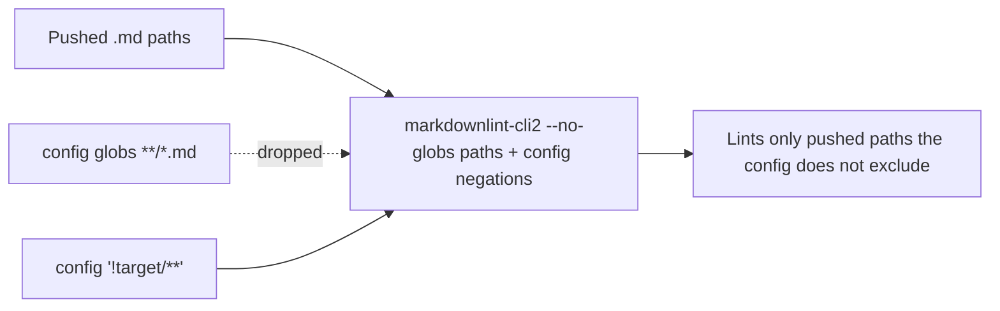

## Summary

The changed-file pre-push gate now runs `markdownlint-cli2 --no-globs <pushed .md paths>`, so a repository's config `globs` (for example `**/*.md`) no longer add the whole tree to the run. Before this change those globs reached the worker's own Graft cards under `.git/graft/`, and pushes were refused for files they did not carry. The root config's negated `globs` entries (`!target/**`, `#…`) are passed on the command line as well, so a pushed path the config excludes stays excluded. The `graft_context.ts` module doc no longer claims that no linter walks into the git directory. Closes #5238.

## Spec

### Intent and Rationale

- The pre-push stage exists to lint the pushed paths. markdownlint-cli2 adds the config's `globs` to the positional paths, and its globbing matches dot directories, so `.git/graft/*.md` cards (MD033 on `<u64>`) refused fleet pushes.
- `--no-globs` is the tool's own switch for this, and the issue proposed it. Excluding `.git/**` instead would still have linted unrelated files across the tree.

### Essential Design Decisions

- `--no-globs` drops negated `globs` entries along with the positive ones. I confirmed this with the real tool: config `{"globs":["**/*.md","!sub/**"]}` → `markdownlint-cli2 sub/x.md` reports 0 issues, but `markdownlint-cli2 --no-globs sub/x.md` reports 2. Without a fix, a pushed path that CI skips would be refused, which is the same class of false refusal this issue removes. NEAT-AI-Lamarck's config has `!target/**`. `loadMarkdownlintGlobExclusions` therefore reads the root `.markdownlint-cli2.jsonc`, else `.markdownlint-cli2.yaml` (the tool's precedence), and the gate appends the negations after the paths. `markdownlint-cli2 --no-globs y.md '!sub/**'` still lints `y.md`.
- An unreadable or unparseable config gives no exclusions. That fails closed: dropping a negation only lints more of the pushed paths, never fewer, and markdownlint-cli2 itself exits 2 on a config it cannot parse. A `.cjs`/`.mjs` config is not read, because reading it would mean executing it.
- `markdownlintExclusions` is an optional option of `planChangedFileChecks`, not a required one. `runPrePushGate` is the only production caller that can plan markdownlint, and it always passes the option. The other production caller, `runAffectedShellcheckChecks`, plans with no changed files. Making the option required would have touched roughly 40 unrelated test calls.
- YAML is parsed through the full `jsr:@std/yaml@^1.0.12/parse` specifier, the one `cargo_deny_gate.ts` already uses, because the agent's hook runtime cannot resolve the bare import-map entry. `deno.lock` is unchanged.

### Undiscoverable Facts

- markdownlint-cli2 v0.24.1 prints `Finding: good.md **/*.md` without the flag and `Finding: good.md` with it. These outputs were observed in the container, not taken from the docs.
- The container's own agent pre-push hook (`core.hooksPath` via `GIT_CONFIG_KEY_0`) refuses fixture pushes in `pre_push_gate_test.ts`. That test file therefore has to be run with those variables unset. `./quality.sh` passes it as is.

## Evidence

Backend/CLI only, no UI files. Real-tool reproduction in a scratch repo with `globs: ["**/*.md"]`, a violating untracked `other.md` and a violating `.git/graft/card.md`:

```text
$ markdownlint-cli2 good.md
Finding: good.md **/*.md
Linting: 3 files
Summary: 4 issues in 2 files
.git/graft/card.md:3:4 error MD033/no-inline-html Inline HTML [Element: u64]
$ markdownlint-cli2 --no-globs good.md
Finding: good.md
Linting: 1 file
Summary: 0 issues in 0 files
```



Docs updated: `docs/CONFIGURATION.md`, the changed-file checks list (the `markdownlint-cli2` bullet), and the module doc in `worker/deno/lib/graft_context.ts` ("Why the git directory, and not the working tree"). Other `CONFIGURATION.md` mentions of markdownlint for the pushed paths (around lines 3074, 5227 and 5292) were re-read and are still true.

Issue numbers cited: #5238 (this issue). #2915 and #3577 were already cited in the code.

## Test Plan

- `worker/deno/tests/pre_push_gate_test.ts`:
  - `runPrePushGate: markdownlint ignores Graft cards under .git (Issue #5238)` runs the real binary through the production runner. A clean pushed `good.md` passes while a violating untracked `other.md` and `.git/graft/card.md` sit in the tree. A pushed violating `bad.md` is still refused, with a `PreFlightGateError` naming it. Observed red against the unfixed command (`'/usr/local/bin/markdownlint-cli2' 'good.md' failed with exit code 1`, listing `.git/graft/card.md:3:4 error MD033`), and green after the fix.
  - `runPrePushGate: markdownlint keeps a config's negated globs under --no-globs (Issue #5238)` uses the real binary. With config `!vendor/**`, a pushed violating `vendor/x.md` beside a clean `good.md` passes. Observed red when `runPrePushGate` passed no exclusions (`--no-globs 'good.md' 'vendor/x.md' failed with exit code 1`), and green with them.
  - `planChangedFileChecks: root config negations are re-applied after --no-globs` asserts the exact command `'/r/mdl' --no-globs 'README.md' '!target/**' '#vendor'`.
  - The `loadMarkdownlintGlobExclusions` tests cover five cases: a JSONC config with comments and non-string entries, a YAML config, an untracked config, an unparseable config, and JSONC taking precedence over YAML.
  - Both real-binary tests are skipped (`ignore`) when no markdownlint-cli2 binary is found, because the CI test shard does not install it. The plan and loader tests run everywhere.
- Removed from `worker/deno/tests/pre_push_gate_test.ts`: `"'/r/node_modules/.bin/mdl' 'README.md'",`
  - Required by: "pass markdownlint-cli2's `--no-globs` in the pre-push command"
  - Replaced by: `"'/r/node_modules/.bin/mdl' --no-globs 'README.md'",` in the same test (`planChangedFileChecks: doc-only change plans fmt and markdownlint, no lint`).
- `env -u GIT_CONFIG_COUNT -u GIT_CONFIG_KEY_0 -u GIT_CONFIG_VALUE_0 deno test -A tests/pre_push_gate_test.ts` (from `worker/deno`) passed: 206 passed, 0 failed. The new and edited tests were re-run on the final head: 9 passed.
- `./quality.sh` ran on the final code. Every stage passed except `deno tests`, which had 35,148 passed and 1 failed. The failure is `worker/deno/tests/pr_summary_ci_workflow_3768_test.ts`, which could not download `entities@3.0.1` from `registry.npmjs.org` (`dns error: failed to lookup address information`). It is a container network fault, not this change.

Not done or not checked: `worker/deno/lib/markdownlint_check.ts` (the whole-tree quality-gate stage) still runs on the config's `globs` and was not changed, because it is out of this issue's scope. The five private-repo refusals the issue mentions were not examined. A negated entry in a `.cjs`/`.mjs` config is not re-applied.

🤖 Generated with [Claude Code](https://claude.com/claude-code)
