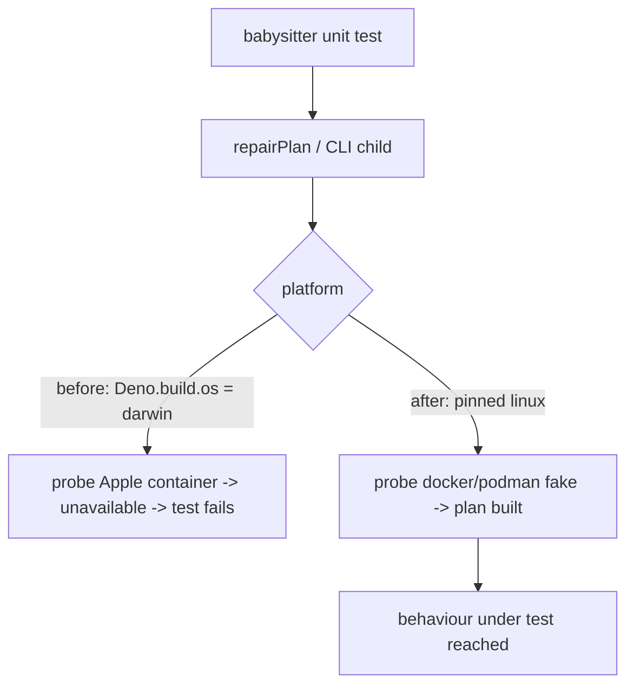

## Summary

On macOS, 11 babysitter unit tests failed with
`ContainerRuntimeUnavailableError` before reaching what they assert. Their
fixtures fake a docker or podman host, but runtime detection picks its
candidates by `Deno.build.os`, and on macOS the only candidate is Apple
`container`. The fixtures now pin the platform to Linux, so these tests give the
same result on macOS and Linux. A new guard test simulates a macOS host and
fails if the shared fixture cannot resolve its runtime or starts a runtime
process. Test-only change: no production code is touched. Closes #5245.

## Spec

### Intent and Rationale

- `repairPlan` in
  `worker/deno/tests/fixtures/babysitter_container_fakes_4770.ts` already
  injected a probe where only podman answers, but left `platform` at
  `Deno.build.os`. It now passes `platform: "linux"` to
  `buildLaunchPlanForCommand`, the option #5088 added for this purpose. That
  fixes the 9 tests in `babysitter_host_disk_admission_5105_test.ts` and every
  other test that builds its plan through `repairPlan` or `fakeContainer`.
- The two failing tests in `fleet_babysitter_chromium_check_4738_test.ts` run
  the babysitter CLI as a child process, where no function can be injected. They
  stub `docker` on PATH. A new preload,
  `worker/deno/tests/fixtures/linux_host_platform_preload.ts`, pins the child's
  platform to Linux and passes itself to every `deno run` child that process
  starts (the supervisor's babysitter child).

### Essential Design Decisions

- No production seam was added: an environment override for the platform would
  exist only for tests to read. The pin lives in test fixtures only.
- The preload replaces `Deno.build` with a frozen Linux copy (`Deno.build.os`
  itself cannot be redefined) and wraps `Deno.Command` to forward itself to
  `deno run` children. `fleet_babysitter_container_preload.ts` imports it, so
  every CLI test using that preload is pinned too.
- The guard allows one runtime call: `buildLaunchPlanForCommand` runs a
  best-effort `<runtime> version --format …` query
  (`worker/deno/commands/container_launch_plan.ts`) that is caught and falls
  back to `unknown`. It is not the detection probe, and making it injectable
  would be a production change outside this issue. Any other `container`,
  `docker` or `podman` command makes the guard throw.

### Undiscoverable Facts

- No macOS host was available. macOS was simulated on Linux with a scratch
  preload (not committed) that sets `Deno.build.os` to `darwin` in the test
  process and its `deno run` children. On unchanged code it reproduced the
  issue's counts exactly: 7 passed and 9 failed for the 5105 file, 18 passed and
  2 failed for the 4738 file.

## Evidence

Test-only change; no UI files.

- `worker/deno/tests/babysitter_runtime_probe_hermetic_5245_test.ts`, the guard
  the issue asks for:
  - `repairPlan resolves podman on a macOS host without starting a runtime
    process`;
  - `fakeContainer's Chromium check reaches its spawn seam on a macOS host`;
  - `the Linux preload pins a deno run child and its own deno run children`,
    which asserts that both the child and the grandchild report `linux` and run
    with the preload's `PinnedCommand`.
- Issue numbers this diff cites: #5245 (Babysitter unit tests reach the real
  container-runtime probe and fail on macOS (11 tests in the 5105 and 4738
  files)). This summary also names #5088 (recovery_authority_4417_test fails on
  macOS hosts: the launch plan reads the host's container runtime instead of an
  injected one).

## Test Plan

- Red run, simulated macOS, unchanged code:
  `deno test --allow-all --preload <darwin sim> tests/babysitter_host_disk_admission_5105_test.ts`
  gave 7 passed and 9 failed. The 4738 file gave 18 passed and 2 failed: the
  tests at lines 561 and 649.
- Red run of the new guard file before the fixture fix: 1 passed, 2 failed. Both
  failures were
  `ContainerRuntimeUnavailableError: No supported container runtime is available on darwin`,
  thrown from `repairPlan`.
- After the fix, from `worker/deno`:
  - `deno test --allow-all` on the new guard file,
    `tests/babysitter_host_disk_admission_5105_test.ts`,
    `tests/fleet_babysitter_chromium_check_4738_test.ts`,
    `tests/fleet_babysitter_container_4738_test.ts`,
    `tests/recovery_authority_4417_test.ts`,
    `tests/babysitter_fix_orchestration_test.ts`,
    `tests/fleet_babysitter_app_test.ts` and
    `tests/plan_coverage_repair_test.ts` passed: 215 passed, 0 failed.
  - Under the simulated-macOS preload, the 5105 and 4738 Chromium files passed
    (36 passed, 0 failed), and the new guard file passed too.
- The propagation test went red when the preload's `Deno.Command` wrapper was
  removed: it printed `linux Command` twice instead of `linux PinnedCommand`.
- `./quality.sh` on the final code: every stage passed except `deno tests`,
  which ran 35157 passed and 1 failed. The failure is
  `worker/deno/tests/pr_summary_ci_workflow_3768_test.ts`, which could not
  download `commonmark` from npm ("dns error: failed to lookup address
  information"). That is environmental, and this diff does not touch it.
- No existing assertion was removed or changed. The only edit to an existing
  test adds a `--preload` argument to the supervisor run in
  `worker/deno/tests/fleet_babysitter_chromium_check_4738_test.ts`.
- Not verified on a real macOS host. The pinned child runs with `Deno.build.os`
  set to `linux` on a macOS host, and only the simulation above shows that path.
