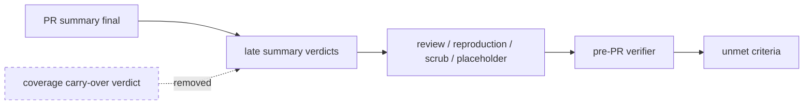

## Summary

This removes the coverage carry-over check (Issue #3795) and everything that
only it used, as #5247 proposes. Nothing replaces it. TDD rule 3, the
test-change policy and the reviewer brief are unchanged, and auto-merge arming
is untouched. The `skip_coverage_carryover_check` key is retired: a
`.config.json` that still sets it keeps loading, and one warning names the key.
Closes #5247.

## Spec

### Intent and Rationale

- The check never ran on a Rust test. Where it did run, the pattern still
  reached review, and since #4234 it could not stop a PR. Each qualifying run
  still paid for it: up to 600 s, a worktree and three coverage runs. The fleet
  reviewer and the pre-PR verifier already ask the same question in every
  language.
- The removal follows the #5095 precedent (the retired mutation check): delete
  the code, keep the shared helpers that live checks still use, and tolerate the
  retired config key with a named warning.

### Essential Design Decisions

- **Unreachable code removed with the check.** "Remove what becomes unreachable"
  was applied transitively. Each symbol below had no production caller left once
  the carry-over runner was gone; this was checked with `git grep -w`.
  - `parseMutationExemptions` in `mutation_gate.ts`.
  - In `mutation_runner.ts`: `importsModule`, `loadDenoProject`/`DenoProject`,
    the `listTestFiles` and `writeTextFile` seams and the directory walk behind
    `listTestFiles`.
  - The whole of `deno_test_config.ts` (#4533). Its only importer was that walk.
  - The recovery prompt's `allowsTestChanges`/`needsTestChanges` plumbing. Only
    the carry-over verdict set it.
  - The hard-kill `coverage carry-over check` label.
  - The two lib-sweep ledger slices that named only the deleted modules
    (`top-up-3795.json`, `top-up-4533.json`).
- **Code that stays.** `isDenoTestFile`, `mdSafe`, `confinePath`,
  `findDenoConfigDir`, `findCargoPackageDir` and the remaining runner seams have
  live callers in security-fix discrimination, `pr_ci_processor.ts`,
  `lib_sweep_coverage.ts` and `token_economizer_plugin.ts`.
- **Retired key.** `RETIRED_REPO_CONFIG_KEYS` (`config_unknown_keys.ts`) is now
  a map from each retired key to the issue that retired it. The warning
  therefore says "retired by Issue #5247" for the carry-over key and "Issue
  #5095" for the mutation keys. Both spellings, `skip_coverage_carryover_check`
  and `skipCoverageCarryOverCheck`, are dropped from `RepoConfig` and warned
  about.
- **Prompt text.** The step-2 recovery prompt text is byte-identical to the old
  output when `allowsTestChanges` was false, which was every case except a
  carry-over block.

### Undiscoverable Facts

- Run on its own,
  `worker/deno/tests/completion_phase_pre_push_gate_3689_test.ts::completion - an uncommitted recovery fix cannot pass the gate and advance origin`
  failed both on unmodified `origin/main` (checked in a temporary worktree) and
  on this branch. It passes inside `./quality.sh`. This change does not touch
  it.

## Evidence

This is a backend and docs change; there is no UI.

- Deleted modules and tests:
  - `worker/deno/lib/coverage_carryover_gate.ts`
  - `worker/deno/lib/coverage_carryover_runner.ts`
  - `worker/deno/lib/deno_test_config.ts`
  - `worker/deno/tests/coverage_carryover_gate_test.ts`
  - `worker/deno/tests/coverage_carryover_runner_test.ts`
  - `worker/deno/tests/completion_phase_coverage_carryover_gate_test.ts`
  - `worker/deno/tests/deno_test_config_test.ts`
- Wiring removed from `worker/deno/lib/issue_worker_wiring.ts` and
  `worker/deno/lib/phases/completion_phase.ts`. The carry-over label was removed
  from `worker/deno/lib/hard_kill_report.ts`, and
  `tests/mutation_runner_test.ts` was removed from
  `worker/deno/lib/parallel_unsafe_test_manifest.ts` because it no longer
  measures a clock.
- Docs:
  - `docs/coverage-carryover-check.md` is deleted, along with its row in
    `README.md`.
  - The mentions are removed from `docs/mutation-check.md`,
    `docs/CONFIGURATION.md` (the key's row now reads as retired),
    `docs/workflows/issue-processing.md`, `docs/TROUBLESHOOTING.md` and
    `docs/CALLBACKS.md`.
  - A final case-insensitive grep across the repository, excluding
    `docs/archive/` and `docs/audits/`, for
    `coverage.carry|coverage-carryover|carried-over line|parseMutationExemptions|deno_test_config|importsModule`
    finds only the retired `skip_coverage_carryover_check` row in
    `docs/CONFIGURATION.md`, plus the tests that pin the retired key.
  - Left alone on purpose: the `exempt (untestable)` branch-outcome rule in
    `prompts/pr_feedback/prompt.md` (#3428) and the unrelated "baseline
    carryover" feature.
- Issues the diff cites:
  - #5095: Retire automatic mutation testing from completion and review-fix
    workflows.
  - #5247: Remove the coverage carry-over check after #3795 recurrence.
- `deno.lock` is unchanged.

## Test Plan

- `./quality.sh < /dev/null` was run on the final code and exited 0. Every stage
  passed except `config integration` and `checkov`, which were skipped for lack
  of tooling.
- Added `worker/deno/tests/config_unknown_keys_test.ts`: both carry-over
  spellings warn naming Issue #5247. A mutation key in the same entry still
  names #5095, and a live key gets no warning.
- Replaced the #3795 key-mapping test in `worker/deno/tests/config_test.ts` with
  "loadConfig tolerates the retired coverage carry-over repo_config key (Issue
  #5247)". The config loads, neither spelling reaches `RepoConfig`, a sibling
  live key still maps, and the warning names each key and #5247. The obsolete
  behaviour (mapping the key) is removed functionality.
- `worker/deno/tests/hard_kill_report_test.ts`:
  - The coverage cases are removed from the historical-notes test. The mutation
    cases, which pin the retained `mutation check` label, stay.
  - The `carried-over lines` detail is removed from the agent-progress test. Its
    other details still prove the progress precedence.
  - Added a test: an old carry-over note now falls back to the `pre-PR verifier`
    label, which proves the label is gone.
- Removed-functionality tests whose behaviour and callers are gone:
  - The two carry-over step-2 tests in
    `worker/deno/tests/summary_rule_gate_retry_test.ts`. The standing-violation
    step-2 text ("A CODE FIX item is the one exception") is still asserted by
    the existing "a standing violation arrives as a CODE FIX item" test.
  - The wiring test in `worker/deno/tests/issue_worker_wiring_test.ts`.
  - The `listTestFiles` and `importsModule` tests in
    `worker/deno/tests/mutation_runner_test.ts`. Its `confinePath`, seam
    environment, SIGTERM and temp-dir tests stay.
  - The `parseMutationExemptions` tests in
    `worker/deno/tests/mutation_gate_test.ts`. The `mdSafe` tests stay.
- Targeted runs on the final code all passed:
  - `tests/summary_rule_gate_retry_test.ts`, `tests/config_test.ts`,
    `tests/config_unknown_keys_test.ts`, `tests/hard_kill_report_test.ts` and
    `tests/issue_worker_wiring_test.ts`.
  - `tests/mutation_runner_test.ts`, `tests/mutation_gate_test.ts` and
    `tests/security_fix_discrimination_test.ts`.
  - `tests/fleet_babysitter_app_test.ts` (17 passed) and
    `deno task check:manifests`.

Not done or not checked: no Spec/Standards reviewer sub-agents were dispatched,
because the issue states no acceptance-criteria list. markdownlint ran only as
part of `./quality.sh`. No other risk remains that I know of.

🤖 Generated with [Claude Code](https://claude.com/claude-code)
