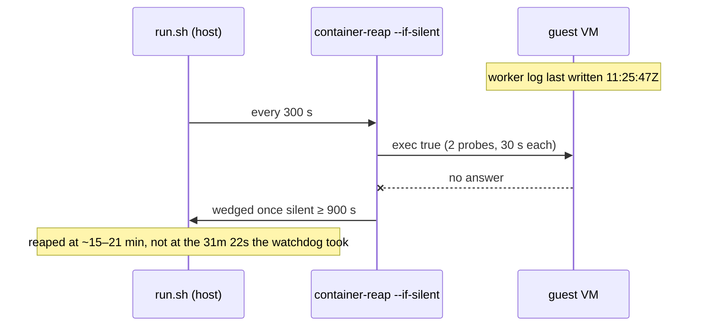

## Summary

The kill in this issue (`vibe-coder-98651` on `GRQ-25`, issue phase, guest
probe `did not answer`, 31m 22s silent before capture) is a frozen guest VM.
Its capture date, 17 November, is before the early silent-guest reap from
Issue #5161 (PR #5266, merged 19 November), so it ran to the full watchdog
deadline. PR #5308 (merged) added the host disk and memory figures that the
next recurrence carries.

This PR adds this kill's public facts to the bounded replay of archived
silent-guest kills in `worker/deno/tests/guest_silence_replay_4815_test.ts`.
The real `checkGuestSilence` decision now judges it wedged 900–1200 s into the
silence, well before the 1882 s it actually ran. A guest that still answers is
never judged wedged.

Closes #5250.

## Spec

### Intent and Rationale

- The archived agent session for this run
  (`stSoftwareAU/GRQ-VibeCoder-logs`,
  `runs/GRQ-25/2026-11-17/stSoftwareAU-VibeCoder-5169-vibe-mwkg63yf-dfc9a6.session.jsonl`)
  shows the guest starving well before the reap. `./quality.sh` started at
  09:13:00Z. Its 30 s tool heartbeats then jumped from 226 s to 357 s, 608 s
  and 1236 s, gaps of up to 628 s. The gate then ended with `Exit code 144` at
  09:35:48Z, having logged only up to `release-tag ruleset: PASSED`.
- A guest that freezes like this cannot report its own cause, so the
  worker-side repair is to reap it from the launcher early. That is the same
  conclusion the #4815 replay reached for its three kills. The replay was
  extended rather than copied, so one file covers every archived kill.

### Essential Design Decisions

- Assumption: the guest VM's freeze is a host-level fault (the leading suspect
  is host disk; three other `GRQ-25` runs that day ended `host_disk` /
  `disk-full`). The worker cannot fix that cause itself. Its part is reaping
  early (#5161) and recording the host's state at the reap (#5308). On that
  basis this PR closes the issue rather than leaving it open for a cause no
  run can observe from inside the container.
- The replay uses only the public timestamps posted on the issue, with no
  private log content. Each kill now carries its own `issue` and `host`, so the
  three #4815 tests keep their exact names.

### Undiscoverable Facts

- The guest saw `/dev/vdc 504G 7.6G 497G 2%` at 09:12:56Z (session record 4).
  The guest's own disk was therefore not short; any disk shortage was on the
  host volume backing it.
- The worker log, boot logs and guest probes are only in
  `~/logs/hard-kill-archive/` on `GRQ-25`, and this container cannot reach
  them.

## Evidence

Backend/test change only; no UI files.

- Session evidence was read with
  `gh api repos/stSoftwareAU/GRQ-VibeCoder-logs/contents/runs/GRQ-25/2026-11-17/stSoftwareAU-VibeCoder-5169-vibe-mwkg63yf-dfc9a6.session.jsonl -H "Accept: application/vnd.github.raw"`
  (32 records, last at 09:36:15.683Z).
- `run.sh` checks every `VIBE_GUEST_SILENCE_CHECK_SECONDS` (default 300), the
  same cadence the replay uses. `DEFAULT_GUEST_SILENCE_SECONDS` is 900, with
  `GUEST_SILENCE_PROBES` 2 × `GUEST_SILENCE_PROBE_TIMEOUT_MS` 30 000 ms, in
  `worker/deno/lib/guest_silence_watch.ts`.

## Reproduction

- **symptom** — a container whose guest stopped answering stayed up 31m 22s
  after its last log line, until the launcher watchdog reaped it
- **status** — `partial` — reason: the guest freeze itself cannot be reproduced
  in-process. The replay pins that the early reap, already on the base branch
  since PR #5266, catches this kill's recorded silence. It is expected green on
  the base branch and was not observed red.
- **regression test** —
  `worker/deno/tests/guest_silence_replay_4815_test.ts::replay #5250 vibe-coder-98651 (agent turn) - the guest is judged wedged before the recorded silence`

## Test Plan

- Edited `worker/deno/tests/guest_silence_replay_4815_test.ts`:
  - It adds the `vibe-coder-98651` kill, and its two tests run through the
    unchanged loop: `replay #5250 vibe-coder-98651 (agent turn) - the guest is
    judged wedged before the recorded silence` (at offsets 1, 150 and 299 s)
    and `… - a guest that still answers is never judged wedged`.
  - `replaySeams` now takes the kill's host instead of a fixed `GRQ-3`.
  - No assertion was removed. The three #4815 tests keep their names and
    assertions.
- `deno test -A tests/guest_silence_replay_4815_test.ts` (from `worker/deno`)
  passed, 8 tests including both `replay #5250` tests.
- `./quality.sh < /dev/null` was run on the head commit. It returned
  `Result: PASSED (with skipped checks)` and exit 0.

Not done: the host's own disk and memory at the time of this kill were not
captured (that evidence only exists for kills after PR #5308), so host disk
remains a suspect rather than a confirmed cause.
