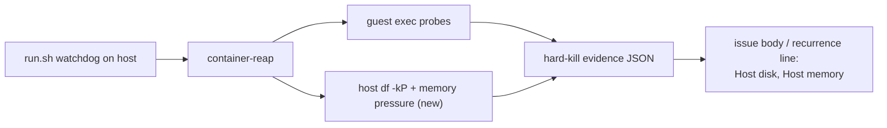

## Summary

Run `vibe-mwkg63yf-dfc9a6` on `GRQ-25` was working issue #5169 when it was
hard-killed. Its issue shows the guest probe `did not answer`, with guest
memory and guest pressure both `not available`. The evidence record read
nothing from the host itself, so this kill, and the other `did not answer`
kills (#5062 on `GRQ-25`, #5161 on `GRQ-3`), could not show whether the host
was out of disk or memory when its guest froze.

The capture now records the host's own state, read on the host at reap time:
- free and total bytes of the filesystem holding the evidence directory
  (`df -kP`);
- host memory pressure (level, plus available and total bytes on Linux).

A new issue's body and a recurrence's follow-up line both show them as
**Host disk** and **Host memory**. Evidence files written before this change
still parse; their host figures read `not available`.

The wedge's cause is still not established, so this PR does not close the
issue. Part of #5250.

## Spec

### Intent and Rationale

- The archived agent session for the run
  (`GRQ-VibeCoder-logs`, `runs/GRQ-25/2026-11-17/stSoftwareAU-VibeCoder-5169-vibe-mwkg63yf-dfc9a6.session.jsonl`)
  ends at 09:36:15Z. That is nearly two hours before the issue's last worker-log
  line (11:25:47Z), so it cannot name what blocked at the reap.
- That session's quality-gate heartbeats should come about 30 s apart (the
  later ones do). Earlier, two gaps lasted 251 s and 628 s, which points to the
  guest being starved well before the reap.
- Three other runs on `GRQ-25` the same day ended as `disk-full`/`host_disk`
  (03:09Z, 08:28Z and 14:14Z), so host disk pressure is the leading suspect.
  The evidence could neither confirm nor rule it out, because every guest
  figure needs a guest that answers.
- Host facts are read by the launcher-side `container-reap` on the host, so a
  frozen guest cannot blank them. That makes the next recurrence decisive on
  this question rather than another `not available`.

### Essential Design Decisions

- Persisted shape: `evidence.hostState` is optional when the record is read. A
  file written before this change is still read, and both host fields become
  `unavailable: not recorded (evidence written before host facts were captured)`.
  `HARD_KILL_EVIDENCE_VERSION` stays 1, so a file the old launcher left behind
  is still filed rather than refused (old shape read, not a key bump).
- The public issue gets only numbers and fixed words. Each host field is
  matched against an anchored pattern with bounded digit runs; anything else,
  including a `df` error that names a path, shows as `not available`.
- Disk is measured on the evidence directory's filesystem (`~/logs` on the
  host). That is the host user's home volume, which is not necessarily the
  volume holding the container store.
- Each host read is bounded by `DEFAULT_STEP_TIMEOUT_MS` and runs alongside
  the existing branches, so it does not extend the 60 s collection cap.

### Undiscoverable Facts

- The worker log, boot logs and guest probes for this run are in
  `~/logs/hard-kill-archive/` on `GRQ-25`. They are not reachable from this
  container, and `~/logs` does not exist here. The only evidence available was
  the redacted session and metadata in `stSoftwareAU/GRQ-VibeCoder-logs`.
- The early guest-silence reap from #5161 (PR #5266) merged on 19 November,
  after this capture (17 November). A recurrence now ends roughly 15–20 minutes
  into the silence instead of at the full watchdog deadline. That shortens the
  outage but does not explain it.

## Evidence

Backend/CLI change only; no UI files.

- Session evidence: `GRQ-VibeCoder-logs`, read with
  `gh api repos/stSoftwareAU/GRQ-VibeCoder-logs/contents/runs/GRQ-25/2026-11-17/...`.
  The `tool_progress` heartbeat `elapsed_time_seconds` values were 357, 608,
  1236, 1267 and 1297. The last record is the tool result at
  `2026-11-17T09:36:15.683Z`.
- Same-day `GRQ-25` metadata: `vibe-mwk3lbxq-de2ff9`, `vibe-mwkdqspk-f649ee`
  and `vibe-mwkqnozl-ab950e` all have `"category": "host_disk"`,
  `"failureClass": "disk-full"`.

## Reproduction

- **symptom** — the hard-kill issue for a guest that did not answer carries
  no figure that says whether the host was short of disk or memory (guest
  memory and guest pressure `not available`, nothing about the host)
- **status** — `partial` — reason: the wedge itself was not reproduced, since
  its worker log and guest probes are only on `GRQ-25`. Only the missing host
  evidence for an unanswering guest is covered, and it is pinned by the tests
  below.
- **regression test** — `worker/deno/tests/hard_kill_evidence_test.ts::captureHardKillEvidence - records the host's disk and memory even when the guest does not answer (Issue #5250)`

## Acceptance Criteria

- **missing** — Hard kill: container wedged in issue (watchdog) — reason: the
  wedge's cause is not established. This PR records the host disk and memory
  evidence the next recurrence needs to confirm or rule out host disk
  exhaustion, the leading suspect.

## Test Plan

New tests (all under `worker/deno/tests/`):

- `hard_kill_evidence_test.ts`:
  - `captureHardKillEvidence - records the host's disk and memory even when the guest does not answer (Issue #5250)`:
    the guest exec fails, and the record still holds
    `available=3435973837 total=493921239040` and
    `level=high available=858993459 total=17179869184`, beside the
    did-not-answer guest fields.
  - `captureHardKillEvidence - a host reading that fails is recorded with its cause (Issue #5250)`:
    a null `df` reading and a thrown `sysctl timed out` each become an
    `unavailable: …` field carrying the cause.
- `hard_kill_report_test.ts`:
  - `parseHardKillEvidence reads a file written before host facts were captured (Issue #5250)`
    is the old-shape persisted-data test: the body says `not available` for
    both host lines.
  - `parseHardKillEvidence refuses a hostState that is not an object (Issue #5250)`.
- `hard_kill_guest_facts_test.ts`: `hardKillHostDisk words the free space in GiB and percent`,
  `hardKillHostDisk never echoes free text or a path`,
  `hardKillHostMemory words the pressure level and bytes`, and
  `hardKillHostMemory gives not available for unknown, inconsistent or hostile fields`.
  The hostile cases include a 50,000-digit run against each of the two
  anchored patterns.

Edited existing tests:

- `hard_kill_report_test.ts::the body carries the four guest figures under the last log time (Issue #5062)`:
  the four guest-figure lines are still asserted with the same values. The
  "blank line after the four figures" expectation now sits after the two new
  host lines, which the test also asserts (literal values). Nothing was dropped.
- `hard_kill_report_test.ts::a recurrence's follow-up line carries the silent time and the guest probe (Issue #5062)`:
  the existing silence and guest-probe assertion is kept, and a host disk and
  host memory assertion is added.
- `hard_kill_evidence_test.ts::captureHardKillEvidence - writes one file holding every field with its expected value`
  and the key list in `container_watchdog_test.ts` now include `hostState`.
  Every other field's expectation is unchanged.
- Fixtures only: the seams literals in `container_reap_command_test.ts`,
  `container_watchdog_test.ts` and `guest_silence_watch_test.ts` gained the two
  new seams. `setup_step_log_test.ts`, `run_failure_issue_test.ts` and
  `run_core_production_deps_hard_kill_test.ts` gained a `hostState`. The last
  one writes its file without `hostState`, so the run-core path still reads an
  old-shape file.

Results:

- Red on base: the two edited test files were copied onto the unfixed base
  `b3f7d788a` and run with `deno test -A --no-check`. Result: 99 passed and 8
  failed, covering the five new #5250 tests in those files, the edited body and
  follow-up-line tests, and the exact-record test.
- Head: the 10 hard-kill test files (`hard_kill_evidence`, `hard_kill_report`,
  `hard_kill_guest_facts`, `container_reap_command`, `container_watchdog`,
  `guest_silence_watch`, `spawn_timeout_callers_4251`,
  `run_core_production_deps_hard_kill`, `run_core_hard_kill`,
  `setup_step_log`): 240 passed, 0 failed.
  `run_failure_issue_test.ts`: 26 passed, 0 failed.
- `./quality.sh` on `0b8314542`: `Result: PASSED (with skipped checks)`.
  Config integration was skipped (`deno or .config.json not available`) and so
  was checkov (no checkov on PATH). The first gate run, before the
  `run_failure_issue_test.ts` fixture fix, failed only that test.
- Docs: `docs/TROUBLESHOOTING.md` (the hard-kill paragraph) and
  `docs/workflows/resilience-and-concurrency.md` (the "Hard-kill evidence" and
  "On the next worker start" paragraphs) were read through and updated.
  `docs/CALLBACKS.md` mentions the archive only, and needed no change.

Not done:

- The wedge's cause, as stated above.
- I did not check whether `GRQ-25` runs the #5266 early reap; merge time alone
  does not prove deployment.
- No independent spec or standards reviewers ran, because the issue states no
  acceptance criteria.
