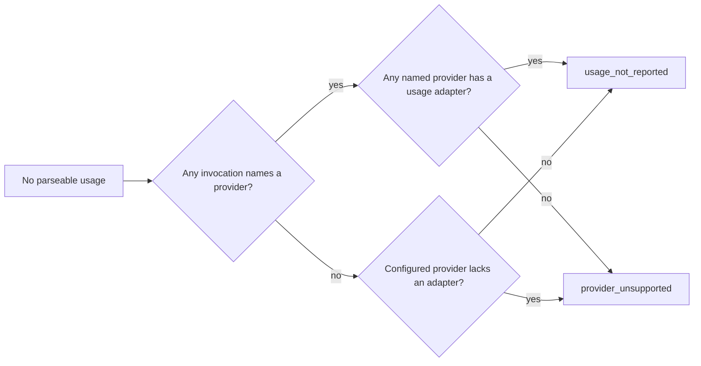

# PR Summary — Issue #5295

## Summary

The run callback's `telemetryAbsentReason` is now classified from the provider
each invocation reports (`runStats.provider`), not the host's configured
provider. `callbackTelemetryAbsenceReason` in
`worker/deno/lib/run_callback_telemetry.ts` uses the configured provider only as
a fallback when no invocation names one. A repository pinned to a provider with
no usage adapter on a Claude host now reports `provider_unsupported`, and a
Claude-served run on a host configured for such a provider reports
`usage_not_reported`. Closes #5295.

## Spec

### Intent and Rationale

- The second argument decided between `provider_unsupported` and
  `usage_not_reported`, and `workOnIssueRecorded` passed
  `ctx.config.agentProvider`, which is wrong whenever a repo pin, reroute or
  fallback sends the run to another provider
- The classified invocations already carry the provider that served them
  (stamped by `buildRunStats` in `worker/deno/lib/run_stats.ts`), so the rule
  reads it from the same records it classifies rather than from a second source

### Essential Design Decisions

- Mixed providers: when invocations name several providers, the reason is
  `usage_not_reported` if any named provider has a usage adapter, because that
  invocation could have reported and did not; `provider_unsupported` only when
  every named provider lacks one
- Invocations that name no provider (blank or absent) are ignored once at least
  one invocation names one; the configured provider is consulted only when none
  does, as the issue asks
- `breakdownInvocationTelemetry` (lifecycle ledger) keeps its signature; its
  explicit `provider` is now the fallback, so an invocation's own
  `runStats.provider` wins there too

### Undiscoverable Facts

None.

## Evidence

Backend-only change; verified by tests.

- `worker/deno/tests/run_callback_telemetry_test.ts` — five new Issue #5295
  cases on the pure rule.
- `worker/deno/tests/run_callback_provider_5163_test.ts` —
  `#5295 - workOnIssue: telemetryAbsentReason follows the served provider`
  drives the real `workOnIssue` with a repo pin that differs from the host
  provider, as the issue asks.
- Issue numbers this diff cites: #5295 (this issue); #4109 (cited for
  `runStats.provider`, already cited for that field in
  `worker/deno/lib/run_stats.ts`).

## Test Plan

- Added to `worker/deno/tests/run_callback_telemetry_test.ts`:
  - deepseek served on a claude host → `provider_unsupported`
  - claude served on a deepseek host → `usage_not_reported`
  - unnamed or blank provider → fallback used (control)
  - mixed claude + deepseek → `usage_not_reported`
  - named deepseek plus an unnamed invocation on a claude host →
    `provider_unsupported`
- Added to `worker/deno/tests/run_callback_provider_5163_test.ts`: three
  `workOnIssue` cases: a deepseek pin on a claude host, an unpinned repo on a
  claude host (control), and a claude pin on a deepseek host. Each asserts that
  the runner was invoked, that `telemetry` is absent and that the expected
  reason is set. `runIssue` gained a trailing `hostProvider` parameter that
  defaults to `"claude"`, so the existing callers and their assertions are
  unchanged.
- Red on base: with `lib/run_callback_telemetry.ts` and `lib/issue_worker.ts`
  restored from `origin/main`, 6 of the new tests failed. Those were 4 unit
  tests (all except the fallback control) and the 2 cross-provider `workOnIssue`
  cases. The result was `FAILED | 48 passed | 6 failed`. At head,
  `deno test -A tests/run_callback_telemetry_test.ts tests/run_callback_provider_5163_test.ts tests/lifecycle_invocation_3719_test.ts`
  gave `ok | 62 passed | 0 failed`.
- No existing assertion was removed or changed. The existing Issue #1948 tests
  and `lifecycle_invocation_3719_test.ts`
  (`breakdownInvocationTelemetry({}, "manager", "other")` →
  `provider_unsupported`) still pass, so the fallback path stays covered.
- Docs: the `VIBECODER_TELEMETRY_ABSENT_REASON` row in `docs/CALLBACKS.md` is
  the only manual sentence about the reason. A grep of `docs/` (outside
  `docs/archive/`), `README.md` and `worker/deno/lib` for `provider_unsupported`
  and `usage_not_reported` found only enum listings, which stay true.
- `./quality.sh < /dev/null` on the head of the code commit:
  `Result: PASSED (with skipped checks)` (config integration and checkov
  skipped, as usual on this host).
- Not done or not checked: none.

🤖 Generated with [Claude Code](https://claude.com/claude-code)
