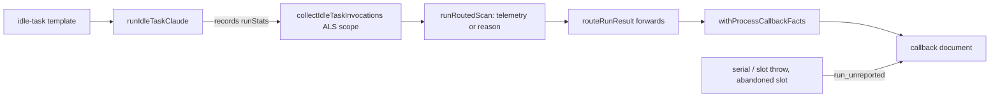

# PR Summary — Issue #5296

## Summary

Routed idle-task runs now publish the telemetry of the agent their template ran,
or a reason that is true for that run. Thrown and abandoned runs no longer claim
`agent_not_invoked`. `runIdleTaskClaude` records each scan invocation into an
`AsyncLocalStorage` collector (`collectIdleTaskInvocations` in
`worker/deno/lib/idle_task_claude_budget.ts`). `runRoutedScan` in
`worker/deno/lib/idle_task_process_issue_route.ts` turns those invocations into
`telemetry` or a `telemetryAbsentReason`, and `routeRunResult` in
`worker/deno/lib/route_claim.ts` forwards the result to the processIssue value
that `withProcessCallbackFacts` already reads. The serial throw, slot throw and
abandoned-slot releases in `worker/deno/lib/run_core.ts` now report the new
reason `run_unreported`. Closes #5296.

## Spec

### Intent and Rationale

- The routed path returned only `success` and `skipped`, so
  `withProcessCallbackFacts` filled in `agent_not_invoked` for every idle scan,
  and idle-task spend was invisible to archive readers
- The invocations are recorded at `runIdleTaskClaude`, the runner the idle-task
  templates launch through (a grep found no template that calls
  `runClaudeWithRetry` directly), so no template needed an edit
- Classification reuses `summariseCallbackTelemetry` and
  `callbackTelemetryAbsenceReason` from `lib/run_callback_telemetry.ts`, the
  same rule the implementation path uses

### Essential Design Decisions

- The collector is `AsyncLocalStorage`, not the existing `runContexts` stack:
  the stack returns the most recently pushed context, so a scan in one slot
  could record into a concurrent slot's run. ALS keeps each async scope to its
  own list (tested with two interleaved collectors)
- A thrown runner records an empty invocation, so a scan whose agent call threw
  reports `usage_not_reported`, not `agent_not_invoked`. A failed result is read
  through `billedResultOfError`, so a billed failure keeps its usage
- New `TelemetryAbsentReason` member `run_unreported` for the three releases
  that cannot know whether an agent ran: the serial loop's throw, the slot
  pool's throw, and a slot abandoned at the shutdown grace or the finish
  deadline. The issue names the throw path; the abandoned-slot release
  hard-coded the same false claim about a slot that was still running, so it is
  covered too. `withProcessCallbackFacts` still defaults to `agent_not_invoked`
  for a returned run with no reason, which is true for the claim-lost,
  opt-in-refused and clone-failure routes
- The lifecycle ledger's `telemetryAbsentReason` validator is unchanged: it
  validates per-invocation events, which `breakdownInvocationTelemetry` builds
  and which never carry `run_unreported`

### Undiscoverable Facts

None.

## Evidence

Backend-only change; verified by tests.

- Downstream consumer check: `lib/token_economizer_trial_report.ts` treats only
  `agent_not_invoked` as zero cost (`onCost`, `offSample`), so a
  `run_unreported` run counts as unavailable cost. That is what
  `docs/TOKEN-ECONOMIZER-TRIAL.md` already says for a run with no cost, so that
  doc is unchanged.
- Docs: the `VIBECODER_TELEMETRY_ABSENT_REASON` row in `docs/CALLBACKS.md` names
  `run_unreported`, a one-line diff. I read every hit of `agent_not_invoked` and
  `telemetryAbsentReason` in `docs/` (outside `docs/archive/`) and `README.md`;
  no other sentence is made false. The `TelemetryAbsentReason` and
  `TerminalIssueRun.telemetryAbsentReason` doc comments in
  `worker/deno/lib/run_callbacks.ts` were updated.
- Issue numbers this diff cites: #5296 (this issue).

## Test Plan

- Added to `worker/deno/tests/idle_task_claude_budget_test.ts`:
  - a collected ok result records its run stats
  - an error result records an invocation
  - a throwing runner records an empty invocation and the error propagates
  - two concurrent collectors each see only their own invocations
  - outside a collector the runner still returns its result
- Added to `worker/deno/tests/idle_task_process_issue_route_test.ts`: the real
  `routeIdleTaskInProcessIssue`, with a handler that calls the real
  `runIdleTaskClaude` through a fake runner:
  - usage reported → `telemetry` with those token counts and turns
  - no usage → `usage_not_reported`
  - no agent → `agent_not_invoked`
- Added to `worker/deno/tests/route_claim_test.ts`: `routeRunResult` forwards
  `telemetry` and `telemetryAbsentReason`, and a lost claim carries neither.
- Added to `worker/deno/tests/run_core_callbacks_test.ts`: the serial throw,
  slot throw and slot abandoned at the shutdown grace each dispatch
  `telemetryAbsentReason: "run_unreported"` with no `telemetry`. An ordinary run
  with no usage still reports `agent_not_invoked`. The finish-deadline release
  shares the abandoned-slot release call and has no separate test.
- Edited expectations, where the route now correctly adds a reason. Every other
  assertion is unchanged, and the new value is what the issue asks for:
  - Five assertions in `worker/deno/tests/idle_task_process_issue_route_test.ts`
    and one in `worker/deno/tests/idle_task_cross_host_claim_1139_test.ts` now
    expect `telemetryAbsentReason: "agent_not_invoked"`, because their fakes
    launch no agent.
  - Four assertions in `worker/deno/tests/idle_task_opt_in_5096_test.ts` now
    expect `telemetryAbsentReason: "usage_not_reported"`, because the real
    test-audit template ran its fake runner, which reports no stats.
  - The refused-wrapper expectation in that file is unchanged: no agent ran.
- Red on base:
  - With `lib/idle_task_claude_budget.ts`,
    `lib/idle_task_process_issue_route.ts` and `lib/route_claim.ts` restored
    from `origin/main`, `deno test -A --no-check` on the three idle and route
    test files gave `FAILED | 19 passed | 10 failed`, and the budget test file
    failed to load because `collectIdleTaskInvocations` did not exist.
  - Against the unchanged `run_core.ts`, the serial throw, slot throw and
    abandoned-slot tests failed with `agent_not_invoked`.
- `./quality.sh < /dev/null` on head `e867197f1`:
  `Result: PASSED (with skipped checks)` (config integration and checkov
  skipped, as usual on this host). The first gate run, before the edited
  expectations, failed on exactly those five route tests.
- Not done or not checked: the finish-deadline release (as opposed to the
  shutdown-grace release) has no test of its own.

🤖 Generated with [Claude Code](https://claude.com/claude-code)
